# VeganHelper System Design, Workflows & Diagrams

- **Reviewed:** 08/11/2026, against the current local source.
- **Frontend:** FE-VeganHelper, branch dev, commit 7ab80e84416a2fe6d79bcb4d8aeaf5aa84ba88d5.
- **Backend:** VeganHelperProject, branch developer, commit 910eebf725dbaab0faac7ac1e171494e442a2ead.
- **Scope:** FN01–FN52, account security, payments, video transcription/summary and cross-feature workflows.
- **Evidence level:** source inspection of routes, components, services, controllers, validators and repositories. “Integrated” describes wiring visible in source, not a claim that every user journey passed a live test. This review does not query provider APIs or change database data.

The commit hashes above identify the local source snapshots reviewed. FE source paths are relative to this repository; BE links point to the reviewed developer snapshot.

## 1. Product Vision & Visual Design System

VeganHelper is a modern plant-based culinary and family nutrition platform. The frontend is a React/Vite single-page application with JavaScript, form validation, responsive styles, shared HTTP services and motion effects. Validation in the browser supports usability; backend authorization and validation remain authoritative.

### 1.1 Current CSS Token Families

The stylesheet contains a legacy botanical palette and a newer `vh-*` palette. Both remain in use across pages, so this table is an inventory of defined tokens rather than a claim that every screen follows one unified design system.
| Token | CSS value | Current role |
|---|---|---|
| `--bg-herb-white` | `#F3F6EE` | Body background used by the base stylesheet. |
| `--surface-paper` | `#FDFBF6` | Light surface. |
| `--primary-moss` / `--primary-moss-hover` | `#2F5233` / `#25401F` | Legacy brand and hover colors. |
| `--accent-beetroot` | `#A63446` | Legacy alert/destructive accent. |
| `--accent-turmeric` | `#D9A441` | Legacy warm accent. |
| `--text-charcoal` / `--text-stem-gray` | `#2B2A25` / `#6B6F63` | Main and secondary text. |
| `--border-sage-mist` | `#DCE3D5` | Legacy border color. |
| `--vh-forest` / `--vh-sage` | `#244C38` / `#A8BDA2` | Newer green palette. |
| `--vh-mint` / `--vh-cream` | `#DDF2E1` / `#FAF8F0` | Newer supporting surfaces. |
| `--vh-glass` / `--vh-gold` | `rgba(255, 255, 255, 0.65)` / `#D6B66A` | Glass surface and newer warm accent. |

### 1.2 Typography Hierarchy

- The base stylesheet uses `Be Vietnam Pro` for body text and defines utility classes for Libre Caslon Text, Fraunces, Be Vietnam Pro, DM Serif Display and DM Sans.
- DM Sans and DM Serif Display are imported by the stylesheet. Other font families depend on their page-level or external font loading; do not assume they are available everywhere.

---

## 2. Current System Architecture & Access

### 2.1 Technology and responsibility boundaries
| Area | Current implementation |
|---|---|
| FE | React 18.3, JavaScript/JSX, Vite 8, React Router 6, Tailwind 3, Framer Motion, React Hook Form/Zod, Axios; versions are from package.json, not an external compatibility audit. |
| API | .NET 10 ASP.NET Core controllers, JWT bearer authentication, account/session validation, active-admin policy, FluentValidation/DataAnnotations and exception middleware. |
| BLL | DTOs, validators, contracts and business services. Services call DAL repositories and provider interfaces. |
| DAL | Entities, repository interfaces/implementations, AppDbContext, EF Core/Npgsql, PostgreSQL migrations and some integration adapters. |
| Database | PostgreSQL hosted on Supabase, through EF Core Code First. Application authentication remains custom JWT/Google/SendGrid; the UI does not use Supabase Auth or query its database directly. |
| Media | Cloudflare R2 for uploaded avatars and post media. Database records contain media URLs/metadata. Temporary audio/video files used during processing are not persistent user-avatar storage. |
| AI Genie | IAiChatClient resolves to DeepSeekChatClient. Model is configuration-driven through DeepSeekChat:Model (options default: deepseek-flash). |
| Post moderation | Gemini reviews text/images. If video media and TwelveLabsApiKey are configured, TwelveLabs Pegasus 1.6 reviews videos concurrently; otherwise Gemini reviews the full post including video. |
| Video transcript/summary | GroqVideoSummaryClient, with FFmpeg audio extraction; configured Whisper and chat models (options defaults: whisper-large-v3-turbo and openai/gpt-oss-20b). |
| Store discovery | Shops stored in PostgreSQL; Goong map rendering/geocoding in FE; Google Maps directions are external navigation URLs. No AI or Google Places database retrieval is implemented in this flow. |
| Payments | payOS SDK through PayOSGateway; signed webhook and authenticated direct verification both use the existing transaction-safe order/access update path. |
| Background work | Hangfire/PostgreSQL when workers are enabled: post moderation, video-summary jobs, web push and meal-routine reviews. In-app notification counts use browser polling, not SignalR. |

The current project references are API → BLL, API → DAL, and BLL → DAL. Repository contracts live in DAL/Repositories; service contracts generally live in BLL/Contracts. Some meal-planning interfaces are still beside their service implementations. This describes the existing layout, not a proposal to reorganize it.

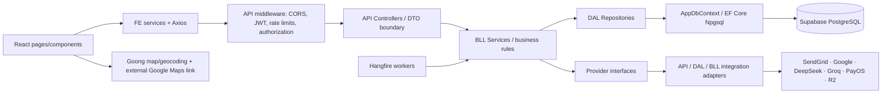

### 2.2 Authentication, roles and session restoration

- Guest is the absence of a valid application session; it is not a users-table role. Account roles are member and admin. FE normalizes the role to Member/Admin for display and route guards.
- AuthContext restores a stored access token by calling GET /api/users/me. Transient restore failures display a retry state. A missing/invalid session takes a protected route to /login with its return location.
- Local login stores tokens in sessionStorage, or localStorage when Remember me is selected. Google login currently chooses localStorage. Tokens are explicitly sent as Bearer headers; this implementation does not use authentication cookies.
- Axios coordinates concurrent 401 responses through one refresh request. It rotates both tokens and retries queued requests. Login and explicitly marked auth requests bypass this redirect behavior. Invalid refresh credentials clear storage; network/provider failures are not automatically treated as a wrong password.
- Backend JWT validation checks signature/issuer/audience/expiry and the current account/token version. An active-admin policy checks actual account eligibility. FE guards support navigation; backend checks own security.
- Account activation, email verification, temporary failed-login lockout, admin ban and soft deletion are different fields/records. An unverified registration is inactive; verification sets EmailVerifiedAt and IsActive. A ban is represented by user_bans and session revocation, not by a separate membership role.

### 2.3 Actual application routes

Routes listed as “Protected” accept authenticated members and administrators. Guest access to an anonymous backend API does not make its corresponding FE route public.
| Route | Page | Access / next transition |
|---|---|---|
| / | HomeGuest | GuestRoute; authenticated visitor goes to /home. |
| /login | Login | GuestRoute; successful local/Google login goes to saved return path or /home. |
| /sign-up | SignUp | Public route; registration dialog continues to /verify-otp. |
| /verify-otp | VerifyOTP | Public; requires an email supplied by registration or entered by the user; success goes to /login. |
| /forgot-password | ForgotPasswordResetPassword | Public; token+email query parameters select reset mode. |
| /search-guest | SearchResultsGuest/SearchCore | Public recipe search; people discovery is gated. |
| /posts/:id/guest | PostDetailGuest/PostDetailCore | Public published-post detail and comments; protected actions prompt authentication. |
| /weekly-menu/locked; /vegan-stores/locked; /my-posts/locked | Guest locked pages | Public previews; login/sign-up buttons navigate to the matching auth pages. |
| /home | Home | Protected; Trending/Latest use feed API; Following is currently aggregated by FE. |
| /profile | Profile | Protected; self profile, avatar, set-password and Google link/unlink dialogs. |
| /security | Security | Protected; change-password form and account-security navigation. No active-session directory is implemented here. |
| /security/change-email | ChangeEmail | Protected; new email+password → old-email OTP → new-email OTP → logout. |
| /users/:id | PublicUserProfile | Protected even though the displayed profile fields are public to signed-in users. |
| /my-posts | MyPosts | Protected; own posts, status filters and create/edit/delete actions. |
| /posts/create; /posts/edit/:id | CreatePost; EditPost | Protected; API write access is owner-only, not an admin edit override. |
| /posts/:id | PostDetail | Protected; author may preview their unpublished post, but social APIs still require a published post. |
| /saved-posts | SavedPosts | Protected; newest saved available posts first. |
| /weekly-menu | WeeklyMenu/WeeklyMealPlanner | Protected; weekly menu and Health & Wellness tabs, access banner, wizard/history. |
| /meal-plans/payment | MealPlanPayment | Protected; package selection and PayOS checkout. |
| /meal-plans/payment/success; /cancel; /failed | MealPlanPaymentResult | Protected; real order state is read from BE, not trusted from URL status. |
| /health; /health/bmi | HealthAndWellness | Protected; both routes use the shared health/BMI page. |
| /vegan-stores; /vegan-stores/:id | FindVeganStores; StoreDetail | Protected; database shops + map/directions. |
| /account-suspended | AccountSuspended | Public support route. Current Login also displays ban information inline; the route is not the universal destination for every 403. |
| /admin; /admin/members; /admin/categories; /admin/content; /admin/audit-logs | Admin pages | FE admin guard and BE active-admin policy. Non-admin is sent to /home. |
| /404; any unmatched route | NotFound | Public 404 page. |

### 2.4 Contract and evidence conventions

- API URLs below include /api. FE service strings omit that prefix because Axios baseURL already contains it. Controller route casing (for example /Posts) is retained where helpful.
- 400 means invalid input, 401 unauthenticated/invalid session, 403 a business/access rejection, 404 unavailable/not-visible resource, 409 conflicting state/revision, 402 meal-plan entitlement required, 429 rate/trial limit, and 5xx provider/server failure. Response bodies differ by controller/service/middleware; clients must read their actual contract.
- Shared Pagination validates PageIndex 1–1,000,000 and PageSize 1–100. Post feed/search, saved posts, user search and follows normalize/clamp their own page sizes to at most 50. Comments return a depth-limited tree, not a paginated collection.

## 2.5 Functional Specifications (FN01–FN52)

### FN01 — Đăng ký tài khoản — Registration and email activation

**Actor / entry:** Guest; /sign-up → /verify-otp → /login.

**API contract** (paths include the /api prefix):
- `POST /api/auth/register`
- `POST /api/auth/resend-verification`
- `POST /api/auth/verify-email`

**Current workflow:**
1. Submit username, email, fullName, password and confirmPassword. FE also requires agreement to its terms checkbox.
2. BE creates the user inactive and stores DisplayName from fullName; it hashes the password and stores only a hash of the 6-digit email OTP. Registration normally returns 201.
3. An existing inactive, unverified, non-deleted registration can be restarted: credentials/profile are updated and a fresh code is requested; this path returns 200 with isExistingUnverified.
4. FE opens its verification dialog, then routes to /verify-otp. Submit email and otp; a successful code sets EmailVerifiedAt and IsActive and returns to /login.

**Conditions and outcomes:**
- Username/fullName are 3–100 characters; password 8–128 and confirmation must match. Current schemas do not enforce the previously documented uppercase/lowercase/digit/special-character combination.
- An active, already verified or deleted account using that email returns 409. A username owned by a different user also returns 409.
- Registration/security codes expire after 15 minutes. VerifyOTP uses a 120-second client resend countdown; that timer is not the token lifetime.
- A new registration can remain saved if sending the email fails (503). Resend is the recovery path. The restarted-registration branch does not propagate ResendVerificationAsync failure; a 200 there does not prove delivery.

**Source evidence:** [FE: src/pages/guest/SignUp.jsx](src/pages/guest/SignUp.jsx); [FE: src/pages/guest/VerifyOTP.jsx](src/pages/guest/VerifyOTP.jsx); [BE: src/VeganHelper.BLL/Services/AuthService.cs](https://github.com/HoangAnh250/VeganHelperProject/blob/910eebf725dbaab0faac7ac1e171494e442a2ead/src/VeganHelper.BLL/Services/AuthService.cs); [BE: src/VeganHelper.BLL/DTOs/AuthDtos.cs](https://github.com/HoangAnh250/VeganHelperProject/blob/910eebf725dbaab0faac7ac1e171494e442a2ead/src/VeganHelper.BLL/DTOs/AuthDtos.cs).

**Implementation status:** Integrated in source; runtime not re-tested in this review.

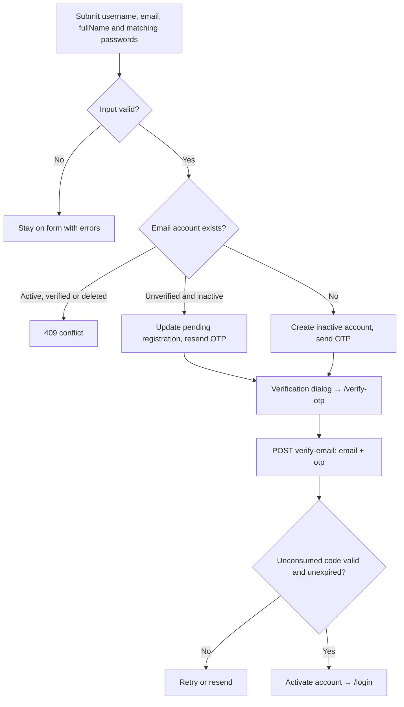

---

### FN02 — Đăng nhập — Local login, Google and token refresh

**Actor / entry:** Guest; existing members refresh; /login.

**API contract** (paths include the /api prefix):
- `POST /api/auth/login`
- `POST /api/auth/google`
- `POST /api/auth/refresh`
- `GET /api/users/me`

**Current workflow:**
1. Local form accepts a username or email and sends identifier/password. BE checks password before returning an unverified-account error.
2. After a correct password, BE rejects deleted/inactive/unverified/banned accounts; eligible accounts receive access+refresh tokens. FE loads /users/me and navigates to the saved route or /home.
3. On unverified 403, FE opens /verify-otp with requiresEmail=true; the user enters their registered email and requests a code. A username is not assumed to be an email.
4. Google Identity Services supplies idToken. BE validates audience/identity/email_verified: a linked subject logs into that account; a new identity with an unused email creates an active verified account; an existing email without the Google link returns 409.
5. When eligible API requests receive 401, Axios refreshes once for concurrent callers, saves the rotated pair and retries the original calls.

**Conditions and outcomes:**
- Five incorrect local password attempts set LockedUntil for 15 minutes. Correct login resets failed attempts; temporary lockout is different from an admin ban.
- Google verification is based on the validated Google token, with no registration OTP for a genuinely new Google account. Existing local accounts are not automatically merged by email.
- Refresh tokens are hashed, checked for expiry/revocation/token version and rotated. Token lifetimes come from configuration, not fixed diagram constants.
- Local login honors Remember me; Google login currently persists in localStorage. FE role parsing is navigation support, while BE validates the current account and role.

**Source evidence:** [FE: src/pages/guest/Login.jsx](src/pages/guest/Login.jsx); [FE: src/context/AuthContext.jsx](src/context/AuthContext.jsx); [FE: src/lib/axios.js](src/lib/axios.js); [BE: src/VeganHelper.BLL/Services/AuthService.cs](https://github.com/HoangAnh250/VeganHelperProject/blob/910eebf725dbaab0faac7ac1e171494e442a2ead/src/VeganHelper.BLL/Services/AuthService.cs); [BE: src/VeganHelper.API/Authorization/AccountTokenValidation.cs](https://github.com/HoangAnh250/VeganHelperProject/blob/910eebf725dbaab0faac7ac1e171494e442a2ead/src/VeganHelper.API/Authorization/AccountTokenValidation.cs).

**Implementation status:** Integrated in source; runtime not re-tested in this review.

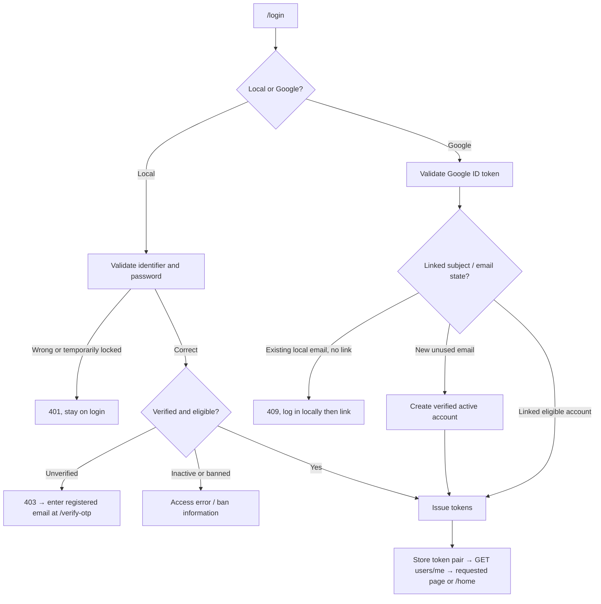

---

### FN03 — Đăng xuất — Logout

**Actor / entry:** Member / Admin; Profile menu or security completion.

**API contract** (paths include the /api prefix):
- `POST /api/auth/logout`

**Current workflow:**
1. FE attempts to disable its browser-push subscription, then posts the stored refreshToken with the current Bearer access token.
2. BE revokes that refresh token if it belongs to the caller. An empty/missing refreshToken revokes all refresh tokens for the caller.
3. FE clears auth storage in finally, clears AuthContext and returns to the guest/auth destination used by the caller.

**Conditions and outcomes:**
- The endpoint is authenticated; a refresh token alone is not the Bearer access token.
- Normal logout does not increment TokenVersion or revoke an already issued access JWT immediately. FE removes it; a separately retained JWT can remain valid until expiry/account revocation.
- FE clears its local session even if logout or push cleanup fails; server-side revocation is not guaranteed during that network failure.

**Source evidence:** [FE: src/services/authService.js](src/services/authService.js); [FE: src/context/AuthContext.jsx](src/context/AuthContext.jsx); [BE: src/VeganHelper.BLL/Services/AuthService.cs](https://github.com/HoangAnh250/VeganHelperProject/blob/910eebf725dbaab0faac7ac1e171494e442a2ead/src/VeganHelper.BLL/Services/AuthService.cs).

**Implementation status:** Integrated in source; runtime not re-tested in this review.

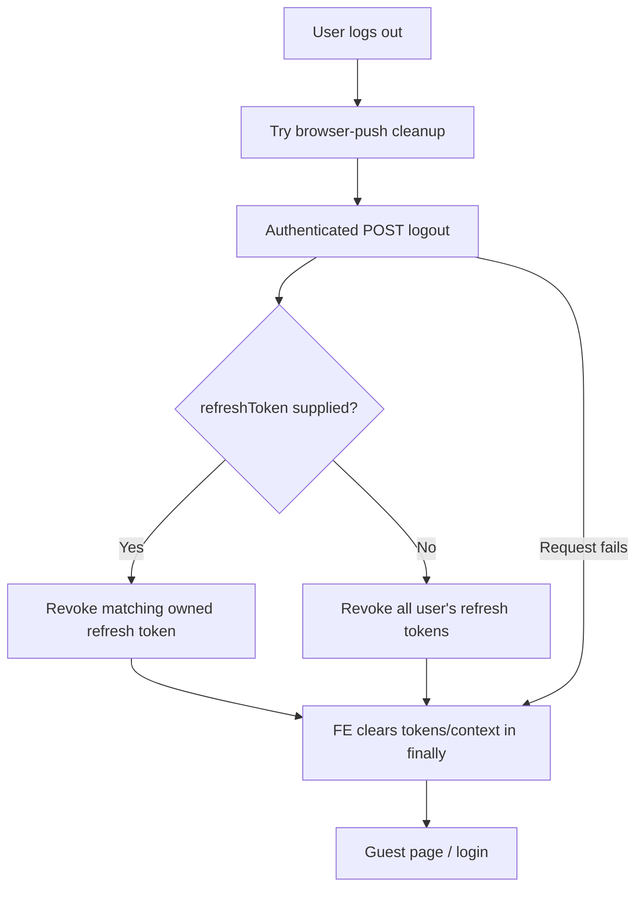

---

### FN04 — Quên / đặt lại mật khẩu — Email recovery link

**Actor / entry:** Guest / account owner; /forgot-password.

**API contract** (paths include the /api prefix):
- `POST /api/auth/forgot-password`
- `POST /api/auth/reset-password`

**Current workflow:**
1. Submit an email. BE returns the same generic message whether or not the email exists.
2. For an existing non-deleted account, BE stores a hashed opaque reset token and sends a link to /forgot-password?token=...&email=....
3. The page reads token+email from the query and displays the new-password/confirmation form.
4. FE sends email, token and newPassword. BE checks ownership, unused state and expiry, consumes the token, hashes the password and revokes refresh tokens; FE returns to /login.

**Conditions and outcomes:**
- This flow uses a reset link, not the 6-digit registration OTP. The reset token expires after 15 minutes.
- FE confirmation must match; BE reset DTO requires password length 8–128. Confirmation is not a reset-password API field.
- Generic success does not reveal whether an account exists or guarantee delivery. Invalid/expired/used token returns 400.
- Reset revokes refresh tokens but currently does not increment TokenVersion. Do not describe it as immediate revocation of every existing access JWT.

**Source evidence:** [FE: src/pages/guest/ForgotPasswordResetPassword.jsx](src/pages/guest/ForgotPasswordResetPassword.jsx); [FE: src/services/authService.js](src/services/authService.js); [BE: src/VeganHelper.BLL/Services/AuthService.cs](https://github.com/HoangAnh250/VeganHelperProject/blob/910eebf725dbaab0faac7ac1e171494e442a2ead/src/VeganHelper.BLL/Services/AuthService.cs).

**Implementation status:** Integrated in source; runtime not re-tested in this review.

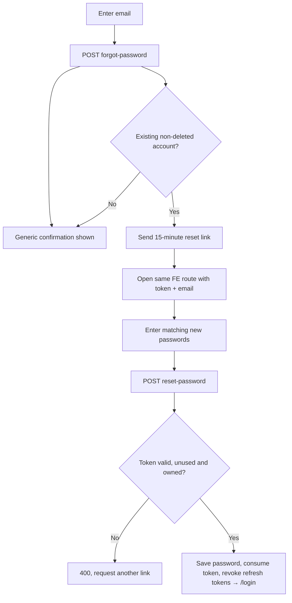

---

### FN05 — Xem hồ sơ cá nhân — Self profile

**Actor / entry:** Member / Admin; /profile.

**API contract** (paths include the /api prefix):
- `GET /api/users/me`

**Current workflow:**
1. ProtectedRoute waits for session restoration.
2. FE loads the self-profile DTO and renders account/profile information.
3. BE creates a default profile if the user exists but its profile record is missing.

**Conditions and outcomes:**
- DTO includes id, username, email, isEmailVerified, isGoogleLinked, displayName, avatarUrl, optional measurements/date/sex and role. Presence in the DTO does not mean every field must be shown in UI.
- A missing/deleted account returns 404. Authentication failures use the shared refresh/guard path.
- This is the self-profile endpoint; other users' public profiles are FN21 and do not expose private email/password.

**Source evidence:** [FE: src/pages/member/Profile.jsx](src/pages/member/Profile.jsx); [BE: src/VeganHelper.BLL/Services/UserService.cs](https://github.com/HoangAnh250/VeganHelperProject/blob/910eebf725dbaab0faac7ac1e171494e442a2ead/src/VeganHelper.BLL/Services/UserService.cs); [BE: src/VeganHelper.BLL/DTOs/ProfileDtos.cs](https://github.com/HoangAnh250/VeganHelperProject/blob/910eebf725dbaab0faac7ac1e171494e442a2ead/src/VeganHelper.BLL/DTOs/ProfileDtos.cs).

**Implementation status:** Integrated in source; runtime not re-tested in this review.

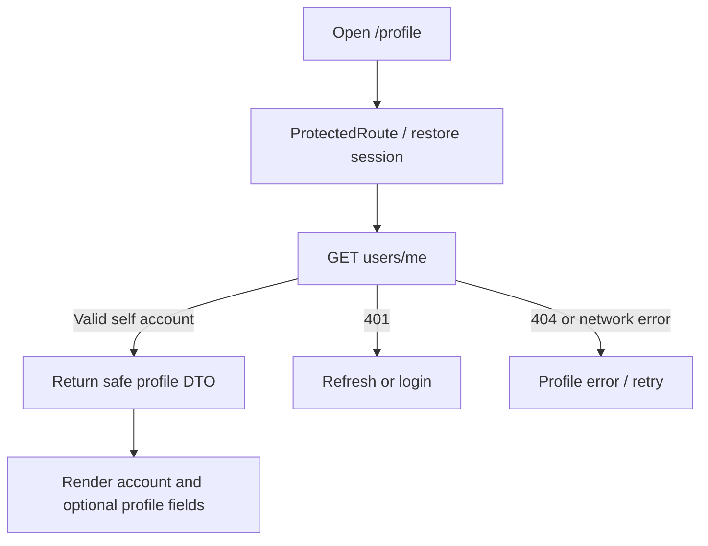

---

### FN06 — Chỉnh sửa hồ sơ — Self profile and R2 avatar

**Actor / entry:** Account owner; /profile.

**API contract** (paths include the /api prefix):
- `PUT /api/users/me`

**Current workflow:**
1. Edit profile fields and optionally select an avatar.
2. FE submits multipart/form-data; BE validates the self update and avatar.
3. The configured R2 storage saves the avatar and BE persists its public URL in the profile.
4. FE renders the returned profile and updated avatar; errors leave the user on the form.

**Conditions and outcomes:**
- Trimmed display name must be at least 3 characters (maximum 100); birth date must be strictly before today. Vietnamese phone numbers are normalized and validated.
- Avatar is JPEG/PNG and at most 5 MiB. This path is cloud storage; no persistent local-avatar fallback or automatic image transcoding is promised.
- General profile height/weight limits differ from HealthProfile validation: profile DTO permits up to 300 cm/500 kg; the meal-planning health flow is stricter.
- Security actions are separate endpoints: a generic profile update does not change email/password or link Google.

**Source evidence:** [FE: src/pages/member/Profile.jsx](src/pages/member/Profile.jsx); [FE: src/services/authService.js](src/services/authService.js); [BE: src/VeganHelper.BLL/Services/UserService.cs](https://github.com/HoangAnh250/VeganHelperProject/blob/910eebf725dbaab0faac7ac1e171494e442a2ead/src/VeganHelper.BLL/Services/UserService.cs); [BE: src/VeganHelper.API/Controllers/UserController.cs](https://github.com/HoangAnh250/VeganHelperProject/blob/910eebf725dbaab0faac7ac1e171494e442a2ead/src/VeganHelper.API/Controllers/UserController.cs).

**Implementation status:** Integrated in source; runtime not re-tested in this review.

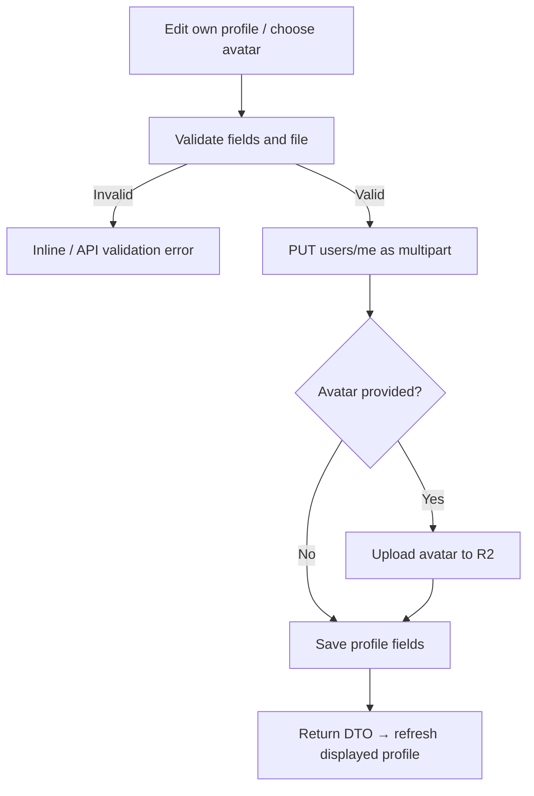

---

### FN07 — Khóa tính năng với Guest — Access boundaries

**Actor / entry:** Guest / signed-in user; Protected route or protected action.

**API contract** (paths include the /api prefix):
- `Backend [Authorize] and active-admin policy across protected APIs`

**Current workflow:**
1. Public pages allow published-post reads, recipe search, comments reads, saved-summary reads and the guest AI trial.
2. Like/save/comment writes, publishing, user search/profile/follow, health/planning, shops and notifications require authentication.
3. FE prompts through LandingAuthDialog or redirects to /login preserving the return location; admin pages also check the normalized role.
4. BE independently checks bearer credentials, current account/session state, ownership and admin policy.

**Conditions and outcomes:**
- GET public posts/comments/summary is not authorization to perform corresponding write operations.
- /users/:id and user-search APIs currently require login; the old document's guest author-directory access was inaccurate.
- An authenticated admin can use normal member pages. Elevated moderation permissions do not grant editing other users' comment text or regular post ownership operations.

**Source evidence:** [FE: src/components/layout/ProtectedRoute.jsx](src/components/layout/ProtectedRoute.jsx); [FE: src/components/layout/GuestRoute.jsx](src/components/layout/GuestRoute.jsx); [BE: src/VeganHelper.API/Program.cs](https://github.com/HoangAnh250/VeganHelperProject/blob/910eebf725dbaab0faac7ac1e171494e442a2ead/src/VeganHelper.API/Program.cs).

**Implementation status:** Integrated in source; runtime not re-tested in this review.

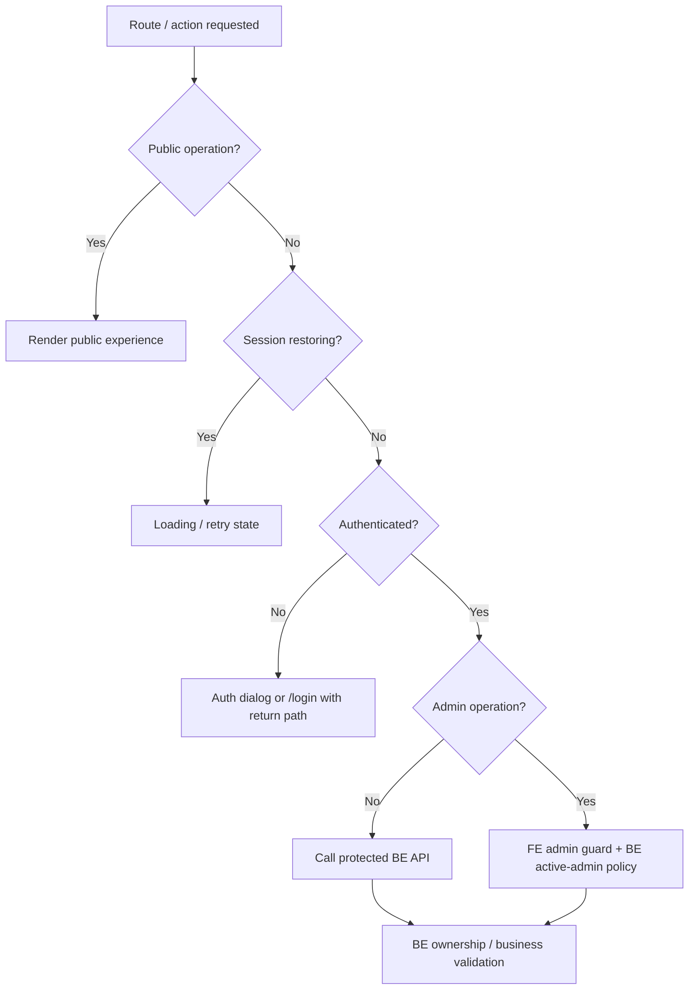

---

### FN08 — Xem Feed — Trending, latest and following

**Actor / entry:** Guest or Member; / or /home.

**API contract** (paths include the /api prefix):
- `GET /api/Posts`
- `GET /api/users/{userId}/following`
- `GET /api/users/{userId}/profile`

**Current workflow:**
1. Trending/Latest call the paged feed with filters; BE returns non-deleted published posts.
2. Home currently requests 6 items initially and supports loading more.
3. Following is a different FE path: get up to 50 followed users, load each returned public profile, merge/deduplicate its posts and sort by createdAt.
4. Cards lead to the correct guest/member detail route and protected interaction handlers.

**Conditions and outcomes:**
- Feed pageSize is capped at 50 by BE. FE may request fewer items.
- Following is not a dedicated BE feed endpoint and is bounded by the first follow page/profile post payloads. It should not be described as a complete server-paginated following feed.
- No followed users produces an empty-state CTA; a guest does not call protected follow APIs.

**Source evidence:** [FE: src/pages/member/Home.jsx](src/pages/member/Home.jsx); [FE: src/services/postService.js](src/services/postService.js); [BE: src/VeganHelper.BLL/Services/PostService.cs](https://github.com/HoangAnh250/VeganHelperProject/blob/910eebf725dbaab0faac7ac1e171494e442a2ead/src/VeganHelper.BLL/Services/PostService.cs); [BE: src/VeganHelper.DAL/Repositories/PostRepository.cs](https://github.com/HoangAnh250/VeganHelperProject/blob/910eebf725dbaab0faac7ac1e171494e442a2ead/src/VeganHelper.DAL/Repositories/PostRepository.cs).

**Implementation status:** Integrated in source; runtime not re-tested in this review.

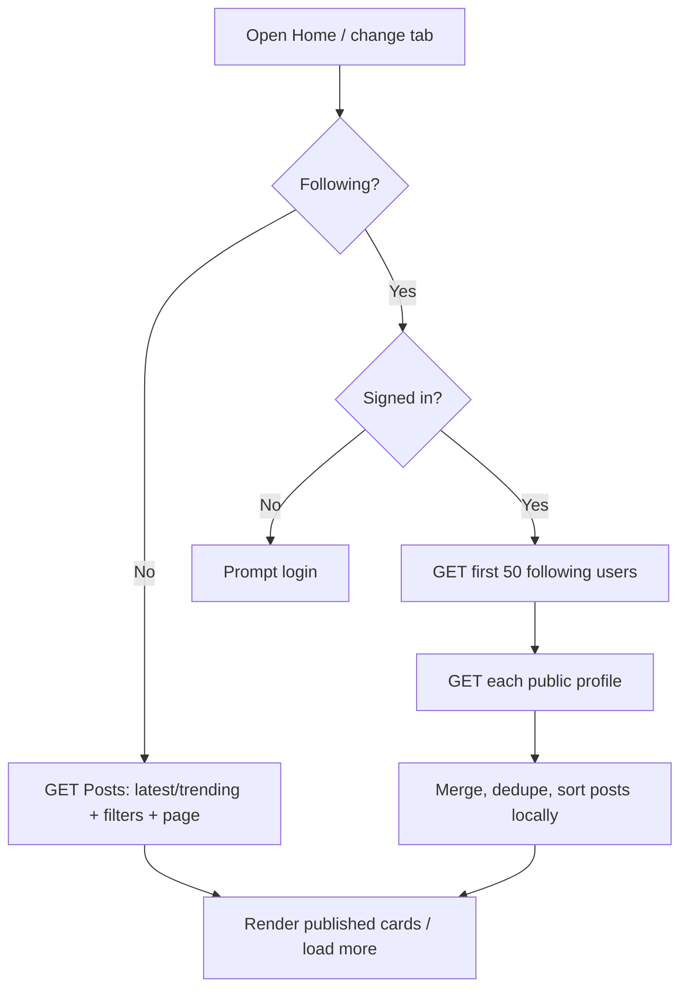

---

### FN09 — Tìm bài/video theo từ khóa — Keyword post search

**Actor / entry:** Guest or Member; /search-guest or /search.

**API contract** (paths include the /api prefix):
- `GET /api/Posts/search`

**Current workflow:**
1. Submit q in SearchCore; URL stores query, tab and page.
2. For a nonempty trimmed query, FE requests keyword/pageIndex/pageSize.
3. BE searches public published post text and returns a paged result; detail navigation depends on authentication.

**Conditions and outcomes:**
- At least 1 trimmed character is required by BE, not 2. Empty q displays the FE search introduction; it does not automatically GET all posts.
- Post search uses relational text matching; it is not a dedicated full-text-index search.
- FE All preview requests 6 posts; Posts tab requests 10 per page. BE caps pageSize at 50. Dedicated search does not accept the feed's category/difficulty filters.

**Source evidence:** [FE: src/components/home/SearchCore.jsx](src/components/home/SearchCore.jsx); [FE: src/services/postService.js](src/services/postService.js); [BE: src/VeganHelper.BLL/Services/PostService.cs](https://github.com/HoangAnh250/VeganHelperProject/blob/910eebf725dbaab0faac7ac1e171494e442a2ead/src/VeganHelper.BLL/Services/PostService.cs); [BE: src/VeganHelper.DAL/Repositories/PostRepository.cs](https://github.com/HoangAnh250/VeganHelperProject/blob/910eebf725dbaab0faac7ac1e171494e442a2ead/src/VeganHelper.DAL/Repositories/PostRepository.cs).

**Implementation status:** Integrated in source; runtime not re-tested in this review.

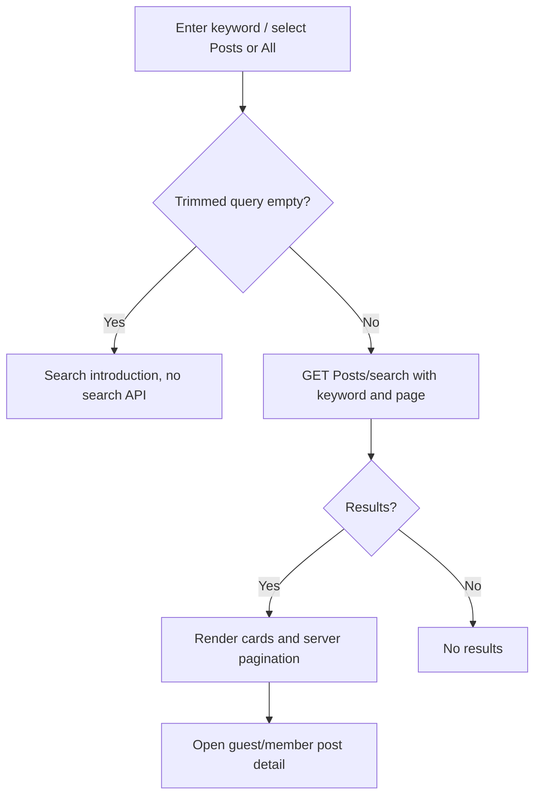

---

### FN10 — Tìm người dùng — People search

**Actor / entry:** Authenticated Member / Admin; /search?tab=people or All.

**API contract** (paths include the /api prefix):
- `GET /api/users/search`

**Current workflow:**
1. SearchCore runs people search only for signed-in users.
2. All tab shows a 4-person preview; People tab requests 12 people per server page.
3. Selecting a result opens the protected public-user-profile page.

**Conditions and outcomes:**
- Keyword must contain at least 1 trimmed character. Blank keyword returns 400 if called directly.
- BE normalizes pageIndex and caps pageSize at 50. The FE preview sizes are choices by the caller, not different BE endpoints.
- The search DTO is limited to identity/display name/avatar; private email and security fields are not a people-search response.

**Source evidence:** [FE: src/components/home/SearchCore.jsx](src/components/home/SearchCore.jsx); [FE: src/services/userService.js](src/services/userService.js); [BE: src/VeganHelper.BLL/Services/UserService.cs](https://github.com/HoangAnh250/VeganHelperProject/blob/910eebf725dbaab0faac7ac1e171494e442a2ead/src/VeganHelper.BLL/Services/UserService.cs).

**Implementation status:** Integrated in source; runtime not re-tested in this review.

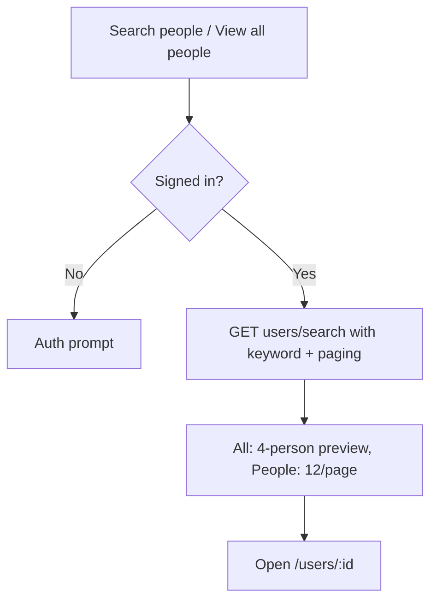

---

### FN11 — Lọc bài theo danh mục — Feed filters

**Actor / entry:** Guest or Member; Home feed filters.

**API contract** (paths include the /api prefix):
- `GET /api/Categories`
- `GET /api/Posts`

**Current workflow:**
1. Load category options.
2. FE sends supported feed filters (CategoryId, DifficultyLevel, DietType, PrepTimeMax, SortBy) and resets paging when selection changes.
3. Render the resulting published-post feed or its empty/error state.

**Conditions and outcomes:**
- This is the feed contract. SearchCore's dedicated keyword endpoint does not implement the same filter query.
- Diet values are vegan/lacto_ovo_vegetarian and difficulty values easy/medium/hard where the write validators define them.
- The Home Following branch filters its aggregated payload locally; do not assume parity with every server feed filter.

**Source evidence:** [FE: src/services/postService.js](src/services/postService.js); [FE: src/pages/member/Home.jsx](src/pages/member/Home.jsx); [BE: src/VeganHelper.BLL/DTOs/Posts/GetFeedRequest.cs](https://github.com/HoangAnh250/VeganHelperProject/blob/910eebf725dbaab0faac7ac1e171494e442a2ead/src/VeganHelper.BLL/DTOs/Posts/GetFeedRequest.cs).

**Implementation status:** Integrated in source; runtime not re-tested in this review.

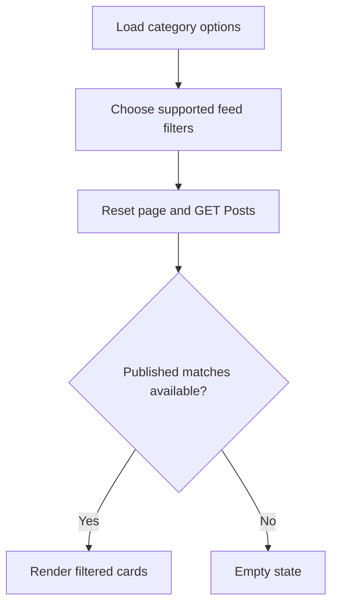

---

### FN12 — Xem chi tiết bài/video — Post detail

**Actor / entry:** Guest; Member; owner preview; /posts/:id/guest or /posts/:id.

**API contract** (paths include the /api prefix):
- `GET /api/Posts/{id}`
- `GET /api/posts/{postId}/comments`
- `GET /api/posts/{postId}/summary`

**Current workflow:**
1. Fetch post detail and comments; detail returns real recipe ingredients/steps/media and current interaction state.
2. BE allows published posts publicly. A non-deleted unpublished post is visible through this endpoint only to its author; admin review uses separate moderation endpoints.
3. FE detail and comment modal request maxDepth=4. Missing/inaccessible detail is taken to /404.
4. Video transcript/summary remains collapsed until the user clicks its button; its generation flow is documented in section 3.

**Conditions and outcomes:**
- Fetching detail increments viewCount; it is not a per-user unique-view metric.
- Comment/like/save APIs still require a published post even if the author can preview an unpublished detail.
- A guest can read comments and a completed shared summary but must log in for writes or to request creation of a missing summary.

**Source evidence:** [FE: src/components/home/PostDetailCore.jsx](src/components/home/PostDetailCore.jsx); [FE: src/components/home/PostVideoSummary.jsx](src/components/home/PostVideoSummary.jsx); [BE: src/VeganHelper.BLL/Services/PostService.cs](https://github.com/HoangAnh250/VeganHelperProject/blob/910eebf725dbaab0faac7ac1e171494e442a2ead/src/VeganHelper.BLL/Services/PostService.cs).

**Implementation status:** Integrated in source; runtime not re-tested in this review.

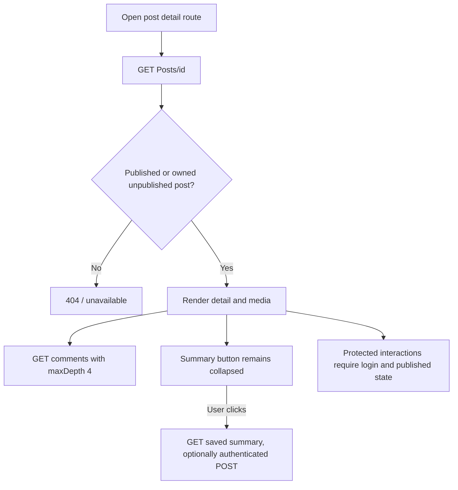

---

### FN13 — Đăng bài/video — Publish first, scan in background

**Actor / entry:** Member / Admin as author; /posts/create.

**API contract** (paths include the /api prefix):
- `POST /api/Posts`

**Current workflow:**
1. FE builds multipart data with title/category/content, diet/difficulty/time fields, JSON ingredients/steps and media files.
2. BE validates, uploads media to R2 and saves structured post data transactionally.
3. The new post is created with status published and a moderation scan is queued. It does not wait in a mandatory admin pre-publication queue.
4. A background AI assessment may place it on pending_review with ModerationHold; admin then makes a decision.

**Conditions and outcomes:**
- Title required ≤255; positive category ID; content required; nonnegative optional prep/cook times. Each submitted ingredient ID must exist, duplicate ingredients are rejected, and steps require distinct positive numbers/descriptions.
- At least 1 and at most 10 media files. Images JPEG/PNG/WebP ≤5 MiB each; videos MP4/MOV/WebM ≤200 MiB and ≤60 seconds; uploaded batch total ≤200 MiB.
- BE validates extension, MIME and file signature/duration metadata. R2 upload does not imply adaptive transcoding or responsive-video generation.
- DB failure triggers transaction rollback and best-effort cleanup of newly uploaded media. New public posts can be found by FN32 through its relational post and ingredient query once eligible.

**Source evidence:** [FE: src/services/postService.js](src/services/postService.js); [FE: src/components/home/CreatePostModal.jsx](src/components/home/CreatePostModal.jsx); [BE: src/VeganHelper.BLL/Services/PostService.cs](https://github.com/HoangAnh250/VeganHelperProject/blob/910eebf725dbaab0faac7ac1e171494e442a2ead/src/VeganHelper.BLL/Services/PostService.cs); [BE: src/VeganHelper.BLL/Services/Media/PostMediaUploadValidation.cs](https://github.com/HoangAnh250/VeganHelperProject/blob/910eebf725dbaab0faac7ac1e171494e442a2ead/src/VeganHelper.BLL/Services/Media/PostMediaUploadValidation.cs).

**Implementation status:** Integrated in source; runtime not re-tested in this review.

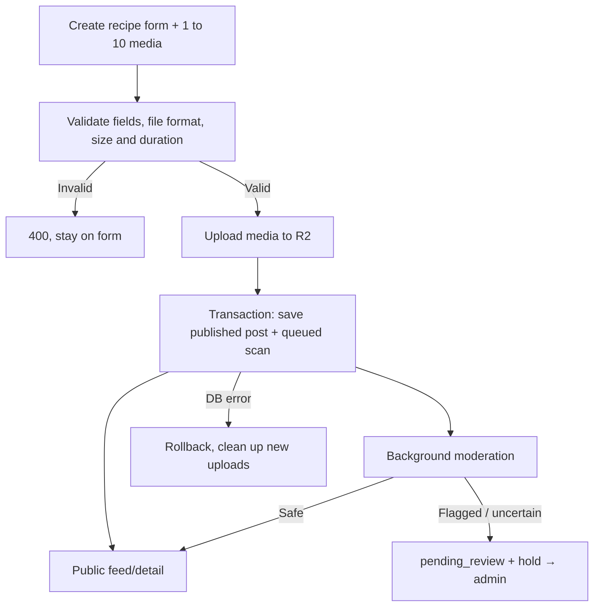

---

### FN14 — Chỉnh sửa bài — Owner update and re-scan

**Actor / entry:** Post owner; /posts/edit/:id.

**API contract** (paths include the /api prefix):
- `GET /api/Posts/{id}`
- `PUT /api/Posts/{id}`

**Current workflow:**
1. Load the owned post, edit recipe fields, retain/remove existing media and add uploads.
2. BE verifies author ownership and final media count, increments ContentRevision and queues a new scan.
3. Inside the transaction BE locks the existing publication state: an unrestricted public post stays published, while a held/hidden/rejected post becomes pending_review and keeps its hold.
4. FE refreshes the post/management view from the actual returned status.

**Conditions and outcomes:**
- Regular update is author-only. Admin role does not permit editing someone else's recipe.
- Only media IDs belonging to this post can be removed; final count remains 1–10. New upload constraints are the same as FN13.
- An admin decision racing with an edit cannot be silently bypassed; a changed revision can cause 409.
- A safe AI result does not automatically remove an existing human/AI moderation hold.

**Source evidence:** [FE: src/pages/member/EditPost.jsx](src/pages/member/EditPost.jsx); [FE: src/services/postService.js](src/services/postService.js); [BE: src/VeganHelper.BLL/Services/PostService.cs](https://github.com/HoangAnh250/VeganHelperProject/blob/910eebf725dbaab0faac7ac1e171494e442a2ead/src/VeganHelper.BLL/Services/PostService.cs).

**Implementation status:** Integrated in source; runtime not re-tested in this review.

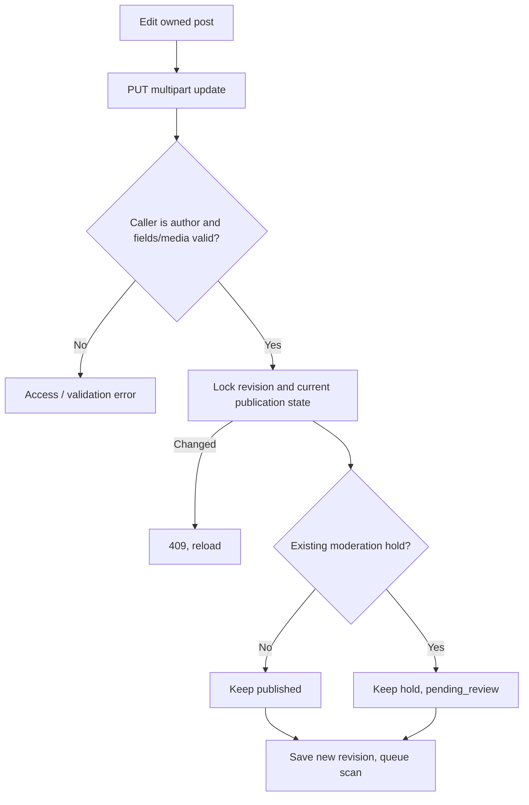

---

### FN15 — Xóa bài — Owner soft deletion

**Actor / entry:** Post owner; My Posts / owned post action.

**API contract** (paths include the /api prefix):
- `DELETE /api/Posts/{id}`

**Current workflow:**
1. The author confirms deletion.
2. BE loads non-deleted post independent of its publication status and verifies the author.
3. BE sets IsDeleted and deletion/update timestamps. Public detail/feed/search/saved retrieval stop exposing the original post.
4. FE removes it from the visible collection or returns to My Posts.

**Conditions and outcomes:**
- This is soft deletion; it does not hard-delete the post's related rows or cloud media.
- An admin deleting another author's post is not authorized by this route. Admin moderation uses keep/remove or approve/reject with a reason.
- Cancellation changes nothing; missing/already-deleted post returns 404.

**Source evidence:** [FE: src/pages/member/MyPosts.jsx](src/pages/member/MyPosts.jsx); [BE: src/VeganHelper.BLL/Services/PostService.cs](https://github.com/HoangAnh250/VeganHelperProject/blob/910eebf725dbaab0faac7ac1e171494e442a2ead/src/VeganHelper.BLL/Services/PostService.cs); [BE: src/VeganHelper.DAL/Repositories/PostRepository.cs](https://github.com/HoangAnh250/VeganHelperProject/blob/910eebf725dbaab0faac7ac1e171494e442a2ead/src/VeganHelper.DAL/Repositories/PostRepository.cs).

**Implementation status:** Integrated in source; runtime not re-tested in this review.

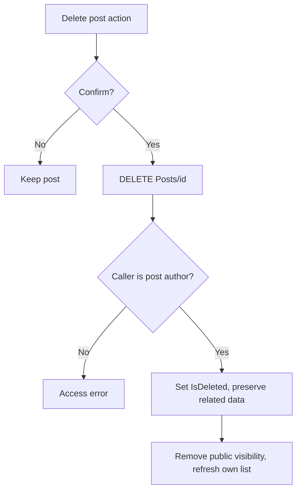

---

### FN16 — Quản lý bài của tôi — Own post collection

**Actor / entry:** Member / Admin as author; /my-posts.

**API contract** (paths include the /api prefix):
- `GET /api/Posts/my-posts`

**Current workflow:**
1. Load the current caller's posts with page/status query.
2. Render own-post cards, actual publication status and available owner actions.
3. Create/edit/delete refreshes the management view; author can preview unpublished non-deleted content.

**Conditions and outcomes:**
- Only the authenticated author's posts are returned; soft-deleted posts are excluded.
- Statuses are lowercase database values such as published, pending_review and rejected. UI wording is not a separate APPROVED/PENDING status enum.
- Creating a new post now defaults to published. Do not force every new card into an Under Review tab in the workflow description.

**Source evidence:** [FE: src/pages/member/MyPosts.jsx](src/pages/member/MyPosts.jsx); [FE: src/services/postService.js](src/services/postService.js); [BE: src/VeganHelper.BLL/Services/PostService.cs](https://github.com/HoangAnh250/VeganHelperProject/blob/910eebf725dbaab0faac7ac1e171494e442a2ead/src/VeganHelper.BLL/Services/PostService.cs).

**Implementation status:** Integrated in source; runtime not re-tested in this review.

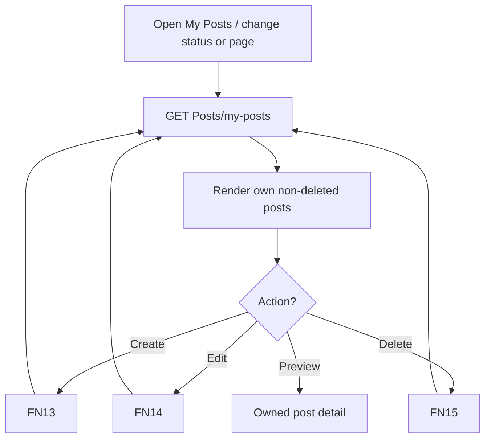

---

### FN17 — Bình luận và trả lời — Comment tree

**Actor / entry:** Guest reads; authenticated users create comments/replies; Post detail / CommentModal.

**API contract** (paths include the /api prefix):
- `GET /api/posts/{postId}/comments`
- `POST /api/posts/{postId}/comments`

**Current workflow:**
1. Load the public comment tree. FE requests `maxDepth=4`; the API returns a depth-limited tree without pagination.
2. Submit trimmed content between 1 and 500 characters. A parent must be visible, belong to the same published post, and remain within the supported depth.
3. The keyword filter either allows the comment, rejects it without saving, or stores it hidden for admin review.
4. Successful visible comments appear in the thread; comment edit/delete/report behavior is documented separately in FN43–FN45 and FN50.

**Conditions and outcomes:**
- The keyword list includes Vietnamese and English variants with tone folding; it cannot guarantee detection of every slang spelling or context.
- Keyword-hidden comments and user reports are reviewed in the admin comment queue. An LLM comment-scanning worker is not implemented.

**Source evidence:** [FE: src/components/home/PostDetailCore.jsx](src/components/home/PostDetailCore.jsx); [FE: src/components/home/CommentModal.jsx](src/components/home/CommentModal.jsx); [FE: src/services/interactionService.js](src/services/interactionService.js); [BE: src/VeganHelper.BLL/Services/CommentService.cs](https://github.com/HoangAnh250/VeganHelperProject/blob/910eebf725dbaab0faac7ac1e171494e442a2ead/src/VeganHelper.BLL/Services/CommentService.cs); [BE: src/VeganHelper.BLL/Services/CommentKeywordFilter.cs](https://github.com/HoangAnh250/VeganHelperProject/blob/910eebf725dbaab0faac7ac1e171494e442a2ead/src/VeganHelper.BLL/Services/CommentKeywordFilter.cs).

**Implementation status:** Integrated in source; runtime not re-tested in this review.

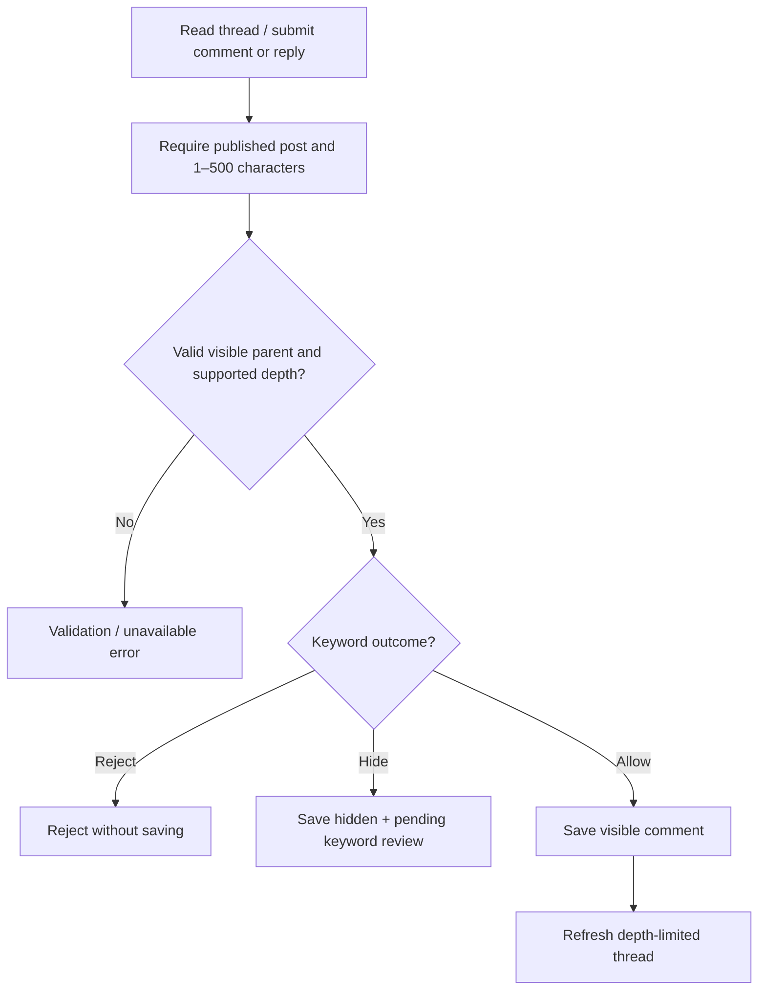

---

### FN18 — Thích bài — Like / unlike

**Actor / entry:** Member / Admin; Post card or detail.

**API contract** (paths include the /api prefix):
- `POST /api/posts/{postId}/like`

**Current workflow:**
1. FE updates the heart/count optimistically and blocks another in-flight click in the same UI.
2. BE validates the published post and toggles that user's existing like record in a transaction.
3. BE returns isLiked/likeCount; FE reconciles with that result or rolls back its optimistic state on error.

**Conditions and outcomes:**
- Guest action prompts authentication; unavailable posts return 404.
- A like can publish a notification to the author; unlike does not create a second like notification.
- The endpoint is a toggle, not a set-to-true command. A client should use the server result rather than infer state after repeated requests.

**Source evidence:** [FE: src/services/interactionService.js](src/services/interactionService.js); [FE: src/components/home/PostDetailCore.jsx](src/components/home/PostDetailCore.jsx); [BE: src/VeganHelper.BLL/Services/PostInteractionService.cs](https://github.com/HoangAnh250/VeganHelperProject/blob/910eebf725dbaab0faac7ac1e171494e442a2ead/src/VeganHelper.BLL/Services/PostInteractionService.cs).

**Implementation status:** Integrated in source; runtime not re-tested in this review.

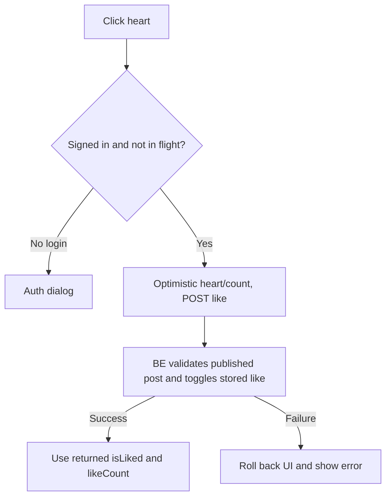

---

### FN19 — Lưu bài — Save / unsave toggle

**Actor / entry:** Member / Admin; Post card or detail.

**API contract** (paths include the /api prefix):
- `POST /api/posts/{postId}/save`

**Current workflow:**
1. Authenticated user clicks bookmark.
2. BE requires an available published post, then adds or removes the user's saved record.
3. FE uses returned isSaved, with optimistic rollback on error; the Saved Recipes list reflects the relationship.

**Conditions and outcomes:**
- Saved status is per user, not a global property of the post.
- Guest must authenticate. The same endpoint toggles both saving and unsaving.
- Saving does not create an author notification.

**Source evidence:** [FE: src/services/interactionService.js](src/services/interactionService.js); [BE: src/VeganHelper.BLL/Services/PostInteractionService.cs](https://github.com/HoangAnh250/VeganHelperProject/blob/910eebf725dbaab0faac7ac1e171494e442a2ead/src/VeganHelper.BLL/Services/PostInteractionService.cs).

**Implementation status:** Integrated in source; runtime not re-tested in this review.

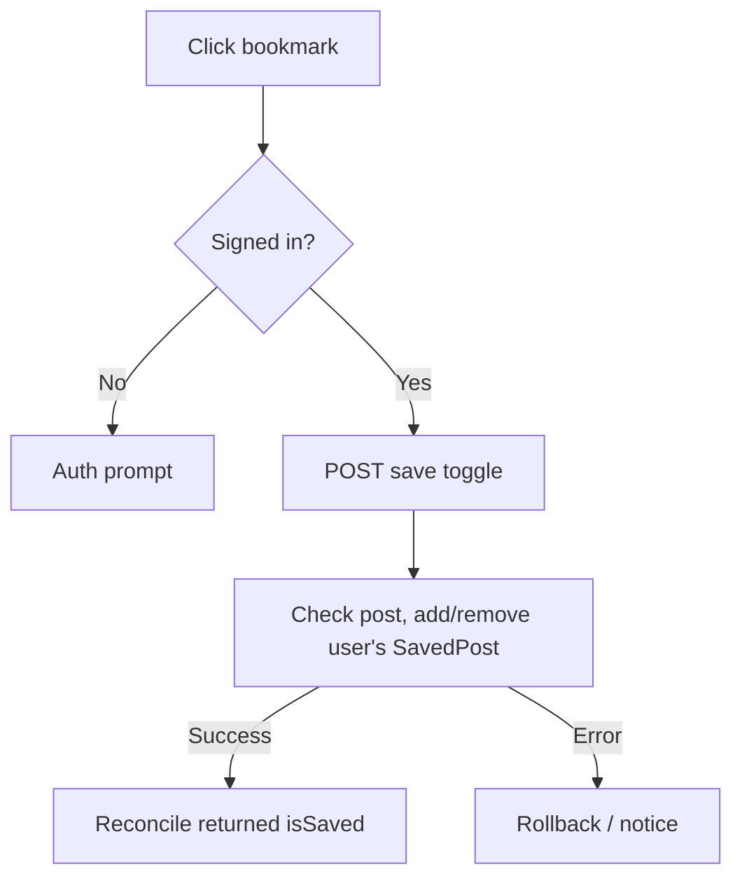

---

### FN20 — Xem bài đã lưu — Saved posts

**Actor / entry:** Member / Admin; /saved-posts.

**API contract** (paths include the /api prefix):
- `GET /api/users/me/saved-posts`

**Current workflow:**
1. FE requests the caller's saved-post page.
2. BE returns available published originals, ordered by newest SavedAt first.
3. Open a card to view detail or unsave it using FN19.

**Conditions and outcomes:**
- Default page size is 10 and BE caps at 50.
- An original post becoming deleted/unavailable is filtered from this list; its absence is not a hard deletion of every saved relationship.
- Zero results renders the Saved Recipes empty state.

**Source evidence:** [FE: src/pages/member/SavedPosts.jsx](src/pages/member/SavedPosts.jsx); [FE: src/services/interactionService.js](src/services/interactionService.js); [BE: src/VeganHelper.DAL/Repositories/PostInteractionRepository.cs](https://github.com/HoangAnh250/VeganHelperProject/blob/910eebf725dbaab0faac7ac1e171494e442a2ead/src/VeganHelper.DAL/Repositories/PostInteractionRepository.cs).

**Implementation status:** Integrated in source; runtime not re-tested in this review.

```mermaid
flowchart TD
    A["Open Saved Recipes"] --> B["GET own saved-posts page"]
    B --> C["Filter available published originals, newest SavedAt first"]
    C --> D{"Any results?"}
    D -->|No| E["Empty state"]
    D -->|Yes| F["Cards → detail or unsave"]
```

---

### FN21 — Hồ sơ tác giả — Public author profile

**Actor / entry:** Authenticated member or admin; `/users/:id`.

**API contract** (paths include the /api prefix):
- `GET /api/users/{userId}/profile`

**Current workflow:**
1. FE loads the profile DTO with public identity, counts and published post cards.
2. Profile visibility requires authentication. Private account/security fields are not returned by this public-profile DTO.
3. Follow status, follow actions and paged follower/following lists are tracked separately in FN47–FN48.

**Source evidence:** [FE: src/pages/member/PublicUserProfile.jsx](src/pages/member/PublicUserProfile.jsx); [FE: src/services/userService.js](src/services/userService.js); [BE: src/VeganHelper.BLL/Services/UserService.cs](https://github.com/HoangAnh250/VeganHelperProject/blob/910eebf725dbaab0faac7ac1e171494e442a2ead/src/VeganHelper.BLL/Services/UserService.cs); [BE: src/VeganHelper.API/Controllers/UserController.cs](https://github.com/HoangAnh250/VeganHelperProject/blob/910eebf725dbaab0faac7ac1e171494e442a2ead/src/VeganHelper.API/Controllers/UserController.cs).

**Implementation status:** Integrated in source; runtime not re-tested in this review.

---

### FN22 — Hồ sơ sức khỏe — Health profile and calorie baseline

**Actor / entry:** Member / Admin; /health or Weekly Menu → Health & Wellness.

**API contract** (paths include the /api prefix):
- `GET /api/HealthProfile`
- `PUT /api/HealthProfile`

**Current workflow:**
1. Load the shared health profile and editable fields.
2. Submit height, weight, biologicalSex, dietType, activityLevel and birthDate; BE normalizes enum values and validates.
3. BE calculates rounded BMI, persists the health profile/history and returns estimatedTdee when the calorie formula has sufficient supported information.
4. Health page refreshes metrics; the planner re-reads the profile instead of using FE calorie calculations as authority.

**Conditions and outcomes:**
- Health limits are 100–250 cm and 30–200 kg; sex male/female/other, diet vegan/lacto_ovo_vegetarian and the five activity levels in the validator.
- The current meal generator requires DOB/age 18–120, male/female for the calorie equation, supported activity and diet. General profile fields can be optional while a planner attempt still rejects insufficient inputs.
- Mifflin–St Jeor maintenance energy is calculated in BE; TDEE may be null when a supported baseline cannot be estimated. This is a product estimate, not medical diagnosis.

**Source evidence:** [FE: src/pages/member/HealthAndWellness.jsx](src/pages/member/HealthAndWellness.jsx); [FE: src/services/healthProfileService.js](src/services/healthProfileService.js); [BE: src/VeganHelper.BLL/Services/HealthProfileService.cs](https://github.com/HoangAnh250/VeganHelperProject/blob/910eebf725dbaab0faac7ac1e171494e442a2ead/src/VeganHelper.BLL/Services/HealthProfileService.cs); [BE: src/VeganHelper.BLL/Services/MealPlanning/MaintenanceEnergy.cs](https://github.com/HoangAnh250/VeganHelperProject/blob/910eebf725dbaab0faac7ac1e171494e442a2ead/src/VeganHelper.BLL/Services/MealPlanning/MaintenanceEnergy.cs).

**Implementation status:** Integrated in source; runtime not re-tested in this review.

```mermaid
flowchart TD
    A["Open Health & Wellness"] --> B["GET HealthProfile"]
    B --> C["Edit measurements, DOB, sex, activity and diet"]
    C --> D["PUT HealthProfile"]
    D -->|Invalid| E["400, correct fields"]
    D -->|Valid| F["Save profile, calculate BMI and optional TDEE"]
    F --> G["Refresh metrics and planner baseline"]
```

---

### FN23 — Khai báo dị ứng — Ingredient and custom allergies

**Actor / entry:** Member / Admin; Health & Wellness allergy form.

**API contract** (paths include the /api prefix):
- `GET /api/HealthProfile/ingredients`
- `PUT /api/HealthProfile/allergies`
- `GET /api/posts/{postId}/allergy-warnings`

**Current workflow:**
1. Search the ingredient catalog and/or enter custom allergy names.
2. Submit allergyIngredientIds and customAllergies; BE deduplicates/replaces the user's saved declarations.
3. Health profile returns the updated list; weekly planning and AI post retrieval apply their own backend allergy exclusions.
4. The post-warning endpoint exists in BE. Current AllergyWarningBanner is dormant: it is not mounted, and its imported getPostAllergyWarnings service helper is not exported. Do not claim a connected post-detail warning UI.

**Conditions and outcomes:**
- At most 100 ingredient IDs and 50 custom names; IDs positive and custom names trimmed 1–100 characters.
- Empty list means no allergies are recorded, not that the person is allergy-free.
- Allergy matching depends on catalog relationships, structured ingredients and implemented aliases. It is not a clinical safety guarantee for unlabeled ingredients or cross-contamination.

**Source evidence:** [FE: src/services/healthProfileService.js](src/services/healthProfileService.js); [FE: src/components/home/AllergyWarningBanner.jsx](src/components/home/AllergyWarningBanner.jsx); [BE: src/VeganHelper.BLL/Services/HealthProfileService.cs](https://github.com/HoangAnh250/VeganHelperProject/blob/910eebf725dbaab0faac7ac1e171494e442a2ead/src/VeganHelper.BLL/Services/HealthProfileService.cs); [BE: src/VeganHelper.BLL/Services/MealPlanning/AllergyFilter.cs](https://github.com/HoangAnh250/VeganHelperProject/blob/910eebf725dbaab0faac7ac1e171494e442a2ead/src/VeganHelper.BLL/Services/MealPlanning/AllergyFilter.cs).

**Implementation status:** Health allergy declarations are integrated; recipe-warning banner is not connected.

```mermaid
flowchart TD
    A["Search/select ingredients or enter custom allergies"] --> B["PUT allergies"]
    B --> C["Validate, deduplicate and replace declarations"]
    C --> D["Store user allergy relationships"]
    D --> E["Weekly meal generator excludes matching ingredients"]
    D --> F["AI post-search callback excludes matching posts"]
    D --> G["Optional recipe allergy-warning presentation"]
```

---

### FN24 — Tính BMI — BMI result

**Actor / entry:** Member / Admin; /health/bmi or Health & Wellness tab.

**API contract** (paths include the /api prefix):
- `GET /api/HealthProfile/bmi`

**Current workflow:**
1. BE loads valid current height/weight and calculates kg divided by squared height in metres, rounded to two decimals.
2. Response includes BMI and, when the code's adult-reference condition is satisfied, a category and reference weight range.
3. TDEE is returned only when supported age/sex/activity inputs are available; FE renders the response.

**Conditions and outcomes:**
- A missing/invalid measurement returns 400 with guidance to update health profile.
- Implemented categories: below 18.5 Underweight; below 25 Normal; below 30 Overweight; otherwise Obese. The application does not provide a clinical diagnosis.
- The BMI category's adult-reference check and maintenance-energy eligibility are separate code paths; do not imply that a BMI result alone makes the person eligible for a weight-goal plan.

**Source evidence:** [FE: src/pages/member/HealthAndWellness.jsx](src/pages/member/HealthAndWellness.jsx); [BE: src/VeganHelper.BLL/Services/HealthProfileService.cs](https://github.com/HoangAnh250/VeganHelperProject/blob/910eebf725dbaab0faac7ac1e171494e442a2ead/src/VeganHelper.BLL/Services/HealthProfileService.cs).

**Implementation status:** Integrated in source; runtime not re-tested in this review.

```mermaid
flowchart TD
    A["Open BMI section"] --> B["GET HealthProfile/bmi"]
    B --> C{"Height/weight valid?"}
    C -->|No| D["400, edit health profile"]
    C -->|Yes| E["Compute BMI, category/reference when applicable"]
    E --> F["Return optional TDEE and reference guidance"]
    F --> G["Render BMI summary"]
```

---

### FN25 — Lịch sử BMI — Measurement history

**Actor / entry:** Member / Admin; Health & Wellness BMI history.

**API contract** (paths include the /api prefix):
- `GET /api/HealthProfile/bmi-history`

**Current workflow:**
1. Health-profile updates record BMI measurement history through the repository.
2. FE requests history; BE filters to the last six months and applies server pagination.
3. Render recorded values/dates or the no-history state.

**Conditions and outcomes:**
- Controller defaults to pageIndex=1, pageSize=100; shared pagination allows at most 100.
- The current FE getBmiHistory helper does not expose paging arguments, so its first request is not a guarantee that all rows over 100 are displayed.
- Viewing history does not generate new measurement records or change the profile.

**Source evidence:** [FE: src/services/healthProfileService.js](src/services/healthProfileService.js); [BE: src/VeganHelper.BLL/Services/HealthProfileService.cs](https://github.com/HoangAnh250/VeganHelperProject/blob/910eebf725dbaab0faac7ac1e171494e442a2ead/src/VeganHelper.BLL/Services/HealthProfileService.cs); [BE: src/VeganHelper.DAL/Repositories/HealthProfileRepository.cs](https://github.com/HoangAnh250/VeganHelperProject/blob/910eebf725dbaab0faac7ac1e171494e442a2ead/src/VeganHelper.DAL/Repositories/HealthProfileRepository.cs).

**Implementation status:** Integrated in source; runtime not re-tested in this review.

```mermaid
flowchart TD
    A["Open history"] --> B["GET bmi-history"]
    B --> C["Last 6 months, paged by BE"]
    C --> D{"Records available?"}
    D -->|Yes| E["Render measurement timeline/list"]
    D -->|No| F["No-history state"]
```

---

### FN26 — Thực đơn tuần — Rule-based planning, goals and routines

**Actor / entry:** Member / Admin with generation access; /weekly-menu.

**API contract** (paths include the /api prefix):
- `GET /api/MealPlans`
- `GET /api/MealPlans/{id}`
- `POST /api/MealPlans/goal-preview`
- `POST /api/MealPlans/generate`
- `POST /api/MealPlans/{id}/regenerate`
- `PATCH /api/MealPlans/{id}/name`
- `DELETE /api/MealPlans/{id}`
- `PUT /api/MealPlans/{id}/tracking`
- `PUT /api/MealPlans/{id}/reminders`
- `POST /api/MealPlans/{id}/revision-preview`
- `POST /api/MealPlans/{id}/revisions`
- `GET /api/meal-plan-payments/access`

**Current workflow:**
1. Open the dashboard: access status/history and Health & Wellness are loaded. A new unpaid account with unused trials receives an empty plan list, not an access exception.
2. The 3-step wizard is Your approach → Your schedule → Review & create. Choose maintenance or weight_goal; provide start/name, timezone and breakfast/lunch/dinner calorie percentages totalling 100.
3. BE checks generation entitlement (active package or remaining trial), valid health baseline, start date in the selected timezone and no overlapping unarchived plan.
4. The rules engine selects 21 distinct eligible meals from the meals catalog for 7 days/3 meals, preserving diet/allergy exclusions and portion bounds. It does not ask an LLM to invent dishes and does not retrieve social posts.
5. Successful generation is already persisted with slots, routine, entries and a profile/allergy/generation snapshot. FE displays the returned calendar; no second save POST is needed.
6. Dashboard offers rename, pre-start regeneration, archive and history. Weight-goal routines additionally support meal logs/reminders and preview→confirmation revisions with expectedVersion/profile fingerprint.

**Conditions and outcomes:**
- Three successful trial generations are allowed per account. Archiving does not refund them. A saved revision/continued week can consume another trial; pre-start regenerate replaces the same plan rather than creating a new trial record.
- The generator requires enough safe meals: at least seven candidates per slot and 21 distinct dishes overall. It fails with 409 rather than relaxing allergies/diet.
- StartDate is today through the next year in the selected timezone; EndDate is StartDate+6 days. Each positive calorie split is below 100 and the sum is exactly 100; the legacy default is 30/35/35 if omitted.
- Maintenance requires the supported adult energy baseline. Weight goal adds eligibility confirmation, age 18–65, target 30–200 kg, target date 7–730 days away and pace/calorie safety checks. Current source rejects current BMI >40 (exactly 40 proceeds to other checks); this is a coded product policy, not an endorsement of a clinical cutoff.
- Weight-goal tracking supports unlogged/followed/changed/skipped, only at/after the meal's due time, with a note ≤500. Maintenance does not support tracking/reminders. Regeneration is blocked after the plan starts, after tracking, or when superseded.
- Paid access permits viewing existing plans; the seven-day grace period begins at subscription expiry, not at a plan's EndDate. Current trial plans remain readable under CanViewTrialPlans without an EndDate+7 cutoff. AvailableIngredientsSnapshot is currently saved as an empty array: pantry-based generation is not implemented.

**Source evidence:** [FE: src/components/meal-planning/PlanSetupFlow.jsx](src/components/meal-planning/PlanSetupFlow.jsx); [FE: src/components/meal-planning/WeeklyMealPlanner.jsx](src/components/meal-planning/WeeklyMealPlanner.jsx); [FE: src/services/mealPlanService.js](src/services/mealPlanService.js); [BE: src/VeganHelper.BLL/Services/MealPlanning/MealPlanningService.cs](https://github.com/HoangAnh250/VeganHelperProject/blob/910eebf725dbaab0faac7ac1e171494e442a2ead/src/VeganHelper.BLL/Services/MealPlanning/MealPlanningService.cs); [BE: src/VeganHelper.BLL/Services/MealPlanning/MealPlanGenerator.cs](https://github.com/HoangAnh250/VeganHelperProject/blob/910eebf725dbaab0faac7ac1e171494e442a2ead/src/VeganHelper.BLL/Services/MealPlanning/MealPlanGenerator.cs); [BE: src/VeganHelper.BLL/Services/MealPlanAccessPolicy.cs](https://github.com/HoangAnh250/VeganHelperProject/blob/910eebf725dbaab0faac7ac1e171494e442a2ead/src/VeganHelper.BLL/Services/MealPlanAccessPolicy.cs).

**Implementation status:** Integrated in source; runtime not re-tested in this review.

```mermaid
flowchart TD
    A["Weekly Menu dashboard"] --> B["GET access + plan history"]
    B --> C{"CanGenerate?"}
    C -->|No| D["Choose paid package"]
    C -->|Yes| E["Wizard: approach → schedule → review"]
    E --> F{"Profile, dates, split and goal valid?"}
    F -->|No| G["Correct inputs / health profile"]
    F -->|Yes| H["POST generate, check overlap and access"]
    H --> I["Rules: DB meals + diet/allergy filter + portions"]
    I -->|Not enough suitable dishes| J["409, preserve safety constraints"]
    I -->|Success| K["Persist plan + 21 slots + routine/entries"]
    K --> L["Calendar / history"]
    L --> M["Rename, archive or allowed pre-start regenerate"]
    L --> N["Weight goal: logs, reminders, revision preview → confirm"]
```

---

### FN27 — Quán chay gần vị trí — Nearby database shops

**Actor / entry:** Member / Admin; guest locked preview; /vegan-stores.

**API contract** (paths include the /api prefix):
- `GET /api/Shops/nearby`

**Current workflow:**
1. FE requests browser geolocation.
2. On permission failure/unsupported location, it uses HCMC centre (10.7769,106.7009) with fallback messaging.
3. Current page requests radius 10 km, page 1, pageSize 50; BE queries approved, non-deleted shops and computes Haversine distance.
4. Goong displays returned database stores and the location marker. Search this area uses the current map centre.

**Conditions and outcomes:**
- BE accepts valid paired latitude/longitude, radius 5–10 km and shared pagination up to 100. The helper's default radius=5 is not the page's current 10 km request.
- Goong map tiles/geocoding do not populate the database with arbitrary nearby businesses.
- Guest is sent to the locked page/auth experience; the shops API requires authentication.
- A missing public map key can affect rendering even while the backend shop list is available.

**Source evidence:** [FE: src/pages/member/FindVeganStores.jsx](src/pages/member/FindVeganStores.jsx); [FE: src/services/shopService.js](src/services/shopService.js); [BE: src/VeganHelper.BLL/Services/ShopService.cs](https://github.com/HoangAnh250/VeganHelperProject/blob/910eebf725dbaab0faac7ac1e171494e442a2ead/src/VeganHelper.BLL/Services/ShopService.cs); [BE: src/VeganHelper.DAL/Repositories/ShopRepository.cs](https://github.com/HoangAnh250/VeganHelperProject/blob/910eebf725dbaab0faac7ac1e171494e442a2ead/src/VeganHelper.DAL/Repositories/ShopRepository.cs).

**Implementation status:** Integrated in source; runtime not re-tested in this review.

```mermaid
flowchart TD
    A["Open protected Vegan Stores"] --> B["Request geolocation"]
    B -->|Granted| C["Use current coordinates"]
    B -->|Denied/unavailable| D["Explain fallback, use HCMC centre"]
    C --> E["GET Shops/nearby: 10 km, first 50"]
    D --> E
    E --> F["BE filters stored approved shops by distance"]
    F --> G["Goong map pins + store cards"]
```

---

### FN28 — Tìm quán theo từ khóa — Store search

**Actor / entry:** Member / Admin; Search field on /vegan-stores.

**API contract** (paths include the /api prefix):
- `GET /api/Shops/search`

**Current workflow:**
1. FE debounces a nonempty search for 500 ms and sends keyword plus coordinates.
2. BE matches stored shop name/address or menu-item name; search does not enforce the nearby radius.
3. BE prioritizes rating, then available distance and stable name/id ordering; FE refreshes cards and markers.

**Conditions and outcomes:**
- Keyword must be 2–100 characters in BE. Current FE starts requests for any nonempty string, so a 1-character query can return a validation error.
- The page currently requests only the first 50 items. A paginated BE response does not prove that every additional page is reachable in the current map UI.
- Results are stored shops/menu items, not a generative AI recommendation or live Google Places lookup.

**Source evidence:** [FE: src/pages/member/FindVeganStores.jsx](src/pages/member/FindVeganStores.jsx); [FE: src/services/shopService.js](src/services/shopService.js); [BE: src/VeganHelper.BLL/Services/ShopService.cs](https://github.com/HoangAnh250/VeganHelperProject/blob/910eebf725dbaab0faac7ac1e171494e442a2ead/src/VeganHelper.BLL/Services/ShopService.cs); [BE: src/VeganHelper.DAL/Repositories/ShopRepository.cs](https://github.com/HoangAnh250/VeganHelperProject/blob/910eebf725dbaab0faac7ac1e171494e442a2ead/src/VeganHelper.DAL/Repositories/ShopRepository.cs).

**Implementation status:** Integrated in source; runtime not re-tested in this review.

```mermaid
flowchart TD
    A["Type store/menu keyword"] --> B["500 ms debounce"]
    B --> C["GET Shops/search with optional paired coordinates"]
    C --> D{"Keyword length 2–100?"}
    D -->|No| E["400, show search error"]
    D -->|Yes| F["Query stored name/address/menu, rating-first results"]
    F --> G["Refresh map and first-page cards"]
```

---

### FN29 — Chi tiết quán và chỉ đường — Store detail

**Actor / entry:** Member / Admin; /vegan-stores/:id.

**API contract** (paths include the /api prefix):
- `GET /api/Shops/{id}`

**Current workflow:**
1. Open a stored shop from a card or map interaction.
2. BE returns approved/non-deleted detail, saved images/menu items/opening periods and optional distance.
3. BE evaluates open-now using UTC+7; FE displays details and can open a Google Maps navigation/search URL in a new tab.

**Conditions and outcomes:**
- Optional origin coordinates must be supplied as a valid pair. Missing shop returns 404.
- External directions links do not require a backend Google Maps Places integration or an AI API.
- Unknown opening periods produce unknown open-now state; do not invent opening hours.

**Source evidence:** [FE: src/pages/member/StoreDetail.jsx](src/pages/member/StoreDetail.jsx); [FE: src/services/shopService.js](src/services/shopService.js); [BE: src/VeganHelper.BLL/Services/ShopService.cs](https://github.com/HoangAnh250/VeganHelperProject/blob/910eebf725dbaab0faac7ac1e171494e442a2ead/src/VeganHelper.BLL/Services/ShopService.cs).

**Implementation status:** Integrated in source; runtime not re-tested in this review.

```mermaid
flowchart TD
    A["Open shop card/pin"] --> B["GET Shops/id"]
    B -->|404| C["Unavailable shop"]
    B -->|Found| D["Render stored detail, hours, menu and distance"]
    D --> E["User clicks directions"]
    E --> F["External Google Maps URL"]
```

---

### FN30 — AI Genie — Nutrition chat and conversation context

**Actor / entry:** Guest / Member / Admin; Floating chat popup.

**API contract** (paths include the /api prefix):
- `POST /api/ai/chat`
- `GET /api/ai/chat/{sessionId}`

**Current workflow:**
1. FE immediately appends the user's message and changes Send to a busy/Stop control; it submits message, optional sessionId and anonymous guestSessionId.
2. BE checks session ownership, stores the user message/usage reservation and loads structured profile/context when authenticated.
3. DeepSeekChatClient calls the configured model and may invoke the controlled FN32 post-search tool. BE stores a successful AI reply plus usage/card IDs and returns it.
4. FE renders supported Markdown through ChatMarkdown and backend-supplied post cards, not raw model HTML.
5. For members, after at least 20 unsummarized messages BE summarizes the older portion, retaining four recent raw messages and a SummaryThroughMessageId checkpoint. Stored messages are not deleted.

**Conditions and outcomes:**
- Message must be nonempty and ≤4,000 characters. FE HTTP timeout is 75 s; backend provider timeout is configuration-driven (options default 45 s). Provider failure/cancellation is not a guarantee that the upstream spent no quota.
- The current FE clears conversation sessionStorage keys on a navigation entry of type reload (F5). Ordinary SPA route changes can restore the same tab's conversation by sessionId/history API. This is not server-side deletion and not a guarantee about browser tab-session restoration.
- Stop aborts the HTTP request and adds an inline stopped notice. BE avoids saving an assistant reply if cancellation is observed before persistence; the user message/usage may already be saved, and a reply already committed before Stop is not undone.
- History is ownership-scoped and limited to the latest 100 messages in the current history API. Model raw history is bounded separately, combined with summary/profile context.
- System prompt supports Vietnamese/English according to the latest message, defaults other languages to English, keeps vegetarian scope and treats user/tool text as untrusted data. Health answers are informational.

**Source evidence:** [FE: src/components/chat/AIChatbot.jsx](src/components/chat/AIChatbot.jsx); [FE: src/components/chat/ChatMarkdown.jsx](src/components/chat/ChatMarkdown.jsx); [FE: src/services/aiChatService.js](src/services/aiChatService.js); [BE: src/VeganHelper.BLL/Services/AiChatService.cs](https://github.com/HoangAnh250/VeganHelperProject/blob/910eebf725dbaab0faac7ac1e171494e442a2ead/src/VeganHelper.BLL/Services/AiChatService.cs); [BE: src/VeganHelper.API/Infrastructure/AI/DeepSeekChatClient.cs](https://github.com/HoangAnh250/VeganHelperProject/blob/910eebf725dbaab0faac7ac1e171494e442a2ead/src/VeganHelper.API/Infrastructure/AI/DeepSeekChatClient.cs); [BE: src/VeganHelper.API/Prompts/VeganNutrition.v2.json](https://github.com/HoangAnh250/VeganHelperProject/blob/910eebf725dbaab0faac7ac1e171494e442a2ead/src/VeganHelper.API/Prompts/VeganNutrition.v2.json).

**Implementation status:** Integrated in source; runtime not re-tested in this review.

```mermaid
flowchart TD
    A["Send question"] --> B["Append user bubble immediately, show Stop"]
    B --> C["POST ai/chat"]
    C --> D["Check owner/quota, save user turn, load permitted context"]
    D --> E["DeepSeek response, optional controlled post search"]
    E -->|Failure| F["Mark usage failed, FE shows inline error"]
    E -->|Success| G["Persist assistant reply and real card IDs"]
    G --> H{"Member and at least 20 unsummarized messages?"}
    H -->|Yes| I["Summarize older turns, keep 4 raw messages"]
    H -->|No| J["Return response"]
    I --> J
    J --> K["Render Markdown + optional post cards"]
    B -->|Stop| L["Abort request, show stopped notice"]
```

---

### FN31 — AI Genie cá nhân hóa — Allowed profile context

**Actor / entry:** Member / Admin; Inside the same chat popup.

**API contract** (paths include the /api prefix):
- `POST /api/ai/chat`

**Current workflow:**
1. BE loads the authenticated user's health projection.
2. BuildModelContext includes meal_type/diet, calculated current_bmi, activity_level, optional estimated_maintenance_calories, declared_allergies and whether allergies are recorded.
3. The provider uses this reference data and prior conversation summary to tailor its answer.
4. For a basic dish suggestion it can answer immediately with an allergy reminder; detailed personalization asks only for missing relevant information.

**Conditions and outcomes:**
- AI has no direct database connection, arbitrary SQL permission or automatic access to all posts/private user fields.
- A default vegan profile is labeled as potentially an application default; the prompt must not invent that the person explicitly chose it.
- No underlying-disease diagnosis, invented missing health data or automatic claim that the user has no allergies. BMI need not be mentioned in every food answer.
- Post-card allergy filtering is performed by BE during FN32; prompt instructions alone are not the database filter.

**Source evidence:** [BE: src/VeganHelper.BLL/Services/AiChatService.cs](https://github.com/HoangAnh250/VeganHelperProject/blob/910eebf725dbaab0faac7ac1e171494e442a2ead/src/VeganHelper.BLL/Services/AiChatService.cs); [BE: src/VeganHelper.API/Prompts/VeganNutrition.v2.json](https://github.com/HoangAnh250/VeganHelperProject/blob/910eebf725dbaab0faac7ac1e171494e442a2ead/src/VeganHelper.API/Prompts/VeganNutrition.v2.json); [FE: src/components/chat/AIChatbot.jsx](src/components/chat/AIChatbot.jsx).

**Implementation status:** Integrated in source; runtime not re-tested in this review.

```mermaid
flowchart TD
    A["Authenticated chat"] --> B["Load caller's health profile"]
    B --> C["Allowlisted structured context + optional conversation summary"]
    C --> D["Provider receives data as reference"]
    D --> E{"Relevant information missing?"}
    E -->|Basic suggestion| F["Suggest food with appropriate reminder"]
    E -->|Needed for detailed request| G["Ask only necessary follow-up"]
```

---

### FN32 — AI tìm bài theo nguyên liệu/bữa — Controlled relational retrieval

**Actor / entry:** Guest within trial / Member / Admin; Natural-language food/post request in chat.

**API contract** (paths include the /api prefix):
- `POST /api/ai/chat (search_vegan_posts tool inside this request)`

**Current workflow:**
1. Prompt instructs the model to use search_vegan_posts for dish/recipe/post requests. The provider returns structured criteria, never SQL.
2. BE sanitizes/bounds criteria and calls PostRepository.SearchRecommendationsAsync, limiting results to non-deleted published posts without a moderation hold.
3. All required ingredients must match structured ingredients; available ingredients normally allow any match. Strict-only mode applies a stricter verified-ingredients subset rule.
4. BE applies profile allergy IDs/names and available aliases, requested/profile diet, optional meal type/cooking time and previously recommended IDs.
5. Return 0–3 real cards. BE constructs a consistent card-introduction answer for a nonempty result and persists recommended IDs. No matches can be explained with clearly labeled general-knowledge suggestions.

**Conditions and outcomes:**
- A request for a dish with mushrooms makes mushrooms required, not the only allowed ingredient. The stricter setting requires an explicit only-these-ingredients request.
- When profile allergies exist, candidates must have verified structured ingredients; exact IDs and implemented name aliases are excluded. This is a conservative matching policy, not proof against every unknown allergen.
- More-results searches exclude cards already recommended in the same conversation. Changing/reloading to a new session changes that deduplication scope; there is no explicit replay-old-cards parameter.
- Eligible cards are ranked newest-first after relational text and ingredient filters. The model receives structured criteria and repository results, not SQL or arbitrary database access.

**Source evidence:** [BE: src/VeganHelper.API/Infrastructure/AI/DeepSeekChatClient.cs](https://github.com/HoangAnh250/VeganHelperProject/blob/910eebf725dbaab0faac7ac1e171494e442a2ead/src/VeganHelper.API/Infrastructure/AI/DeepSeekChatClient.cs); [BE: src/VeganHelper.BLL/Services/AiChatService.cs](https://github.com/HoangAnh250/VeganHelperProject/blob/910eebf725dbaab0faac7ac1e171494e442a2ead/src/VeganHelper.BLL/Services/AiChatService.cs); [BE: src/VeganHelper.DAL/Repositories/PostRepository.cs](https://github.com/HoangAnh250/VeganHelperProject/blob/910eebf725dbaab0faac7ac1e171494e442a2ead/src/VeganHelper.DAL/Repositories/PostRepository.cs); [FE: src/components/chat/AIChatbot.jsx](src/components/chat/AIChatbot.jsx).

**Implementation status:** Integrated in source; runtime not re-tested in this review.

```mermaid
flowchart TD
    A["User asks for dishes/posts"] --> B["DeepSeek tool call: structured criteria"]
    B --> C["BE validates fields, adds profile allergies/diet and excluded IDs"]
    C --> D["Relational query: public posts + structured ingredients"]
    D --> E["Diet/allergy/time/meal filters, take at most 3"]
    E --> F{"Real matches?"}
    F -->|Yes| G["Return consistent answer + real post cards"]
    F -->|No| H["No matching system post, optional general food advice"]
    G --> I["Save shown IDs, exclude from later more requests"]
```

---

---

### FN33 — Giới hạn AI Guest — Three-question trial

**Actor / entry:** Guest; AI Genie popup.

**API contract** (paths include the /api prefix):
- `POST /api/ai/chat`

**Current workflow:**
1. FE maintains a browser guest GUID and a remaining-count hint in localStorage, independently of the current conversation ID.
2. BE atomically reserves a trial turn for that guest GUID with a limit of 3. Completed usage and pending requests created within the last three minutes consume the allowance; recorded failed usage can release a reservation.
3. Response returns guestQuestionsRemaining, or 429 with GUEST_CHAT_LIMIT_REACHED and a registration requirement when exhausted.
4. FE keeps the third answer visible and leaves the composer available. When the guest tries to send a fourth question, FE blocks the request and opens the sign-in/sign-up prompt; closing it does not restore the trial. Member requests are not subject to this cap.

**Conditions and outcomes:**
- Client remaining count is a UI hint; the server check is authoritative. F5 clearing the displayed conversation does not reset the stored guest GUID/quota.
- The trial is browser-identity based, not a strong per-human identity guarantee. Clearing/changing browser identity can create another anonymous scope.
- An additional per-IP guest limiter permits 12 requests/hour in the current API configuration; its GUEST_CHAT_RATE_LIMITED response differs from the three-question registration limit.
- A network/cancellation race can delay quota-release bookkeeping; Stop does not guarantee that no provider quota was consumed.

**Source evidence:** [FE: src/components/chat/AIChatbot.jsx](src/components/chat/AIChatbot.jsx); [BE: src/VeganHelper.BLL/Services/AiChatService.cs](https://github.com/HoangAnh250/VeganHelperProject/blob/910eebf725dbaab0faac7ac1e171494e442a2ead/src/VeganHelper.BLL/Services/AiChatService.cs); [BE: src/VeganHelper.DAL/Repositories/ChatRepository.cs](https://github.com/HoangAnh250/VeganHelperProject/blob/910eebf725dbaab0faac7ac1e171494e442a2ead/src/VeganHelper.DAL/Repositories/ChatRepository.cs); [BE: src/VeganHelper.API/Program.cs](https://github.com/HoangAnh250/VeganHelperProject/blob/910eebf725dbaab0faac7ac1e171494e442a2ead/src/VeganHelper.API/Program.cs).

**Implementation status:** Integrated in source; runtime not re-tested in this review.

```mermaid
flowchart TD
    A["Anonymous chat request + guest GUID"] --> B["Per-IP rate limiter"]
    B -->|Exceeded| C["429 network rate limit"]
    B --> D["Atomic server reservation for guest GUID"]
    D -->|3 already reserved/completed| E["429 GUEST_CHAT_LIMIT_REACHED as server fallback"]
    E --> F["Keep prior answers visible; fourth send opens sign-in / sign-up prompt and is blocked"]
    D -->|Allowed| G["Provider request"]
    G -->|Success| H["Return answer and remaining count"]
    G -->|Failure recorded| I["Usage failed, reservation no longer counted"]
```

---

### FN34 — Thông báo — In-app and optional web push

**Actor / entry:** Member / Admin; Header NotificationBell / browser push opt-in.

**API contract** (paths include the /api prefix):
- `GET /api/notifications`
- `GET /api/notifications/unread-count`
- `GET /api/notifications/push/config`
- `POST /api/notifications/push/subscriptions`
- `DELETE /api/notifications/push/subscriptions/{id}`

**Current workflow:**
1. Business services persist recipient-scoped notifications for implemented social/moderation/meal events with deduplication keys.
2. NotificationBell fetches unread count on mount and at 60-second intervals while the document is visible; opening the bell loads its list.
3. If configured and permission is granted, the browser/service worker subscribes for push; a background dispatcher sends pending web-push deliveries.
4. Selecting a notification can open its target URL and invoke FN35.

**Conditions and outcomes:**
- In-app polling is not an instant WebSocket/SignalR stream. Web push is a separate optional channel.
- The API scopes notifications/subscriptions to the current user. Push requires provider configuration, browser permission and an eligible endpoint/key pair.
- Self-interaction notifications are suppressed where the publisher checks actor/recipient. Only actually implemented event publishers should be claimed.
- No global permanent 'unlimited notification history' guarantee is made by a paged UI.

**Source evidence:** [FE: src/components/notifications/NotificationBell.jsx](src/components/notifications/NotificationBell.jsx); [FE: src/services/browserPushService.js](src/services/browserPushService.js); [BE: src/VeganHelper.BLL/Services/NotificationService.cs](https://github.com/HoangAnh250/VeganHelperProject/blob/910eebf725dbaab0faac7ac1e171494e442a2ead/src/VeganHelper.BLL/Services/NotificationService.cs); [BE: src/VeganHelper.BLL/Services/NotificationPushDispatcher.cs](https://github.com/HoangAnh250/VeganHelperProject/blob/910eebf725dbaab0faac7ac1e171494e442a2ead/src/VeganHelper.BLL/Services/NotificationPushDispatcher.cs).

**Implementation status:** Integrated in source; runtime not re-tested in this review.

```mermaid
flowchart TD
    A["Business event"] --> B["Store recipient notification + dedupe key"]
    B --> C["FE unread-count polling while visible"]
    C --> D["Open bell → GET notifications"]
    B --> E{"Push configured and subscribed?"}
    E -->|Yes| F["Background push delivery → service worker"]
    E -->|No| G["In-app channel remains"]
    D --> H["Open target / mark read"]
```

---

### FN35 — Đánh dấu thông báo đã đọc — Read state

**Actor / entry:** Notification recipient; Notification popover.

**API contract** (paths include the /api prefix):
- `PATCH /api/notifications/{id}/read`
- `PATCH /api/notifications/read-all`

**Current workflow:**
1. Select an unread owned item or Mark all as read.
2. BE updates the current user's matching notification records and returns updatedCount/unreadCount.
3. FE reconciles dots/badge with the response and navigates to the selected target where appropriate.

**Conditions and outcomes:**
- A caller cannot mark another user's notification read. Missing inaccessible items return the service's unavailable result.
- A concurrent new notification can leave unreadCount above zero after Mark all; use the returned count instead of forcing zero.
- On error, FE preserves/restores a usable display and shows feedback.

**Source evidence:** [FE: src/components/notifications/NotificationBell.jsx](src/components/notifications/NotificationBell.jsx); [BE: src/VeganHelper.BLL/Services/NotificationService.cs](https://github.com/HoangAnh250/VeganHelperProject/blob/910eebf725dbaab0faac7ac1e171494e442a2ead/src/VeganHelper.BLL/Services/NotificationService.cs).

**Implementation status:** Integrated in source; runtime not re-tested in this review.

```mermaid
flowchart TD
    A["Click item / Mark all read"] --> B["PATCH own notification read state"]
    B --> C["BE updates owned rows"]
    C --> D["Return updatedCount + unreadCount"]
    D --> E["Reconcile badge and unread markers"]
    B -->|Error| F["Show error, avoid false read confirmation"]
```

---

### FN36 — Quản lý thành viên — Admin directory

**Actor / entry:** Active administrator; /admin/members.

**API contract** (paths include the /api prefix):
- `GET /api/admin/members`
- `GET /api/admin/members/summary`
- `GET /api/admin/members/{id}`

**Current workflow:**
1. FE admin guard opens the member table; BE active-admin policy checks authorization.
2. Query list/summary with keyword, role, status and pagination; open a detail modal.
3. From an eligible member row, proceed to FN37. Admin reads/writes covered by AdminAuditService record an audit event.

**Conditions and outcomes:**
- Roles are member/admin. Supported status filters include active, inactive, pending_verification, locked, banned and deleted; these are projections, not one account-status enum.
- Keyword maximum 100; shared page validation caps size at 100. Sensitive account operations still validate actor/target in service.
- A token containing an old admin claim alone is insufficient after the user's role/session becomes unavailable.

**Source evidence:** [FE: src/pages/admin/AdminMemberManagement.jsx](src/pages/admin/AdminMemberManagement.jsx); [FE: src/services/adminService.js](src/services/adminService.js); [BE: src/VeganHelper.BLL/Services/AdminMemberService.cs](https://github.com/HoangAnh250/VeganHelperProject/blob/910eebf725dbaab0faac7ac1e171494e442a2ead/src/VeganHelper.BLL/Services/AdminMemberService.cs).

**Implementation status:** Integrated in source; runtime not re-tested in this review.

```mermaid
flowchart TD
    A["Open Admin Members"] --> B["FE admin guard + BE active-admin policy"]
    B -->|Allowed| C["GET paged list and summary"]
    C --> D["Filter / inspect member"]
    D --> E["Ban / unban if eligible"]
    B -->|Denied| F["Access failure"]
```

---

### FN37 — Khóa / mở thành viên — Ban/unban and sessions

**Actor / entry:** Active administrator; Member detail/table.

**API contract** (paths include the /api prefix):
- `POST /api/admin/members/{id}/ban`
- `POST /api/admin/members/{id}/unban`

**Current workflow:**
1. Select a member and supply a reason; ban can include a future expiresAt or omit it for an indefinite ban.
2. BE locks the target, rejects self/admin/deleted/inconsistent targets and duplicate active-ban state.
3. Ban inserts user_bans; unban closes the active ban. Both increment TokenVersion and revoke refresh tokens.
4. BE commits the operation with audit and FE refreshes status/summary. Existing tokens fail current-account validation.

**Conditions and outcomes:**
- Reason required, at most 500 characters. Ban expiry, if supplied, must be in the future.
- Cannot ban/unban yourself or another admin using this feature. Already-banned/no-active-ban returns 409.
- The ban record is distinct from inactive registration and 15-minute failed-login lockout. Expiration is evaluated by active-ban queries.

**Source evidence:** [FE: src/pages/admin/AdminMemberManagement.jsx](src/pages/admin/AdminMemberManagement.jsx); [BE: src/VeganHelper.BLL/Services/AdminMemberService.cs](https://github.com/HoangAnh250/VeganHelperProject/blob/910eebf725dbaab0faac7ac1e171494e442a2ead/src/VeganHelper.BLL/Services/AdminMemberService.cs); [BE: src/VeganHelper.API/Authorization/AccountTokenValidation.cs](https://github.com/HoangAnh250/VeganHelperProject/blob/910eebf725dbaab0faac7ac1e171494e442a2ead/src/VeganHelper.API/Authorization/AccountTokenValidation.cs).

**Implementation status:** Integrated in source; runtime not re-tested in this review.

```mermaid
flowchart TD
    A["Ban/unban selected member + reason"] --> B["Lock and validate target"]
    B -->|Self/admin/deleted/conflict| C["Reject without change"]
    B -->|Eligible| D["Create/close active ban"]
    D --> E["Increment TokenVersion, revoke refresh tokens"]
    E --> F["Commit with audit, refresh UI"]
    F --> G["Old sessions fail backend validation"]
```

---

### FN38 — Quản lý danh mục — Post category CRUD

**Actor / entry:** Active administrator; /admin/categories.

**API contract** (paths include the /api prefix):
- `GET /api/admin/categories`
- `GET /api/admin/categories/{id}`
- `POST /api/admin/categories`
- `PUT /api/admin/categories/{id}`
- `DELETE /api/admin/categories/{id}`

**Current workflow:**
1. List/filter categories and inspect details.
2. Create/update name, optional slug and postCategoryKind; BE generates a unique slug when needed.
3. For delete or kind change, BE checks references under a category write lock.
4. Successful mutation and audit commit together, then FE reloads the category table.

**Conditions and outcomes:**
- Name 1–100, optional slug ≤120 using lowercase a-z/digits/hyphens; kind is food, recipe or topic.
- A category referenced by posts cannot be deleted or have its kind changed; conflicts return 409.
- Admin category service manages post categories. It is not a generic editor for every category/table in the database.

**Source evidence:** [FE: src/pages/admin/AdminCategoryManagement.jsx](src/pages/admin/AdminCategoryManagement.jsx); [BE: src/VeganHelper.BLL/Services/AdminCategoryService.cs](https://github.com/HoangAnh250/VeganHelperProject/blob/910eebf725dbaab0faac7ac1e171494e442a2ead/src/VeganHelper.BLL/Services/AdminCategoryService.cs).

**Implementation status:** Integrated in source; runtime not re-tested in this review.

```mermaid
flowchart TD
    A["Create / edit / delete post category"] --> B["Validate name, slug and kind"]
    B --> C["Acquire write lock, check duplicates/references"]
    C -->|Conflict or in use| D["409, keep current category"]
    C -->|Allowed| E["Persist category + audit"]
    E --> F["Reload category UI"]
```

---

### FN39 — Kiểm duyệt thủ công — Post and comment decisions

**Actor / entry:** Active administrator; /admin/content.

**API contract** (paths include the /api prefix):
- `GET /api/admin/moderation/posts`
- `GET /api/admin/moderation/posts/{id}`
- `POST /api/admin/moderation/posts/{id}/decision`
- `GET /api/admin/moderation/reports`
- `GET /api/admin/moderation/comment-reports`
- `POST /api/admin/moderation/comment-reports/{id}/decision`

**Current workflow:**
1. Active AdminContentManagement presents three queues: “AI Flagged Posts”, reported posts and reported comments. The first tab requests posts with `status=pending_review`, so it can include held posts beyond a strict AI-flag-only list.
2. Admin inspects source/evidence and submits a supported action and reason.
3. BE locks the affected data, revalidates revision/status, changes visibility and resolves pending flags transactionally with audit/notifications as applicable.
4. The first tab submits `approve` or `remove` through the pending-review post decision endpoint. Separate AI-flag endpoints exist in BE and the FE service, but the active page does not call the dedicated AI-flag list/decision pair.

**Conditions and outcomes:**
- The active pending-review tab offers Approve post and Keep post hidden; it does not expose the API-supported reject action.
- AI-flag decisions use keep/remove; post-report decisions use dismiss/keep/remove. UI labels such as Hide post map to remove, which sets hidden rather than hard-deleting the post.
- Comment-review decisions are keep/remove, with dismiss supported by BE when allowed. Admin may restore visibility or delete/hide, never rewrite another user's comment text.
- No reviewed-code timer automatically deletes all comments after seven unreviewed days; that must not be shown as an existing worker.

**Source evidence:** [FE: src/pages/admin/AdminContentManagement.jsx](src/pages/admin/AdminContentManagement.jsx); [FE: src/services/adminService.js](src/services/adminService.js); [BE: src/VeganHelper.BLL/Services/AdminModerationService.cs](https://github.com/HoangAnh250/VeganHelperProject/blob/910eebf725dbaab0faac7ac1e171494e442a2ead/src/VeganHelper.BLL/Services/AdminModerationService.cs); [BE: src/VeganHelper.BLL/Services/AdminCommentReportService.cs](https://github.com/HoangAnh250/VeganHelperProject/blob/910eebf725dbaab0faac7ac1e171494e442a2ead/src/VeganHelper.BLL/Services/AdminCommentReportService.cs).

**Implementation status:** Report queues and the pending-review tab are integrated. The dedicated AI-flag endpoints are not wired into the active page; its “AI Flagged Posts” label is broader than its pending_review query.

```mermaid
flowchart TD
    A["Open Admin Content"] --> B{"Queue?"}
    B -->|AI Flagged Posts (tab label)| C["Load pending_review post + any scan evidence"]
    B -->|Post reports| D["Inspect reported snapshot + current post"]
    B -->|Comments| E["Inspect keyword/user review"]
    C --> F["Approve or keep hidden + reason"]
    D --> F
    E --> F
    F --> G["BE locks, validates and commits visibility + audit"]
    G --> H["Refresh queues / notify applicable recipient"]
```

---

### FN40 — Hàng đợi AI — Background post assessment

**Actor / entry:** Background assessment worker; Admin reviews held posts in /admin/content.

**API contract** (paths include the /api prefix):
- `GET /api/admin/moderation/ai-flags`
- `GET /api/admin/moderation/posts/{id}`
- `GET /api/admin/moderation/settings`

**Current workflow:**
1. Post create/update saves a revision-scoped moderation scan; Hangfire wakes the processor when moderation is enabled.
2. Gemini reviews text and images. If videos exist and the TwelveLabs key is configured, Gemini text/image review and TwelveLabs Pegasus 1.6 video review run concurrently. Without that key, Gemini receives the full post including its videos.
3. A valid flagged/uncertain assessment from a normal scan puts the post on pending_review with ModerationHold and creates a pending AI flag.
4. Dedicated AI-flag endpoints expose findings and decisions. The active page instead loads the broader pending_review post list and uses the post decision endpoint; it does not call the dedicated AI-flag endpoints.

**Conditions and outcomes:**
- These are implemented features, not Stretch placeholders. AI moderation is separate from DeepSeek chat and Groq summary.
- Each video needs its own relevant vegan-community content; an on-topic title does not automatically make unrelated footage pass.
- A safe assessment does not automatically release an existing hold. Provider failure/quota can leave queued/manual_required/failed scan states; failure is not the same as a content violation.
- Report-triggered AI rechecks supply evidence for admin and do not automatically sanction the reported post.
- Moderation settings PUT currently returns 410; do not document an active UI toggle that changes auto-publish policy. Score may be absent, so do not require a confidence percentage for every result.

**Source evidence:** [BE: src/VeganHelper.BLL/Services/PostModerationProcessor.cs](https://github.com/HoangAnh250/VeganHelperProject/blob/910eebf725dbaab0faac7ac1e171494e442a2ead/src/VeganHelper.BLL/Services/PostModerationProcessor.cs); [BE: src/VeganHelper.DAL/Integrations/Moderation/GeminiPostModerationClient.cs](https://github.com/HoangAnh250/VeganHelperProject/blob/910eebf725dbaab0faac7ac1e171494e442a2ead/src/VeganHelper.DAL/Integrations/Moderation/GeminiPostModerationClient.cs); [FE: src/pages/admin/AdminContentManagement.jsx](src/pages/admin/AdminContentManagement.jsx); [BE: src/VeganHelper.API/Controllers/Admin/AdminModerationController.cs](https://github.com/HoangAnh250/VeganHelperProject/blob/910eebf725dbaab0faac7ac1e171494e442a2ead/src/VeganHelper.API/Controllers/Admin/AdminModerationController.cs).

**Implementation status:** Background assessment is integrated. The dedicated AI-flag endpoints exist, but the active admin page uses the broader pending_review list; runtime not re-tested in this review.

```mermaid
flowchart TD
    A["Queued scan for post revision"] --> B["Worker claims scan without holding DB lock during provider call"]
    B --> C["Gemini text/image review; Pegasus 1.6 video review when configured"]
    C -->|Provider failure/quota| D["Retry/defer or manual-required scan, no invented violation"]
    C -->|Safe| E["Record safe assessment, do not release existing hold"]
    C -->|Flagged/uncertain| F{"Normal scan or report recheck?"}
    F -->|Normal| G["Hold post + pending AI flag"]
    F -->|Report recheck| H["Evidence for admin, no automatic sanction"]
    G --> I["pending_review list (UI label: AI Flagged Posts)"]
    H --> I
```

---

### FN41 — Xử lý AI flag — Human decision

**Actor / entry:** Active administrator; /admin/content → AI detail.

**API contract** (paths include the /api prefix):
- `POST /api/admin/moderation/ai-flags/{id}/decision`
- `POST /api/admin/moderation/reports/{id}/decision`
- `POST /api/admin/moderation/comment-reports/{id}/decision`

**Current workflow:**
1. AI-flag decision submits keep or remove, a reason and expectedRevision.
2. BE confirms that the flag is pending and still applicable to the locked post/revision.
3. Keep publishes/releases hold; remove sets post hidden/held. Pending flags and obsolete scans are resolved consistently.
4. Store moderation decision/audit and send applicable author notification, then reload queue counts.

**Conditions and outcomes:**
- Stale revision/already-resolved state returns 409 and requires reload; admin decisions do not edit recipe/comment text.
- User post reports have an additional dismiss-selected-report action. Keep/remove can resolve the current revision's related reports.
- Comment keep sets visible; comment remove sets IsDeleted/hidden and notifies that selected owner. Root display is hidden with its subtree by public-tree filtering.
- Human restoration is required for a held post even after a later safe AI assessment.

**Source evidence:** [FE: src/pages/admin/AdminContentManagement.jsx](src/pages/admin/AdminContentManagement.jsx); [BE: src/VeganHelper.BLL/Services/AdminModerationService.cs](https://github.com/HoangAnh250/VeganHelperProject/blob/910eebf725dbaab0faac7ac1e171494e442a2ead/src/VeganHelper.BLL/Services/AdminModerationService.cs); [BE: src/VeganHelper.BLL/Services/PostReportService.cs](https://github.com/HoangAnh250/VeganHelperProject/blob/910eebf725dbaab0faac7ac1e171494e442a2ead/src/VeganHelper.BLL/Services/PostReportService.cs); [BE: src/VeganHelper.BLL/Services/AdminCommentReportService.cs](https://github.com/HoangAnh250/VeganHelperProject/blob/910eebf725dbaab0faac7ac1e171494e442a2ead/src/VeganHelper.BLL/Services/AdminCommentReportService.cs).

**Implementation status:** Report decisions are wired in the active page. Dedicated AI-flag decision endpoints exist in BE and FE service code, but the active AI-labelled tab uses the pending-review post decision endpoint; runtime not re-tested in this review.

```mermaid
flowchart TD
    A["Admin inspects held post or report"] --> B["Submit supported decision + reason + expectedRevision"]
    B --> C["Lock post/flag and validate current revision"]
    C -->|Stale/resolved| D["409, reload"]
    C -->|Valid keep| E["published, release hold"]
    C -->|Valid remove| F["hidden, retain evidence/data"]
    E --> G["Resolve flags/scans + decision + audit + notification"]
    F --> G
    G --> H["Refresh queue"]
```

---

### FN42 — Nhật ký quản trị — Append-only application audit

**Actor / entry:** Active administrator; /admin/audit-logs.

**API contract** (paths include the /api prefix):
- `GET /api/admin/audit-logs`
- `GET /api/admin/audit-logs/{id}`

**Current workflow:**
1. AdminAuditService validates an active admin and wraps covered operations in a transaction.
2. On successful completion it appends adminId, action, targetType, targetId, IP, traceId and timestamp; audit persistence failure rolls back the covered operation.
3. FE loads audit records/detail and displays/filter/exports the available rows.

**Conditions and outcomes:**
- There is no audit edit/delete API. “Append-only in the application” does not claim external tamper-proof/WORM storage.
- Current AdminAuditLog has no before/after JSON fields, so the old document's universal JSON diff inspector was inaccurate. Some moderation evidence lives in separate flag/assessment/decision records.
- Current audit page requests the first 100 importantOnly rows and filters/paginates them locally in pages of 10. This is not complete global server pagination for all audit rows.
- Covered administrative reads may also append audit entries. The wrapper does not mean every failed or unrelated application operation is automatically logged.

**Source evidence:** [FE: src/pages/admin/AdminAuditLogs.jsx](src/pages/admin/AdminAuditLogs.jsx); [BE: src/VeganHelper.BLL/Services/AdminAuditService.cs](https://github.com/HoangAnh250/VeganHelperProject/blob/910eebf725dbaab0faac7ac1e171494e442a2ead/src/VeganHelper.BLL/Services/AdminAuditService.cs); [BE: src/VeganHelper.DAL/Entities/AdminAuditLog.cs](https://github.com/HoangAnh250/VeganHelperProject/blob/910eebf725dbaab0faac7ac1e171494e442a2ead/src/VeganHelper.DAL/Entities/AdminAuditLog.cs).

**Implementation status:** Integrated in source; runtime not re-tested in this review.

```mermaid
flowchart TD
    A["Covered admin operation"] --> B["Validate active admin, begin transaction"]
    B --> C["Run operation"]
    C -->|Failure| D["Rollback, return error"]
    C -->|Success| E["Append audit metadata"]
    E -->|Audit failure| D
    E -->|Success| F["Commit"]
    G["Audit page"] --> H["GET first 100 important rows/detail"]
    H --> I["Current UI filters and pages fetched rows"]
```

---

### FN43 — Chỉnh sửa bình luận — Edit comment

**Actor / entry:** Comment owner; Post detail / CommentModal. `PUT /api/posts/{postId}/comments/{commentId}`.

The owner can edit their own comment with 1–500 trimmed characters. The keyword filter runs again and `UpdatedAt` supports the edited marker; there is no version-history viewer. See FN17 and section 3.7. Integrated in source; runtime not re-tested in this review.

---

### FN44 — Xóa bình luận — Delete comment

**Actor / entry:** Comment owner, post owner, or authorized admin; Post detail / CommentModal. `DELETE /api/posts/{postId}/comments/{commentId}`.

Comment/post owners can delete without a reason or notice. An admin deleting another user's comment on someone else's post must supply a reason (maximum 500 characters); only the selected comment owner is notified. Root deletion hides the thread; deleting a reply preserves descendants behind a compact deleted-comment placeholder. See section 3.7. Integrated in source; runtime not re-tested in this review.

---

### FN45 — Báo cáo bình luận — Report comment

**Actor / entry:** Authenticated user reporting another user's visible comment. `POST /api/posts/{postId}/comments/{commentId}/reports`.

The first two distinct pending reports do not hide a visible comment. At least three distinct pending reporters hide it for admin review. A pending duplicate is rejected; the database unique key also blocks another report row by the same user for that comment after resolution. See section 3.8. Integrated in source; runtime not re-tested in this review.

---

### FN46 — Báo cáo bài viết — Report post

**Actor / entry:** Authenticated user other than the post author; post detail report action. `POST /api/Posts/{postId}/reports`.

The request records a reason/category and content revision. A post report creates review evidence and may request an AI recheck; it does not by itself hide the post. Duplicate pending reports for the same reporter/revision return the existing receipt. See section 3.8. Integrated in source; runtime not re-tested in this review.

---

### FN47 — Theo dõi tác giả — Follow author

**Actor / entry:** Authenticated member/admin; public author profile. `POST /api/users/{userId}/follow` and `DELETE /api/users/{userId}/follow`.

Self-follow is rejected. Duplicate follow returns conflict; unfollow without an active relationship returns not found. Follow/unfollow returns updated status/counts and follow creates an in-app notification. See FN21 and FN48. Integrated in source; runtime not re-tested in this review.

---

### FN48 — Xem danh sách follower/following — Follow lists

**Actor / entry:** Authenticated member/admin; follower/following dialogs on `/users/:id`. `GET /api/users/{userId}/followers` and `GET /api/users/{userId}/following`.

Both lists are paginated; current defaults are 10 and the maximum is 50. Selecting a row opens that user's profile. See FN21 and FN47. Integrated in source; runtime not re-tested in this review.

---

### FN49 — Thanh toán gói thực đơn tuần — PayOS meal-plan access

**Actor / entry:** Authenticated user; `/meal-plans/payment`. Package/checkout/order-verify endpoints and signed PayOS webhook.

The server supplies 1-, 6- and 12-month package prices, creates a pending order, verifies return/webhook data, and applies paid access idempotently. The FE does not trust the return URL's `status=PAID` by itself. Existing plans remain viewable according to the access rules in section 3.9. Integrated in source; runtime not re-tested in this review.

---

### FN50 — Chủ bài viết xóa bình luận — Post owner comment removal

**Actor / entry:** Post author; Post detail / CommentModal. Uses the comment DELETE endpoint.

A post author may remove any comment in their own post without entering a reason and without sending a deletion notice. Root/reply behavior follows the same tree rules in section 3.7. An admin acting on another user's post remains subject to the admin reason/notification rule in FN44. Integrated in source; runtime not re-tested in this review.

---

### FN51 — Chuyển giọng nói thành văn bản — Video speech-to-text

**Actor / entry:** Guest may view an existing shared result; an authenticated viewer can request creation from post detail. `POST /api/posts/{postId}/summary` starts the shared asynchronous pipeline.

The worker fetches each eligible video in post order, extracts temporary audio with FFmpeg, transcribes each clip with Groq Whisper, and stores labeled transcript segments with the source revision. Users can reveal and copy the transcript. This is speech-to-text, not text-to-speech. See section 3.11. Integrated in source; runtime not re-tested in this review.

---

### FN52 — Tóm tắt công thức từ video — AI summary

**Actor / entry:** Guest may view an existing result; an authenticated viewer can request generation from post detail. `GET /api/posts/{postId}/summary` reads the shared result and the POST endpoint requests generation.

Groq summarizes the combined transcript. Results are reused across viewers for the same post/source revision/model; every viewer still clicks to reveal them. A source change makes the previous result stale. See section 3.11. Integrated in source; runtime not re-tested in this review.

---

## 3. End-to-End Workflows & State Diagrams

### 3.1 Main journeys
| Journey | Actual transitions | Endpoint / terminal state |
|---|---|---|
| Onboarding | Guest landing → SignUp → inactive registration → verification dialog → email OTP → Login → token pair → self profile | /home or saved return path; verification alone does not log in. |
| Community publishing | Create/edit → R2 upload → DB revision/scan → published if no existing hold → background assessment → possible hold → human review | Published content visible publicly; held content only owner/admin preview. |
| Health and planning | Health profile + allergies → access/trial check → 3-step setup → optional goal preview → rules-based generation + save → calendar/history | 7 days, 3 meals/day; revisions/logs/reminders depend on mode/eligibility. |
| Meal-plan purchase | /meal-plans/payment → server package/checkout → PayOS → return verification and/or signed webhook → atomic order/access update | Real BE order status and access DTO; URL status alone is not success. |
| Shop discovery | Protected map → geolocation or HCMC fallback → stored nearby shops → keyword search/detail → external directions | Goong presentation and Google Maps URL, not AI-powered Places retrieval. |
| AI consultation | Popup → immediate user bubble → server quota/session/profile → DeepSeek → optional relational post search → reply/cards → optional conversation summary | Same-tab conversation continuity; F5 resets display scope, server history remains. |
| Governance | Active admin → members/categories/content queues/audit → reason + revision/version validation → transaction → audit/notifications | Human visibility decisions; ownership rules still apply on normal user routes. |

### 3.2 Master system workflow

```mermaid
flowchart TD
    G["Guest / public landing"] --> PUBLIC["Published feed, recipe search/detail and comments read"]
    G --> TRIAL["AI guest trial: 3 questions per browser GUID"]
    G --> AUTH["Registration + OTP or Google/local login"]
    PUBLIC --> LOCK["Protected action → authentication prompt"]
    TRIAL -->|Limit exhausted| LOCK
    LOCK --> AUTH
    AUTH --> SESSION["Tokens + users/me + AuthContext"]
    SESSION --> COMMUNITY["Member feed, publishing, interactions and follows"]
    COMMUNITY --> POSTS["R2 media + post revision + DB moderation scan"]
    POSTS --> AI["Background post assessment"]
    AI -->|Flagged normal scan| HOLD["pending_review + hold"]
    SESSION --> HEALTH["Health profile and allergies"]
    HEALTH --> MENU["Rules-based weekly planner"]
    MENU --> ENTITLEMENT{"Active access or remaining trial?"}
    ENTITLEMENT -->|Yes| CAL["Persisted calendar / routines"]
    ENTITLEMENT -->|No| PAYMENT["PayOS package checkout"]
    PAYMENT --> VERIFY["Verified webhook / server lookup → access"]
    VERIFY --> MENU
    SESSION --> SHOPS["Stored vegan shops + map/directions"]
    SESSION --> CHAT["Member AI chat + allowed profile context + optional post cards"]
    SESSION --> SECURITY["Password, Google linking/unlinking and 3-step email change"]
    SESSION --> ROLE{"Active admin?"}
    ROLE -->|Yes| ADMIN["Admin queues / members / categories / audit"]
    HOLD --> ADMIN
    ADMIN --> DECISION["Human decision + audit + applicable notification"]
    DECISION --> COMMUNITY
    COMMUNITY --> NOTIFY["Stored notifications"]
    CAL --> NOTIFY
    NOTIFY --> BELL["60-second visible-page polling / optional web push"]
```

### 3.3 Session refresh sequence

```mermaid
sequenceDiagram
    actor U as User
    participant F as FE page/service
    participant X as Axios interceptor
    participant A as API/JWT validation
    participant S as AuthService/repository
    U->>F: Open protected page
    F->>X: API request
    X->>A: Bearer access token
    A-->>X: 401 if invalid/expired session
    X->>X: Queue eligible concurrent requests
    X->>S: POST /api/auth/refresh with refreshToken
    S->>S: Validate hash, expiry, revocation, account and tokenVersion
    alt Eligible session
        S-->>X: Rotated access/refresh token pair
        X->>X: Store pair and release queued requests
        X->>A: Retry original request once
        A-->>F: Resource result
    else Invalid refresh credentials
        S-->>X: 400/401/403
        X->>X: Clear tokens and navigate to /login
    else Network/provider failure
        S-->>X: Request failure
        X-->>F: Propagate failure, do not claim successful refresh
    end
```

### 3.4 Google linking, local password and unlink

Google login/registration share POST /api/auth/google. Account identity is linked by a validated Google subject; email equality alone is not account-link authorization. In Profile, a signed-in account can explicitly link a verified Google identity whose email matches its account email.

```mermaid
flowchart TD
    A["Sign in with Google"] --> B["BE validates Google ID token"]
    B --> C{"Subject/email state"}
    C -->|Linked subject| D["Validate account eligibility → issue JWT"]
    C -->|Unused email| E["Create verified active Google account → issue JWT"]
    C -->|Email belongs to unlinked local account| F["409 → log in locally"]
    F --> G["Profile: explicit Google link"]
    G --> H["POST google/link with matching verified identity"]
    H --> I["One account supports both methods"]
    I --> J{"Unlink requested?"}
    J --> K{"Local password exists?"}
    K -->|No| L["POST set-password while authenticated"]
    L --> M["Enter local password for unlink request"]
    K -->|Yes| M
    M --> N["POST google/unlink/request → OTP to current email"]
    N --> O["POST google/unlink/confirm with OTP"]
    O --> P["Remove Google identity, local password remains"]
```

Unlink request requires the current local password and sends a 15-minute OTP to the current email. Confirm consumes that purpose-scoped OTP. Current Profile DTO does not expose hasLocalPassword, so FE prompts/handles the BE set-password requirement rather than relying on a definitive stored password-state field.

### 3.5 Change password versus email recovery versus change email

- Signed-in change password: POST /api/auth/change-password with currentPassword/newPassword/confirmPassword; success increments TokenVersion and revokes refresh tokens. FE logs out.
- First local password on a Google-created account: POST /api/auth/set-password with matching newPassword/confirmPassword while authenticated.
- Forgot password: the email reset-link workflow in FN04. It is not the same operation as signed-in change password.
- Change email: Google must already be unlinked and the account must have a local password. The three steps below are implemented in ChangeEmail.jsx.

```mermaid
sequenceDiagram
    actor U as User
    participant F as ChangeEmail page
    participant B as AuthService
    participant M as SendGrid/email
    participant D as PostgreSQL
    U->>F: New email + current local password
    F->>B: POST /api/auth/change-email/request
    B->>B: Require active verified account, local password and Google unlinked
    B->>D: Check new-email uniqueness and save PendingEmail with hashed old-email OTP
    B->>M: Code to current email
    U->>F: Old-email OTP
    F->>B: POST /api/auth/change-email/verify-current
    B->>D: Consume old-email OTP, store new-email OTP
    B->>M: Code to PendingEmail
    U->>F: New-email OTP
    F->>B: POST /api/auth/change-email/confirm
    B->>D: Recheck uniqueness, change verified email, clear PendingEmail, revoke refresh tokens
    B-->>F: Success
    F->>F: Logout, clear local tokens and route to /login
```

The current change-email confirmation revokes refresh tokens but does not increment TokenVersion. Therefore the UI logout requirement is implemented, while immediate invalidation of a separately retained access JWT is not an additional documented guarantee.

### 3.6 Publication and moderation states

Post.Status, Post.IsDeleted, Post.ModerationHold and PostModerationScan.State are different values. Do not collapse scan states such as queued/processing/safe/manual_required into a post Status named APPROVED.

```mermaid
stateDiagram-v2
    [*] --> published: Create valid post
    published --> published: Owner edit without an existing hold, new revision/scan
    published --> pending_review: Normal AI scan flagged or uncertain
    pending_review --> pending_review: Owner edits held revision
    hidden --> pending_review: Owner edits held content
    rejected --> pending_review: Owner edits held content
    pending_review --> published: Admin approve or keep
    pending_review --> rejected: Admin reject
    pending_review --> hidden: Admin remove
    published --> hidden: Admin removes reported/flagged content
    hidden --> published: Valid admin keep through applicable report decision
```

Author deletion sets IsDeleted separately and prevents public visibility for any status; data/media are retained. A safe background assessment records evidence and does not release a hold. A user post report creates evidence/recheck work but does not itself apply the three-report comment-hiding rule.

### 3.7 Comment deletion, edit and reply continuity

```mermaid
flowchart TD
    A["Delete selected comment"] --> B{"Comment belongs to post and is not deleted?"}
    B -->|No| C["404 / unavailable"]
    B -->|Yes| D{"Caller owns comment or post?"}
    D -->|Yes| E["No reason required, no deletion notice"]
    D -->|No| F{"Administrator?"}
    F -->|No| G["Reject"]
    F -->|Yes| H["Require nonempty reason, at most 500 chars"]
    E --> I{"Selected comment is root?"}
    H --> I
    I -->|Yes| J["Direct DELETE marks root + descendants deleted/hidden"]
    I -->|No| K["Delete selected reply, retain its descendants"]
    J --> L["Root thread absent from public tree"]
    K --> M["Compact deleted placeholder and reply-to name"]
    H --> N["Notify only selected comment owner after deletion"]
```

Ownership takes precedence even for an admin: deleting one's own comment or a comment on one's own post needs no reason and no notice. Admin moderation of someone else's comment on another person's post requires a reason and notifies only that selected owner, not every descendant owner.

The admin comment-report decision path marks the selected comment deleted; a deleted root's thread is hidden by public-tree projection. That path does not mark every descendant IsDeleted the way direct DELETE does. Public results are similar, but the persisted subtree flags differ. Editing is owner-only, repeats keyword moderation and exposes UpdatedAt/edited state without history.

### 3.8 Comment/report queues

```mermaid
flowchart TD
    A["Comment submitted/edited"] --> K{"Keyword filter"}
    K -->|Hard block| R["Reject, no new content or review flag"]
    K -->|Hold keyword| H["Store hidden + pending keyword flag"]
    K -->|Allowed| V["Store visible comment"]
    V --> U["Another user reports with reason 1–500"]
    U --> P{"Already has pending report?"}
    P -->|Yes| C["409 duplicate pending report"]
    P -->|No pending duplicate| UQ{"Has a prior report row for this user/comment?"}
    UQ -->|Yes| DB["Unique-index conflict; current service does not normalize it"]
    UQ -->|No| S["Insert pending user flag"]
    S --> N{"At least 3 distinct pending user reporters?"}
    N -->|No| O["Comment remains visible"]
    N -->|Yes| Q["Comment becomes hidden"]
    H --> ADMIN["Same admin comment queue, paged 10 in FE"]
    S --> ADMIN
    Q --> ADMIN
    ADMIN --> DEC{"Admin action + reason"}
    DEC -->|Keep| KEEP["visible, pending flags dismissed"]
    DEC -->|Remove| DEL["deleted/hidden, flags resolved, selected owner notified"]
    DEC -->|Dismiss allowed visible/deleted report| DIS["Close remaining review without restoration"]
```

BE admin lists use shared pagination with a maximum of 100; the active queue UI requests 10. Visible comments remain visible after the first and second distinct pending reports. A hidden comment cannot accept another normal report through this endpoint. No implemented LLM worker or seven-day auto-deletion timer is implied.

Post reports are a separate flow: POST /api/Posts/{id}/reports uses reasonCategory, reason (≤1000) and expectedRevision; the author cannot report their own post, duplicate pending same-revision reports return the existing receipt, and reporter rate limit is 10 new reports/hour. Report-triggered AI recheck supplies evidence for admin; it does not automatically hide the post even if that recheck flags it.

### 3.9 Weekly plan access and PayOS confirmation

Package prices are obtained from GET /api/meal-plan-payments/packages. Current local migration/seed values are 1 month = 1,000 VND, 6 months = 5,000 VND, 12 months = 10,000 VND. These are current project test prices, not a reason to hard-code amounts in FE.

```mermaid
sequenceDiagram
    actor U as User
    participant F as MealPlanPayment / Result
    participant B as API + PaymentService
    participant P as PayOS
    participant D as PostgreSQL
    F->>B: GET /api/meal-plan-payments/packages and /access
    U->>F: Select package
    F->>B: POST /api/meal-plan-payments/checkout with packageCode
    B->>D: Create pending order using package/amount snapshot + generated orderCode
    B->>P: Create payment link
    P-->>B: paymentLinkId + checkoutUrl
    B->>D: Save checkout link
    B-->>F: Local orderId + orderCode + URL
    F->>F: Save checkout context in sessionStorage
    F->>P: Browser opens checkout
    U->>P: Pay
    par Public webhook delivery when configured/reachable
        P->>B: POST /api/meal-plan-payments/webhook
        B->>B: Verify signature and payment identity/amount
        B->>D: Apply confirmed order/access transaction idempotently
    and Browser returns to FE
        P-->>F: Configured return URL with query data
        F->>F: Require saved checkout context and matching orderCode
        F->>B: POST /api/meal-plan-payments/orders/{orderId}/verify with JWT
        B->>D: Load order owned by caller
        B->>P: SDK GetAsync using stored orderCode
        P-->>B: Verified payment state and amounts
        B->>B: Match link/id/amount, require Paid + exact amountPaid + zero remaining
        B->>D: Apply same idempotent order/access transaction
        B-->>F: Actual local order state
    end
    F->>B: GET access after confirmed paid
    B-->>F: Updated entitlement
    F-->>U: Confirmed result or pending/error/retry
```

- The verify URL uses a local orderId, checked against the authenticated owner. The PayOS orderCode/paymentLinkId are loaded dynamically from that order, not a hard-coded example ID.
- Return query parameters such as status=PAID do not grant a subscription. GET /orders/id reads local state; POST /orders/id/verify makes the server-to-server provider lookup.
- The success result checks local state up to six times with 1.5-second spacing after verification if still pending, and offers Check payment status again. A failed provider lookup can fall back to a paid local order already updated by webhook.
- Return verification works when local BE can make an outbound PayOS request. Incoming webhook delivery needs a public reachable BE URL. A user closing checkout without returning still needs webhook or a later verification/reconciliation call for timely update.
- A valid success update locks the user/order and grants exactly one access row per order. StartsAt is the later of confirmed receipt time or previous furthest expiry; ExpiresAt adds the purchased 1/6/12 calendar months. Repeated success delivery must not extend twice.
- Missing/expired sessionStorage checkout context is an explicit recovery state; the current UI does not offer a complete order-history/reconciliation screen.
| Access projection | New generation | Existing paid plans | Trial plans |
|---|---|---|---|
| active | Allowed | Allowed | Allowed |
| none with unused trials | Allowed while remaining >0 | No paid access; history can be empty | Previously created trial plans readable |
| grace_period | Only remaining trial allowance unless renewed | Allowed until subscription expiry + 7 days | Readable if trial history exists |
| expired / scheduled | Only remaining trial allowance unless active access exists | Not unlocked by this state | Readable if trial history exists |

Generation, view eligibility and individual plan ownership are separate checks. Current trial viewing has no per-plan expiry filter. The “read-only grace” name is a policy intent; current APIs such as rename/archive/pre-start regenerate use view eligibility, so the code does not uniformly prohibit every write during grace.

### 3.10 Meal-plan generation and routine changes

```mermaid
flowchart TD
    A["Valid health profile + allergies"] --> B["Wizard / goal preview"]
    B --> C["Validate access, timezone, dates, split and optional goal"]
    C --> D["Lock profile, reject overlapping active date range"]
    D --> E["Load meals catalog, ingredient quantities and cooking steps"]
    E --> F["Diet/allergy filter, safe calorie/portion selection"]
    F -->|Failure| G["Return validation/409, do not save or charge trial"]
    F -->|Success| H["Persist 7-day snapshot + slots + routine entries"]
    H --> I["Selected plan calendar"]
    I --> R["Before start and no logs: regenerate same plan"]
    I --> J["Weight-goal logs/reminders with expectedVersion"]
    J --> K["Review changed profile or goal via revision-preview"]
    K --> L{"Allowed and user confirms current fingerprint/version?"}
    L -->|No| M["Explain reasons / reload"]
    L -->|Yes| N["Save successor plan, preserve past entries if mid-week"]
    N --> O["Previous routine superseded or continued"]
```

The meal-routine worker can send due-meal reminders and a health-profile review prompt for low adherence. It does not silently change calories or produce a paid continuation without user confirmation. Current BMI >40 rejection and all numerical goal limits are product screening rules in WeightGoalSafety; this document records their implemented values rather than validating their medical adequacy.

### 3.11 Multi-video speech-to-text and shared summary

```mermaid
sequenceDiagram
    actor U as Viewer
    participant F as PostVideoSummary
    participant B as PostSummaryService
    participant D as PostgreSQL
    participant J as Hangfire summary job
    participant R as R2 media
    participant A as Groq STT + summary
    U->>F: Click View video summary
    F->>B: GET /api/posts/{postId}/summary
    B->>D: Read public source + saved summary/version/model
    alt Matching completed cache
        B-->>F: Shared transcript/summary
        F-->>U: Expand content after click
    else Missing or retry/update requested
        B-->>F: not_requested / stale / failed
        alt Authenticated viewer and generation enabled
            F->>B: POST /api/posts/{postId}/summary
            B->>D: Create/reset pending entry for current revision + ordered video IDs
            B->>J: Enqueue postId
            B-->>F: 202 Accepted
            J->>D: Claim processing lease
            loop Each ready video in post order
                J->>R: Fetch validated source, extract temporary audio with FFmpeg
                J->>A: Transcribe clip
                A-->>J: Clip transcript
            end
            J->>A: Summarize combined transcript, chunk if required
            A-->>J: Recipe summary
            J->>D: Save only if source revision/video IDs still match
            F->>B: Poll GET every 4 seconds while expanded and pending
            B-->>F: completed or failed
        else Guest needs creation
            F-->>U: Sign in to create summary
        end
    end
```

The summary is cached per post/source revision/model, not per viewer. Every viewer must click to expand it; another account can reuse the existing result without paying for another transcription/summary call. GET is anonymous for a public eligible post; POST requires authentication and is limited to six requests/hour per current API policy. Closing the panel stops polling, not the background job.

All ready clips contribute labeled transcript segments; the combined text is summarized into one recipe summary. Silent/music-only input with no reliable speech fails with a recoverable message. Current service bounds combined transcript to 80,000 characters and uses 16,000-character summary chunks when needed. The source-media snapshot/revision prevents a changed post from receiving an outdated result. Users can reveal/copy the full transcript. This feature is speech-to-text plus summary; it does not synthesize speech.


### 3.12 Admin overview dashboard

The active /admin route mounts AdminDashboard.jsx, which loads four resource blocks independently: GET /api/admin/dashboard/overview, GET /api/admin/dashboard/post-activity, GET /api/admin/dashboard/top-categories and a five-item audit preview. A failure in one block has its own error/retry state instead of inventing metrics for it.

The default window is the last 30 UTC calendar days. Backend validates an ordered range of at most 366 days ending no later than today, activity grouping day/week/month, and a category limit 1–10 (FE currently requests 3). Changing chart grouping refetches activity; date-range changes update the resource requests.

```mermaid
flowchart TD
    A["Active admin opens /admin"] --> B["Choose valid UTC range"]
    B --> C["Load overview"]
    B --> D["Load grouped post activity"]
    B --> E["Load top categories"]
    B --> F["Load recent audit preview"]
    C --> G["Render real metrics with per-block loading/error state"]
    D --> G
    E --> G
    F --> G
    G --> H["Navigate to members, categories, content or full audit page"]
```

**Source evidence:** [FE: src/pages/admin/AdminDashboard.jsx](src/pages/admin/AdminDashboard.jsx); [BE: src/VeganHelper.BLL/Services/AdminDashboardService.cs](https://github.com/HoangAnh250/VeganHelperProject/blob/910eebf725dbaab0faac7ac1e171494e442a2ead/src/VeganHelper.BLL/Services/AdminDashboardService.cs).


## 4. Consolidated FN Coverage

This matrix is a navigation index. Conditions and errors are in the individual FN sections; source-level integration must not be promoted to a blanket live-verification claim.
| FN | Function | Actor | Entry / route | Source implementation |
|---|---|---|---|---|
| FN01 | Đăng ký tài khoản — Registration and email activation | Guest | /sign-up → /verify-otp → /login | Integrated in source; runtime not re-tested in this review |
| FN02 | Đăng nhập — Local login, Google and token refresh | Guest; existing members refresh | /login | Integrated in source; runtime not re-tested in this review |
| FN03 | Đăng xuất — Logout | Member / Admin | Profile menu or security completion | Integrated in source; runtime not re-tested in this review |
| FN04 | Quên / đặt lại mật khẩu — Email recovery link | Guest / account owner | /forgot-password | Integrated in source; runtime not re-tested in this review |
| FN05 | Xem hồ sơ cá nhân — Self profile | Member / Admin | /profile | Integrated in source; runtime not re-tested in this review |
| FN06 | Chỉnh sửa hồ sơ — Self profile and R2 avatar | Account owner | /profile | Integrated in source; runtime not re-tested in this review |
| FN07 | Khóa tính năng với Guest — Access boundaries | Guest / signed-in user | Protected route or protected action | Integrated in source; runtime not re-tested in this review |
| FN08 | Xem Feed — Trending, latest and following | Guest or Member | / or /home | Integrated in source; runtime not re-tested in this review |
| FN09 | Tìm bài/video theo từ khóa — Keyword post search | Guest or Member | /search-guest or /search | Integrated in source; runtime not re-tested in this review |
| FN10 | Tìm người dùng — People search | Authenticated Member / Admin | /search?tab=people or All | Integrated in source; runtime not re-tested in this review |
| FN11 | Lọc bài theo danh mục — Feed filters | Guest or Member | Home feed filters | Integrated in source; runtime not re-tested in this review |
| FN12 | Xem chi tiết bài/video — Post detail | Guest; Member; owner preview | /posts/:id/guest or /posts/:id | Integrated in source; runtime not re-tested in this review |
| FN13 | Đăng bài/video — Publish first, scan in background | Member / Admin as author | /posts/create | Integrated in source; runtime not re-tested in this review |
| FN14 | Chỉnh sửa bài — Owner update and re-scan | Post owner | /posts/edit/:id | Integrated in source; runtime not re-tested in this review |
| FN15 | Xóa bài — Owner soft deletion | Post owner | My Posts / owned post action | Integrated in source; runtime not re-tested in this review |
| FN16 | Quản lý bài của tôi — Own post collection | Member / Admin as author | /my-posts | Integrated in source; runtime not re-tested in this review |
| FN17 | Bình luận và trả lời — Comment tree | Guest read; authenticated create/reply | Post detail / CommentModal | Integrated in source; runtime not re-tested in this review |
| FN18 | Thích bài — Like / unlike | Member / Admin | Post card or detail | Integrated in source; runtime not re-tested in this review |
| FN19 | Lưu bài — Save / unsave toggle | Member / Admin | Post card or detail | Integrated in source; runtime not re-tested in this review |
| FN20 | Xem bài đã lưu — Saved posts | Member / Admin | /saved-posts | Integrated in source; runtime not re-tested in this review |
| FN21 | Hồ sơ tác giả — Public author profile | Member / Admin | /users/:id | Integrated in source; runtime not re-tested in this review |
| FN22 | Hồ sơ sức khỏe — Health profile and calorie baseline | Member / Admin | /health or Weekly Menu → Health & Wellness | Integrated in source; runtime not re-tested in this review |
| FN23 | Khai báo dị ứng — Ingredient and custom allergies | Member / Admin | Health & Wellness allergy form | Health allergy declarations integrated; recipe-warning UI not connected |
| FN24 | Tính BMI — BMI result | Member / Admin | /health/bmi or Health & Wellness tab | Integrated in source; runtime not re-tested in this review |
| FN25 | Lịch sử BMI — Measurement history | Member / Admin | Health & Wellness BMI history | Integrated in source; runtime not re-tested in this review |
| FN26 | Thực đơn tuần — Rule-based planning, goals and routines | Member / Admin with generation access | /weekly-menu | Integrated in source; runtime not re-tested in this review |
| FN27 | Quán chay gần vị trí — Nearby database shops | Member / Admin; guest locked preview | /vegan-stores | Integrated in source; runtime not re-tested in this review |
| FN28 | Tìm quán theo từ khóa — Store search | Member / Admin | Search field on /vegan-stores | Integrated in source; runtime not re-tested in this review |
| FN29 | Chi tiết quán và chỉ đường — Store detail | Member / Admin | /vegan-stores/:id | Integrated in source; runtime not re-tested in this review |
| FN30 | AI Genie — Nutrition chat and conversation context | Guest / Member / Admin | Floating chat popup | Integrated in source; runtime not re-tested in this review |
| FN31 | AI Genie cá nhân hóa — Allowed profile context | Member / Admin | Inside the same chat popup | Integrated in source; runtime not re-tested in this review |
| FN32 | AI tìm bài theo nguyên liệu/bữa — Controlled relational retrieval | Guest within trial / Member / Admin | Natural-language food/post request in chat | Integrated in source; runtime not re-tested in this review |
| FN33 | Giới hạn AI Guest — Three-question trial | Guest | AI Genie popup | Integrated in source; runtime not re-tested in this review |
| FN34 | Thông báo — In-app and optional web push | Member / Admin | Header NotificationBell / browser push opt-in | Integrated in source; runtime not re-tested in this review |
| FN35 | Đánh dấu thông báo đã đọc — Read state | Notification recipient | Notification popover | Integrated in source; runtime not re-tested in this review |
| FN36 | Quản lý thành viên — Admin directory | Active administrator | /admin/members | Integrated in source; runtime not re-tested in this review |
| FN37 | Khóa / mở thành viên — Ban/unban and sessions | Active administrator | Member detail/table | Integrated in source; runtime not re-tested in this review |
| FN38 | Quản lý danh mục — Post category CRUD | Active administrator | /admin/categories | Integrated in source; runtime not re-tested in this review |
| FN39 | Kiểm duyệt thủ công — Post and comment decisions | Active administrator | /admin/content | Pending-review and report queues are wired; first tab queries all pending_review posts and offers approve/remove |
| FN40 | Hàng đợi AI — Background post assessment | Background worker; Admin reviews held posts | /admin/content | Background assessment is integrated; dedicated AI-flag API is not wired into the active page |
| FN41 | Xử lý AI flag — Human decision | Active administrator | /admin/content | BE and FE service expose dedicated decisions; active page uses pending-review decision endpoint |
| FN42 | Nhật ký quản trị — Append-only application audit | Active administrator | /admin/audit-logs | Integrated in source; runtime not re-tested in this review |
| FN43 | Chỉnh sửa bình luận — Edit comment | Comment owner | Post detail / CommentModal | Integrated in source; runtime not re-tested in this review |
| FN44 | Xóa bình luận — Delete comment | Comment owner, post owner or Admin | Post detail / CommentModal | Integrated in source; runtime not re-tested in this review |
| FN45 | Báo cáo bình luận — Report comment | Authenticated user | Post detail / CommentModal | Integrated in source; runtime not re-tested in this review |
| FN46 | Báo cáo bài viết — Report post | Authenticated non-author | Post detail | Integrated in source; runtime not re-tested in this review |
| FN47 | Theo dõi tác giả — Follow author | Member / Admin | /users/:id | Integrated in source; runtime not re-tested in this review |
| FN48 | Xem danh sách follower/following — Follow lists | Member / Admin | /users/:id follow dialogs | Integrated in source; runtime not re-tested in this review |
| FN49 | Thanh toán gói thực đơn tuần — PayOS meal-plan access | Authenticated user | /meal-plans/payment | Integrated in source; runtime not re-tested in this review |
| FN50 | Chủ bài viết xóa bình luận — Post owner comment removal | Post owner | Post detail / CommentModal | Integrated in source; runtime not re-tested in this review |
| FN51 | Chuyển giọng nói thành văn bản — Video speech-to-text | Authenticated requester; public viewer of cached result | Post detail summary panel | Integrated in source; runtime not re-tested in this review |
| FN52 | Tóm tắt công thức từ video — AI summary | Authenticated requester; public viewer of cached result | Post detail summary panel | Integrated in source; runtime not re-tested in this review |


## 5. Confirmed Implementation Gaps & Boundaries

These observations were found by following current code, not copied from the initial backlog. They are documentation findings; this review does not implement the missing application behavior.
| Area | Current source evidence | Consequence for workflow/design |
|---|---|---|
| Registration retry | Pending-registration branch awaits resend but ignores its ServiceResult. | Success response is not proof that the new OTP email was delivered. |
| Password rules | Current FE/DTO require length and confirmation, not the previously described full character-class policy. | Do not draw strong-password checks that do not exist. |
| Access-token revocation | change-password/ban increment TokenVersion; normal logout/reset-password/change-email only revoke refresh tokens in their current implementations. | Do not claim immediate global access-JWT revocation for all three flows. |
| Author access | User search/public-user-profile APIs and /users/:id FE route require login. | Guest recipe browsing does not include an authenticated author directory. |
| Following feed | First 50 followees, then per-profile loads and FE aggregation. | Bounded client aggregation; not a complete dedicated server-paginated feed. |
| Empty search | FE shows search introduction; post/user search BE rejects blank keyword. | Empty keyword does not currently GET all. Post/user search accept 1+ characters. |
| Recipe allergy banner | AllergyWarningBanner is not mounted by another current component; it imports getPostAllergyWarnings, which is absent from healthProfileService exports. | The warning API exists in BE, but this recipe-detail warning UI is not connected. Do not call it a verified FE flow. |
| Pantry ingredients | MealPlanningService stores AvailableIngredientsSnapshot as an empty array. | The current weekly generator uses health/diet/allergies and meals catalog, not a user pantry request. |
| Trial viewing | CanViewTrialPlans depends on trial history; repository applies no EndDate+7 cutoff. | Do not promise a trial-plan seven-day viewing expiry that code does not enforce. |
| Grace writes | Rename/archive/regenerate use view eligibility; generation/revision has its own access gate. | The term read-only grace is not a uniform backend write ban. |
| BMI threshold | WeightGoalSafety rejects current BMI >40; exactly 40 proceeds to further checks. | Record the existing business rule explicitly; do not present it as clinical validation. |
| Health input bounds | General profile and meal-planning health validators currently use different height/weight ranges. | Do not imply one shared range until the API rules are unified. |
| Comment reports | Service rejects duplicate pending reports; a unique `(comment_id, reporter_id)` database index also prevents a second report after resolution. | Later retries can surface a database conflict because the service precheck only looks for pending reports. |
| Comment delete paths | Direct DELETE root marks subtree; admin report decision marks selected item and public filtering hides a deleted-root tree. | Same public disappearance, different descendant stored flags. Preserve this distinction for future maintenance. |
| Comment scalability | GET comments is maxDepth-limited but not paginated. | Depth limit does not bound the total number of comments returned. |
| Moderation page | The “AI Flagged Posts” tab calls the pending_review post list and offers approve/remove; the separate dedicated AI-flag endpoints are not used by the active page. | The label does not guarantee every listed post has an AI flag; do not document an AI-only queue or a visible reject action. |
| Moderation settings | PUT settings returns 410 in controller. | Treat the current settings flow as read-only. |
| Store search | BE minimum 2 characters; FE debounces any nonempty input. Map requests first 50 results. | One-character query may error; do not claim complete pagination/UI load-more. |
| Audit | No before/after JSON in AdminAuditLog; FE requests first 100 importantOnly rows and pages locally. | No universal audit JSON diff or complete global pagination claim. |
| Chat lifetime | F5 clears conversation session keys; server history persists; ordinary SPA navigation may restore current session. | “Reset visible chat” is not data deletion. Browser identity quota persists separately. |
| Stop/cancellation | User turn is stored before provider call; cancellation has race windows. | Stop changes UI/cancels the request; no guarantee of upstream quota refund or removal of already committed output. |
| Video size/duration | Current upload code allows at most 10 media, 200 MiB batch and 60 seconds per video. | Do not promise 1–5 minute uploads based only on earlier discussion. |
| Payment recovery | Return verification needs saved order context; webhook still needs reachable URL. | No full order-history recovery UI or automatic confirmation after all abandoned checkouts is asserted. |

## 6. Evidence, Source Map & Validation Scope

- FE source: routes in App.jsx; services in src/services; real forms/pages/components are traced in each FN.
- BE source: controllers in src/VeganHelper.API/Controllers; business services/DTOs in BLL; repository queries and entities in DAL.
- Current PostgreSQL migrations are under src/VeganHelper.DAL/PostgresMigrations. VeganHelper.DAL.csproj explicitly excludes Migrations/**/*.cs from compilation. The legacy SQL Server folder moved out locally was already excluded from the application assembly; it is not an active PostgreSQL migration set.
- Current latest local PostgreSQL migration is 20261108082645_RemoveUnusedSchemaObjects; it retires unused recommendation and available-ingredient schema objects. This document edit neither creates a migration nor applies schema/data updates to Supabase.
- Tests in the repositories are evidence of intended scenarios only. This review checks Markdown/Mermaid syntax and source references; it does not claim live payment, email, Google login, provider inference, R2 upload or every user-journey execution.
- Runtime configuration controls model names, provider enablement, origins, worker startup and URLs. Secrets belong to the backend deployment configuration; none are included in this document.


## 7. Project-Wide Date Format Standardization Policy

### 7.1 API dates and visible dates
| Context | Format / behavior |
|---|---|
| UI calendar dates | DD/MM/YYYY through shared date utilities and DateInput where used. |
| UI full timestamps | DD/MM/YYYY HH:mm, optionally seconds; current utility uses the browser's local date/time fields. |
| API date-only values | YYYY-MM-DD. Do not send formatted DD/MM/YYYY to DateOnly endpoints. |
| API timestamps | ISO 8601 UTC/offset; keep the instant and render in the intended timezone. |
| Meal schedules | DateOnly plus TimeZoneId and ordered meal times; BE converts due times to UTC. |
| Relative social labels | Relative labels may be used by social UI; they are presentation, not stored dates. |

### 7.2 Shared utility behavior

The current src/utils/dateUtils.js exports formatDate/formatDateDMY, formatDateTime/formatDateTimeDMY, date-input parsing/validation and ISO date-only helpers. DateInput.jsx is the reusable controlled form component.

- formatDate preserves the date part of date-only/recognized zero-time calendar strings. General timestamp display follows browser local time.
- formatDateTime uses local getters; the previous description of an explicit en-GB formatter was inaccurate.
- Invalid/missing values currently return an empty string from the basic formatting functions, not a guaranteed dash.
- Native date-picker rendering can depend on browser/locale. The API payload format remains YYYY-MM-DD regardless of visible format.

```javascript
import { formatDate, formatDateTime, parseDateDMY } from '../../utils/dateUtils';

formatDate('2006-11-10'); // '10/11/2006'
formatDate(null);         // ''
const isoDate = parseDateDMY('10/11/2006'); // '2006-11-10'
// Timestamps display the instant in the browser's local timezone.
formatDateTime('2026-10-31T18:30:00Z');
```
