# VeganHelper Frontend Design & Functional Specifications

> **System Version:** 2.0 (React/Vite Architecture)  
> **Repository:** `frontend-VeganHelperSystem-new`  
> **Scope:** Complete Single Source of Truth for Frontend Architecture, Design System Tokens, Navigation Map, and 44 Functional Number (FN01–FN44) Workflows.

---

## 1. Product Vision & Visual Design System

VeganHelper is a modern plant-based culinary and family nutrition platform. It transitioned from static HTML/CSS to a high-performance React (Vite) single-page application with end-to-end type validation, responsive design tokens, robust session interceptors, and rich micro-animations.

### 1.1 Visual Design Tokens (Botanical Glassmorphism & Cream)

The application adheres strictly to the **Botanical Glassmorphism & Cream** visual design language:

| Token Category | Key Identifier | Hex / Value | Usage & Visual Role |
|:---|:---|:---|:---|
| **Primary Brand** | `primary-moss` | `#2F5233` | Deep forest moss green used for active states, primary CTA buttons, active tab indicators, and primary headings. |
| **Primary Hover** | `primary-hover` | `#25401F` | Darkened moss green for button hover and active interactive feedback. |
| **Accent Beetroot** | `accent-beetroot` | `#A63446` | Vivid beetroot red for Like active states, destructive delete actions, and danger alerts. |
| **Accent Turmeric** | `accent-turmeric` | `#E09F3E` | Warm golden turmeric yellow for ratings, star reviews, and draft status badges. |
| **Background Cream** | `surface-cream` | `#FDFBF6` | Warm, calming natural linen background for the main viewport, preventing harsh pure white glare. |
| **Background Paper** | `surface-paper` | `#F7F4EB` | Subtle off-white paper tone for card surfaces and modal overlays. |
| **Sage Mist Border** | `border-sage-mist` | `#DCE3D5` | Soft organic green-gray for card borders, input field borders, and structural dividing lines. |
| **Text Charcoal** | `text-charcoal` | `#2B2A25` | Deep charcoal for primary headings, body text, and recipe titles ensuring WCAG AAA contrast. |
| **Text Stem Gray** | `text-stem-gray` | `#6B6F63` | Subdued olive-gray for secondary text, metadata timestamps, servings, and helper labels. |

### 1.2 Typography Hierarchy

- **Serif Display:** `font-caslon` / `font-fraunces` (`Fraunces, serif`) — Used for editorial headers, hero title banners, and major feature titles.
- **Sans-Serif Body:** `font-vietnam` / `font-dm-sans` (`Be Vietnam Pro`, `DM Sans`, sans-serif) — Clean, legible modern sans-serif optimized for ingredients, nutritional data tables, and interactive UI controls.

---

## 2. Overall System Design & Architecture

### 2.1 System Overview

#### Purpose
VeganHelper empowers individuals and families to adopt, maintain, and enjoy a nourishing plant-based lifestyle in Vietnam (starting with Ho Chi Minh City). It combines community recipe publishing, tailored nutrition tracking (BMI, Mifflin-St Jeor TDEE, allergen exclusion), automated 7-day meal planning with PayOS subscription access, localized vegan store discovery with Goong Maps vector map geolocation, and an intelligent AI Genie conversational nutrition assistant.

#### User Roles & Access Boundaries
1. **Guest (Unauthenticated User):**
   - Can explore the public landing page (`/`), view trending and approved community recipes (`/search-guest`, `/posts/:id/guest`), trial up to 3 AI Genie nutrition questions, and preview locked feature boundaries (`/weekly-menu/locked`, `/vegan-stores/locked`, `/my-posts/locked`).
   - Triggering protected actions (Like, Save, Comment, Follow, Create Post, or Unlimited AI) presents the accessible `LandingAuthDialog` or redirects to `/login`.
2. **Member (Authenticated User):**
   - Registered and OTP-verified user holding valid JWT tokens (`accessToken`, `refreshToken`).
   - Accesses `/home`, personal profile (`/profile`), security settings (`/security`), recipe publishing with multi-media upload (`/posts/create`, `/posts/edit/:id`), post interactions (Like, Save, Comments), Health Profile & Food Allergies (`/health`), BMI Dashboard (`/health/bmi`), 7-day Weekly Meal Planning (`/weekly-menu`), Vegan Store Geolocation Map (`/vegan-stores`), and In-App / Web Push Notifications (`NotificationBell`).
3. **Administrator (`Admin` Claim in JWT):**
   - System administrator verified via JWT role claim `http://schemas.microsoft.com/ws/2008/06/identity/claims/role: "Admin"`.
   - Accesses `/admin` and management modules: Member Governance & Ban/Unban (`/admin/members`), Recipe Category CRUD (`/admin/categories`), Content & Comment Moderation Queue (`/admin/content`), AI Flagged Content Resolution (`/admin/content`), and System Audit Logging (`/admin/audit-logs`).

#### Main Functional Modules
```text
VEGANHELPER PLATFORM
│
├── 1. AUTHENTICATION & ACCESS CONTROL (FN01–FN07)
│   ├── User Registration & Email OTP Activation (FN01)
│   ├── JWT Login, Google OAuth & Account Lockout (FN02)
│   ├── Logout & Session Revocation (FN03)
│   ├── Forgot Password & OTP Reset (FN04)
│   ├── Profile & Account Security Management (FN05, FN06)
│   └── Route Guards, Guest Boundaries & Session Restorer (FN07)
│
├── 2. CONTENT & COMMUNITY RECIPES (FN08–FN21)
│   ├── Home Community Feed (Trending, Latest, Following) (FN08)
│   ├── Full-text Recipe Search by Keyword (FN09)
│   ├── User / Author Directory Search (FN10)
│   ├── Category & Difficulty Filters (FN11)
│   ├── Recipe Detail, Adaptive Media & AI Summary (FN12)
│   ├── Recipe Creation with Multi-Media Drag & Drop (FN13)
│   ├── Recipe Updating & Moderation Re-submission (FN14)
│   ├── Soft-delete Recipe with Confirmation (FN15)
│   ├── Author Recipe Management across Status Tabs (FN16)
│   ├── Nested Comments & Moderation Feedback (FN17)
│   ├── Optimistic UI Like / Unlike (FN18)
│   ├── Recipe Bookmarking / Save (FN19)
│   ├── Saved Recipes Collection (FN20)
│   └── Public Author Profile & Follow System (FN21)
│
├── 3. HEALTH, NUTRITION & MEAL PLANNING (FN22–FN26)
│   ├── Health Profile & Mifflin-St Jeor TDEE Calculation (FN22)
│   ├── Food Allergies Declaration & Recipe Allergen Warnings (FN23)
│   ├── WHO Standard BMI Calculation & Weight Guidance (FN24)
│   ├── 6-Month BMI Progress Timeline & History Tracking (FN25)
│   └── 7-Day Rule-based Weekly Meal Plan, Goal Tracking & PayOS Access (FN26)
│
├── 4. VEGAN STORE DISCOVERY & LOCAL MAP (FN27–FN29)
│   ├── Geolocation Haversine Nearby Store Radius Discovery (FN27)
│   ├── Store Keyword Search by Dish & Rating (FN28)
│   └── Store Profile, Opening Hours & 1-Tap Google Maps Navigation (FN29)
│
├── 5. AI GENIE CONVERSATIONAL ASSISTANT (FN30–FN35)
│   ├── Conversational Nutrition Consultation Chatbot (FN30)
│   ├── Member Context Injection (BMI, TDEE, Allergies) (FN31)
│   ├── Recipe Discovery by Available Ingredients & Meal Type (FN32)
│   ├── Semantic Vector Search via Cosine Similarity (FN33 - Stretch)
│   ├── Vector Database Sync for Approved Recipes (FN34 - Stretch)
│   └── Guest 3-Question Trial Allowance Enforcement (FN35)
│
├── 6. REAL-TIME NOTIFICATIONS & ALERTS (FN36–FN37)
│   ├── In-App & Web Push Notification Reception (FN36)
│   └── Single & Bulk Mark-As-Read Badge Reset (FN37)
│
└── 7. SYSTEM ADMINISTRATION & GOVERNANCE (FN38–FN44)
    ├── Member Management, Filter & Search (FN38)
    ├── Member Ban / Unban with Reason & Token Revocation (FN39)
    ├── Category CRUD with Post-Usage Constraints (FN40)
    ├── Manual Recipe & Comment Moderation (Approve / Reject) (FN41)
    ├── AI Flagged Content Inspection Queue (FN42 - Stretch)
    ├── Human-in-the-Loop AI Flag Resolution (FN43 - Stretch)
    └── Immutable Administrative Audit Logging (FN44)
```

---

### 2.2 Frontend Architecture

#### Tech Stack
- **Framework & Tooling:** React 18, Vite 5/6, Node.js environment.
- **Styling:** Tailwind CSS with custom HSL/HEX botanical design tokens, Vanilla CSS utility extensions (`src/styles/index.css`), responsive viewport measurement hooks.
- **Routing:** React Router v6 (`Routes`, `Route`, `Navigate`, `useLocation`, `useNavigate`).
- **Motion & Micro-interactions:** Framer Motion (`motion.div`, `AnimatePresence`, `useReducedMotion`) honoring OS-level `prefers-reduced-motion`.
- **Form Management & Validation:** React Hook Form, Zod schema validation (`signUpSchema`, etc.).
- **HTTP Client & Interceptors:** Axios instance with automatic request bearer header injection, response error handling, and a mutex-guarded 401 token refresh queue.
- **Map & Geolocation:** Goong Maps (`@goongmaps/goong-js`) vector tiles, Goong reverse geocoding API (with OpenStreetMap Nominatim fallback), and custom botanical SVG pin markers (`storeMapMarker.js`).
- **OAuth & Payments:** `@react-oauth/google` for Google Sign-In; PayOS checkout gateway integration for weekly meal plan subscriptions.
- **Testing Suite:** Vitest, Testing Library (`@testing-library/react`), JSDOM for responsive component verification.

#### Main Application Entry Point
The application starts at `index.html` loading `src/index.jsx`, which mounts `<App />` wrapped in `<BrowserRouter>`:
```jsx
// src/App.jsx structure
<AuthProvider>
  <Toaster position="top-right" />
  <Routes>
    {/* Public & Guest Routes */}
    <Route path="/" element={<GuestRoute><HomeGuest /></GuestRoute>} />
    ...
    {/* Protected Member Routes */}
    <Route path="/home" element={<ProtectedRoute><Home /></ProtectedRoute>} />
    ...
    {/* Protected Admin Routes */}
    <Route path="/admin" element={<ProtectedRoute requireAdmin={true}><AdminDashboard /></ProtectedRoute>} />
  </Routes>
</AuthProvider>
```

#### State Management & Token Interceptor Architecture
1. **`AuthContext` (`src/context/AuthContext.jsx`):**
   - Manages `user`, `isAuthenticated`, `isLoading`, `restoreError`.
   - On application mount, executes `restoreSession()`: reads `accessToken` from storage, verifies authentication against `GET /users/me`, extracts role from JWT claims (handling Base64URL padding), and sets global state.
   - Provides `login()`, `loginWithGoogle()`, `logout()`, `restoreSession()`.
2. **Token Interceptor & Mutex Refresh Queue (`src/lib/axios.js`):**
   - **Request Interceptor:** Automatically reads `accessToken` from `localStorage` / `sessionStorage` and injects `Authorization: Bearer <token>`.
   - **Response Interceptor:** If a request receives `401 Unauthorized` and `!originalRequest._retry`:
     - Sets `isRefreshing = true` and enqueues concurrent API requests into `failedQueue`.
     - Calls `POST /auth/refresh` using the stored `refreshToken`.
     - Upon success: writes new `accessToken`, flushes `failedQueue` with the new token, and retries the original request seamlessly.
     - Upon refresh failure (expired refresh token): clears local auth storage via `clearAuthTokens()` and forces redirect to `/login`.

---

### 2.3 Application Navigation Map

| Route Path | Component / Page | Access Role | How Users Reach the Route | Where Users Can Navigate Next |
|:---|:---|:---|:---|:---|
| `/` | `HomeGuest` | Guest (Public) | Direct URL entry or logout destination. | `/login`, `/sign-up`, `/search-guest`, `/posts/:id/guest`, `/weekly-menu/locked` |
| `/login` | `Login` | Guest | Header "Log In" button or auth redirect. | `/home`, `/sign-up`, `/forgot-password`, `/verify-otp` |
| `/sign-up` | `SignUp` | Guest | Header "Get Started" or link from `/login`. | `/verify-otp`, `/login` |
| `/verify-otp` | `VerifyOTP` | Guest | Auto-redirected after registration or 403 unverified. | `/login`, `/sign-up` (resend OTP) |
| `/forgot-password` | `ForgotPasswordResetPassword` | Guest | Link from `/login` ("Forgot password?"). | `/login` |
| `/search-guest` | `SearchResultsGuest` | Guest | Search input on `HomeGuest`. | `/posts/:id/guest`, `/login` |
| `/posts/:id/guest` | `PostDetailGuest` | Guest | Recipe card click on guest home/search. | `/search-guest`, `/login` (via auth dialog) |
| `/weekly-menu/locked`| `WeeklyMenuGuestLocked` | Guest | Header "Weekly Menu" click while unauthenticated. | `/login`, `/sign-up` |
| `/vegan-stores/locked`| `FindVeganStoresGuestLocked`| Guest | Header "Vegan Stores" click while unauthenticated. | `/login`, `/sign-up` |
| `/my-posts/locked` | `MyPostsGuestLocked` | Guest | Direct link or utility button while unauthenticated. | `/login`, `/sign-up` |
| `/home` | `Home` | Member | Login success, brand logo click, or `/` redirect. | `/posts/:id`, `/posts/create`, `/search`, `/weekly-menu`, `/vegan-stores` |
| `/profile` | `Profile` | Member | User menu dropdown -> "Profile Settings". | `/security`, `/my-posts`, `/weekly-menu`, `/health` |
| `/security` | `Security` | Member | Link from `/profile` or user dropdown. | `/profile`, `/security/change-email` |
| `/security/change-email`| `ChangeEmail` | Member | Button on `/security` page. | `/security` |
| `/users/:id` | `PublicUserProfile` | Member / Guest | Author link on recipe card, comments, or user search. | `/posts/:id`, author's published recipe cards |
| `/my-posts` | `MyPosts` | Member | User dropdown -> "My Recipes" / "My Posts". | `/posts/create`, `/posts/edit/:id`, `/posts/:id` |
| `/posts/create` | `CreatePost` | Member | Header "Create Recipe" button or CTA in `/my-posts`. | `/posts/:id`, `/my-posts` |
| `/posts/edit/:id` | `EditPost` | Member (Author/Admin) | "Edit" button on recipe detail or `/my-posts`. | `/posts/:id`, `/my-posts` |
| `/posts/:id` | `PostDetail` | Member | Recipe card click on Home, Search, or My Posts. | `/users/:id`, `/posts/edit/:id`, `/posts/create` |
| `/weekly-menu` | `WeeklyMenu` | Member | Header navigation -> "Weekly Menu". | `/meal-plans/payment/success`, `/health`, `/posts/:id` |
| `/meal-plans/payment/success` | `MealPlanPaymentResult` | Member | PayOS gateway return after successful payment. | `/weekly-menu` |
| `/meal-plans/payment/cancel` | `MealPlanPaymentResult` | Member | PayOS gateway return when user cancels payment. | `/weekly-menu` |
| `/meal-plans/payment/failed` | `MealPlanPaymentResult` | Member | PayOS gateway return on payment error. | `/weekly-menu` |
| `/vegan-stores` | `FindVeganStores` | Member | Header navigation -> "Vegan Stores". | `/vegan-stores/:id`, Google Maps |
| `/vegan-stores/:id` | `StoreDetail` | Member | Store card click in list or map pin on `/vegan-stores`. | `/vegan-stores`, Google Maps external |
| `/search` | `SearchResults` | Member | Header search bar input or `/home` search CTA. | `/posts/:id`, `/users/:id` |
| `/saved-posts` | `SavedPosts` | Member | User dropdown -> "Saved Recipes". | `/posts/:id` |
| `/health` | `HealthAndWellness` | Member | User dropdown -> "Health & Nutrition". | `/health/bmi`, `/weekly-menu` |
| `/health/bmi` | `HealthAndWellness` | Member | Direct link or BMI tab in `/health`. | `/health`, `/weekly-menu` |
| `/account-suspended` | `AccountSuspended` | Banned Member | Redirected on 403 banned detection during login/refresh. | `/login` (contact support) |
| `/admin` | `AdminDashboard` | Administrator | User dropdown -> "Admin Console" (Admin only). | `/admin/members`, `/admin/categories`, `/admin/content`, `/admin/audit-logs` |
| `/admin/members` | `AdminMemberManagement` | Administrator | Admin sidebar / tab -> "Members". | `/admin/audit-logs`, member detail modal |
| `/admin/categories`| `AdminCategoryManagement`| Administrator | Admin sidebar / tab -> "Categories". | Category create/edit modal |
| `/admin/content` | `AdminContentManagement`| Administrator | Admin sidebar / tab -> "Content Moderation". | Post review modal, report resolution |
| `/admin/audit-logs`| `AdminAuditLogs` | Administrator | Admin sidebar / tab -> "Audit Logs". | Log event inspection modal |
| `*` / `/404` | `NotFound` | Public | Any unmatched URL. | `/` or `/home` |

---

## 2.4 Comprehensive Functional Number Specifications (FN01–FN44)

### FN01 — Đăng ký tài khoản (User Registration & OTP Activation)

**A. Purpose**
Enables a new guest user to register an account on VeganHelper using email, full name, and password, followed by email OTP verification to activate the account.

**B. Actor / User Role**
`Guest`

**C. Preconditions**
- User is not authenticated (or guest session).
- User has a valid, accessible email address to receive the verification OTP.

**D. Start Point**

| Attribute | Description |
|---|---|
| Start Route | `/sign-up` |
| Start Page | Sign Up Page (`SignUp.jsx`) |
| Trigger | User clicks 'Sign Up' button on landing page or 'Sign up now' link from `/login`. |
| Initial State | Guest user (unauthenticated). |
| Input | Full Name (`fullName`), Email (`email`), Password (`password`), Confirm Password (`confirmPassword`). |

**E. Main Functional Flow**

| Step | User Action | Frontend Behavior | Validation / API | System Response |
|---|---|---|---|---|
| 1 | User navigates to `/sign-up` | FE renders Registration Form with input fields and botanical styling | Client state checks | Registration form displayed |
| 2 | User enters registration details | FE captures input and executes real-time Zod schema validation | Zod `signUpSchema`: RFC email, password >= 8 chars with uppercase, lowercase, digit, special char, passwords match | Inline validation errors shown if invalid; submit enabled when valid |
| 3 | User clicks 'Create Account' button | FE sets loading state (`isSubmitting = true`) and sends POST request | Calls `authService.register({ fullName, email, password })` (`POST /auth/register`) | Loading spinner displayed on submit button |
| 4 | API returns 200 OK | FE receives success response and extracts email | Success response validation | FE displays toast 'Registration successful! Verification code sent to your email.' and navigates to `/verify-otp` with `{ state: { email } }` |
| 5 | User enters 6-digit OTP on `/verify-otp` | FE captures 6-digit numeric input | Checks OTP length == 6 digits | Submits to `authService.verifyEmail({ email, code })` (`POST /auth/verify-email`) |
| 6 | OTP verified successfully | FE shows success animation and resets form state | API returns verification confirmation | Redirects to `/login` with success banner |

**F. Conditional and Alternative Flows**
- **Successful Path**: Registration succeeds -> redirects to `/verify-otp` -> OTP confirmed -> redirects to `/login`.
- **Invalid Input / Format Error**: Zod schema catches missing fullName, invalid email format, or weak password (<8 characters, missing required character classes). Red error text displayed under relevant field.
- **Duplicate Email (Conflict)**: Backend returns `409 Conflict` (Email already registered). FE shows error toast: 'This email is already registered. Please log in or reset your password.'
- **Invalid or Expired OTP**: Backend returns `400 Bad Request` on `/verify-otp`. FE displays error toast: 'Invalid or expired OTP. Please request a new code.' and keeps input focused.
- **Resend OTP Requested**: User clicks 'Resend Code'. FE calls `authService.resendVerification({ email })` (`POST /auth/resend-verification`) and starts a 60-second cooldown timer.
- **Network Failure**: Network error caught by Axios interceptor. FE displays toast: 'Could not connect to the server. Please check your network and try again.'

**G. End Point**

| Attribute | Description |
|---|---|
| Successful End Route | `/login` |
| Successful End State | Account activated. User arrives at `/login` ready to enter credentials. |
| Data Result | New user record created in backend database with status `ACTIVE`. |
| Next Available Action | Log in using the newly registered credentials (FN02). |
| Next FN | FN02 — Đăng nhập hệ thống |

| Condition | End Point |
|---|---|
| Validation Failure | Remains on `/sign-up` with field validation errors. |
| Email Conflict (409) | Remains on `/sign-up` with error toast advising login. |
| OTP Verification Failure | Remains on `/verify-otp` with option to retry or resend OTP. |
| User Cancellation | User clicks 'Log in' link -> navigates to `/login`. |

**H. Related Functions**
- **Preceding**: None (First entry point for new users).
- **Succeeding**: FN02 (Login with registered account).
- **Shared Workflow**: FN04 (Password reset shares email verification mechanisms).

**I. FE Implementation Mapping**

| Layer | Actual Implementation |
|---|---|
| Route | `/sign-up, /verify-otp` |
| Page | ``src/pages/guest/SignUp.jsx`, `src/pages/guest/VerifyOTP.jsx`` |
| Components | `LandingAuthDialog.jsx`, `AuthViewportMeasurements.test.jsx` |
| Services | `authService.register`, `authService.verifyEmail`, `authService.resendVerification` |
| State | React local state (`isSubmitting`, `isSuccess`, `errors`), location state (`location.state.email`) |
| Guards | `GuestRoute` (redirects already authenticated members to `/home`) |
| Related files | `src/pages/guest/SignUp.jsx`, `src/pages/guest/VerifyOTP.jsx`, `src/services/authService.js` |

**J. Implementation Status**
- **Classification**: Implemented and verified in FE
- **Technical Evidence**: Fully implemented with Zod validation, responsive auth cards, OTP verification, resend timers, and integration tests (`SignUp.test.jsx`).

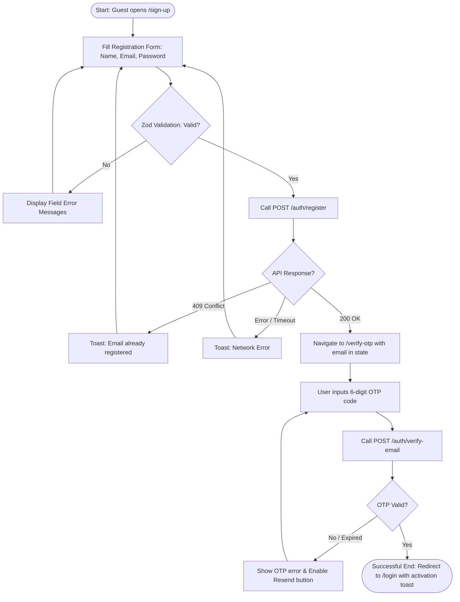

---

### FN02 — Đăng nhập hệ thống (System Authentication & Token Refresh)

**A. Purpose**
Authenticates registered members and administrators via email/password credentials or Google OAuth, obtains JWT access and refresh tokens, restores session profile, and redirects to protected features.

**B. Actor / User Role**
`Guest (authenticating into Member or Admin)`

**C. Preconditions**
- Account is registered and email OTP verified.
- Account is not banned or suspended.

**D. Start Point**

| Attribute | Description |
|---|---|
| Start Route | `/login` |
| Start Page | Login Page (`Login.jsx`) |
| Trigger | User clicks 'Log In' in Header, arrives from redirect guard, or clicks 'Sign in with Google'. |
| Initial State | Guest user (unauthenticated). |
| Input | Username/Email (`username`), Password (`password`), Remember Me (`rememberMe` boolean). |

**E. Main Functional Flow**

| Step | User Action | Frontend Behavior | Validation / API | System Response |
|---|---|---|---|---|
| 1 | User accesses `/login` | FE renders Login card with dual local credentials and Google OAuth button | Route guard check via `GuestRoute` | Login interface displayed |
| 2 | User enters credentials and clicks 'Log In' | FE sets `isSubmitting = true` and submits form | Validates non-empty username/password | Button displays loading spinner |
| 3 | FE calls `authService.login({ username, password })` | Axios sends `POST /auth/login` | Backend validates password hash and lockout counter | Backend returns `{ accessToken, refreshToken }` |
| 4 | FE receives tokens | Stores tokens in `localStorage` (if rememberMe) or `sessionStorage` via `storeAuthTokens()` | Token format verification | Tokens securely persisted |
| 5 | FE fetches user profile | Calls `authService.getProfile()` (`GET /users/me`) | Parses role claim from JWT `http://schemas.microsoft.com/ws/2008/06/identity/claims/role` | Sets `user` and `isAuthenticated = true` in `AuthContext` |
| 6 | FE navigates to destination | Reads `location.state?.from?.pathname` or defaults to `/home` | Role evaluation (Admin vs Member) | Redirects to destination route |

**F. Conditional and Alternative Flows**
- **Successful Local Login**: Credentials valid -> tokens stored -> profile restored -> navigates to `/home` or original requested URL.
- **Google OAuth Login**: User clicks 'Sign in with Google' -> Google popup -> Google returns `idToken` -> FE calls `authService.googleLogin({ idToken })` (`POST /auth/google`) -> sets session -> navigates to `/home`.
- **Invalid Credentials (401)**: Backend returns `401 Unauthorized`. FE displays toast: 'Invalid username or password.'
- **Account Locked (5 Failed Attempts)**: Backend locks account for 15 minutes. FE displays: 'Account locked due to multiple failed login attempts. Please try again after 15 minutes.'
- **Account Banned / Suspended (403)**: Backend returns `403 Forbidden` with `banReason`. FE triggers `setBanInfo` and opens suspension modal or navigates to `/account-suspended`.
- **Unverified Account (403)**: Backend indicates unverified email. FE redirects user to `/verify-otp` with email prepopulated.
- **Silent Token Refresh (Automatic Background)**: When an authenticated API request receives 401, Axios response interceptor intercepts error, freezes pending requests in `failedQueue`, calls `POST /auth/refresh`, updates `accessToken`, and retries failed calls transparently.

**G. End Point**

| Attribute | Description |
|---|---|
| Successful End Route | `/home (or requested protected route from `state.from`)` |
| Successful End State | Authenticated session active; `AuthContext.isAuthenticated = true`; `user` profile populated. |
| Data Result | `accessToken` and `refreshToken` stored in client storage. |
| Next Available Action | Access member features: Home feed (FN08), Weekly menu (FN26), Profile (FN05), etc. |
| Next FN | FN08 — Xem Feed trang chủ |

| Condition | End Point |
|---|---|
| Invalid Credentials | Remains on `/login` with error message. |
| Account Banned | Redirected to `/account-suspended` or banned alert modal. |
| Account Unverified | Redirected to `/verify-otp`. |
| User Cancellation | User closes tab or navigates back to public `/`. |

**H. Related Functions**
- **Preceding**: FN01 (Registration & verification).
- **Succeeding**: FN03 (Logout), FN05 (Profile), FN08 (Home feed), FN38 (Admin console if Admin role).
- **Shared Workflow**: FN04 (Forgot password recovery into login).

**I. FE Implementation Mapping**

| Layer | Actual Implementation |
|---|---|
| Route | `/login` |
| Page | ``src/pages/guest/Login.jsx`` |
| Components | `GoogleLogin` (@react-oauth/google), `AuthSessionStatus.jsx` |
| Services | `authService.login`, `authService.googleLogin`, `authService.getProfile` |
| State | `AuthContext` (`user`, `isAuthenticated`, `isLoading`), `authStorage.js` |
| Guards | `GuestRoute` |
| Related files | `src/pages/guest/Login.jsx`, `src/context/AuthContext.jsx`, `src/lib/axios.js`, `src/utils/authStorage.js` |

**J. Implementation Status**
- **Classification**: Implemented and verified in FE
- **Technical Evidence**: Production-tested login flow, Google OAuth button, 401 token refresh queue in `src/lib/axios.js`, role decoder with Base64URL padding fix in `AuthContext.jsx`.

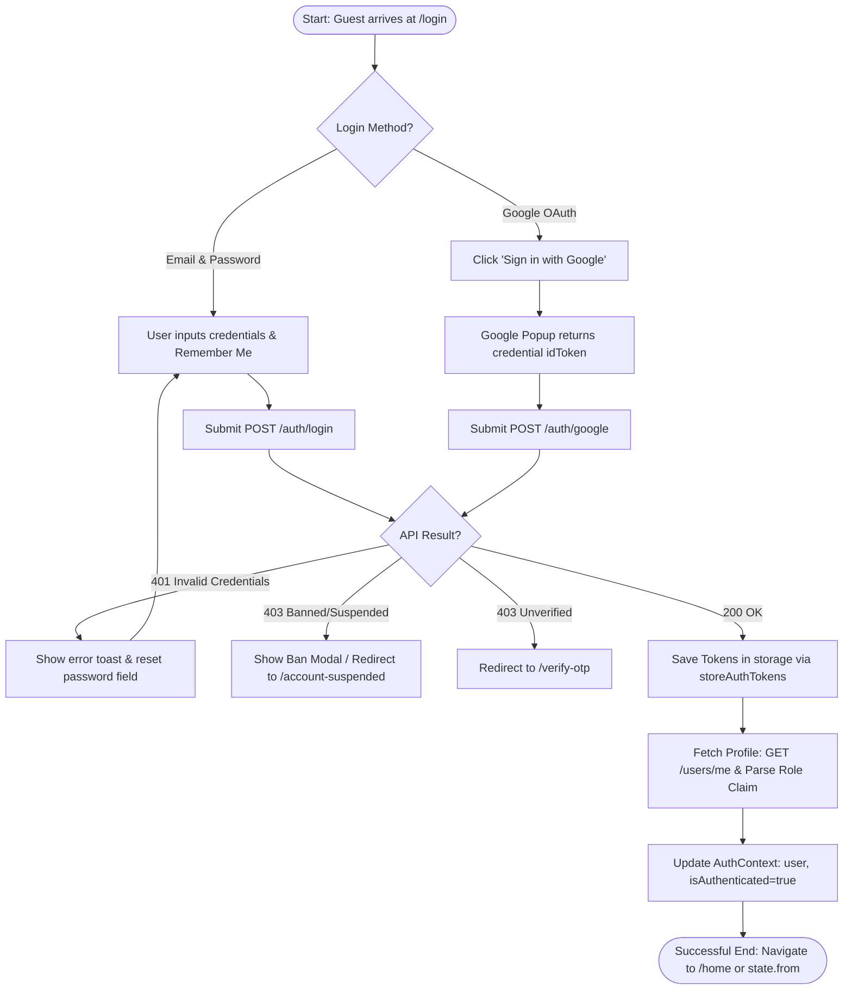

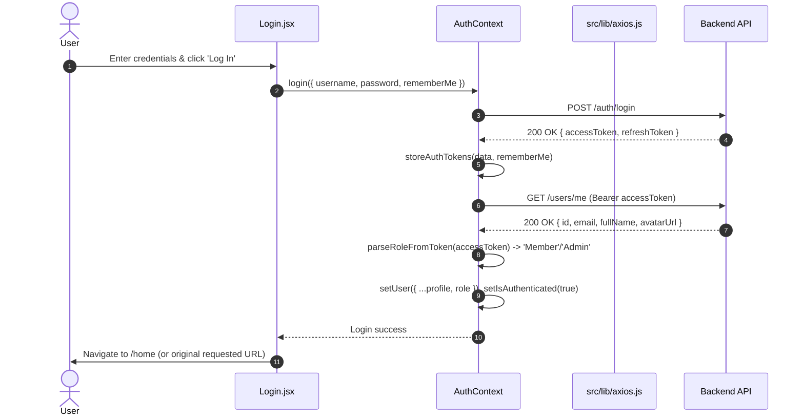

---

### FN03 — Đăng xuất (Logout & Client Session Revocation)

**A. Purpose**
Terminates the authenticated session, disables web push notifications, revokes refresh token on backend, purges client-side credentials, and returns user to the public landing page.

**B. Actor / User Role**
`Member, Administrator`

**C. Preconditions**
- User is currently authenticated (`isAuthenticated = true`).

**D. Start Point**

| Attribute | Description |
|---|---|
| Start Route | `Any authenticated route (`/home`, `/profile`, `/admin`, etc.)` |
| Start Page | Top Navigation Header (`HeaderMember.jsx`) or Admin Shell (`AdminLayout.jsx`) |
| Trigger | User opens profile dropdown menu and clicks 'Log Out'. |
| Initial State | Authenticated session active. |
| Input | None. |

**E. Main Functional Flow**

| Step | User Action | Frontend Behavior | Validation / API | System Response |
|---|---|---|---|---|
| 1 | User clicks 'Log Out' | FE initiates `logout()` workflow in `AuthContext` | Confirm session active | Triggers logout handler |
| 2 | Disable Browser Push | FE calls `disableBrowserPush()` to unsubscribe Service Worker | Service Worker push subscription cleanup | Push token unlinked |
| 3 | Call Logout API | FE calls `authService.logout()` sending `POST /auth/logout` with `refreshToken` | Token revocation on backend | Server invalidates refresh token |
| 4 | Clear Client Storage | FE executes `clearAuthTokens()` removing `accessToken` and `refreshToken` from `localStorage` and `sessionStorage` | Storage purge | Client credentials cleared |
| 5 | Reset Global State | FE sets `user = null`, `isAuthenticated = false` in `AuthContext` | State reset | React context updated |
| 6 | Redirect to Public Landing | FE redirects browser to `/` (`HomeGuest`) | Route change | Guest landing page displayed |

**F. Conditional and Alternative Flows**
- **Successful Logout**: Full revocation completed -> storage cleared -> redirected to `/`.
- **Backend Logout API Fails / Offline**: Network error caught in `catch` block. Client-side tokens are ALWAYS purged in `finally` block to guarantee user privacy even if server is unreachable.
- **Web Push Cleanup Failure**: Ignored with warning log to ensure logout is never blocked by push service worker failures.

**G. End Point**

| Attribute | Description |
|---|---|
| Successful End Route | `/` |
| Successful End State | Unauthenticated guest state; local session storage empty; user context `null`. |
| Data Result | Tokens removed from browser storage; backend refresh token revoked. |
| Next Available Action | Browse public recipes or log in with another account. |
| Next FN | FN08 — Xem Feed trang chủ (Guest Mode) |

| Condition | End Point |
|---|---|
| API Error / Offline | Redirects to `/` with local tokens cleared unconditionally. |

**H. Related Functions**
- **Preceding**: FN02 (Login).
- **Succeeding**: FN01 (Register), FN02 (Login).
- **Shared Workflow**: FN07 (Route guards enforce guest boundary once logged out).

**I. FE Implementation Mapping**

| Layer | Actual Implementation |
|---|---|
| Route | `Any route -> `/`` |
| Page | ``src/components/layout/HeaderMember.jsx`, `src/components/admin/AdminLayout.jsx`` |
| Components | `NotificationBell.jsx`, `BrowserPushControl.jsx` |
| Services | `authService.logout`, `browserPushService.disableBrowserPush` |
| State | `AuthContext` (`logout()`), `clearAuthTokens()` in `authStorage.js` |
| Guards | `ProtectedRoute` |
| Related files | `src/context/AuthContext.jsx`, `src/services/authService.js`, `src/utils/authStorage.js` |

**J. Implementation Status**
- **Classification**: Implemented and verified in FE
- **Technical Evidence**: Verified `authService.logout()` implementation, `disableBrowserPush()` cleanup, `clearAuthTokens()` invocation, and test suites.

```mermaid
flowchart TD
    A([Start: User clicks 'Log Out' in profile dropdown]) --> B[Invoke AuthContext.logout()]
    B --> C[Call disableBrowserPush to unsubscribe web push]
    C --> D[Send POST /auth/logout with refreshToken]
    D --> E[Execute clearAuthTokens: Purge localStorage & sessionStorage]
    E --> F[Reset AuthContext: user=null, isAuthenticated=false]
    F --> G([Successful End: Redirect browser to / - HomeGuest])
```

---

### FN04 — Quên / Đặt lại mật khẩu (Forgot & Reset Password via OTP)

**A. Purpose**
Enables users who forgot their password to request a one-time reset code sent to their registered email and submit a new secure password.

**B. Actor / User Role**
`Guest`

**C. Preconditions**
- User has a registered account associated with the email address.

**D. Start Point**

| Attribute | Description |
|---|---|
| Start Route | `/forgot-password` |
| Start Page | Forgot & Reset Password Page (`ForgotPasswordResetPassword.jsx`) |
| Trigger | User clicks 'Forgot password?' link on `/login` page. |
| Initial State | Guest user (unauthenticated). |
| Input | Step 1: Email (`email`). Step 2: 6-digit OTP code (`otp`), New Password (`newPassword`), Confirm Password (`confirmPassword`). |

**E. Main Functional Flow**

| Step | User Action | Frontend Behavior | Validation / API | System Response |
|---|---|---|---|---|
| 1 | User navigates to `/forgot-password` | FE renders Step 1 (Request OTP) form | Form mount | Email input card displayed |
| 2 | User enters email and clicks 'Send Reset Code' | FE validates email format and sets loading state | RFC email regex validation; calls `authService.forgotPassword({ email })` (`POST /auth/forgot-password`) | Loading indicator on submit button |
| 3 | API returns 200 OK | FE displays success toast and transitions to Step 2 (Reset Password) | Step state transitions to `step = 2` | Step 2 form displayed: OTP, New Password, Confirm Password |
| 4 | User inputs OTP and new password | FE validates inputs in real-time | Checks OTP == 6 digits; password >= 8 characters; passwords match | Validation feedback indicated |
| 5 | User clicks 'Reset Password' | FE calls `authService.resetPassword({ email, otp, newPassword })` (`POST /auth/reset-password`) | Payload verification | Submit button shows loading spinner |
| 6 | API confirms password update | FE displays success message and initiates redirect countdown | Success toast shown | Navigates to `/login` |

**F. Conditional and Alternative Flows**
- **Successful Password Reset**: OTP requested -> email delivered -> OTP and new password submitted -> redirected to `/login`.
- **Email Not Found (404)**: Backend returns `404 Not Found`. FE displays: 'No account found with this email address.'
- **Invalid or Expired OTP (400)**: Backend returns `400 Bad Request`. FE displays: 'Invalid or expired reset code. Please request a new code.' and keeps user on Step 2.
- **Weak New Password**: FE validation prevents submission if password < 8 characters or fails complexity rules.
- **Resend Reset Code**: User clicks 'Resend Code' on Step 2. FE calls `authService.forgotPassword({ email })` again and restarts cooldown timer.

**G. End Point**

| Attribute | Description |
|---|---|
| Successful End Route | `/login` |
| Successful End State | Password successfully reset on backend; user arrives at `/login` ready to authenticate. |
| Data Result | User's password hash updated in backend database. |
| Next Available Action | Log in with new password (FN02). |
| Next FN | FN02 — Đăng nhập hệ thống |

| Condition | End Point |
|---|---|
| Email Not Found | Remains on Step 1 with error toast. |
| Invalid OTP | Remains on Step 2 with error toast allowing code re-entry. |
| User Cancellation | User clicks 'Back to Login' -> navigates to `/login`. |

**H. Related Functions**
- **Preceding**: FN01 (Registration).
- **Succeeding**: FN02 (Login with new credentials).

**I. FE Implementation Mapping**

| Layer | Actual Implementation |
|---|---|
| Route | `/forgot-password` |
| Page | ``src/pages/guest/ForgotPasswordResetPassword.jsx`` |
| Components | `AuthSessionStatus.jsx` |
| Services | `authService.forgotPassword`, `authService.resetPassword` |
| State | Local state (`step`, `email`, `otp`, `newPassword`, `isSubmitting`) |
| Guards | `GuestRoute` |
| Related files | `src/pages/guest/ForgotPasswordResetPassword.jsx`, `src/services/authService.js` |

**J. Implementation Status**
- **Classification**: Implemented and verified in FE
- **Technical Evidence**: Fully implemented two-step flow with OTP entry, cooldown timers, password strength checks, and toast notifications.

```mermaid
flowchart TD
    A([Start: User clicks 'Forgot password?' on /login]) --> B[Step 1: Enter Email]
    B --> C[Submit POST /auth/forgot-password]
    C --> D{Email Exists?}
    D -->|No (404)| E[Toast: Email not found] --> B
    D -->|Yes (200)| F[Transition to Step 2: Form displays OTP & New Password]
    F --> G[User inputs 6-digit OTP & new password]
    G --> H{Passwords Match & >= 8 chars?}
    H -->|No| I[Display validation error] --> G
    H -->|Yes| J[Submit POST /auth/reset-password]
    J --> K{OTP Valid & Unexpired?}
    K -->|No| L[Toast: Invalid OTP & Allow Resend] --> G
    K -->|Yes| M([Successful End: Toast 'Password reset successfully!' & Redirect to /login])
```

---

### FN05 — Xem hồ sơ cá nhân (View Personal Profile & Account Info)

**A. Purpose**
Displays the authenticated member's personal profile details including full name, username, email, phone number, bio, avatar, role, account status, and Google link status, while concealing sensitive password hashes and tokens.

**B. Actor / User Role**
`Member, Administrator`

**C. Preconditions**
- User is authenticated (`isAuthenticated = true`).

**D. Start Point**

| Attribute | Description |
|---|---|
| Start Route | `/profile` |
| Start Page | Personal Profile Page (`Profile.jsx`) |
| Trigger | User clicks user avatar/name in Header dropdown and selects 'Profile Settings'. |
| Initial State | Authenticated session. |
| Input | None (uses current session context). |

**E. Main Functional Flow**

| Step | User Action | Frontend Behavior | Validation / API | System Response |
|---|---|---|---|---|
| 1 | User navigates to `/profile` | FE mounts `Profile.jsx` wrapped in `ProtectedRoute` | Verifies authentication token | Profile layout renders |
| 2 | Component loads profile data | FE reads cached `user` from `AuthContext` and calls `authService.getProfile()` (`GET /users/me`) | Axios injects `Authorization: Bearer <token>` | Loading skeleton displayed if fetching |
| 3 | API returns profile object | FE updates user state and populates display fields | Data structure validation | Profile card renders with avatar, name, email, phone, bio |
| 4 | Display Google account status | Checks `isGoogleLinked` boolean | Determines link badge | Shows 'Google Account Linked' badge or 'Link Google' CTA |

**F. Conditional and Alternative Flows**
- **Successful Load**: Profile data renders cleanly with all personal attributes.
- **Session Expired (401)**: Handled by Axios interceptor. If refresh fails, user is redirected to `/login`.
- **Server Error (500)**: Displays error banner: 'Unable to load profile data' with a 'Retry' button.

**G. End Point**

| Attribute | Description |
|---|---|
| Successful End Route | `/profile` |
| Successful End State | Profile details displayed; edit mode available; navigation links to security and meal plans active. |
| Data Result | Profile data retrieved and synchronized in `AuthContext`. |
| Next Available Action | Edit profile details (FN06), manage password/security (Security page), or navigate to recipes. |
| Next FN | FN06 — Chỉnh sửa hồ sơ cá nhân |

| Condition | End Point |
|---|---|
| Session Expired | Redirected to `/login` with `from: /profile`. |
| Network Failure | Error banner displayed on `/profile` with retry CTA. |

**H. Related Functions**
- **Preceding**: FN02 (Login).
- **Succeeding**: FN06 (Edit profile), FN03 (Logout).
- **Shared Workflow**: FN21 (Public user profile displays public subset of this data).

**I. FE Implementation Mapping**

| Layer | Actual Implementation |
|---|---|
| Route | `/profile` |
| Page | ``src/pages/member/Profile.jsx`` |
| Components | `HeaderMember.jsx`, `ImageGallery.jsx` |
| Services | `authService.getProfile`, `userService.getProfile` |
| State | `AuthContext.user` |
| Guards | `ProtectedRoute` |
| Related files | `src/pages/member/Profile.jsx`, `src/services/authService.js` |

**J. Implementation Status**
- **Classification**: Implemented and verified in FE
- **Technical Evidence**: Verified profile view in `Profile.jsx`, avatar display via `getImageUrl`, Google linking badge, and integration with `AuthContext`.

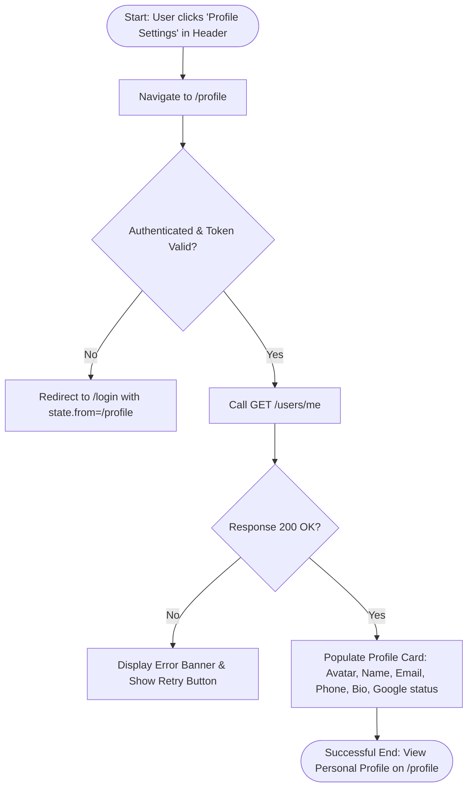

---

### FN06 — Chỉnh sửa hồ sơ cá nhân (Edit Personal Profile & Avatar Upload)

**A. Purpose**
Allows authenticated members to update their display name, Vietnamese phone number, biographical text, and upload a new profile avatar image (<= 5MB).

**B. Actor / User Role**
`Member, Administrator`

**C. Preconditions**
- User is authenticated.
- User is the owner of the profile.

**D. Start Point**

| Attribute | Description |
|---|---|
| Start Route | `/profile` |
| Start Page | Personal Profile Page (`Profile.jsx`) |
| Trigger | User clicks 'Edit Profile' or clicks on the avatar upload icon. |
| Initial State | Viewing profile details. |
| Input | Full Name (`fullName`), Phone (`phoneNumber`), Bio (`bio`), Avatar file (`avatar` image). |

**E. Main Functional Flow**

| Step | User Action | Frontend Behavior | Validation / API | System Response |
|---|---|---|---|---|
| 1 | User triggers edit mode on `/profile` | FE toggles edit form fields into editable inputs | Initial values pre-filled | Editable form rendered |
| 2 | User edits text fields | FE captures changes in local state | Validates Vietnamese phone format: 10 digits starting with 03, 05, 07, 08, 09. Full name non-empty. | Live validation feedback |
| 3 | User selects new Avatar file | FE checks file type and size | File type must be JPEG, PNG, or WebP; file size must be <= 5MB | Generates instant local preview via `URL.createObjectURL` |
| 4 | User clicks 'Save Changes' | FE bundles data into `FormData` and sets submitting state | Validates all constraints before sending | Button displays loading spinner |
| 5 | FE calls `authService.updateProfile(formData)` | Axios sends `PUT /users/me` with multipart headers | Backend processes image upload and updates database | Backend returns updated user object |
| 6 | FE receives updated user data | Updates `user` in `AuthContext` and displays success toast | Synchronizes global state | Switches back to view mode showing updated info |

**F. Conditional and Alternative Flows**
- **Successful Update**: Data and avatar saved -> global `user` state refreshed -> success toast displayed.
- **Avatar Size Exceeded (> 5MB)**: FE rejects file before upload: 'Avatar image must not exceed 5MB.' File input cleared.
- **Invalid Phone Number**: Inline error shown: 'Please enter a valid 10-digit Vietnamese phone number (e.g. 0912345678).'
- **User Cancels Edit**: User clicks 'Cancel'. Form reverts to previous profile values without saving.
- **API Error**: Toast error displayed: 'Failed to update profile. Please try again.' Form remains in edit mode.

**G. End Point**

| Attribute | Description |
|---|---|
| Successful End Route | `/profile` |
| Successful End State | Updated profile information displayed; `AuthContext.user` synchronized across all header and comment components. |
| Data Result | User profile record and avatar URL updated in database. |
| Next Available Action | Continue browsing or manage account security. |
| Next FN | FN05 — Xem hồ sơ cá nhân |

| Condition | End Point |
|---|---|
| Validation Error | Remains in edit mode on `/profile` with validation warnings. |
| Cancellation | Returns to `/profile` view mode with original data. |
| API Failure | Remains in edit mode with error toast. |

**H. Related Functions**
- **Preceding**: FN05 (View profile).
- **Succeeding**: FN05 (View updated profile), FN21 (Public profile reflects new name/avatar).

**I. FE Implementation Mapping**

| Layer | Actual Implementation |
|---|---|
| Route | `/profile` |
| Page | ``src/pages/member/Profile.jsx`` |
| Components | `AvatarUpload.jsx`, `ModalMotion.jsx` |
| Services | `authService.updateProfile`, `userService.updateProfile` |
| State | Local form state, `AuthContext.setUser` |
| Guards | `ProtectedRoute` |
| Related files | `src/pages/member/Profile.jsx`, `src/services/authService.js` |

**J. Implementation Status**
- **Classification**: Implemented and verified in FE
- **Technical Evidence**: Implemented in `Profile.jsx` with Vietnamese phone validation, 5MB file check, instant object-URL preview, and multipart `PUT /users/me` submission.

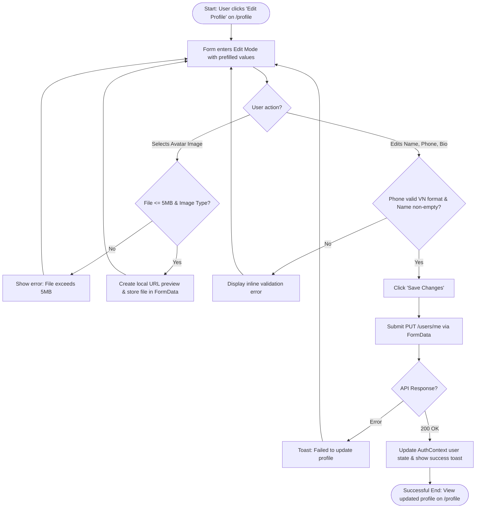

---

### FN07 — Khóa tính năng khi chưa đăng nhập (Route Guards & Guest Locked Boundaries)

**A. Purpose**
Protects private routes and interactive member features from unauthorized guest access, remembers original destination in route state, displays rich guest preview boundaries, and prompts login via modals without breaking navigation flow.

**B. Actor / User Role**
`Guest (unauthenticated user encountering protected features)`

**C. Preconditions**
- User has not established an authenticated session (`isAuthenticated = false`).

**D. Start Point**

| Attribute | Description |
|---|---|
| Start Route | `Any protected route (`/weekly-menu`, `/vegan-stores`, `/my-posts`, `/posts/create`, `/profile`, `/admin`) or in-page interactive action (Like, Save, Comment, Follow)` |
| Start Page | Application wide (`ProtectedRoute.jsx`, `WeeklyMenuGuestLocked.jsx`, `FindVeganStoresGuestLocked.jsx`, `LandingAuthDialog.jsx`) |
| Trigger | Direct URL navigation to protected page or clicking an interactive member action while logged out. |
| Initial State | Guest user (unauthenticated). |
| Input | Target destination route or target interactive entity (post ID, author ID). |

**E. Main Functional Flow**

| Step | User Action | Frontend Behavior | Validation / API | System Response |
|---|---|---|---|---|
| 1 | Guest accesses a protected route or clicks member action | FE intercepts action via `ProtectedRoute` or in-component `onAuthRequired` handler | Checks `isAuthenticated` in `AuthContext` | Determines interception type |
| 2 | Route Interception (Full Page) | If user directly accessed protected route, `ProtectedRoute` catches unauthenticated state | Saves target URL: `state: { from: location }` | Redirects to `/login` with stored state |
| 3 | Feature Boundary Pages (Locked Previews) | For primary feature entry points (`/weekly-menu/locked`, `/vegan-stores/locked`, `/my-posts/locked`), FE renders tailored locked showcase | Checks route permission | Renders feature preview with 'Sign In to Unlock' CTA |
| 4 | In-Page Action Interception (Modals) | Guest clicks Like, Save, Comment, or Follow on recipe card | FE opens `LandingAuthDialog` modal with focus trap | Modal displayed over current page without losing scroll position |
| 5 | Guest logs in or registers | Guest completes authentication in modal or `/login` | Auth state updates to `true` | User returns to previous context with action ready to execute |

**F. Conditional and Alternative Flows**
- **Route Redirect Path**: Guest visits `/weekly-menu` -> `ProtectedRoute` redirects to `/login` with `state: { from: '/weekly-menu' }` -> after login, automatically returns to `/weekly-menu`.
- **Locked Showcase Preview Path**: Guest clicks 'Weekly Menu' in guest header -> views `/weekly-menu/locked` showing meal planning benefits -> clicks 'Get Started' -> navigates to `/sign-up`.
- **Modal Dialog Path**: Guest clicks Heart (Like) on recipe card -> `LandingAuthDialog` opens -> guest logs in -> modal closes -> post is liked.
- **Admin Route Guard**: Non-admin member attempts accessing `/admin/*` -> `ProtectedRoute` detects `requireAdmin=true` but `user.role !== 'Admin'` -> immediately redirects to `/home`.

**G. End Point**

| Attribute | Description |
|---|---|
| Successful End Route | `/login (or `LandingAuthDialog` modal open on current page)` |
| Successful End State | Target destination captured in `location.state.from`; unauthorized access prevented. |
| Data Result | Redirect state preserved in React Router history. |
| Next Available Action | Log in or sign up to proceed to requested feature. |
| Next FN | FN02 — Đăng nhập hệ thống |

| Condition | End Point |
|---|---|
| Dismiss Dialog | User closes `LandingAuthDialog` -> remains on current public page in view mode. |
| Admin Guard Denial | Member redirected from `/admin` to `/home`. |

**H. Related Functions**
- **Preceding**: None (Initiated by guest).
- **Succeeding**: FN02 (Login restores target route), FN01 (Sign up).

**I. FE Implementation Mapping**

| Layer | Actual Implementation |
|---|---|
| Route | ``/login`, `/weekly-menu/locked`, `/vegan-stores/locked`, `/my-posts/locked`` |
| Page | `src/components/layout/ProtectedRoute.jsx`, `src/pages/guest/WeeklyMenuGuestLocked.jsx`, `src/pages/guest/FindVeganStoresGuestLocked.jsx`, `src/pages/guest/MyPostsGuestLocked.jsx` |
| Components | `LandingAuthDialog.jsx`, `AuthSessionStatus.jsx` |
| Services | Client-side routing and context inspection |
| State | `AuthContext.isAuthenticated`, React Router `location.state` |
| Guards | `ProtectedRoute`, `GuestRoute` |
| Related files | `src/components/layout/ProtectedRoute.jsx`, `src/components/landing/LandingAuthDialog.jsx`, `src/App.jsx` |

**J. Implementation Status**
- **Classification**: Implemented and verified in FE
- **Technical Evidence**: Verified `ProtectedRoute.jsx`, locked showcase pages (`WeeklyMenuGuestLocked.jsx`, `FindVeganStoresGuestLocked.jsx`), and `LandingAuthDialog.jsx` modal focus trapping in responsive tests.

```mermaid
flowchart TD
    A([Start: Guest attempts protected action or URL]) --> B{Interception Type?}
    B -->|Direct Protected URL| C[ProtectedRoute checks AuthContext.isAuthenticated]
    C --> D{Is Authenticated?}
    D -->|No| E[Redirect to /login with state: { from: location }]
    D -->|Yes, but Admin required| F{user.role == 'Admin'?}
    F -->|No| G[Redirect to /home (Access Denied)]
    F -->|Yes| H([Allow Access to Admin Route])
    B -->|Guest Header Click| I[Navigate to Feature Locked Page: /weekly-menu/locked]
    I --> J[Render Showcase Preview with 'Sign In to Unlock' CTA]
    B -->|In-Page Interactive Click: Like/Save/Comment| K[Trigger onAuthRequired]
    K --> L[Open LandingAuthDialog modal with focus trap]
    L --> M{User Logs In?}
    M -->|Yes| N([Authenticated: Return to target and execute action])
    M -->|Cancel / Esc| O([Close Modal: Remain on page in read-only mode])
```

---

### FN08 — Xem Feed trang chủ (Home Community Feed & Discovery)

**A. Purpose**
Displays approved community recipes and culinary blogs in a high-engagement feed with tabbed sorting (Trending, Latest, Following), category quick-filters, and paginated infinite scrolling.

**B. Actor / User Role**
`Member (`/home`), Guest (`/` read-only preview)`

**C. Preconditions**
- User accesses Home page (authenticated for `/home`, unauthenticated for `/`).

**D. Start Point**

| Attribute | Description |
|---|---|
| Start Route | `/home (Member) or / (Guest)` |
| Start Page | Member Home (`Home.jsx`) or Guest Landing (`HomeGuest.jsx`) |
| Trigger | Navigating to home route or clicking platform logo in Header. |
| Initial State | Viewing main dashboard. |
| Input | Active tab ('trending', 'latest', 'following'), Category filter ID (optional). |

**E. Main Functional Flow**

| Step | User Action | Frontend Behavior | Validation / API | System Response |
|---|---|---|---|---|
| 1 | User lands on `/home` | FE mounts `Home.jsx` and renders hero banner and category filter row | Session state check | Hero and feed container rendered |
| 2 | Feed component mounts | FE executes `getPostsFeed({ pageIndex: 1, pageSize: 10, sortBy: activeTab })` | Axios sends `GET /Posts` with query parameters | Loading skeleton cards displayed |
| 3 | API returns approved posts | FE renders recipe cards showing cover photo, title, author avatar, prep time, difficulty, like & comment counts | Status check (`status === 'approved'`) | Feed grid populated with 10 cards |
| 4 | User switches tab (e.g. 'Latest') | FE updates `activeTab`, resets page cursor, and queries `GET /Posts?SortBy=latest` | Tab transition animation | Displays latest recipes chronologically |
| 5 | User scrolls to bottom | FE triggers pagination 'Load More' or infinite scroll | Appends next 10 items without duplicate IDs | Feed seamlessly extends |

**F. Conditional and Alternative Flows**
- **Following Tab (Guest)**: Guest clicks 'Following' tab -> intercepted by `LandingAuthDialog` prompting login.
- **Following Tab (Member Follows Nobody)**: Displays clean empty state: 'You are not following any authors yet. Explore trending recipes and follow your favorite creators!'
- **Empty Feed**: Displays empty state card: 'No recipes found for this selection.' with button to reset filters.
- **API Error**: Displays error state with 'Try Again' button to re-fetch feed.

**G. End Point**

| Attribute | Description |
|---|---|
| Successful End Route | `/home` |
| Successful End State | Feed loaded with interactive recipe cards; user can filter, like, save, or click to view details. |
| Data Result | Feed posts cached in component state. |
| Next Available Action | Click recipe card to view full detail (FN12) or apply category filter (FN11). |
| Next FN | FN12 — Xem chi tiết bài viết/video |

| Condition | End Point |
|---|---|
| Guest Interception | Auth modal opens on click of protected feed actions. |
| Network Failure | Error state displayed with retry trigger. |

**H. Related Functions**
- **Preceding**: FN02 (Login).
- **Succeeding**: FN11 (Category filter), FN12 (Post detail), FN18 (Like), FN19 (Save).

**I. FE Implementation Mapping**

| Layer | Actual Implementation |
|---|---|
| Route | `/home, /` |
| Page | ``src/pages/member/Home.jsx`, `src/pages/guest/HomeGuest.jsx`` |
| Components | `CategoryFilterRow.jsx`, `HomeFeedTabs.test.jsx`, `PostCard.jsx` |
| Services | `postService.getPostsFeed` |
| State | `activeTab`, `posts`, `pageIndex`, `hasMore`, `loading` |
| Guards | `ProtectedRoute` (for `/home`) |
| Related files | `src/pages/member/Home.jsx`, `src/services/postService.js` |

**J. Implementation Status**
- **Classification**: Implemented and verified in FE
- **Technical Evidence**: Verified feed loading across Trending, Latest, and Following tabs with comprehensive test suite `src/pages/member/HomeFeedTabs.test.jsx` (5/5 passed).

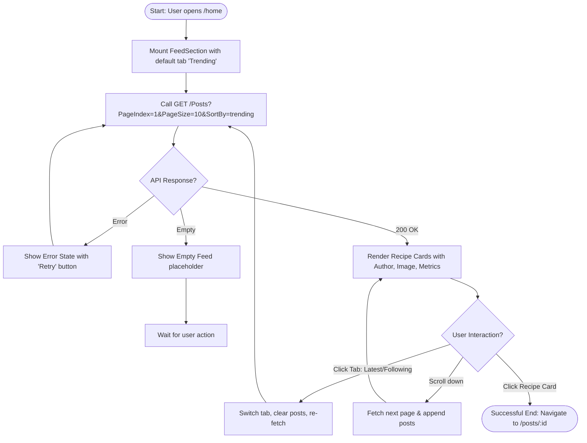

---

### FN09 — Tìm kiếm bài viết/video theo từ khóa (Search Posts / Recipes by Keyword)

**A. Purpose**
Provides full-text search capability for recipes and culinary videos by matching keywords against recipe titles, descriptions, and ingredients, complete with pagination and sorting.

**B. Actor / User Role**
`Member (`/search`), Guest (`/search-guest`)`

**C. Preconditions**
- Search keyword contains at least 2 characters.

**D. Start Point**

| Attribute | Description |
|---|---|
| Start Route | `/search (Member) or /search-guest (Guest)` |
| Start Page | Search Results Page (`SearchResults.jsx` / `SearchResultsGuest.jsx`) |
| Trigger | User submits text in Header search input or Home hero search bar. |
| Initial State | Search view active. |
| Input | Search query (`q` string >= 2 chars), Page index, Sort order. |

**E. Main Functional Flow**

| Step | User Action | Frontend Behavior | Validation / API | System Response |
|---|---|---|---|---|
| 1 | User enters keyword in search input | FE captures text input and validates length | Checks `keyword.trim().length >= 2` | Shows clear button; triggers on Enter or button click |
| 2 | User submits search | FE updates URL query params (`/search?q=tofu`) and sets loading state | Encodes URI query string | Loading skeleton cards render |
| 3 | FE calls `postService.searchPosts({ query, pageIndex: 1, pageSize: 10 })` | Axios sends `GET /Posts/search?q=...` | Backend performs full-text query | Backend returns matching posts list with total count |
| 4 | FE displays search results | Renders matching recipe cards with highlighted matching terms and metadata | Result count check | Displays: 'Found X recipes for "keyword"' |
| 5 | User clicks pagination | FE requests page 2, scrolls back to top smoothly | Server-side pagination | Page 2 results loaded |

**F. Conditional and Alternative Flows**
- **Keyword < 2 Characters**: FE displays warning: 'Please enter at least 2 characters to search.' Search is not submitted.
- **No Results Found**: FE displays friendly empty state: 'No recipes matched your search. Try different keywords or browse our categories.'
- **Switch to People Tab**: User clicks 'People' tab on search page -> transitions to user search (FN10) keeping query string.

**G. End Point**

| Attribute | Description |
|---|---|
| Successful End Route | `/search?q={query}` |
| Successful End State | Search results displayed in grid with active pagination controls. |
| Data Result | Search results cached in component state. |
| Next Available Action | Click recipe card to view detail (FN12) or refine search filters. |
| Next FN | FN12 — Xem chi tiết bài viết/video |

| Condition | End Point |
|---|---|
| Empty Results | Remains on `/search` with empty search placeholder. |
| Short Query | Input field highlighted with validation cue. |

**H. Related Functions**
- **Preceding**: FN08 (Home page search bar).
- **Succeeding**: FN12 (View post detail), FN10 (Search people tab).

**I. FE Implementation Mapping**

| Layer | Actual Implementation |
|---|---|
| Route | `/search, /search-guest` |
| Page | ``src/pages/member/SearchResults.jsx`, `src/pages/guest/SearchResultsGuest.jsx`` |
| Components | `SearchBar.jsx`, `Pagination.jsx` |
| Services | `postService.searchPosts` |
| State | `query`, `results`, `totalCount`, `pageIndex`, `isSearching` |
| Guards | `ProtectedRoute` (for `/search`) |
| Related files | `src/pages/member/SearchResults.jsx`, `src/services/postService.js` |

**J. Implementation Status**
- **Classification**: Implemented and verified in FE
- **Technical Evidence**: Implemented in `SearchResults.jsx` and `SearchResultsGuest.jsx` with server-side pagination, keyword normalization, and tab switching.

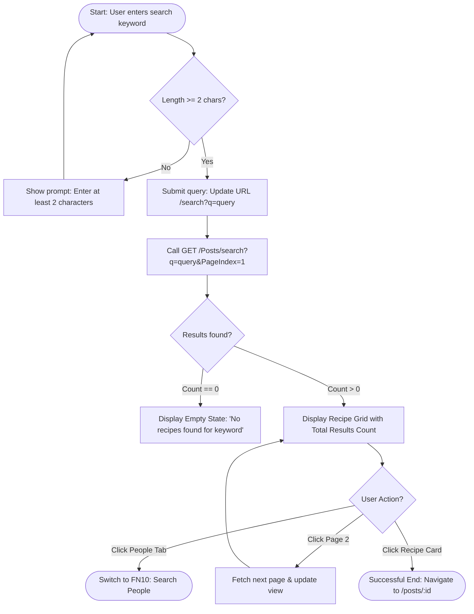

---

### FN10 — Tìm kiếm trang cá nhân người dùng (Search Users & Author Discovery)

**A. Purpose**
Allows users to discover authors, plant-based chefs, and fellow community members by searching for usernames or display names.

**B. Actor / User Role**
`Member, Guest`

**C. Preconditions**
- Search query contains at least 1 character.

**D. Start Point**

| Attribute | Description |
|---|---|
| Start Route | `/search` |
| Start Page | Search Results Page (`SearchResults.jsx`) |
| Trigger | User clicks the 'People' tab on the search page. |
| Initial State | Viewing search page with 'People' tab active. |
| Input | Search keyword (`keyword`). |

**E. Main Functional Flow**

| Step | User Action | Frontend Behavior | Validation / API | System Response |
|---|---|---|---|---|
| 1 | User selects 'People' tab on `/search` | FE toggles active tab to `people` | Tab state change | People search interface renders |
| 2 | User enters author name/username | FE captures keyword and initiates search | Validates input non-empty | Loading skeletons render |
| 3 | FE calls `userService.searchUsers({ keyword, pageIndex: 1, pageSize: 10 })` | Axios sends `GET /users/search?keyword=...` | Backend filters for active user records | Backend returns matching author profiles |
| 4 | FE displays user list | Renders author cards with avatar, display name, username, bio, recipe count, and Follow button | Response mapping | Author search cards displayed |

**F. Conditional and Alternative Flows**
- **No Matching Users**: Displays empty state: 'No authors found matching this name.'
- **Follow / Unfollow Action**: Member clicks 'Follow' on author card -> calls `userService.followUser(userId)` with optimistic follow count increment.

**G. End Point**

| Attribute | Description |
|---|---|
| Successful End Route | `/search?tab=people` |
| Successful End State | Matching author profiles listed; user can follow or click profile. |
| Data Result | Author search results loaded. |
| Next Available Action | Click author profile card to view Public User Profile (FN21). |
| Next FN | FN21 — Xem trang cá nhân tác giả khác |

| Condition | End Point |
|---|---|
| Empty Results | Remains on People tab with empty placeholder. |

**H. Related Functions**
- **Preceding**: FN09 (Search posts).
- **Succeeding**: FN21 (Public user profile).

**I. FE Implementation Mapping**

| Layer | Actual Implementation |
|---|---|
| Route | `/search` |
| Page | ``src/pages/member/SearchResults.jsx`` |
| Components | `UserCard.jsx`, `FollowButton.jsx` |
| Services | `userService.searchUsers`, `userService.followUser` |
| State | `activeTab = 'people'`, `userResults`, `isLoading` |
| Guards | `ProtectedRoute` |
| Related files | `src/pages/member/SearchResults.jsx`, `src/services/userService.js` |

**J. Implementation Status**
- **Classification**: Implemented and verified in FE
- **Technical Evidence**: Verified in `SearchResults.jsx` under People tab, connected to `userService.searchUsers`.

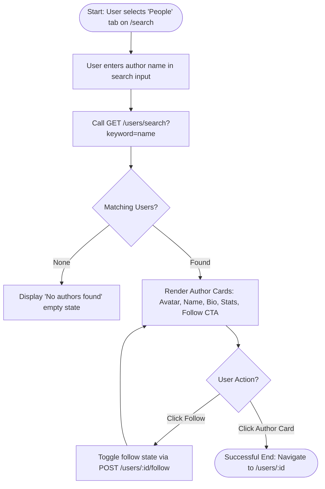

---

### FN11 — Lọc bài viết theo danh mục (Filter Recipes by Category & Difficulty)

**A. Purpose**
Filters feed and search recipes by culinary category (Main Dish, Soup, Salad, Dessert, Beverage), cooking difficulty (Easy, Medium, Hard), and maximum preparation time.

**B. Actor / User Role**
`Member, Guest`

**C. Preconditions**
- Categories loaded from backend or cached.

**D. Start Point**

| Attribute | Description |
|---|---|
| Start Route | `/home or /search` |
| Start Page | Home (`Home.jsx`) or Search (`SearchResults.jsx`) |
| Trigger | User clicks a category pill in `CategoryFilterRow` or selects difficulty/time filter. |
| Initial State | Viewing recipe collection. |
| Input | Category ID (`categoryId`), Difficulty (`difficultyLevel`), Prep time (`prepTimeMax`). |

**E. Main Functional Flow**

| Step | User Action | Frontend Behavior | Validation / API | System Response |
|---|---|---|---|---|
| 1 | User views category chip rail | FE renders category chips horizontally with icons | Category list loaded via `postService.getCategoryList()` | Category chips displayed |
| 2 | User clicks a category (e.g. 'Soup') | FE marks chip active (moss green background), resets feed cursor to page 1 | Active state update | Visual feedback on active pill |
| 3 | FE calls `postService.getPostsFeed({ categoryId: 3, pageIndex: 1 })` | Axios sends `GET /Posts?CategoryId=3` | Backend filters recipes by foreign key | Backend returns filtered recipes list |
| 4 | FE renders filtered feed | Replaces feed items with filtered results | Count evaluation | Displays recipes belonging to selected category |

**F. Conditional and Alternative Flows**
- **Category Empty**: Displays empty category state: 'No recipes in this category yet. Be the first to create one!'
- **Reset Category ('All')**: User clicks 'All' pill -> clears `categoryId` filter -> reloads full community feed.

**G. End Point**

| Attribute | Description |
|---|---|
| Successful End Route | `/home (or `/search`)` |
| Successful End State | Feed filtered according to selected category and difficulty criteria. |
| Data Result | Filtered recipe list cached in state. |
| Next Available Action | Select a recipe to view details (FN12) or pick another category. |
| Next FN | FN12 — Xem chi tiết bài viết/video |

| Condition | End Point |
|---|---|
| Empty Category | Displays empty state card with CTA to create recipe. |

**H. Related Functions**
- **Preceding**: FN08 (Home feed).
- **Succeeding**: FN12 (Post detail), FN13 (Create post in empty category).

**I. FE Implementation Mapping**

| Layer | Actual Implementation |
|---|---|
| Route | `/home, /search` |
| Page | ``src/pages/member/Home.jsx`, `src/pages/member/SearchResults.jsx`` |
| Components | `CategoryFilterRow.jsx`, `CategoryFilterRow.test.jsx` |
| Services | `postService.getCategoryList`, `postService.getPostsFeed` |
| State | `selectedCategory`, `filterDifficulty`, `filterMaxTime` |
| Guards | `ProtectedRoute` (for member home) |
| Related files | `src/components/home/CategoryFilterRow.jsx`, `src/services/postService.js` |

**J. Implementation Status**
- **Classification**: Implemented and verified in FE
- **Technical Evidence**: Verified via `CategoryFilterRow.test.jsx` (4/4 passed) and `Home.jsx` integration.

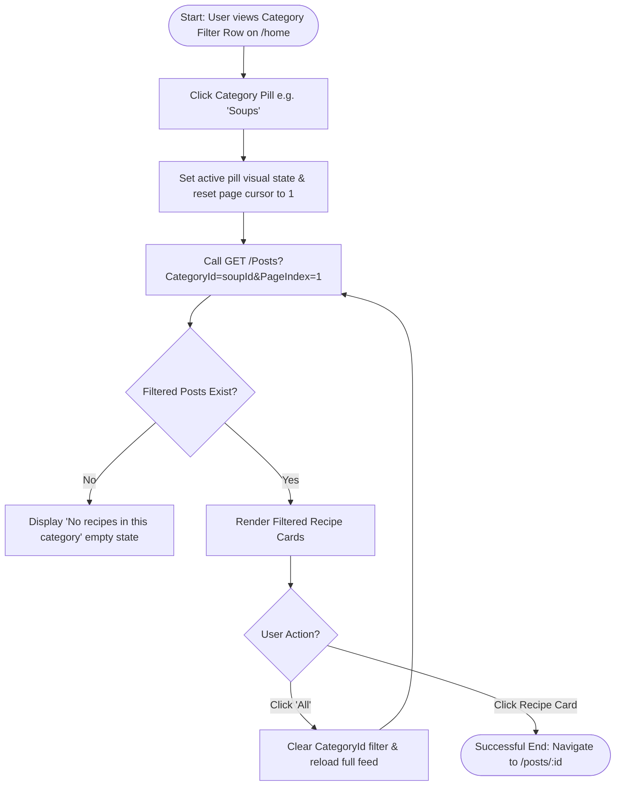

---

### FN12 — Xem chi tiết bài viết/video (View Post / Video Detail & Recipe Instructions)

**A. Purpose**
Renders complete recipe details including author profile, cooking metadata (prep time, cook time, servings, difficulty), structured ingredients, step-by-step instructions, adaptive media gallery, AI video summary, and view counter tracking.

**B. Actor / User Role**
`Member (`/posts/:id`), Guest (`/posts/:id/guest`)`

**C. Preconditions**
- Post ID exists in route parameters.

**D. Start Point**

| Attribute | Description |
|---|---|
| Start Route | `/posts/:id (Member) or /posts/:id/guest (Guest)` |
| Start Page | Post Detail Page (`PostDetail.jsx` / `PostDetailGuest.jsx`) |
| Trigger | User clicks any recipe card on Home feed, search results, or user profile. |
| Initial State | Navigating to post detail. |
| Input | Route parameter `id` (integer/UUID). |

**E. Main Functional Flow**

| Step | User Action | Frontend Behavior | Validation / API | System Response |
|---|---|---|---|---|
| 1 | User clicks recipe card | FE routes to `/posts/:id` and mounts `PostDetailCore.jsx` | Route parameter validation | Detail layout skeleton renders |
| 2 | Component fetches post detail | FE calls `postService.getPostDetail(id)` (`GET /Posts/:id`) | Axios request with error handling | Loading spinner displayed |
| 3 | API returns post payload | FE extracts title, content, author, ingredients, cooking steps, media array | Data integrity check | Recipe details populate |
| 4 | Render Adaptive Media | Mounts `PostDetailAdaptiveMedia` calculating intrinsic aspect ratios with `object-contain` within `min(640px, 75vh)` | Checks image vs video media types | Media renders with zoom lightbox and thumbnail gallery |
| 5 | Render AI Video Summary (if video) | If post contains video media, mounts `PostVideoSummary` displaying AI-generated key takeaways | Checks `mediaType === 'video'` | AI Summary banner displayed |
| 6 | Track 15-second view count | Starts 15-second timer while user actively views post | Checks active tab visibility | Calls view count increment API when >= 15 seconds |

**F. Conditional and Alternative Flows**
- **Post Not Found / Deleted (404)**: Backend returns 404. FE redirects to `/404` or displays error card: 'This recipe could not be found or has been removed.'
- **Post Under Moderation (Pending/Rejected)**: If viewer is not author or admin, displays notice: 'This recipe is currently under review.'
- **Allergen Detected Banner**: If logged-in member has declared food allergies (FN23) matching any recipe ingredient, a prominent amber/red Allergen Warning banner displays at top of recipe.
- **Image Zoom Lightbox**: User clicks image -> opens fullscreen lightbox modal with keyboard navigation (Esc to exit, Arrow keys to navigate).

**G. End Point**

| Attribute | Description |
|---|---|
| Successful End Route | `/posts/:id` |
| Successful End State | Recipe displayed in full; interaction buttons (Like, Save, Comments) active; view count registered. |
| Data Result | Post detail loaded into local state and cache (`postDetailsCache.js`). |
| Next Available Action | Like (FN18), Save (FN19), Comment (FN17), or Edit (FN14 if author). |
| Next FN | FN17 — Bình luận & trả lời bình luận |

| Condition | End Point |
|---|---|
| 404 Not Found | Redirected to `/404` page. |
| Under Review | Displays restricted banner. |

**H. Related Functions**
- **Preceding**: FN08 (Home feed), FN09 (Search).
- **Succeeding**: FN17 (Comments), FN18 (Like), FN19 (Save), FN14 (Edit), FN15 (Delete).

**I. FE Implementation Mapping**

| Layer | Actual Implementation |
|---|---|
| Route | `/posts/:id, /posts/:id/guest` |
| Page | ``src/pages/member/PostDetail.jsx`, `src/pages/guest/PostDetailGuest.jsx`` |
| Components | `PostDetailCore.jsx`, `PostDetailAdaptiveMedia.jsx`, `PostVideoSummary.jsx`, `UserProfilePreview.jsx` |
| Services | `postService.getPostDetail`, `postSummaryService.getVideoSummary` |
| State | `post`, `activeMediaIndex`, `isLightboxOpen`, `hasTrackedView` |
| Guards | `ProtectedRoute` (for `/posts/:id`) |
| Related files | `src/components/home/PostDetailCore.jsx`, `src/components/home/PostDetailAdaptiveMedia.jsx`, `src/services/postService.js` |

**J. Implementation Status**
- **Classification**: Implemented and verified in FE
- **Technical Evidence**: Verified with dedicated test suite `PostDetailAdaptiveMedia.test.jsx` (10/10 passed), lightbox support, and touch-target compliance.

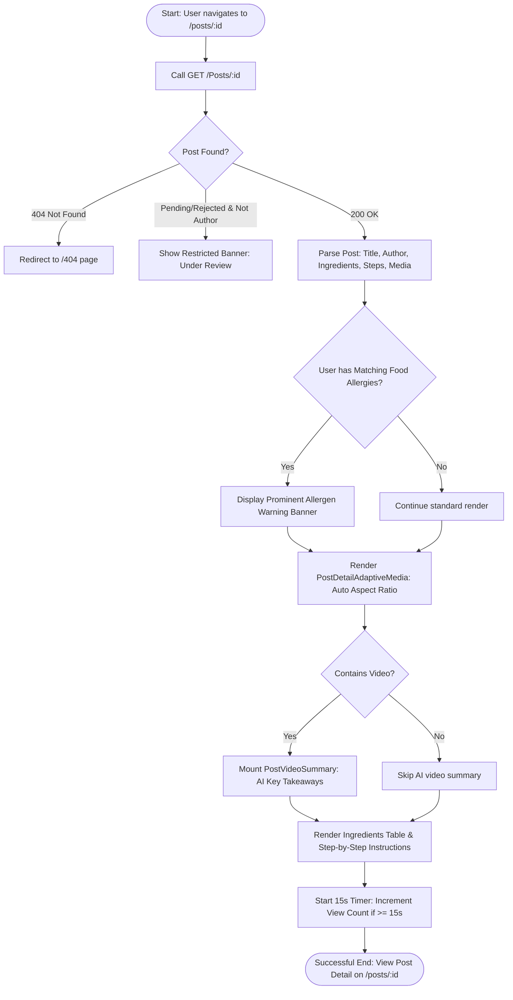

---

### FN13 — Đăng bài viết/video mới (Create New Recipe Post with Multi-Media)

**A. Purpose**
Enables members to author and publish plant-based recipes with title, category, cooking time, servings, difficulty, structured ingredients, numbered steps, and multiple images/videos with drag-and-drop ordering.

**B. Actor / User Role**
`Member, Administrator`

**C. Preconditions**
- User is authenticated.
- User has verified account status.

**D. Start Point**

| Attribute | Description |
|---|---|
| Start Route | `/posts/create` |
| Start Page | Create Recipe Page (`CreatePost.jsx`) |
| Trigger | User clicks 'Create Recipe' in Header or 'New Recipe' in `/my-posts`. |
| Initial State | Authenticated member session. |
| Input | Title, Description, Category, Prep Time, Cook Time, Servings, Difficulty, Ingredients list, Steps list, Media files. |

**E. Main Functional Flow**

| Step | User Action | Frontend Behavior | Validation / API | System Response |
|---|---|---|---|---|
| 1 | User navigates to `/posts/create` | FE renders recipe authoring form | Checks `isAuthenticated` | Recipe editor form displayed |
| 2 | User enters metadata | Title (required), description, category dropdown, cooking times, difficulty (Easy/Medium/Hard) | Validates required text fields | Input validation indicators |
| 3 | User adds Ingredients | Clicks 'Add Ingredient', specifies name, quantity, unit (g, ml, tbsp, etc.) | At least 1 ingredient required | Dynamic row added to ingredients table |
| 4 | User adds Cooking Steps | Clicks 'Add Step', types step instruction, optionally selects step photo | At least 1 step required | Numbered instruction card created |
| 5 | User uploads Media files | Drag & drop or file picker for multiple images/videos (max 10 files, total <= 50MB) | Validates mime types and file sizes | Generates preview thumbnails with drag-to-reorder |
| 6 | User clicks 'Submit Recipe' | Bundles all text and files into `FormData` and sends `POST /Posts` | Full form validation | Button shows loading state |
| 7 | API confirms submission | Backend creates post with default status `PENDING` (awaiting moderation) | Response 201 Created | Toast: 'Recipe submitted for moderation!' -> redirects to `/my-posts` |

**F. Conditional and Alternative Flows**
- **Missing Required Fields**: FE highlights missing title, ingredients, or steps in red and scrolls to first error.
- **File Too Large (> 50MB)**: FE rejects oversized file with error toast: 'Total media upload size must not exceed 50MB.'
- **Save as Draft**: User selects 'Save Draft' -> submits with status `DRAFT` (excluded from moderation queue until published).
- **Cancel Creation**: User clicks 'Cancel' -> confirmation modal warns about unsaved changes -> navigates back to `/my-posts`.

**G. End Point**

| Attribute | Description |
|---|---|
| Successful End Route | `/my-posts` |
| Successful End State | Recipe submitted; appears in author's 'Under Review' (Pending) tab; moderation notification dispatched to admins. |
| Data Result | New recipe record created in database with status `PENDING`. |
| Next Available Action | View recipe in My Posts (FN16) or create another recipe. |
| Next FN | FN16 — Quản lý danh sách bài viết của tôi |

| Condition | End Point |
|---|---|
| Validation Error | Remains on `/posts/create` with error callouts. |
| Cancellation | Navigates back to `/my-posts`. |

**H. Related Functions**
- **Preceding**: FN02 (Login).
- **Succeeding**: FN16 (My posts management), FN41 (Admin moderation).

**I. FE Implementation Mapping**

| Layer | Actual Implementation |
|---|---|
| Route | `/posts/create` |
| Page | ``src/pages/member/CreatePost.jsx`` |
| Components | `CreatePostModal.jsx`, `MultiMediaUpload.jsx` |
| Services | `postService.createPost` |
| State | `formState`, `mediaFiles`, `ingredients`, `steps`, `isSubmitting` |
| Guards | `ProtectedRoute` |
| Related files | `src/pages/member/CreatePost.jsx`, `src/services/postService.js` |

**J. Implementation Status**
- **Classification**: Implemented and verified in FE
- **Technical Evidence**: Verified in `CreatePost.jsx` with dynamic ingredient rows, cooking step reordering, multi-media drag-and-drop preview, and `FormData` upload.

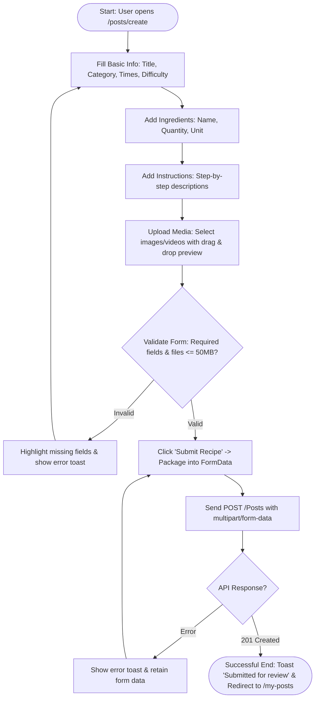

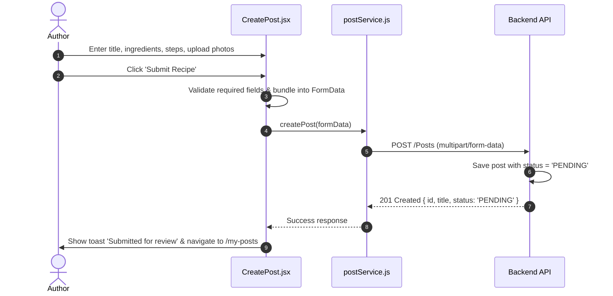

---

### FN14 — Chỉnh sửa bài viết đã đăng (Edit Existing Recipe Post)

**A. Purpose**
Allows recipe authors or administrators to edit the content, ingredients, cooking steps, and media of an existing recipe. Modifying core recipe content resets the publication status to PENDING for moderation re-review.

**B. Actor / User Role**
`Recipe Author (Member), Administrator`

**C. Preconditions**
- User is authenticated.
- User is the author of the post or holds Admin role.
- Post is not deleted.

**D. Start Point**

| Attribute | Description |
|---|---|
| Start Route | `/posts/edit/:id` |
| Start Page | Edit Recipe Page (`EditPost.jsx`) |
| Trigger | User clicks 'Edit' button on `/posts/:id` or on recipe card in `/my-posts`. |
| Initial State | Viewing post in owner mode. |
| Input | Route parameter `id`, updated title, description, category, ingredients, steps, new/retained media. |

**E. Main Functional Flow**

| Step | User Action | Frontend Behavior | Validation / API | System Response |
|---|---|---|---|---|
| 1 | User clicks 'Edit' | FE navigates to `/posts/edit/:id` | Verifies author identity | Pre-populates form with current recipe data |
| 2 | Component loads existing post | Calls `postService.getPostDetail(id)` | Checks ownership (`post.authorId === user.id` or `user.role === 'Admin'`) | Populates all inputs and existing media gallery |
| 3 | User modifies recipe content | Edits text, adds/removes ingredients, reorders steps, removes existing images, uploads new photos | Validates updated fields | Live preview updates |
| 4 | User clicks 'Save Changes' | FE bundles existing media IDs to keep + new files into `FormData` | Checks required fields | Submit button shows loading spinner |
| 5 | FE calls `postService.editPost(id, formData)` | Axios sends `PUT /Posts/:id` | Backend updates post; resets status to `PENDING` if published content changed | Backend confirms update |
| 6 | Update succeeds | FE displays success toast and redirects to My Posts | Navigation update | Redirects to `/my-posts` |

**F. Conditional and Alternative Flows**
- **Unauthorized User (403)**: If a user manually enters the edit URL of another person's recipe, FE displays error toast: 'You are not authorized to edit this recipe.' and redirects to `/home`.
- **Cancel Edit**: User clicks 'Cancel' -> prompts confirmation -> returns to `/posts/:id` without saving changes.

**G. End Point**

| Attribute | Description |
|---|---|
| Successful End Route | `/my-posts` |
| Successful End State | Recipe updated; author redirected to My Posts with success toast; status marked `PENDING` if re-moderation is triggered. |
| Data Result | Recipe record updated in backend database. |
| Next Available Action | View recipe card in My Posts list (FN16) or click recipe card to view detail (FN12). |
| Next FN | FN16 — Quản lý danh sách bài viết của tôi |

| Condition | End Point |
|---|---|
| Unauthorized | Redirects to `/home` with 403 toast. |
| Cancellation | Returns to `/my-posts` unchanged. |

**H. Related Functions**
- **Preceding**: FN12 (Post detail), FN16 (My posts).
- **Succeeding**: FN12 (View updated post), FN41 (Admin re-moderation).

**I. FE Implementation Mapping**

| Layer | Actual Implementation |
|---|---|
| Route | `/posts/edit/:id` |
| Page | ``src/pages/member/EditPost.jsx`` |
| Components | `MultiMediaUpload.jsx`, `ModalMotion.jsx` |
| Services | `postService.getPostDetail`, `postService.editPost` |
| State | `formState`, `existingMedia`, `newFiles`, `isUpdating` |
| Guards | `ProtectedRoute` |
| Related files | `src/pages/member/EditPost.jsx`, `src/services/postService.js` |

**J. Implementation Status**
- **Classification**: Implemented and verified in FE
- **Technical Evidence**: Verified in `EditPost.jsx` with ownership checks, pre-population of ingredient/step lists, existing media retention, and `PUT /Posts/:id` submission.

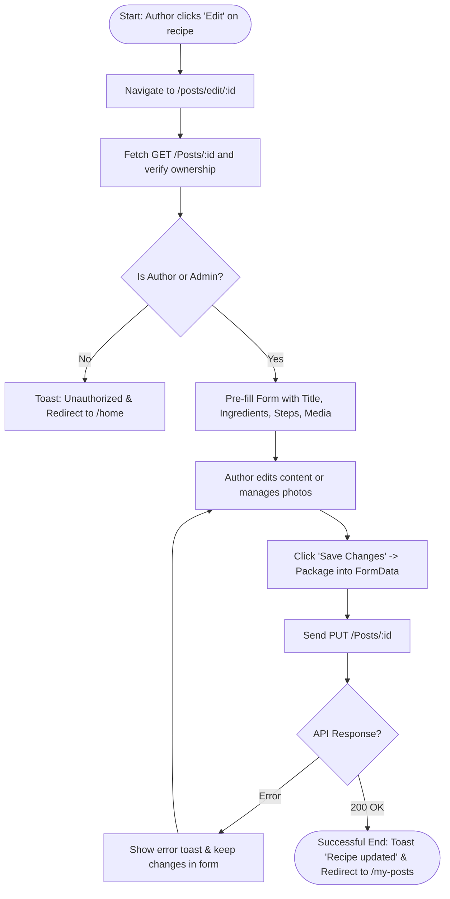

---

### FN15 — Xóa bài viết (Delete Recipe Post with Soft-Delete Confirmation)

**A. Purpose**
Enables recipe authors or administrators to delete a recipe post via a confirmation modal dialog, performing a soft-delete on the backend and removing it from all public feeds.

**B. Actor / User Role**
`Recipe Author (Member), Administrator`

**C. Preconditions**
- User is authenticated.
- User is the author of the post or holds Admin role.

**D. Start Point**

| Attribute | Description |
|---|---|
| Start Route | `/posts/:id or /my-posts` |
| Start Page | Post Detail (`PostDetail.jsx`) or My Posts (`MyPosts.jsx`) |
| Trigger | User clicks the 'Delete' (trash icon) button on the recipe. |
| Initial State | Viewing post or managing recipe list. |
| Input | Target post ID (`id`). |

**E. Main Functional Flow**

| Step | User Action | Frontend Behavior | Validation / API | System Response |
|---|---|---|---|---|
| 1 | User clicks 'Delete' button | FE intercepts click and opens confirmation modal dialog | Modal state opens | Dialog displays: 'Are you sure you want to delete this recipe? This action cannot be undone.' |
| 2 | User reviews confirmation dialog | FE focuses 'Delete' button, provides 'Cancel' option | Accessible focus trap | Modal prompts for explicit confirmation |
| 3 | User clicks 'Confirm Delete' | FE sets modal loading state and sends delete request | Ownership verification | Button shows loading spinner |
| 4 | FE calls `postService.deletePost(id)` | Axios sends `DELETE /Posts/:id` | Backend executes soft-delete (`isDeleted = true`) | Backend confirms deletion |
| 5 | FE processes deletion | Removes post from local lists, shows toast 'Recipe deleted successfully' | State update | Navigates to `/my-posts` (if on detail page) or filters out card in `/my-posts` |

**F. Conditional and Alternative Flows**
- **User Cancels Deletion**: User clicks 'Cancel' or presses Escape -> modal closes -> post remains untouched.
- **API Error During Deletion**: FE shows error toast: 'Failed to delete recipe. Please try again.' Modal closes; post remains.

**G. End Point**

| Attribute | Description |
|---|---|
| Successful End Route | `/my-posts` |
| Successful End State | Deleted recipe removed from UI; success toast displayed. |
| Data Result | Recipe record marked soft-deleted in backend database. |
| Next Available Action | View remaining recipes or create a new recipe. |
| Next FN | FN16 — Quản lý danh sách bài viết của tôi |

| Condition | End Point |
|---|---|
| Cancellation | Remains on `/posts/:id` or `/my-posts` with modal closed. |
| API Failure | Remains on current page with error toast. |

**H. Related Functions**
- **Preceding**: FN12 (Post detail), FN16 (My posts).
- **Succeeding**: FN16 (My posts list updated).

**I. FE Implementation Mapping**

| Layer | Actual Implementation |
|---|---|
| Route | `/posts/:id, /my-posts` |
| Page | ``src/pages/member/PostDetail.jsx`, `src/pages/member/MyPosts.jsx`` |
| Components | `ModalMotion.jsx` |
| Services | `postService.deletePost` |
| State | `deleteModalOpen`, `postToDelete`, `isDeleting` |
| Guards | `ProtectedRoute` |
| Related files | `src/pages/member/PostDetail.jsx`, `src/pages/member/MyPosts.jsx`, `src/services/postService.js` |

**J. Implementation Status**
- **Classification**: Implemented and verified in FE
- **Technical Evidence**: Implemented in both `PostDetail.jsx` and `MyPosts.jsx` with accessible modal confirmation dialog and `DELETE /Posts/:id` integration.

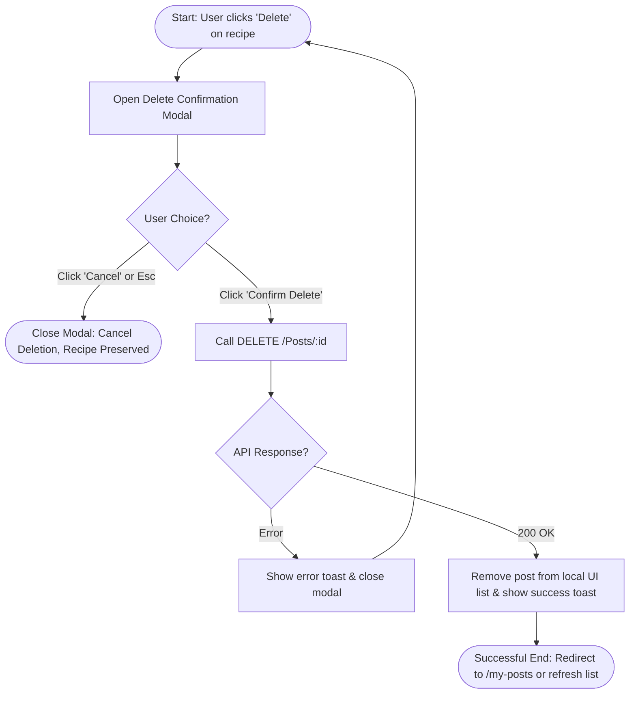

---

### FN16 — Quản lý danh sách bài viết của tôi (My Posts Management & Status Tabs)

**A. Purpose**
Provides a comprehensive dashboard for authors to manage their recipe portfolio across distinct lifecycle tabs: All, Published (Approved), Under Review (Pending), Drafts, and Hidden/Restricted (Rejected), with integrated Saved Recipes.

**B. Actor / User Role**
`Member, Administrator`

**C. Preconditions**
- User is authenticated.

**D. Start Point**

| Attribute | Description |
|---|---|
| Start Route | `/my-posts` |
| Start Page | My Posts Management Page (`MyPosts.jsx`) |
| Trigger | User selects 'My Recipes' in Header profile dropdown. |
| Initial State | Authenticated member session. |
| Input | Active tab filter ('all', 'published', 'under_review', 'draft', 'restricted', 'saved'). |

**E. Main Functional Flow**

| Step | User Action | Frontend Behavior | Validation / API | System Response |
|---|---|---|---|---|
| 1 | User navigates to `/my-posts` | FE mounts `MyPosts.jsx` and defaults to 'All' or 'Published' tab | Session check | Dashboard header and tab bar render |
| 2 | Component fetches user's recipes | FE calls `postService.getMyPosts({ pageIndex: 1, status: activeFilter })` | Axios sends `GET /Posts/my-posts` | Loading card skeletons displayed |
| 3 | API returns author's posts with status counters | FE renders recipe cards displaying status badges, view counts, like counts, and comments | Counter computation | Tab badges show exact counts: e.g. Published (12), Under Review (2) |
| 4 | User switches tab (e.g. 'Under Review') | FE filters view to pending posts awaiting admin moderation | Tab switch transition | Pending recipe cards displayed with review status cue |
| 5 | User triggers recipe action | User clicks 'Edit' (FN14), 'Delete' (FN15), or 'View' (FN12) | Action delegation | Transitions to chosen recipe action |

**F. Conditional and Alternative Flows**
- **Tab Empty State**: Displays tailored empty state for each tab: e.g. 'No drafts saved yet' or 'No recipes under review.'
- **Switch to Saved Recipes Tab**: User clicks 'Saved Recipes' tab -> loads user's bookmarked recipes (FN20) seamlessly inside the same dashboard.

**G. End Point**

| Attribute | Description |
|---|---|
| Successful End Route | `/my-posts` |
| Successful End State | Recipe dashboard active with filtered tabs; quick actions (Create, Edit, Delete) available. |
| Data Result | Author recipes and status counts loaded in state. |
| Next Available Action | Create new recipe (FN13), Edit (FN14), or Delete (FN15). |
| Next FN | FN13 — Đăng bài viết/video mới |

| Condition | End Point |
|---|---|
| Empty Portfolio | Displays welcoming empty state with prominent 'Create Your First Recipe' CTA button. |

**H. Related Functions**
- **Preceding**: FN02 (Login).
- **Succeeding**: FN13 (Create post), FN14 (Edit post), FN15 (Delete post), FN20 (Saved posts tab).

**I. FE Implementation Mapping**

| Layer | Actual Implementation |
|---|---|
| Route | `/my-posts` |
| Page | ``src/pages/member/MyPosts.jsx`` |
| Components | `PostCard.jsx`, `ModalMotion.jsx` |
| Services | `postService.getMyPosts` |
| State | `activeTab`, `statusFilter`, `posts`, `statusCounts`, `isLoading` |
| Guards | `ProtectedRoute` |
| Related files | `src/pages/member/MyPosts.jsx`, `src/services/postService.js` |

**J. Implementation Status**
- **Classification**: Implemented and verified in FE
- **Technical Evidence**: Verified in `MyPosts.jsx` with tabbed status filtering (Published, Under Review, Draft, Hidden), count chips, and integrated Saved Recipes tab.

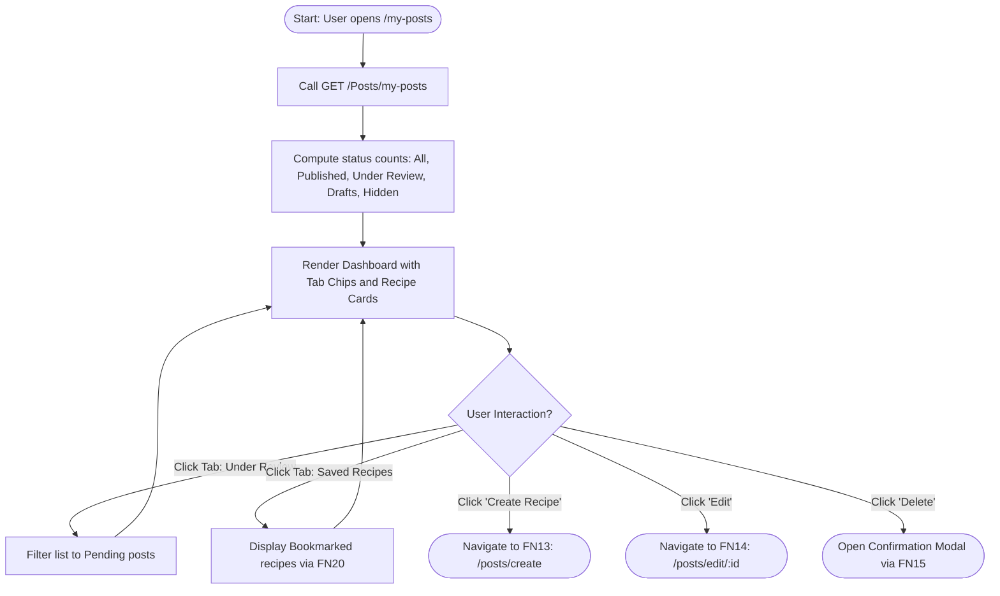

---

### FN17 — Bình luận & trả lời bình luận (Comments & Nested Replies)

**A. Purpose**
Enables members to participate in community culinary discussions by submitting top-level recipe comments and threaded replies (up to 2 levels deep), editing owner comments, deleting comments, and blocking abusive language.

**B. Actor / User Role**
`Member (create/reply/edit/delete), Guest (read-only view)`

**C. Preconditions**
- Post detail is loaded.
- Member is authenticated to submit or reply.

**D. Start Point**

| Attribute | Description |
|---|---|
| Start Route | `/posts/:id` |
| Start Page | Post Detail Page (`PostDetail.jsx` -> `PostDetailCore.jsx`) |
| Trigger | User scrolls to 'Comments' section below recipe content. |
| Initial State | Viewing post detail. |
| Input | Comment text (`content`, 1–500 characters), Parent comment ID (`parentCommentId` if replying). |

**E. Main Functional Flow**

| Step | User Action | Frontend Behavior | Validation / API | System Response |
|---|---|---|---|---|
| 1 | User scrolls to Comments section | FE fetches comments via `interactionService.getComments(postId)` | Axios sends `GET /posts/:id/comments?maxDepth=4` | Comments list rendered with timestamps and author badges |
| 2 | User enters comment text | FE captures text in input box, checks character count (1–500 chars) | Disables submit if empty or > 500 chars | Submit button becomes active |
| 3 | User clicks 'Post Comment' | FE sets submitting state and calls `interactionService.createComment(postId, { content })` | Axios sends `POST /posts/:id/comments` | New comment appends to list; comment counter increments |
| 4 | User replies to comment | Clicks 'Reply' on an existing comment -> inline reply box opens -> enters text -> submits with `parentCommentId` | Calls `POST /posts/:id/comments` with parent ID | Nested reply renders indented beneath parent comment |
| 5 | User edits/deletes own comment | Author clicks 'Edit' or 'Delete' on own comment | Ownership check (`comment.userId === user.id`) | Edits update text with '(edited)' tag; deletion removes comment |

**F. Conditional and Alternative Flows**
- **Guest Clicks Comment / Reply**: Unauthenticated guest clicks comment box -> opens `LandingAuthDialog` prompting login without losing post scroll position.
- **Comment Exceeds 500 Characters**: FE displays character counter warning and prevents submission.
- **Content Moderation Trigger**: Backend checks comment for profanity. If flagged, status set to `hidden` with moderation review toast to the user.
- **Admin Comment Deletion**: Admin clicks delete on any comment -> prompts for mandatory removal reason -> calls `decideCommentReport`.

**G. End Point**

| Attribute | Description |
|---|---|
| Successful End Route | `/posts/:id` |
| Successful End State | New comment or reply visible in conversation tree; comment count updated; recipe author notified. |
| Data Result | Comment record saved in backend database. |
| Next Available Action | Continue reading or post another comment/reply. |
| Next FN | FN12 — Xem chi tiết bài viết/video |

| Condition | End Point |
|---|---|
| Guest Interception | Auth dialog modal opens over post detail. |
| Validation Error | Submit button remains disabled. |

**H. Related Functions**
- **Preceding**: FN12 (View post detail).
- **Succeeding**: FN36 (Recipe author receives notification of new comment).

**I. FE Implementation Mapping**

| Layer | Actual Implementation |
|---|---|
| Route | `/posts/:id` |
| Page | ``src/pages/member/PostDetail.jsx`` |
| Components | `PostDetailCore.jsx`, `LandingAuthDialog.jsx` |
| Services | `interactionService.getComments`, `interactionService.createComment`, `interactionService.deleteComment` |
| State | `comments`, `newCommentText`, `replyingToId`, `isSubmittingComment` |
| Guards | `ProtectedRoute` (for write actions) |
| Related files | `src/components/home/PostDetailCore.jsx`, `src/services/interactionService.js` |

**J. Implementation Status**
- **Classification**: Implemented and verified in FE
- **Technical Evidence**: Verified in `PostDetailCore.jsx` and `interactionService.js` supporting comments, nested replies, character limits, edit tags, and guest modal prompts.

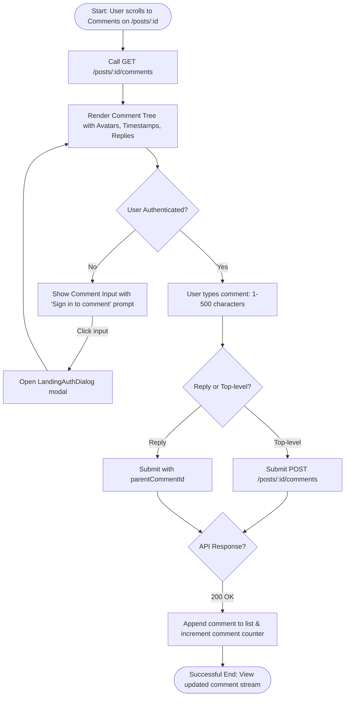

---

### FN18 — Thích bài viết (Like / Unlike Post with Optimistic UI)

**A. Purpose**
Enables authenticated members to like or unlike recipes with instant Optimistic UI feedback, updating like counts and heart icon states immediately while synchronizing with the backend.

**B. Actor / User Role**
`Member (Guest triggers login prompt)`

**C. Preconditions**
- Post is visible on Home feed, search, author profile, or post detail page.

**D. Start Point**

| Attribute | Description |
|---|---|
| Start Route | ``/home`, `/posts/:id`, `/search`, or `/users/:id`` |
| Start Page | Any page rendering recipe cards (`Home.jsx`, `PostDetail.jsx`, `SearchResults.jsx`) |
| Trigger | User clicks the Heart (Like) button on a recipe. |
| Initial State | Viewing recipe item. |
| Input | Target post ID (`postId`). |

**E. Main Functional Flow**

| Step | User Action | Frontend Behavior | Validation / API | System Response |
|---|---|---|---|---|
| 1 | User clicks Heart icon | FE checks `isAuthenticated` in `AuthContext` | Auth check | Determines whether to execute like or prompt auth |
| 2 | Optimistic UI Update | FE immediately toggles heart state (beetroot red filled vs outline) and increments/decrements like counter by 1 | Instant UI feedback without waiting for network | Heart animates with micro-scale bounce |
| 3 | Send API Request | FE calls `interactionService.toggleLike(postId)` | Axios sends `POST /posts/:id/like` | Backend toggles like record in database |
| 4 | API returns confirmation | Backend returns `{ liked: boolean, likeCount: number }` | Payload validation | FE reconciles optimistic state with exact server count |

**F. Conditional and Alternative Flows**
- **Guest Clicks Heart**: Unauthenticated guest clicks Heart -> opens `LandingAuthDialog` modal prompting login -> state remains unliked until logged in.
- **API / Network Failure**: If network drops or server returns error, FE catches failure, rolls back heart state and counter to previous values, and displays error toast: 'Failed to update like status.'

**G. End Point**

| Attribute | Description |
|---|---|
| Successful End Route | `Current route` |
| Successful End State | Heart icon reflects liked status (filled beetroot red); like count updated. |
| Data Result | Like record created/removed in backend database. |
| Next Available Action | Continue browsing or interact with recipe. |
| Next FN | FN19 — Lưu bài viết để xem sau |

| Condition | End Point |
|---|---|
| Guest Interception | Auth dialog opens over current page. |
| Network Failure | Heart icon reverts to original state. |

**H. Related Functions**
- **Preceding**: FN08 (Feed), FN12 (Post detail).
- **Succeeding**: FN19 (Save post), FN36 (Author receives like notification).

**I. FE Implementation Mapping**

| Layer | Actual Implementation |
|---|---|
| Route | ``/home`, `/posts/:id`, `/search`, `/users/:id`` |
| Page | ``src/pages/member/Home.jsx`, `src/pages/member/PostDetail.jsx`` |
| Components | `PostCard.jsx`, `PostDetailCore.jsx`, `LandingAuthDialog.jsx` |
| Services | `interactionService.toggleLike` |
| State | `isLiked`, `likeCount` (local optimistic state) |
| Guards | `ProtectedRoute` (or `onAuthRequired` handler) |
| Related files | `src/components/home/PostDetailCore.jsx`, `src/services/interactionService.js` |

**J. Implementation Status**
- **Classification**: Implemented and verified in FE
- **Technical Evidence**: Verified in `PostDetailCore.jsx` and `Home.jsx` with instant optimistic state toggling, rollback on API error, and test suites.

```mermaid
flowchart TD
    A([Start: User clicks Heart icon on recipe]) --> B{Is Authenticated?}
    B -->|No| C[Open LandingAuthDialog modal] --> D([Guest Prompt End])
    B -->|Yes| E[Apply Optimistic UI: Toggle Heart fill & update count ±1]
    E --> F[Call POST /posts/:id/like]
    F --> G{API Success?}
    G -->|No / Error| H[Rollback Heart icon and count & show error toast] --> I([Rollback End])
    G -->|Yes (200)| J[Reconcile with server likeCount] --> K([Successful End: Like active])
```

---

### FN19 — Lưu bài viết để xem sau (Save / Bookmark Recipe Post)

**A. Purpose**
Enables members to bookmark recipes for later culinary access, toggling bookmark states with optimistic updates and preventing duplicate entries.

**B. Actor / User Role**
`Member (Guest triggers login prompt)`

**C. Preconditions**
- Post is visible in feed or detail view.

**D. Start Point**

| Attribute | Description |
|---|---|
| Start Route | ``/home`, `/posts/:id`, or `/search`` |
| Start Page | Recipe Card or Detail (`PostCard.jsx`, `PostDetailCore.jsx`) |
| Trigger | User clicks Bookmark icon on a recipe. |
| Initial State | Viewing recipe. |
| Input | Target post ID (`postId`). |

**E. Main Functional Flow**

| Step | User Action | Frontend Behavior | Validation / API | System Response |
|---|---|---|---|---|
| 1 | User clicks Bookmark icon | FE checks authentication status | Auth check | Determines execution or login modal |
| 2 | Optimistic Save Toggle | FE immediately highlights bookmark icon (active green fill) and toggles saved state | Instant visual response | Bookmark icon animates |
| 3 | Send API Request | FE calls `interactionService.toggleSave(postId)` | Axios sends `POST /posts/:id/save` | Backend adds/removes bookmark record |
| 4 | API confirms bookmark update | Backend confirms bookmark status | State synchronization | Recipe added to user's Saved Recipes collection (FN20) |

**F. Conditional and Alternative Flows**
- **Guest Clicks Bookmark**: Opens `LandingAuthDialog` modal prompting login.
- **Network Failure**: FE rolls back bookmark icon to un-saved state and displays toast: 'Could not save recipe. Please try again.'

**G. End Point**

| Attribute | Description |
|---|---|
| Successful End Route | `Current route` |
| Successful End State | Bookmark icon active; recipe indexed in `/saved-posts`. |
| Data Result | Bookmark association created in backend database. |
| Next Available Action | View bookmarked recipes in Saved Recipes (FN20). |
| Next FN | FN20 — Xem danh sách bài viết đã lưu |

| Condition | End Point |
|---|---|
| Guest Interception | Auth dialog opens over page. |
| Rollback on Failure | Bookmark state reverts to un-saved. |

**H. Related Functions**
- **Preceding**: FN08 (Feed), FN12 (Post detail).
- **Succeeding**: FN20 (Saved recipes collection).

**I. FE Implementation Mapping**

| Layer | Actual Implementation |
|---|---|
| Route | ``/home`, `/posts/:id`, `/search`` |
| Page | ``src/pages/member/Home.jsx`, `src/pages/member/PostDetail.jsx`` |
| Components | `PostCard.jsx`, `PostDetailCore.jsx` |
| Services | `interactionService.toggleSave` |
| State | `isSaved` (local optimistic state) |
| Guards | `ProtectedRoute` (or `onAuthRequired`) |
| Related files | `src/components/home/PostDetailCore.jsx`, `src/services/interactionService.js` |

**J. Implementation Status**
- **Classification**: Implemented and verified in FE
- **Technical Evidence**: Verified in `PostDetailCore.jsx` and `Home.jsx` with optimistic toggling and synchronization with `/saved-posts`.

```mermaid
flowchart TD
    A([Start: User clicks Bookmark icon on recipe]) --> B{Is Authenticated?}
    B -->|No| C[Open LandingAuthDialog modal] --> D([Guest Prompt End])
    B -->|Yes| E[Apply Optimistic UI: Toggle Bookmark highlight]
    E --> F[Call POST /posts/:id/save]
    F --> G{API Success?}
    G -->|No| H[Rollback Bookmark state & show error toast] --> I([Rollback End])
    G -->|Yes (200)| J[Toast: 'Recipe saved to bookmarks'] --> K([Successful End: Saved in FN20])
```

---

### FN20 — Xem danh sách bài viết đã lưu (Saved Recipes Management)

**A. Purpose**
Displays the member's private collection of bookmarked recipes sorted by newest first, automatically hiding deleted original recipes and allowing quick un-saving.

**B. Actor / User Role**
`Member`

**C. Preconditions**
- User is authenticated.

**D. Start Point**

| Attribute | Description |
|---|---|
| Start Route | `/saved-posts (or Saved Recipes tab in `/my-posts`)` |
| Start Page | Saved Recipes Page (`SavedPosts.jsx`) |
| Trigger | User selects 'Saved Recipes' in Header user dropdown or clicks 'Saved Recipes' tab in `/my-posts`. |
| Initial State | Authenticated member session. |
| Input | Page index. |

**E. Main Functional Flow**

| Step | User Action | Frontend Behavior | Validation / API | System Response |
|---|---|---|---|---|
| 1 | User navigates to `/saved-posts` | FE mounts `SavedPosts.jsx` wrapped in `ProtectedRoute` | Verifies authentication | Saved recipes container renders |
| 2 | Component queries saved recipes | FE calls `postService.getSavedPosts({ pageIndex: 1, pageSize: 12 })` | Axios sends `GET /Posts/saved` | Loading card skeletons displayed |
| 3 | API returns bookmarked recipes | FE renders recipe cards with prep time, author, and 'Unsave' action button | Filters out soft-deleted posts | Recipe grid populated |
| 4 | User clicks 'Unsave' on a card | FE calls `interactionService.toggleSave(postId)` | Optimistic card removal | Card animates out of grid; toast: 'Recipe removed from saved collection' |

**F. Conditional and Alternative Flows**
- **No Saved Recipes**: Displays encouraging empty state: 'You haven't saved any recipes yet. Browse trending recipes and click the bookmark icon to save them!' with 'Explore Recipes' CTA button.

**G. End Point**

| Attribute | Description |
|---|---|
| Successful End Route | `/saved-posts` |
| Successful End State | Saved recipe collection rendered; user can click any card to view details (FN12). |
| Data Result | Saved recipes array loaded in state. |
| Next Available Action | Click recipe card to view detail (FN12) or remove bookmarks. |
| Next FN | FN12 — Xem chi tiết bài viết/video |

| Condition | End Point |
|---|---|
| Empty Collection | Displays empty state card with CTA to explore recipes. |

**H. Related Functions**
- **Preceding**: FN19 (Save post).
- **Succeeding**: FN12 (View post detail).

**I. FE Implementation Mapping**

| Layer | Actual Implementation |
|---|---|
| Route | `/saved-posts` |
| Page | ``src/pages/member/SavedPosts.jsx`` |
| Components | `PostCard.jsx`, `MyPosts.jsx` |
| Services | `postService.getSavedPosts`, `interactionService.toggleSave` |
| State | `savedPosts`, `isLoading`, `pageIndex` |
| Guards | `ProtectedRoute` |
| Related files | `src/pages/member/SavedPosts.jsx`, `src/services/postService.js` |

**J. Implementation Status**
- **Classification**: Implemented and verified in FE
- **Technical Evidence**: Verified in `SavedPosts.jsx` and integrated tab in `MyPosts.jsx` connected to `postService.getSavedPosts`.

```mermaid
flowchart TD
    A([Start: User opens /saved-posts]) --> B[Call GET /Posts/saved?PageIndex=1]
    B --> C{Saved Recipes Exist?}
    C -->|None| D[Render Empty State: 'No saved recipes yet' with CTA] --> E([Empty End])
    C -->|Found| F[Render Grid of Bookmarked Recipe Cards]
    F --> G{User Action?}
    G -->|Click 'Unsave'| H[Call POST /posts/:id/save & animate card removal] --> F
    G -->|Click Recipe Card| I([Successful End: Navigate to /posts/:id])
```

---

### FN21 — Xem trang cá nhân tác giả khác (View Public User Profile & Follow)

**A. Purpose**
Displays a creator's public profile featuring their author avatar, biography, follower count, total published recipes, total likes received, follower/following lists, and a grid of their approved published recipes, with a Follow/Unfollow action button.

**B. Actor / User Role**
`Member, Guest`

**C. Preconditions**
- Author ID exists in route parameters.

**D. Start Point**

| Attribute | Description |
|---|---|
| Start Route | `/users/:id` |
| Start Page | Public User Profile Page (`PublicUserProfile.jsx`) |
| Trigger | User clicks author name or avatar on a recipe card, comment, or search result. |
| Initial State | Navigating to author profile. |
| Input | Route parameter `id` (author user ID). |

**E. Main Functional Flow**

| Step | User Action | Frontend Behavior | Validation / API | System Response |
|---|---|---|---|---|
| 1 | User navigates to `/users/:id` | FE mounts `PublicUserProfile.jsx` | Extracts `id` from URL | Profile layout renders skeleton |
| 2 | Component fetches profile & posts | FE calls `userService.getPublicProfile(id)` and `postService.getPostsFeed({ authorId: id })` | Axios sends parallel queries | Loading states active |
| 3 | API returns public profile data | FE populates banner, avatar, display name, bio, follower count, total recipes, total likes | Validates active user status | Profile header rendered |
| 4 | Check Follow Status | If viewer is authenticated, calls `userService.getFollowStatus(id)` | Determines follow state | Renders 'Follow' or 'Following' button |
| 5 | Display Published Recipes | Renders author's approved recipes grid | Filters out pending/draft posts | Author recipe collection displayed |
| 6 | Member clicks Follow button | FE calls `userService.followUser(id)` or `userService.unfollowUser(id)` with optimistic toggle | Optimistic state update | Button toggles to 'Following', follower count updates |

**F. Conditional and Alternative Flows**
- **Author Not Found / Banned (404/403)**: Displays 'Author profile not found or is currently restricted.'
- **Guest Clicks Follow**: Unauthenticated guest clicks Follow button -> opens `LandingAuthDialog` prompting login.

**G. End Point**

| Attribute | Description |
|---|---|
| Successful End Route | `/users/:id` |
| Successful End State | Public author profile displayed; viewer can follow author or browse recipes. |
| Data Result | Author profile and recipe array loaded into component state. |
| Next Available Action | Click recipe card to view detail (FN12) or toggle follow status. |
| Next FN | FN12 — Xem chi tiết bài viết/video |

| Condition | End Point |
|---|---|
| User Not Found | Displays 404 profile not found state. |
| Guest Interception | Auth dialog opens over profile. |

**H. Related Functions**
- **Preceding**: FN08 (Feed card click), FN10 (People search).
- **Succeeding**: FN12 (View post detail), FN36 (Author receives follow notification).

**I. FE Implementation Mapping**

| Layer | Actual Implementation |
|---|---|
| Route | `/users/:id` |
| Page | ``src/pages/member/PublicUserProfile.jsx`` |
| Components | `PostCard.jsx`, `FollowButton.jsx`, `LandingAuthDialog.jsx` |
| Services | `userService.getPublicProfile`, `userService.getFollowStatus`, `userService.followUser`, `userService.unfollowUser` |
| State | `profile`, `posts`, `followStatus`, `isFollowUpdating` |
| Guards | `ProtectedRoute` (for `/users/:id`) |
| Related files | `src/pages/member/PublicUserProfile.jsx`, `src/services/userService.js` |

**J. Implementation Status**
- **Classification**: Implemented and verified in FE
- **Technical Evidence**: Verified in `PublicUserProfile.jsx` with follow toggle, follower count synchronization, published recipe grid, and tests.

```mermaid
flowchart TD
    A([Start: User clicks author link -> /users/:id]) --> B[Call GET /users/:id/profile & GET /users/:id/posts]
    B --> C{Profile Found & Active?}
    C -->|No| D[Display 'Profile not found' error banner]
    C -->|Yes| E[Render Profile Header: Avatar, Name, Bio, Stats]
    E --> F{Viewer Authenticated?}
    F -->|Yes| G[Fetch follow status: Show 'Follow' or 'Following' button]
    F -->|No| H[Show 'Follow' button that triggers LandingAuthDialog on click]
    G --> I[Render Author's Published Recipes Grid]
    H --> I
    I --> J{User Action?}
    J -->|Click Follow| K[Toggle follow state via POST/DELETE /users/:id/follow] --> G
    J -->|Click Recipe Card| L([Successful End: Navigate to /posts/:id])
```

---

### FN22 — Nhập / Cập nhật hồ sơ sức khỏe (Health Profile & TDEE Calculation)

**A. Purpose**
Collects personal biometric measurements (height 100-250cm, weight 30-200kg, biological sex, birth date, physical activity level, vegan diet type) and calculates Total Daily Energy Expenditure (TDEE) using the Mifflin-St Jeor formula.

**B. Actor / User Role**
`Member`

**C. Preconditions**
- User is authenticated.

**D. Start Point**

| Attribute | Description |
|---|---|
| Start Route | `/health` |
| Start Page | Health & Wellness Page (`HealthAndWellness.jsx` / `HealthProfile.jsx`) |
| Trigger | User selects 'Health & Nutrition' in Header user dropdown or clicks 'Review health profile' in `/weekly-menu`. |
| Initial State | Viewing health settings. |
| Input | Height (`heightCm`), Weight (`weightKg`), Biological sex (`biologicalSex`), Date of birth (`birthDate`), Activity level (`activityLevel`), Diet preference (`dietType`). |

**E. Main Functional Flow**

| Step | User Action | Frontend Behavior | Validation / API | System Response |
|---|---|---|---|---|
| 1 | User navigates to `/health` | FE mounts `HealthProfile.jsx` wrapped in `ProtectedRoute` | Verifies authentication | Health metrics form renders |
| 2 | Component loads existing profile | FE calls `healthProfileService.getHealthProfile()` (`GET /HealthProfile`) | Axios request | Pre-populates height, weight, activity, diet preferences |
| 3 | User updates biometric metrics | Enters height (100–250 cm), weight (30–200 kg), activity factor (Sedentary, Light, Moderate, Very Active, Extra Active) | Validates numerical ranges in real-time | Calculates estimated TDEE preview using Mifflin-St Jeor |
| 4 | User clicks 'Save Health Profile' | FE validates all fields and sends update request | Validates positive bounds | Button displays loading spinner |
| 5 | FE calls `healthProfileService.updateHealthProfile(data)` | Axios sends `PUT /HealthProfile` | Backend stores health metrics and triggers BMI recalculation | Backend returns updated profile object |
| 6 | FE updates UI and displays feedback | Updates TDEE indicator, refreshes BMI metrics, shows toast 'Health profile saved successfully!' | State update | Metrics updated across Health and Meal Planning tabs |

**F. Conditional and Alternative Flows**
- **Values Out of Range**: FE warns user if height < 100cm or > 250cm, or weight < 30kg or > 200kg. Submit button remains disabled.
- **Incomplete Health Data**: If height or weight is blank, TDEE calculation displays 'Profile incomplete' with guidance to fill both metrics.
- **API Error**: Displays toast: 'Failed to update health profile. Please check your network and try again.'

**G. End Point**

| Attribute | Description |
|---|---|
| Successful End Route | `/health` |
| Successful End State | Health metrics saved; calculated TDEE visible; values flow into BMI calculation (FN24) and weekly meal plan generator (FN26). |
| Data Result | Health profile updated in backend database. |
| Next Available Action | Declare food allergies (FN23), view BMI dashboard (FN24), or create meal plan (FN26). |
| Next FN | FN23 — Khai báo dị ứng thực phẩm |

| Condition | End Point |
|---|---|
| Validation Error | Remains on `/health` with invalid input highlighted. |
| API Failure | Remains on `/health` with error toast. |

**H. Related Functions**
- **Preceding**: FN02 (Login).
- **Succeeding**: FN23 (Food allergies), FN24 (Calculate BMI), FN26 (Weekly meal plan).

**I. FE Implementation Mapping**

| Layer | Actual Implementation |
|---|---|
| Route | `/health` |
| Page | ``src/pages/member/HealthAndWellness.jsx`, `src/pages/member/HealthProfile.jsx`` |
| Components | `HealthProfile.jsx`, `ModalMotion.jsx` |
| Services | `healthProfileService.getHealthProfile`, `healthProfileService.updateHealthProfile` |
| State | `healthProfile`, `tdee`, `isSaving`, `errors` |
| Guards | `ProtectedRoute` |
| Related files | `src/pages/member/HealthProfile.jsx`, `src/services/healthProfileService.js` |

**J. Implementation Status**
- **Classification**: Implemented and verified in FE
- **Technical Evidence**: Verified in `HealthProfile.jsx` with Mifflin-St Jeor TDEE formula, range boundaries, diet selection, and `PUT /HealthProfile` integration.

```mermaid
flowchart TD
    A([Start: User opens /health -> Health Profile]) --> B[Call GET /HealthProfile to load saved metrics]
    B --> C[User edits Height: 100-250cm, Weight: 30-200kg, Activity Level]
    C --> D{Inputs within valid biometric bounds?}
    D -->|No| E[Display inline range validation error] --> C
    D -->|Yes| F[Compute live Mifflin-St Jeor TDEE preview]
    F --> G[Click 'Save Health Profile' -> Send PUT /HealthProfile]
    G --> H{API Response?}
    H -->|Error| I[Show error toast & retain form state] --> G
    H -->|200 OK| J[Toast: Health profile saved & update global TDEE]
    J --> K([Successful End: Data propagates to FN24 BMI & FN26 Meal Plan])
```

---

### FN23 — Khai báo dị ứng thực phẩm (Food Allergies Declaration & Alerts)

**A. Purpose**
Allows members to declare food allergies and ingredient intolerances (peanuts, soy, gluten, sesame, tree nuts, or custom ingredients) to automatically display prominent warning banners on recipes and exclude matching dishes from meal plans.

**B. Actor / User Role**
`Member`

**C. Preconditions**
- User is authenticated.

**D. Start Point**

| Attribute | Description |
|---|---|
| Start Route | `/health` |
| Start Page | Health Profile (`HealthProfile.jsx` -> 'Food Allergies' section) |
| Trigger | User switches to the 'Food Allergies' tab on `/health`. |
| Initial State | Viewing health settings. |
| Input | Selected preset allergen tags (Peanuts, Soy, Gluten, Tree nuts, Sesame) or custom ingredient names. |

**E. Main Functional Flow**

| Step | User Action | Frontend Behavior | Validation / API | System Response |
|---|---|---|---|---|
| 1 | User navigates to Food Allergies section | FE renders allergen checklist and custom ingredient search input | Reads existing allergies from health profile | Allergen chips render |
| 2 | User selects/unselects allergen tags | FE toggles allergen state in local array | Instant visual chip highlight | Pill changes color to amber/active |
| 3 | User searches custom allergen ingredient | Types keyword -> FE calls `searchIngredients(keyword)` (`GET /HealthProfile/ingredients`) | Autocomplete lookup | Dropdown shows matching master ingredients |
| 4 | User adds custom allergen | Clicks ingredient -> appends to active allergies list | Prevents duplicate tags | New tag chip rendered |
| 5 | User clicks 'Save Allergies' | FE calls `declareAllergies({ allergies: [...] })` (`PUT /HealthProfile/allergies`) | Submits array of allergen strings/IDs | Button shows saving spinner |
| 6 | API confirms allergen save | FE updates profile context, shows toast 'Food allergies updated successfully!' | System synchronization | Allergen filters activate platform-wide |

**F. Conditional and Alternative Flows**
- **No Allergies (Clear All)**: User can uncheck all allergens and save an empty list if they have no dietary restrictions.
- **Duplicate Allergen Selection**: FE detects existing tag and ignores duplicate selection with a subtle shake animation.

**G. End Point**

| Attribute | Description |
|---|---|
| Successful End Route | `/health` |
| Successful End State | Allergies saved in profile; recipe pages (`/posts/:id`) will display warning banners for matching ingredients; meal planner excludes allergens. |
| Data Result | Allergen list saved in backend database. |
| Next Available Action | Check recipe detail (FN12) or generate allergy-safe meal plan (FN26). |
| Next FN | FN26 — Tạo thực đơn tuần |

| Condition | End Point |
|---|---|
| API Failure | Remains on allergies tab with error toast. |

**H. Related Functions**
- **Preceding**: FN22 (Health profile).
- **Succeeding**: FN12 (Allergen warning on recipe detail), FN26 (Allergen exclusion in meal plans).

**I. FE Implementation Mapping**

| Layer | Actual Implementation |
|---|---|
| Route | `/health` |
| Page | ``src/pages/member/HealthProfile.jsx`` |
| Components | `HealthProfile.jsx`, `PostDetailCore.jsx` |
| Services | `healthProfileService.declareAllergies`, `healthProfileService.searchIngredients` |
| State | `allergiesList`, `customAllergens`, `isSaving` |
| Guards | `ProtectedRoute` |
| Related files | `src/pages/member/HealthProfile.jsx`, `src/services/healthProfileService.js` |

**J. Implementation Status**
- **Classification**: Implemented and verified in FE
- **Technical Evidence**: Verified in `HealthProfile.jsx` with preset allergen toggles, master ingredient search, and allergen warning banner integration in `PostDetailCore.jsx`.

```mermaid
flowchart TD
    A([Start: User opens Food Allergies section on /health]) --> B[Select preset allergens e.g. Peanuts, Gluten, Soy]
    B --> C[Optionally search custom ingredients via GET /HealthProfile/ingredients]
    C --> D[Add selected allergen chips to active array]
    D --> E[Click 'Save Allergies' -> Send PUT /HealthProfile/allergies]
    E --> F{API Response 200 OK?}
    F -->|Error| G[Toast: Failed to save allergies] --> D
    F -->|Yes| H[Toast: Allergies updated & sync with AuthContext/PostDetail]
    H --> I([Successful End: FN12 displays warning banner & FN26 excludes dishes])
```

---

### FN24 — Tính chỉ số BMI (BMI Calculation & Nutritional Categorization)

**A. Purpose**
Calculates the member's Body Mass Index (BMI = weight / height^2), categorizes the result according to WHO standards (Underweight, Normal, Overweight, Obese), computes ideal weight range, and provides tailored calorie recommendations.

**B. Actor / User Role**
`Member`

**C. Preconditions**
- User is authenticated.
- Health profile has valid height and weight measurements (from FN22).

**D. Start Point**

| Attribute | Description |
|---|---|
| Start Route | `/health/bmi (or BMI tab in `/health`)` |
| Start Page | BMI Dashboard Page (`BmiDashboard.jsx`) |
| Trigger | User selects 'BMI Dashboard' in Header dropdown or switches to BMI tab in `/health`. |
| Initial State | Viewing BMI metrics. |
| Input | Height (`heightCm`), Weight (`weightKg`) from health profile. |

**E. Main Functional Flow**

| Step | User Action | Frontend Behavior | Validation / API | System Response |
|---|---|---|---|---|
| 1 | User navigates to `/health/bmi` | FE mounts `BmiDashboard.jsx` wrapped in `ProtectedRoute` | Verifies authentication | Dashboard skeleton renders |
| 2 | Component queries BMI and Profile data | FE executes parallel queries: `healthProfileService.getHealthProfile()` and `healthProfileService.getBmiResult()` (`GET /HealthProfile/bmi`) | Axios requests with error recovery | Loading spinner active |
| 3 | Evaluate Height & Weight presence | FE verifies `heightCm > 0` and `weightKg > 0` | Integrity check | Determines calculation readiness |
| 4 | Display BMI score and gauge | FE renders calculated BMI value (e.g. 21.5), WHO classification card ('Normal Weight'), and colored gauge indicator | WHO scale mapping | Visual metric card displayed |
| 5 | Display Ideal Weight Range | FE computes ideal weight range: `18.5 * (height/100)^2` to `24.9 * (height/100)^2` kg | Ideal range formula | Displays: 'Ideal weight: 52.0 kg - 70.0 kg' |
| 6 | Display Nutritional Recommendations | FE renders personalized guidance tailored to BMI category | Category evaluation | Nutritional calorie advice displayed |

**F. Conditional and Alternative Flows**
- **Insufficient Health Data**: If user has not entered height or weight in FN22, FE displays an alert card: 'Insufficient Health Data. Please update your height and weight in the Health Profile to calculate your BMI.' with a direct button linking to `/health`.
- **Recalculate on Weight Change**: Whenever user updates weight in FN22, BMI is automatically updated upon returning to `/health/bmi`.

**G. End Point**

| Attribute | Description |
|---|---|
| Successful End Route | `/health/bmi` |
| Successful End State | Current BMI score, WHO category, ideal weight range, and dietary recommendations displayed. |
| Data Result | BMI calculation record stored; history entry logged. |
| Next Available Action | View historical BMI trend (FN25) or update health profile (FN22). |
| Next FN | FN25 — Xem lịch sử chỉ số BMI |

| Condition | End Point |
|---|---|
| Insufficient Data | Displays empty state card with button linking to `/health`. |

**H. Related Functions**
- **Preceding**: FN22 (Health profile supplies height & weight).
- **Succeeding**: FN25 (BMI history), FN26 (Meal planner uses BMI/TDEE).

**I. FE Implementation Mapping**

| Layer | Actual Implementation |
|---|---|
| Route | `/health/bmi` |
| Page | ``src/pages/member/BmiDashboard.jsx`` |
| Components | `BmiDashboard.jsx`, `HealthAndWellness.jsx` |
| Services | `healthProfileService.getBmiResult`, `healthProfileService.getHealthProfile` |
| State | `bmiResult`, `healthProfile`, `loading` |
| Guards | `ProtectedRoute` |
| Related files | `src/pages/member/BmiDashboard.jsx`, `src/services/healthProfileService.js` |

**J. Implementation Status**
- **Classification**: Implemented and verified in FE
- **Technical Evidence**: Verified in `BmiDashboard.jsx` with WHO classification cards, ideal weight range calculations, insufficient data fallback, and tests.

```mermaid
flowchart TD
    A([Start: User opens /health/bmi]) --> B[Call GET /HealthProfile & GET /HealthProfile/bmi]
    B --> C{Height and Weight available in profile?}
    C -->|No| D[Display 'Insufficient Health Data' card with button to /health] --> E([Prompt Update End])
    C -->|Yes| F[Compute BMI = weight / height^2]
    F --> G[Map to WHO Scale: Underweight, Normal, Overweight, Obese]
    G --> H[Compute Ideal Weight Range: 18.5*h^2 to 24.9*h^2]
    H --> I[Render Color Gauge, Score, Category & Calorie Guidance]
    I --> J([Successful End: View Current BMI])
```

---

### FN25 — Xem lịch sử chỉ số BMI (BMI History Tracking & Progress Timeline)

**A. Purpose**
Visualizes the member's historical BMI and body weight fluctuations over time through an interactive 6-month timeline graph and chronological log table.

**B. Actor / User Role**
`Member`

**C. Preconditions**
- User is authenticated.
- At least one health measurement has been saved.

**D. Start Point**

| Attribute | Description |
|---|---|
| Start Route | `/health/bmi` |
| Start Page | BMI Dashboard (`BmiDashboard.jsx` -> 'BMI History' section) |
| Trigger | User scrolls down to 'BMI History' on the BMI dashboard. |
| Initial State | Viewing BMI dashboard. |
| Input | None. |

**E. Main Functional Flow**

| Step | User Action | Frontend Behavior | Validation / API | System Response |
|---|---|---|---|---|
| 1 | User views BMI History section | FE calls `healthProfileService.getBmiHistory()` (`GET /HealthProfile/bmi-history`) | Axios request | Loading chart skeleton renders |
| 2 | API returns chronological history array | FE receives timestamped weight, BMI, and category entries | Sorts by timestamp ascending for graph | Graph data prepared |
| 3 | FE renders interactive timeline | Renders SVG/CSS line chart showing 6-month weight and BMI trajectory | Data mapping | Visual progress chart displayed |
| 4 | FE renders chronological log table | Displays table with columns: Date (`formatDate`), Weight (kg), BMI, Category change | Data formatting | Detailed historical table rendered |

**F. Conditional and Alternative Flows**
- **No History Logged Yet**: Displays empty state placeholder: 'No BMI history recorded yet. Your progress timeline will appear as you log weight updates over time.'

**G. End Point**

| Attribute | Description |
|---|---|
| Successful End Route | `/health/bmi` |
| Successful End State | Progress chart and historical weight table displayed. |
| Data Result | BMI history array loaded in state. |
| Next Available Action | Log updated weight in Health Profile (FN22) or view Weekly Menu (FN26). |
| Next FN | FN22 — Nhập / Cập nhật hồ sơ sức khỏe |

| Condition | End Point |
|---|---|
| Empty History | Displays empty progress timeline placeholder. |

**H. Related Functions**
- **Preceding**: FN24 (Calculate BMI).
- **Succeeding**: FN22 (Update weight to append new history log point).

**I. FE Implementation Mapping**

| Layer | Actual Implementation |
|---|---|
| Route | `/health/bmi` |
| Page | ``src/pages/member/BmiDashboard.jsx`` |
| Components | `BmiDashboard.jsx` |
| Services | `healthProfileService.getBmiHistory` |
| State | `bmiHistory`, `loading` |
| Guards | `ProtectedRoute` |
| Related files | `src/pages/member/BmiDashboard.jsx`, `src/services/healthProfileService.js` |

**J. Implementation Status**
- **Classification**: Implemented and verified in FE
- **Technical Evidence**: Verified in `BmiDashboard.jsx` with timestamped history table, date formatting via `formatDate`, and empty history fallback.

```mermaid
flowchart TD
    A([Start: User views BMI History on /health/bmi]) --> B[Call GET /HealthProfile/bmi-history]
    B --> C{History records exist?}
    C -->|None| D[Render 'No BMI history recorded yet' placeholder] --> E([Empty End])
    C -->|Found| F[Render 6-Month Weight & BMI Trajectory Graph]
    F --> G[Render Chronological Table: Date, Weight kg, BMI, Category]
    G --> H([Successful End: View Progress Timeline])
```

---

### FN26 — Tạo thực đơn tuần (Rule-Based Weekly Meal Plan & Goal Tracking)

**A. Purpose**
Generates a customized 7-day rule-based plant-based meal plan (3 meals/day: Breakfast, Lunch, Dinner) tailored to the user's daily calorie target, custom meal percentage splits, weight goal tracking, and allergen exclusion, gated by PayOS subscription packages.

**B. Actor / User Role**
`Member`

**C. Preconditions**
- User is authenticated.
- Health profile has completed calorie and allergen data (FN22, FN23).
- User has an active meal plan package access (or trial).

**D. Start Point**

| Attribute | Description |
|---|---|
| Start Route | `/weekly-menu` |
| Start Page | Weekly Menu Page (`WeeklyMenu.jsx`) |
| Trigger | User selects 'Weekly Menu' in Header navigation. |
| Initial State | Authenticated member session. |
| Input | Start date (`startDate`), Menu name (`name`), Calorie split percentages (`breakfastPercent`, `lunchPercent`, `dinnerPercent` totaling 100%), Target weight & target date (optional). |

**E. Main Functional Flow**

| Step | User Action | Frontend Behavior | Validation / API | System Response |
|---|---|---|---|---|
| 1 | User navigates to `/weekly-menu` | FE mounts `WeeklyMenu.jsx` and checks access via `getMealPlanAccess()` | Verifies subscription status | Renders calendar view or setup wizard |
| 2 | Subscription Check | If access expired, displays PayOS package pricing card (1 month, 3 months, 1 year). User clicks package -> calls `createMealPlanCheckout(packageCode)` -> redirects to PayOS payment gateway. On return (`/meal-plans/payment/success`), verifies order and unlocks access. | PayOS payment integration | Meal plan access confirmed |
| 3 | Step 1 of Wizard: Energy & Health | FE displays current TDEE and health profile summary from FN22 | Health profile check | Calorie baseline confirmed |
| 4 | Step 2 of Wizard: Schedule & Calorie Split | User sets Start Date (7 consecutive days, Asia/Bangkok), Menu Name, custom meal calorie split percentages (Breakfast %, Lunch %, Dinner % totaling 100%), and optional weight goal tracking | Validates sum == 100% and date format | Goal and split preview displayed |
| 5 | Step 3: Review & Generate | User clicks 'Create your menu' -> FE calls `mealPlanService.generateMealPlan(payload)` (`POST /MealPlans/generate`) | Excludes all recipes containing user allergies (FN23) | Displays generation progress animation (3-step progress) |
| 6 | API returns persisted plan | Backend returns 7-day plan with selected dishes, macro breakdowns, and calorie allocations | Plan persistence check | Renders 7-day interactive calendar (`WeeklyCalendar.jsx`) |
| 7 | Daily Meal Adherence Tracking | User clicks 2-state tracking button on any day meal to toggle between 'Followed' and 'Not recorded' | Calls `mealPlanService.logMeal(planId, trackingData)` (`PUT /MealPlans/:id/tracking`) | Calendar updates adherence score |

**F. Conditional and Alternative Flows**
- **Split Does Not Equal 100%**: FE blocks submission and displays: 'Total must equal 100%. Current total: X%'.
- **Payment Cancelled / Failed**: PayOS returns to `/meal-plans/payment/cancel` or `/failed`. FE displays recovery screen with button to retry checkout.
- **Regenerate Menu**: User clicks 'Regenerate' on existing plan -> calls `POST /MealPlans/:id/regenerate` with animation -> replaces dishes with fresh combination.
- **Rename Menu**: User clicks menu title -> inline edit -> calls `PATCH /MealPlans/:id/name`.
- **Archive Menu**: User clicks 'Delete plan' -> confirms -> calls `DELETE /MealPlans/:id`.

**G. End Point**

| Attribute | Description |
|---|---|
| Successful End Route | `/weekly-menu` |
| Successful End State | Active 7-day plant-based meal plan displayed; daily meals tracked; macros and nutritional breakdown visible. |
| Data Result | New meal plan saved in database; adherence records logged. |
| Next Available Action | Track daily meal adherence, view dish recipes (FN12), or export menu. |
| Next FN | FN12 — Xem chi tiết bài viết/video |

| Condition | End Point |
|---|---|
| Subscription Expired | PayOS package purchase card displayed on `/weekly-menu`. |
| Payment Failed | Redirected to `/meal-plans/payment/failed` with retry CTA. |

**H. Related Functions**
- **Preceding**: FN22 (TDEE baseline), FN23 (Allergen exclusion).
- **Succeeding**: FN12 (Dish recipes linked from calendar), FN36 (Meal reminder notifications).

**I. FE Implementation Mapping**

| Layer | Actual Implementation |
|---|---|
| Route | ``/weekly-menu`, `/meal-plans/payment/*`` |
| Page | ``src/pages/member/WeeklyMenu.jsx`, `src/pages/member/MealPlanPaymentResult.jsx`` |
| Components | `WeeklyCalendar.jsx`, `WeeklyMenu.css`, `PayOS` integration |
| Services | `mealPlanService.*`, `mealPlanPaymentService.*` |
| State | `activePlan`, `planHistory`, `currentStep`, `accessStatus`, `splitPercentages` |
| Guards | `ProtectedRoute` |
| Related files | `src/pages/member/WeeklyMenu.jsx`, `src/components/meal-planning/WeeklyCalendar.jsx`, `src/services/mealPlanService.js` |

**J. Implementation Status**
- **Classification**: Implemented and verified in FE
- **Technical Evidence**: Verified with dedicated test suite `WeeklyCalendar.test.jsx`, PayOS integration (`MealPlanPaymentResult.test.jsx`), goal tracking, and 7-day calendar view.

```mermaid
flowchart TD
    A([Start: User opens /weekly-menu]) --> B[Call getMealPlanAccess to check subscription]
    B --> C{Access Active?}
    C -->|Expired / None| D[Display PayOS Package Selection: 1mo, 3mo, 1yr]
    D -->|Select Package| E[Call POST /meal-plan-payments/checkout -> Redirect to PayOS]
    E --> F{Payment Return?}
    F -->|Cancel / Failed| G[Show Payment Result Failure screen with retry CTA] --> D
    F -->|Success| H[Return to /meal-plans/payment/success -> Activate Access] --> B
    C -->|Active| I{Saved Plan Exists?}
    I -->|Yes| J[Render 7-Day Interactive WeeklyCalendar with Dishes & Tracking]
    I -->|No| K[Open 3-Step Wizard: Calorie Baseline -> Schedule & Split -> Generate]
    K --> L{Calorie Split == 100%?}
    L -->|No| M[Show error: Total must be 100%] --> K
    L -->|Yes| N[Send POST /MealPlans/generate with allergen exclusion]
    N --> O[Backend creates 7-day plan with recipes]
    O --> J
    J --> P{User Action?}
    P -->|Toggle Meal Eaten| Q[Call PUT /MealPlans/:id/tracking: Update adherence score] --> J
    P -->|Click Recipe Card| R([Successful End: Navigate to /posts/:id])
```

---

### FN27 — Xem quán chay gần vị trí hiện tại (Find Vegan Stores Nearby via Geolocation)

**A. Purpose**
Requests user browser Geolocation, uses Haversine distance calculations to query nearby plant-based eateries and vegetarian stores within a 5-10km radius, and renders them on an interactive Goong Maps vector map with distance-sorted list cards.

**B. Actor / User Role**
`Member (`/vegan-stores`), Guest (`/vegan-stores/locked`)`

**C. Preconditions**
- Browser supports Geolocation API.
- User grants location permission (or falls back to city center).

**D. Start Point**

| Attribute | Description |
|---|---|
| Start Route | `/vegan-stores` |
| Start Page | Vegan Stores Discovery Page (`FindVeganStores.jsx`) |
| Trigger | User selects 'Vegan Stores' in Header navigation. |
| Initial State | Viewing store discovery. |
| Input | User coordinates (`lat`, `lng`), Search radius (`radiusKm` = 5–10km). |

**E. Main Functional Flow**

| Step | User Action | Frontend Behavior | Validation / API | System Response |
|---|---|---|---|---|
| 1 | User navigates to `/vegan-stores` | FE mounts `FindVeganStores.jsx` wrapped in `ProtectedRoute` | Verifies authentication | Map layout and sidebar skeleton render |
| 2 | Request Geolocation | FE prompts `navigator.geolocation.getCurrentPosition()` | User grants browser permission | Acquires user lat/lng coordinates |
| 3 | Query Nearby Stores | FE calls `shopService.getNearbyShops(lat, lng, radiusKm = 5)` | Axios sends `GET /Shops/nearby?Lat=...&Lng=...&RadiusKm=5` | Backend queries stores using Haversine spherical formula |
| 4 | Render Goong Maps Vector Map | Initializes Goong Maps vector map, centers on user location with pulsating blue pin, sets bounds to encompass stores | Goong Maps (`@goongmaps/goong-js`) initialization with `VITE_GOONG_MAPTILES_KEY` | Interactive outdoor vector map renders |
| 5 | Render Custom Store Pins & List | Adds custom green SVG botanical markers for each store; renders sidebar store cards sorted by ascending distance (e.g. '0.8 km') | Marker clustering and list binding | Pins and cards populated |
| 6 | Marker / Card Interaction | User clicks store card in sidebar -> map flies smoothly (`map.flyTo`) to marker and opens popup | Smooth viewport animation | Card and pin highlight simultaneously |

**F. Conditional and Alternative Flows**
- **Geolocation Denied / Blocked**: If user denies geolocation permission, FE falls back gracefully to default Ho Chi Minh City coordinates (`10.7769° N, 106.7009° E`) and displays an informative banner: 'Location permission denied. Showing vegan stores in central Ho Chi Minh City.'
- **No Stores in Radius**: If no stores found within 5km, FE provides a one-click button: 'Expand search radius to 10km' and re-fetches.
- **Guest Interception**: Guest clicks 'Vegan Stores' in guest header -> views `/vegan-stores/locked` with interactive showcase and 'Sign in to explore nearby stores' CTA.

**G. End Point**

| Attribute | Description |
|---|---|
| Successful End Route | `/vegan-stores` |
| Successful End State | Interactive map loaded with store pins; sidebar list populated and sorted by distance. |
| Data Result | Nearby stores array loaded into state. |
| Next Available Action | Click store card to view details & get directions (FN29) or search stores (FN28). |
| Next FN | FN29 — Xem chi tiết quán chay & Chỉ đường |

| Condition | End Point |
|---|---|
| Permission Denied | Falls back to default city center coordinates. |
| Guest Interception | Views `/vegan-stores/locked` showcase. |

**H. Related Functions**
- **Preceding**: FN02 (Login).
- **Succeeding**: FN28 (Search stores), FN29 (Store detail & directions).

**I. FE Implementation Mapping**

| Layer | Actual Implementation |
|---|---|
| Route | `/vegan-stores, /vegan-stores/locked` |
| Page | ``src/pages/member/FindVeganStores.jsx`, `src/pages/guest/FindVeganStoresGuestLocked.jsx`` |
| Components | Goong map container (`mapContainerRef`), `StoreCard.jsx`, `storeMapMarker.js` |
| Services | `shopService.getNearbyShops` |
| State | `userLocation`, `nearbyShops`, `selectedShop`, `radiusKm`, `isLocating` |
| Guards | `ProtectedRoute` (for `/vegan-stores`) |
| Related files | `src/pages/member/FindVeganStores.jsx`, `src/services/shopService.js`, `src/utils/storeMapMarker.js` |

**J. Implementation Status**
- **Classification**: Implemented and verified in FE
- **Technical Evidence**: Verified in `FindVeganStores.jsx` with Goong Maps (`@goongmaps/goong-js`) vector tiles (`https://tiles.goong.io/assets/goong_map_web.json`), Goong reverse geocoding API with OpenStreetMap Nominatim fallback, geolocation permission fallback to central HCMC (`[106.7009, 10.7769]`), custom botanical SVG pins (`storeMapMarker.js`), and `GET /Shops/nearby` integration. (Note: `@maptiler/sdk` remains in `package.json` as an unused legacy package).

```mermaid
flowchart TD
    A([Start: User opens /vegan-stores]) --> B[Request navigator.geolocation.getCurrentPosition]
    B --> C{Permission Granted?}
    C -->|Denied / Unavailable| D[Set default coordinates: HCMC Center & show notice]
    C -->|Granted| E[Extract user latitude and longitude]
    D --> F[Call GET /Shops/nearby?Lat=lat&Lng=lng&RadiusKm=5]
    E --> F
    F --> G{Nearby Stores Found?}
    G -->|No| H[Display 'No stores within 5km' & button to expand to 10km] --> F
    G -->|Yes| I[Initialize Goong Maps Vector Map & render custom botanical pins]
    I --> J[Render Sidebar Store Cards sorted by ascending distance]
    J --> K{User clicks Store Card?}
    K -->|Yes| L[Execute map.flyTo coordinates & open popup pin]
    L --> M([Successful End: Click Store to view FN29 Detail])
```

---

### FN28 — Gợi ý quán chay theo từ khóa tìm kiếm (Search Vegan Stores by Keyword)

**A. Purpose**
Enables users to search vegan restaurants, buffets, and food shops by keyword, dish specialty, or neighborhood, prioritizing high ratings and proximity.

**B. Actor / User Role**
`Member`

**C. Preconditions**
- Store discovery page is loaded.

**D. Start Point**

| Attribute | Description |
|---|---|
| Start Route | `/vegan-stores` |
| Start Page | Vegan Stores Discovery Page (`FindVeganStores.jsx`) |
| Trigger | User enters text into the store search input bar. |
| Initial State | Viewing store map. |
| Input | Search keyword (`keyword`), User coordinates (`lat`, `lng`). |

**E. Main Functional Flow**

| Step | User Action | Frontend Behavior | Validation / API | System Response |
|---|---|---|---|---|
| 1 | User focuses search input on `/vegan-stores` | FE displays search bar with icon and clear trigger | Input focus | Ready for input |
| 2 | User enters search query (e.g. 'pho chay') | FE captures input with 300ms debounce | Checks non-empty query | Debounce timer starts |
| 3 | FE calls `shopService.searchShops(keyword, lat, lng)` | Axios sends `GET /Shops/search?Keyword=pho+chay&Lat=...&Lng=...` | Backend queries name, address, menu tags; sorts by rating and distance | Backend returns matching stores |
| 4 | FE updates map and sidebar | Clears old pins, adds pins for matching stores, updates sidebar cards | Map bounds fit to search results | Matching stores displayed with highlighted keywords |

**F. Conditional and Alternative Flows**
- **No Matching Stores**: FE displays empty state: 'No vegan stores found matching "keyword". Try searching for "buffet", "noodle", or a district name.'
- **Clear Search**: User clicks 'X' in search input -> clears keyword -> reloads nearby stores (FN27).

**G. End Point**

| Attribute | Description |
|---|---|
| Successful End Route | `/vegan-stores?search={keyword}` |
| Successful End State | Search results displayed on map and list; closest and highest rated stores prioritized. |
| Data Result | Search results loaded in state. |
| Next Available Action | Click store card to view details (FN29). |
| Next FN | FN29 — Xem chi tiết quán chay & Chỉ đường |

| Condition | End Point |
|---|---|
| Empty Results | Displays empty search message with suggested keywords. |

**H. Related Functions**
- **Preceding**: FN27 (Find nearby stores).
- **Succeeding**: FN29 (Store detail & directions).

**I. FE Implementation Mapping**

| Layer | Actual Implementation |
|---|---|
| Route | `/vegan-stores` |
| Page | ``src/pages/member/FindVeganStores.jsx`` |
| Components | `SearchBar.jsx`, `StoreCard.jsx` |
| Services | `shopService.searchShops` |
| State | `searchQuery`, `searchResults`, `isSearching` |
| Guards | `ProtectedRoute` |
| Related files | `src/pages/member/FindVeganStores.jsx`, `src/services/shopService.js` |

**J. Implementation Status**
- **Classification**: Implemented and verified in FE
- **Technical Evidence**: Verified in `FindVeganStores.jsx` with debounced search, `shopService.searchShops` integration, and dynamic marker updates.

```mermaid
flowchart TD
    A([Start: User types query into Store Search bar]) --> B[Debounce 300ms]
    B --> C[Call GET /Shops/search?Keyword=query&Lat=lat&Lng=lng]
    C --> D{Matching Stores Found?}
    D -->|No| E[Show 'No stores found' placeholder with search suggestions]
    D -->|Yes| F[Update Map: Fit bounds to matching store pins]
    F --> G[Update Sidebar: Render prioritized store cards]
    G --> H([Successful End: View filtered stores list])
```

---

### FN29 — Xem chi tiết quán chay & Chỉ đường (Vegan Store Detail & 1-Tap Google Maps)

**A. Purpose**
Displays comprehensive store information (photo gallery, full address, opening hours, phone number, price range, vegan specialty tags, rating score) and provides a one-tap button to launch Google Maps directions.

**B. Actor / User Role**
`Member`

**C. Preconditions**
- Store ID exists in route parameters.

**D. Start Point**

| Attribute | Description |
|---|---|
| Start Route | `/vegan-stores/:id` |
| Start Page | Store Detail Page (`StoreDetail.jsx`) |
| Trigger | User clicks 'View Details' on store card or map popup on `/vegan-stores`. |
| Initial State | Navigating to store detail. |
| Input | Route parameter `id`, User coordinates (`lat`, `lng`). |

**E. Main Functional Flow**

| Step | User Action | Frontend Behavior | Validation / API | System Response |
|---|---|---|---|---|
| 1 | User clicks store card | FE routes to `/vegan-stores/:id` and mounts `StoreDetail.jsx` | Route parameter check | Store detail layout skeleton renders |
| 2 | Component fetches store details | FE calls `shopService.getShopDetail(id, userLat, userLng)` | Axios sends `GET /Shops/:id` | Loading indicator active |
| 3 | API returns store data | FE populates name, photo gallery, address, opening hours, phone, price range, tags, rating | Data validation | Store profile displayed |
| 4 | User reviews store info | FE displays distance from user, open/closed badge based on current local time, specialty dishes | Hours calculation | Interactive view active |
| 5 | User clicks 'Get Directions' | FE constructs Google Maps direction URL: `https://www.google.com/maps/dir/?api=1&destination={lat},{lng}` | Coordinate verification | Opens Google Maps in new browser tab with route calculated from user location |

**F. Conditional and Alternative Flows**
- **Store Not Found (404)**: Backend returns 404. FE displays error state: 'Store details could not be found.' with button to return to `/vegan-stores`.
- **Call Store**: User clicks phone number -> triggers device `tel:+84...` dialer action.
- **Missing Coordinates**: If store has missing lat/lng, direction button falls back to address query string: `destination={encodeURIComponent(address)}`.

**G. End Point**

| Attribute | Description |
|---|---|
| Successful End Route | `/vegan-stores/:id (and Google Maps navigation in external tab)` |
| Successful End State | Store detail displayed; external Google Maps turn-by-turn directions launched. |
| Data Result | Store details cached in state. |
| Next Available Action | Follow Google Maps directions or return to store map. |
| Next FN | FN27 — Xem quán chay gần vị trí hiện tại |

| Condition | End Point |
|---|---|
| Store Not Found | Displays 404 state with return CTA to `/vegan-stores`. |

**H. Related Functions**
- **Preceding**: FN27 (Nearby stores), FN28 (Search stores).
- **Succeeding**: FN27 (Return to store map).

**I. FE Implementation Mapping**

| Layer | Actual Implementation |
|---|---|
| Route | `/vegan-stores/:id` |
| Page | ``src/pages/member/StoreDetail.jsx`` |
| Components | `StoreDetail.jsx`, `ImageGallery.jsx` |
| Services | `shopService.getShopDetail` |
| State | `shop`, `isLoading`, `error` |
| Guards | `ProtectedRoute` |
| Related files | `src/pages/member/StoreDetail.jsx`, `src/services/shopService.js` |

**J. Implementation Status**
- **Classification**: Implemented and verified in FE
- **Technical Evidence**: Verified in `StoreDetail.jsx` with full profile layout, opening hours calculation, phone call action, and 1-tap Google Maps link generation.

```mermaid
flowchart TD
    A([Start: User clicks store card on /vegan-stores]) --> B[Navigate to /vegan-stores/:id]
    B --> C[Call GET /Shops/:id?Lat=lat&Lng=lng]
    C --> D{Store Found?}
    D -->|No (404)| E[Show 'Store not found' error banner with back CTA] --> F([Error End])
    D -->|Yes (200)| G[Render Store Profile: Photos, Address, Phone, Hours, Price]
    G --> H{User Action?}
    H -->|Click Phone Number| I[Open device dialer via tel: link]
    H -->|Click 'Get Directions'| J[Construct Google Maps direction URL with lat,lng destination]
    J --> K([Successful End: Launch Google Maps turn-by-turn navigation tab])
```

---

### FN30 — Chat hỏi đáp dinh dưỡng với AI Genie (AI Genie Nutritional Assistant Chat)

**A. Purpose**
Provides an interactive plant-based nutrition chatbot powered by LLM APIs that answers member and guest questions about vegan substitutes, balanced meal ideas, vitamin B12/iron intake, and culinary tips.

**B. Actor / User Role**
`Member, Guest (subject to 3-question trial limit in FN35)`

**C. Preconditions**
- AI service is operational.
- Guest has not exceeded the 3-question allowance.

**D. Start Point**

| Attribute | Description |
|---|---|
| Start Route | `Any page (`/home`, `/`, `/posts/:id`, etc.)` |
| Start Page | Floating Chat Widget (`AIChatbot.jsx`) or Header AI action |
| Trigger | User clicks the floating AI Genie button in bottom-right corner or Header AI icon. |
| Initial State | Chat widget toggled open. |
| Input | User text prompt (`message`). |

**E. Main Functional Flow**

| Step | User Action | Frontend Behavior | Validation / API | System Response |
|---|---|---|---|---|
| 1 | User clicks floating AI Genie button | FE expands `AIChatbot.jsx` window with smooth Framer Motion spring animation | Storage check for existing session ID | Chat window opens with welcome message |
| 2 | Component reads conversation history | FE loads session messages from `sessionStorage` (`veganhelper-ai-chat-*`) | Session validation | Previous messages rendered in thread |
| 3 | User types a nutritional question | FE captures text in message textarea, enables submit button | Validates non-empty string | Send button active |
| 4 | User clicks Send or presses Enter | FE appends user message to UI immediately, displays typing indicator, increments question counter | Pre-submission checks | Bot shows 'AI Genie is thinking...' animation |
| 5 | FE calls `aiChatService.sendMessage({ message, sessionId })` | Axios sends `POST /ai/chat` with session token | Backend passes prompt with plant-based system prompt to LLM | Backend streams/returns AI response |
| 6 | FE renders AI response | FE formats markdown with `ChatMarkdown.jsx` (bold text, lists, ingredient bullet points), plays subtle arrival animation, saves to `sessionStorage` | Markdown parsing | Complete answer displayed in chat |

**F. Conditional and Alternative Flows**
- **Guest Exceeds 3 Questions**: Intercepted by FN35: input disabled, modal prompt asks user to register or log in.
- **AI Service Error / Timeout**: FE displays inline error message: 'AI Genie is currently resting. Please try asking again in a moment.' with a 'Retry' button.
- **Reset Conversation**: User clicks 'Clear Chat' icon -> wipes current `sessionStorage` -> resets conversation to initial welcome greeting.

**G. End Point**

| Attribute | Description |
|---|---|
| Successful End Route | `Current route (within floating chat popup)` |
| Successful End State | Conversation thread updated; AI advice displayed; message saved in session storage. |
| Data Result | Chat message history appended in session storage. |
| Next Available Action | Ask follow-up question or click recommended recipe card (FN32). |
| Next FN | FN31 — AI Genie cá nhân hóa theo hồ sơ |

| Condition | End Point |
|---|---|
| Guest Limit Exceeded | Auth prompt modal displayed via FN35. |
| Service Error | Error message rendered with retry button. |

**H. Related Functions**
- **Preceding**: FN02 (Login for unlimited chat), FN35 (Guest limit checks).
- **Succeeding**: FN31 (Personalized context), FN32 (Recipe recommendations in chat).

**I. FE Implementation Mapping**

| Layer | Actual Implementation |
|---|---|
| Route | `Application wide` |
| Page | ``src/components/chat/AIChatbot.jsx`` |
| Components | `ChatMarkdown.jsx`, `ModalMotion.jsx` |
| Services | `aiChatService.sendMessage` |
| State | `messages`, `isOpen`, `isLoading`, `remainingQuestions`, `sessionId` |
| Guards | Open to all users (Guest limited via FN35) |
| Related files | `src/components/chat/AIChatbot.jsx`, `src/services/aiChatService.js`, `src/components/chat/ChatMarkdown.jsx` |

**J. Implementation Status**
- **Classification**: Implemented and verified in FE
- **Technical Evidence**: Verified in `AIChatbot.jsx` with floating launcher, Framer Motion transitions, `sessionStorage` persistence, markdown rendering, and reload reset.

```mermaid
flowchart TD
    A([Start: User clicks floating AI Genie button]) --> B[Expand AIChatbot window with spring motion]
    B --> C[Load conversation session from sessionStorage]
    C --> D[User types nutrition question & presses Enter]
    D --> E{User is Guest & Questions >= 3?}
    E -->|Yes| F([Trigger FN35: Disable input & show Login Modal])
    E -->|No| G[Append User message to UI & show typing indicator]
    G --> H[Call POST /ai/chat with message and sessionId]
    H --> I{API Response?}
    I -->|Error| J[Display inline error: 'AI Genie unavailable' with retry button] --> H
    I -->|200 OK| K[Parse Markdown with ChatMarkdown & append AI response]
    K --> L[Persist updated thread to sessionStorage]
    L --> M([Successful End: View AI advice in chat])
```

---

### FN31 — AI Genie cá nhân hóa theo hồ sơ (Personalized AI Genie Nutrition Insights)

**A. Purpose**
Injects the authenticated member's biometric health profile, calculated TDEE, BMI category, and declared food allergies into the AI prompt context to produce clinically safe, tailored plant-based advice.

**B. Actor / User Role**
`Member`

**C. Preconditions**
- User is authenticated.
- Health profile has been initialized in FN22/FN23.

**D. Start Point**

| Attribute | Description |
|---|---|
| Start Route | `Any page (inside AI Genie chat window)` |
| Start Page | AI Genie Chat Window (`AIChatbot.jsx`) |
| Trigger | Member submits any health or meal planning prompt to AI Genie. |
| Initial State | Member chat session active. |
| Input | User question + Member profile context (injected via backend user claims). |

**E. Main Functional Flow**

| Step | User Action | Frontend Behavior | Validation / API | System Response |
|---|---|---|---|---|
| 1 | Member asks question (e.g. 'What should I eat for dinner?') | FE sends message with member auth token | Token authentication | Message dispatched |
| 2 | Backend aggregates user profile | Backend fetches user TDEE (2150 kcal), BMI (Normal), Allergies (Peanuts, Gluten) | Context assembly | Appends safety context to system prompt |
| 3 | LLM evaluates tailored response | LLM formulates answer adhering to calorie target while strictly excluding peanut and gluten ingredients | System prompt constraints | Tailored response generated |
| 4 | FE displays personalized response | FE renders response highlighting tailored nutrition notes (e.g. 'Since you have a gluten sensitivity, I recommended quinoa instead of wheat noodles') | Personalization display | User receives customized advice |

**F. Conditional and Alternative Flows**
- **Guest User (No Profile)**: AI Genie answers generically with standard nutritional references, advising the user to log in and set up a health profile for personalized guidance.

**G. End Point**

| Attribute | Description |
|---|---|
| Successful End Route | `Current route (within AI Genie chat)` |
| Successful End State | Personalized recommendation visible in chat thread. |
| Data Result | Personalized response logged in session. |
| Next Available Action | Ask for specific ingredients or explore recommended meals. |
| Next FN | FN32 — AI Genie tìm bài theo nguyên liệu/bữa |

| Condition | End Point |
|---|---|
| Generic Fallback | Provides standard advice if profile data is incomplete. |

**H. Related Functions**
- **Preceding**: FN22 (Health profile), FN23 (Food allergies), FN30 (AI Genie chat).
- **Succeeding**: FN26 (Meal planning), FN32 (Recipe discovery).

**I. FE Implementation Mapping**

| Layer | Actual Implementation |
|---|---|
| Route | `Application wide` |
| Page | ``src/components/chat/AIChatbot.jsx`` |
| Components | `AIChatbot.jsx` |
| Services | `aiChatService.sendMessage` |
| State | `AuthContext.user`, session context |
| Guards | `ProtectedRoute` (for authenticated profile injection) |
| Related files | `src/components/chat/AIChatbot.jsx`, `src/services/aiChatService.js` |

**J. Implementation Status**
- **Classification**: Implemented and verified in FE
- **Technical Evidence**: Verified in `AIChatbot.jsx` via member session keys (`veganhelper-ai-chat-member-{id}`) and backend system prompt injection (`VeganNutrition.v2.json`).

```mermaid
flowchart TD
    A([Start: Member submits prompt to AI Genie]) --> B[Send POST /ai/chat with Bearer Token]
    B --> C[Backend retrieves member TDEE, BMI category, and Allergies]
    C --> D[Inject health constraints into AI System Prompt]
    D --> E[LLM generates allergy-safe, calorie-aligned response]
    E --> F[FE renders personalized advice in ChatMarkdown]
    F --> G([Successful End: Member receives tailored dietary advice])
```

---

### FN32 — AI Genie tìm bài theo nguyên liệu/bữa (AI Genie Recipe Discovery by Ingredients)

**A. Purpose**
Recognizes cooking intent and ingredient availability in chat messages (e.g. 'I have tofu, mushrooms, and bok choy'), executes function calling against published community recipes, and embeds clickable recipe cards directly in the chat stream.

**B. Actor / User Role**
`Member, Guest`

**C. Preconditions**
- AI Genie chat window is open.

**D. Start Point**

| Attribute | Description |
|---|---|
| Start Route | `Any page (inside AI Genie chat window)` |
| Start Page | AI Genie Chat Window (`AIChatbot.jsx`) |
| Trigger | User inputs prompt mentioning ingredients or specific meal desires. |
| Initial State | Chat session active. |
| Input | Ingredient list, meal type (breakfast, lunch, dinner), cooking time constraints. |

**E. Main Functional Flow**

| Step | User Action | Frontend Behavior | Validation / API | System Response |
|---|---|---|---|---|
| 1 | User asks: 'What can I make with tofu and tomato for a quick lunch?' | FE sends message to AI service | Input capture | Typing indicator displayed |
| 2 | AI recognizes ingredient intent | LLM executes function calling to query approved community recipes matching ingredients and meal type | Intent matching | Queries backend recipe catalog |
| 3 | Backend returns conversational text + recipe IDs | Payload contains text advice and structured recipe metadata array | Payload parsing | FE receives matching recipe references |
| 4 | FE renders interactive recipe preview cards | Inside the chat stream, FE renders clickable mini recipe cards (photo, title, prep time, difficulty) | Rich component injection | Cards appear directly beneath AI answer |
| 5 | User clicks recipe card | FE routes user directly to `/posts/:id` to view full recipe details | Navigation trigger | Post detail opens |

**F. Conditional and Alternative Flows**
- **No Exact Ingredient Matches**: AI Genie suggests closest substitutions and provides general cooking instructions.

**G. End Point**

| Attribute | Description |
|---|---|
| Successful End Route | `/posts/:id` |
| Successful End State | Full recipe detail page opened; ingredients and cooking steps displayed. |
| Data Result | Recipe navigated from chat recommendation. |
| Next Available Action | Cook recipe, Like (FN18), Save (FN19), or return to chat. |
| Next FN | FN12 — Xem chi tiết bài viết/video |

| Condition | End Point |
|---|---|
| Stay in Chat | User continues conversation without clicking recipe card. |

**H. Related Functions**
- **Preceding**: FN30 (Chatbot), FN08 (Community recipes).
- **Succeeding**: FN12 (Post detail).

**I. FE Implementation Mapping**

| Layer | Actual Implementation |
|---|---|
| Route | `Application wide -> `/posts/:id`` |
| Page | ``src/components/chat/AIChatbot.jsx`, `src/pages/member/PostDetail.jsx`` |
| Components | `ChatMarkdown.jsx`, `PostCard.jsx` |
| Services | `aiChatService.sendMessage`, `postService.getPostDetail` |
| State | Chat message state with embedded recipe card attachments |
| Guards | Available to all users |
| Related files | `src/components/chat/AIChatbot.jsx`, `src/components/chat/ChatMarkdown.jsx` |

**J. Implementation Status**
- **Classification**: Implemented and verified in FE
- **Technical Evidence**: Verified in `AIChatbot.jsx` with intent recognition, markdown link parsing to `/posts/:id`, and direct navigation.

```mermaid
flowchart TD
    A([Start: User asks AI for recipes by ingredients]) --> B[Send prompt e.g. 'Recipes with tofu and tomato']
    B --> C[AI recognizes ingredients & performs recipe matching]
    C --> D[Backend returns advice + matching recipe IDs]
    D --> E[FE renders text response with embedded clickable recipe cards]
    E --> F{User clicks Recipe Card?}
    F -->|Yes| G([Successful End: Navigate to /posts/:id])
    F -->|No| H([Continue chatting in AI Genie])
```

---

### FN33 — AI Genie tìm bài theo ngữ nghĩa (Semantic Recipe Search via Vector DB - Stretch)

**A. Purpose**
Planned stretch capability for performing conceptual and contextual recipe queries using text embeddings and vector database cosine similarity (e.g. searching 'comforting warm stew for rainy day' retrieves relevant hearty curries and soups).

> [!NOTE]
> **Planned vs. Implemented Architecture Distinction:**
> - **Planned Business Workflow:** End-to-end semantic discovery where user natural language prompts are transformed into high-dimensional vector embeddings, matched via cosine similarity in a Vector DB, and returned as relevance-ranked recipes.
> - **Existing Frontend UI:** The general search bar (`SearchCore.jsx` mounted on `/search`) and AI Genie (`AIChatbot.jsx`) exist and accept descriptive queries. However, they only execute literal keyword matching (`postService.searchPosts` -> `GET /Posts/search?keyword=...`) and conversational nutrition advice respectively. No semantic vector search toggle, vector query endpoint, or similarity scoring UI exists in the frontend.
> - **Backend Functionality Not Yet Available:** The Vector DB (e.g. pgvector) is not provisioned, and the text embedding generation pipeline and `/api/Posts/semantic-search` endpoint are not deployed in the backend.

**B. Actor / User Role**
`Member`

**C. Preconditions**
- Planned: Backend Vector DB and embedding model active (currently pending backend deployment).

**D. Start Point (Conceptual / Planned)**

| Attribute | Description |
|---|---|
| Start Route | `Conceptual / Planned: /search or AI Genie Chat` |
| Start Page | Search Results (`SearchResults.jsx`) or AI Chat (`AIChatbot.jsx`) |
| Trigger | User enters a descriptive, conceptual search query. |
| Initial State | Conceptual semantic search mode (in current FE, initiates standard keyword search). |
| Input | Natural language conceptual query string. |

**E. Main Functional Flow (Planned Business Workflow)**

| Step | User Action | Frontend Behavior | Validation / API | System Response |
|---|---|---|---|---|
| 1 | User enters conceptual query | FE captures natural language phrase | Input capture | Loading indicator rendered |
| 2 | FE calls semantic search endpoint | Sends query to backend embedding pipeline | Planned: `POST /api/Posts/semantic-search` | Backend computes query embedding vector |
| 3 | Vector similarity search | Backend executes cosine similarity against Vector DB recipe embeddings | Similarity ranking | Returns top ranked recipe matches |
| 4 | FE displays ranked results | Renders recipe cards sorted by relevance score | Result presentation | Semantic recipe results displayed |

*Note: In the currently verified FE implementation, entering a query into the search bar executes standard full-text keyword search (FN09) calling `GET /Posts/search?keyword=...`.*

**F. Conditional and Alternative Flows**
- **Fallback to Full-Text Search (FN09)**: If the vector database service is unavailable or confidence is low, the platform falls back to full-text keyword search (FN09).

**G. End Point (Conceptual / Planned)**

| Attribute | Description |
|---|---|
| Successful End Route | `Conceptual / Planned: /search?q={query}&semantic=true` |
| Successful End State | Semantically relevant recipes displayed by relevance score. |
| Current Actual FE Outcome | Falls back to FN09 keyword search results on `/search?q={query}`. |
| Next Available Action | Click recipe card to view details (FN12). |
| Next FN | FN12 — Xem chi tiết bài viết/video |

| Condition | End Point |
|---|---|
| Keyword Fallback (Live FE) | Executes FN09 keyword search on `/search?q={query}`. |

**H. Related Functions**
- **Preceding**: FN09 (Keyword search), FN30 (AI Chat).
- **Succeeding**: FN12 (Post detail).

**I. FE Implementation Mapping**

| Layer | Actual Implementation |
|---|---|
| Route | `/search` (Generic search UI; no semantic vector endpoints) |
| Page | `src/pages/member/SearchResults.jsx`, `src/components/chat/AIChatbot.jsx` |
| Components | `SearchCore.jsx`, `RecipeCard.jsx` |
| Services | Planned: `/api/Posts/semantic-search`; Current: `postService.searchPosts` (literal keyword matching) |
| State | Conceptual: `semanticMode`, `results`; Current: `posts`, `totalPostsCount` |
| Guards | `ProtectedRoute` |
| Related files | `src/pages/member/SearchResults.jsx`, `src/components/home/SearchCore.jsx` |

**J. Implementation Status**
- **Classification**: Planned but not implemented
- **Technical Evidence**: Classified as a Stretch (Could) item in the Sprint Backlog (`[SWP391] Plan - Sprint Backlog.csv`). Frontend search bar accepts natural language strings, but vector embedding pipelines and Vector DB endpoints are not deployed.

```mermaid
flowchart TD
    A([Start: Conceptual query submitted in Search or Chat]) --> B[Send query to semantic search pipeline]
    B --> C{Vector Service Available?}
    C -->|No - Current FE Live State| D[Fall back to FN09 Keyword Search] --> E([Keyword Results on /search])
    C -->|Yes - Planned| F[Compute Query Embedding Vector via Cosine Similarity]
    F --> G[Return Top Ranked Semantic Recipe Matches]
    G --> H([Successful End: Display ranked results on /search])
```

---

### FN34 — Đồng bộ Vector DB cho bài viết mới (Sync Vector DB for Approved Posts - Stretch)

**A. Purpose**
Planned backend background worker process that triggers whenever a recipe reaches `APPROVED` status, generating high-dimensional text embeddings for its title, ingredients, and instructions to update the Vector DB.

> [!NOTE]
> **Planned vs. Implemented Architecture Distinction:**
> - **Planned Business Workflow:** Automated asynchronous domain event listener that queues approved recipes, passes concatenated text to an embedding model, and persists vector records into a Vector DB.
> - **Existing Frontend UI:** **None (Zero Frontend Footprint).** This task is assigned exclusively to an automated System Background Worker. The frontend has NO route, NO page, NO component, and NO user-triggered action for syncing vector databases. (Administrators approve posts in FN41 via `AdminContentManagement.jsx`, which calls `POST /admin/moderation/posts/{id}/decision`, but the FE does not manage or observe vector indexing).
> - **Backend Functionality Not Yet Available:** Asynchronous embedding worker queue and Vector DB storage are not yet deployed.

**B. Actor / User Role**
`System (Backend Background Worker — No Frontend UI)`

**C. Preconditions**
- Recipe post status transitions to `APPROVED` (via Admin Moderation FN41 or automated pipeline).

**D. Start Point (Conceptual System Event)**

| Attribute | Description |
|---|---|
| Start Route | `N/A (System Background Event — No Frontend Route)` |
| Start Page | `N/A (System Worker Process)` |
| Trigger | Domain event: Post status transitions to `APPROVED` in database. |
| Initial State | Message queued in background worker pipeline. |
| Input | Approved `PostId`, title, ingredients, and instruction text corpus. |

**E. Main Functional Flow (Planned System Worker Specification — No Frontend Steps)**

| Step | Actor / System Action | Frontend Behavior | Validation / API | System Outcome |
|---|---|---|---|---|
| 1 | Post status changes to `APPROVED` | No FE interaction (system event) | Event trigger | Pushes `PostId` to embedding worker queue |
| 2 | Generate Text Embedding | No FE interaction | Model inference | Generates high-dimensional vector embedding |
| 3 | Store in Vector Database | No FE interaction | Vector persistence | Persists record into Vector DB indexed by `PostId` |

**F. Conditional and Alternative Flows**
- **Embedding Generation Failure**: System worker logs error to audit log and queues item for automatic retry with exponential backoff.

**G. End Point (Conceptual System State)**

| Attribute | Description |
|---|---|
| Successful End Route | `N/A (System Database State)` |
| Successful End State | Vector DB record created/updated with recipe embeddings. |
| Data Result | Recipe indexed in Vector DB for semantic retrieval (FN33). |
| Next Available Action | Recipe becomes retrievable via semantic search (FN33). |
| Next FN | FN33 — AI Genie tìm bài theo ngữ nghĩa |

| Condition | End Point |
|---|---|
| Worker Failure | Worker retries up to 3 times before dead-letter queueing. |

**H. Related Functions**
- **Preceding**: FN41 (Admin approves recipe post).
- **Succeeding**: FN33 (Semantic search).

**I. FE Implementation Mapping**

| Layer | Actual Implementation |
|---|---|
| Route | `N/A (No Frontend Route — System Background Worker)` |
| Page | `N/A (No Frontend Page)` |
| Components | `N/A (No Frontend Component)` |
| Services | `N/A (Backend Background Worker)` |
| State | `N/A (Backend System State)` |
| Guards | `N/A (Internal Backend Security)` |
| Related files | Documented in Sprint Backlog as Stretch (Could) with `FE: N/A (backend only)` |

**J. Implementation Status**
- **Classification**: Planned but not implemented
- **Technical Evidence**: Explicitly marked as `FE: N/A (backend only)` and Stretch (Could) in `[SWP391] Plan - Sprint Backlog.csv`. No frontend route, UI element, or service exists or is required for this system process.

```mermaid
flowchart TD
    A([Start: Recipe status transitions to APPROVED]) --> B[Backend domain event queues Post ID]
    B --> C[Background Worker extracts title, ingredients, instructions]
    C --> D[Generate High-Dimensional Vector Embedding]
    D --> E[Insert/Update Vector Record in Vector DB]
    E --> F([Successful End: Recipe indexed for FN33 Semantic Search])
```

---

### FN35 — Giới hạn số câu hỏi AI cho Guest (Enforce Guest AI Trial Question Limit)

**A. Purpose**
Enforces a strict 3-question free trial limit for unauthenticated guests interacting with AI Genie, tracking question usage via local session storage and server IP, disabling chat input on the 4th attempt, and displaying an accessible modal prompting login or registration.

**B. Actor / User Role**
`Guest`

**C. Preconditions**
- User is unauthenticated.

**D. Start Point**

| Attribute | Description |
|---|---|
| Start Route | `Any page (inside AI Genie chat window)` |
| Start Page | AI Genie Chat Window (`AIChatbot.jsx`) |
| Trigger | Guest submits questions in `AIChatbot.jsx`. |
| Initial State | Guest chat session with question counter `remaining`. |
| Input | Guest session identifier (`veganhelper-ai-chat-guest-id`). |

**E. Main Functional Flow**

| Step | User Action | Frontend Behavior | Validation / API | System Response |
|---|---|---|---|---|
| 1 | Guest opens AI Genie chat | FE initializes guest identity in `localStorage` (`guestIdentityKey`) and reads remaining questions | Checks `readGuestRemaining()` (defaults to 3) | Displays badge: '3 free questions remaining' |
| 2 | Guest asks question 1 | FE calls AI chat API, receives response, decrements counter: `remaining = 2` | Saves state via `saveGuestRemaining()` | Badge updates to '2 free questions remaining' |
| 3 | Guest asks question 2 & 3 | Counter decrements to 1, then 0 | Counter threshold monitoring | Badge updates to '0 questions remaining' |
| 4 | Guest attempts 4th question | FE intercepts input: disables textarea and send button | Enforces limit check (`remaining <= 0`) | Displays inline banner: 'You have used all 3 free trial questions.' |
| 5 | Display Auth Prompt Modal | FE opens accessible modal prompt with buttons: 'Log In to Continue' and 'Create Free Account' | Focus trapped inside modal | User can choose to authenticate or close dialog |
| 6 | Guest Logs In / Registers | Guest completes login (FN02) or registration (FN01) | Session converts to authenticated member session | Trial limit lifted immediately; unlimited chatting enabled |

**F. Conditional and Alternative Flows**
- **Guest Dismisses Modal**: User clicks 'Close' or presses Escape -> modal closes -> chat remains visible in read-only history mode with input disabled.
- **Guest Refreshes Browser**: Trial count is preserved in `localStorage` (`veganhelper-ai-chat-guest-state`), preventing bypass via page reload.

**G. End Point**

| Attribute | Description |
|---|---|
| Successful End Route | `/login or /sign-up (or modal dialog open)` |
| Successful End State | Guest chat input locked; authentication modal presented. |
| Data Result | Guest trial state recorded in `localStorage`. |
| Next Available Action | Authenticate to unlock unlimited AI consultations (FN02). |
| Next FN | FN02 — Đăng nhập hệ thống |

| Condition | End Point |
|---|---|
| Dismiss Dialog | Chat window remains in read-only history mode. |
| Navigate to Sign Up | User clicks 'Create Free Account' -> navigates to `/sign-up`. |

**H. Related Functions**
- **Preceding**: FN30 (AI Genie chat).
- **Succeeding**: FN01 (Sign up), FN02 (Log in).

**I. FE Implementation Mapping**

| Layer | Actual Implementation |
|---|---|
| Route | `Application wide` |
| Page | ``src/components/chat/AIChatbot.jsx`` |
| Components | `AIChatbot.jsx`, `LandingAuthDialog.jsx` |
| Services | `aiChatService.sendMessage` |
| State | `readGuestRemaining()`, `saveGuestRemaining()`, `guestIdentityKey` |
| Guards | `GuestRoute` |
| Related files | `src/components/chat/AIChatbot.jsx` |

**J. Implementation Status**
- **Classification**: Implemented and verified in FE
- **Technical Evidence**: Verified in `AIChatbot.jsx` lines 31-53 implementing `readGuestRemaining()`, `saveGuestRemaining()`, 3-question trial clamp, and input disablement.

```mermaid
flowchart TD
    A([Start: Guest sends prompt in AIChatbot]) --> B[Read remaining from localStorage: readGuestRemaining()]
    B --> C{remaining > 0?}
    C -->|Yes| D[Send message to AI API & decrement remaining by 1]
    D --> E[Save new remaining in localStorage & display AI response]
    E --> F([Successful End: Question Answered, Counter Updated])
    C -->|No (remaining == 0)| G[Disable textarea & Send button]
    G --> H[Open Login / Register Auth Modal Prompt]
    H --> I{User Choice?}
    I -->|Click 'Log In'| J([Navigate to /login via FN02])
    I -->|Click 'Sign Up'| K([Navigate to /sign-up via FN01])
    I -->|Close Modal| L([Remain in read-only history mode])
```

---

### FN36 — Nhận thông báo hệ thống (Receive In-App & Web Push Notifications)

**A. Purpose**
Delivers real-time and polling notifications to members and administrators for recipe comments, recipe approval/rejection outcomes, meal plan reminders, and system alerts via an in-app notification dropdown and Web Push notifications via Service Worker.

**B. Actor / User Role**
`Member, Administrator`

**C. Preconditions**
- User is authenticated.

**D. Start Point**

| Attribute | Description |
|---|---|
| Start Route | `Any authenticated route` |
| Start Page | Top Navigation Header (`HeaderMember.jsx` -> `NotificationBell.jsx`) |
| Trigger | Component mounts or visibility refresh triggers 60-second polling interval. |
| Initial State | Header bell icon visible. |
| Input | User ID (`userId`), Notification subscription. |

**E. Main Functional Flow**

| Step | User Action | Frontend Behavior | Validation / API | System Response |
|---|---|---|---|---|
| 1 | User logs in and header mounts | FE mounts `NotificationBell.jsx` with active `userId` | Session validation | Bell icon renders in header |
| 2 | Fetch unread count | FE calls `notificationsApi.getUnreadCount()` (`GET /notifications/unread-count`) | Axios request with AbortController | Fetches count of unread notifications |
| 3 | Display unread badge | If `unreadCount > 0`, renders red numerical badge on bell icon (e.g. '3') | Badge rendering | User sees unread counter |
| 4 | Browser Web Push subscription | FE mounts `BrowserPushControl.jsx`, requests `Notification.requestPermission()`, registers Service Worker | Checks browser PushManager | Enables background push notifications |
| 5 | User clicks Bell icon | FE toggles notification popover dropdown with Framer Motion, calls `getNotifications(page=1, pageSize=20)` | Dropdown open animation | Lists recent notifications with icons, titles, and relative timestamps |
| 6 | User clicks a notification | FE reads notification target via `notificationTarget(item)` and navigates directly to target entity (e.g. `/posts/:id`) | Action routing | Marks item read and opens target page |

**F. Conditional and Alternative Flows**
- **No Unread Notifications**: Bell displays without badge; opening dropdown shows empty state: 'No notifications yet.'
- **Push Permission Denied**: If user blocks browser push notifications, `BrowserPushControl` displays subtle toggle off; in-app notifications continue operating normally.
- **Tab Background / Inactive**: 60-second polling timer pauses when browser tab is hidden (`document.visibilityState === 'hidden'`) to conserve client battery and network.

**G. End Point**

| Attribute | Description |
|---|---|
| Successful End Route | `Target destination route (e.g. `/posts/:id`, `/weekly-menu`)` |
| Successful End State | Notification inspected; navigated to target content; unread count decremented. |
| Data Result | Notification list and unread count loaded in state. |
| Next Available Action | Interact with notified content (FN17, FN26). |
| Next FN | FN37 — Đánh dấu đã đọc thông báo |

| Condition | End Point |
|---|---|
| Empty Notifications | Dropdown displays clean empty placeholder. |

**H. Related Functions**
- **Preceding**: FN02 (Login).
- **Succeeding**: FN37 (Mark as read), FN12 (View target post).

**I. FE Implementation Mapping**

| Layer | Actual Implementation |
|---|---|
| Route | `Application wide` |
| Page | ``src/components/layout/HeaderMember.jsx`` |
| Components | `NotificationBell.jsx`, `BrowserPushControl.jsx`, `notificationTarget.js` |
| Services | `notificationService.getNotifications`, `notificationService.getUnreadCount`, `browserPushService.*` |
| State | `unread`, `items`, `open`, `loading` |
| Guards | `ProtectedRoute` |
| Related files | `src/components/notifications/NotificationBell.jsx`, `src/services/notificationService.js`, `src/services/browserPushService.js` |

**J. Implementation Status**
- **Classification**: Implemented and verified in FE
- **Technical Evidence**: Verified with dedicated test suites `notificationService.test.js` (3/3 passed) and `browserPushService.test.js` (12/12 passed) covering polling, push subscriptions, and error handling.

```mermaid
flowchart TD
    A([Start: HeaderMember mounts NotificationBell]) --> B[Call GET /notifications/unread-count]
    B --> C{unreadCount > 0?}
    C -->|Yes| D[Render Red Numerical Badge on Bell e.g. '3']
    C -->|No| E[Render Plain Bell without Badge]
    D --> F[Start 60s visibility-aware polling interval]
    E --> F
    F --> G{User clicks Bell Icon?}
    G -->|Yes| H[Call GET /notifications?page=1&pageSize=20]
    H --> I[Open Animated Dropdown Panel with Notification Items]
    I --> J{User clicks Notification Item?}
    J -->|Yes| K[Call markAsRead via FN37 & Navigate to target route e.g. /posts/:id]
    K --> L([Successful End: View notified post or menu])
```

---

### FN37 — Đánh dấu đã đọc thông báo (Mark Notifications as Read & Reset Badge)

**A. Purpose**
Allows members to mark individual notification items or all notifications simultaneously as read, instantly clearing visual unread dots and resetting the unread badge counter to zero.

**B. Actor / User Role**
`Member, Administrator`

**C. Preconditions**
- User is authenticated.
- Notification panel has loaded notifications.

**D. Start Point**

| Attribute | Description |
|---|---|
| Start Route | `Notification dropdown panel` |
| Start Page | Notification Dropdown (`NotificationBell.jsx`) |
| Trigger | User clicks an unread notification item or clicks 'Mark all as read' at top of dropdown. |
| Initial State | Viewing notification list. |
| Input | Notification ID (`id`) or bulk all trigger. |

**E. Main Functional Flow**

| Step | User Action | Frontend Behavior | Validation / API | System Response |
|---|---|---|---|---|
| 1 | User views notification dropdown | FE lists notifications; unread items marked with botanical green dot | Status check (`!item.isRead`) | Unread indicators displayed |
| 2 | User clicks 'Mark all as read' | FE initiates bulk read action, applies optimistic UI clearing all dots | Optimistic state update | Unread badge immediately resets to 0 |
| 3 | FE calls `notificationsApi.markAllAsRead()` | Axios sends `PUT /notifications/read-all` | Backend marks all rows `is_read = true` for user | Backend confirms update |
| 4 | User clicks single notification | FE calls `notificationsApi.markAsRead(item.id)` (`PUT /notifications/:id/read`) | Single item update | Target notification's green dot disappears, badge count decrements by 1 |

**F. Conditional and Alternative Flows**
- **API Error on Bulk Read**: FE catches error, restores unread counter and dots, and displays error toast: 'Failed to mark notifications as read.'

**G. End Point**

| Attribute | Description |
|---|---|
| Successful End Route | `Notification dropdown` |
| Successful End State | All notifications marked read (`isRead = true`); unread counter badge removed from bell icon. |
| Data Result | Notification records updated to read in database. |
| Next Available Action | Close dropdown or click notification to view content. |
| Next FN | FN36 — Nhận thông báo hệ thống |

| Condition | End Point |
|---|---|
| API Failure | Unread state restored with error notification. |

**H. Related Functions**
- **Preceding**: FN36 (Receive notifications).
- **Succeeding**: FN12 (Navigate to post content from notification).

**I. FE Implementation Mapping**

| Layer | Actual Implementation |
|---|---|
| Route | `Application wide` |
| Page | ``src/components/notifications/NotificationBell.jsx`` |
| Components | `NotificationBell.jsx` |
| Services | `notificationService.markAsRead`, `notificationService.markAllAsRead` |
| State | `unread = 0`, `items.map(i => ({ ...i, isRead: true }))` |
| Guards | `ProtectedRoute` |
| Related files | `src/components/notifications/NotificationBell.jsx`, `src/services/notificationService.js` |

**J. Implementation Status**
- **Classification**: Implemented and verified in FE
- **Technical Evidence**: Verified in `NotificationBell.jsx` with single mark read, bulk mark read, optimistic badge reset, and error handling.

```mermaid
flowchart TD
    A([Start: User opens Notification dropdown]) --> B{User Choice?}
    B -->|Click 'Mark all as read'| C[Optimistic UI: Reset badge to 0 & mark all isRead=true]
    C --> D[Call PUT /notifications/read-all]
    D --> E{API Success?}
    E -->|No| F[Rollback unread counter & show toast: 'Failed to update']
    E -->|Yes| G([Successful End: All notifications marked read])
    B -->|Click Single Notification Item| H[Call PUT /notifications/:id/read & decrement badge]
    H --> I[Navigate to target content e.g. /posts/:id] --> J([Successful End: Target Loaded])
```

---

### FN38 — Quản lý danh sách thành viên (Admin Member Management & Role/Status Filter)

**A. Purpose**
Provides administrators with a high-density, accessible table to browse, search, and filter all registered users by role (All, Member, Admin) and status (All, Active, Banned), with pagination and responsive horizontal scroll cues.

**B. Actor / User Role**
`Administrator (`Admin` role claim in JWT)`

**C. Preconditions**
- User is authenticated.
- User possesses the `Admin` role claim.

**D. Start Point**

| Attribute | Description |
|---|---|
| Start Route | `/admin/members` |
| Start Page | Admin Member Management Page (`AdminMemberManagement.jsx`) |
| Trigger | Administrator clicks 'Members' tab in Admin Console sidebar. |
| Initial State | Viewing admin members console. |
| Input | Search keyword (`searchQuery`), Status filter (`statusFilter`), Role filter (`roleFilter`), Sort by, Page index. |

**E. Main Functional Flow**

| Step | User Action | Frontend Behavior | Validation / API | System Response |
|---|---|---|---|---|
| 1 | Admin navigates to `/admin/members` | FE mounts `AdminMemberManagement.jsx` wrapped in `ProtectedRoute requireAdmin={true}` | Verifies JWT role claim == 'Admin' | Admin member management shell renders |
| 2 | Component queries member directory | FE calls `adminService.getAdminMembers({ pageIndex: 1, pageSize: 6, search, status, role })` | Axios sends `GET /admin/members` with bearer token | Loading table skeletons displayed |
| 3 | API returns member payload & summary | Backend returns member records and count metrics (Total Members, Active, Banned, Admins) | Metrics computation | Summary cards update; table rows render |
| 4 | Admin searches by name or email | FE captures keyword with 300ms debounce, resets page to 1, re-queries API | Debounced search | Table filters to matching members |
| 5 | Admin applies role or status filter | Admin selects 'Banned' in status dropdown -> table updates immediately to display only suspended accounts | Filter query parameter | Filtered member records displayed |
| 6 | Admin clicks 'View Details' | FE calls `getAdminMemberById(id)` and opens inspector modal | Fetches member activity stats | Modal displays joined date, post count, ban history, and email |

**F. Conditional and Alternative Flows**
- **Non-Admin Tries Accessing**: Guard detects `user.role !== 'Admin'`. Immediately redirects to `/home` with access denied toast.
- **Empty Search Results**: Displays clean empty state: 'No members match your search criteria.' with button to clear filters.

**G. End Point**

| Attribute | Description |
|---|---|
| Successful End Route | `/admin/members` |
| Successful End State | Member directory table rendered with summary metrics and action buttons. |
| Data Result | Member list and pagination metadata loaded in state. |
| Next Available Action | Ban or unban a member (FN39) or inspect audit log (FN44). |
| Next FN | FN39 — Khóa / Mở tài khoản thành viên |

| Condition | End Point |
|---|---|
| Access Denied | Redirected to `/home`. |
| Empty Filter | Table shows empty search state. |

**H. Related Functions**
- **Preceding**: FN02 (Admin login).
- **Succeeding**: FN39 (Ban/unban member), FN44 (Audit log records admin member views).

**I. FE Implementation Mapping**

| Layer | Actual Implementation |
|---|---|
| Route | `/admin/members` |
| Page | ``src/pages/admin/AdminMemberManagement.jsx`` |
| Components | `AdminLayout.jsx`, `ModalMotion.jsx`, `Pagination.jsx` |
| Services | `adminService.getAdminMembers`, `adminService.getAdminMemberById` |
| State | `members`, `memberSummary`, `statusFilter`, `roleFilter`, `searchQuery` |
| Guards | `ProtectedRoute requireAdmin={true}` |
| Related files | `src/pages/admin/AdminMemberManagement.jsx`, `src/services/adminService.js` |

**J. Implementation Status**
- **Classification**: Implemented and verified in FE
- **Technical Evidence**: Verified in `AdminMemberManagement.jsx` and tested in `AdminTablesResponsivePhase6.test.jsx` enforcing `min-w-[880px]` table wrapper, accessible scroll cues, and role filtering.

```mermaid
flowchart TD
    A([Start: Admin opens /admin/members]) --> B[ProtectedRoute verifies Admin role claim]
    B --> C{Role is Admin?}
    C -->|No| D[Redirect to /home: Access Denied] --> E([Denied End])
    C -->|Yes| F[Call GET /admin/members?page=1&pageSize=6]
    F --> G[Render Summary Cards: Total, Active, Banned, Admins]
    G --> H[Render Member Management Table with Actions]
    H --> I{Admin Interaction?}
    I -->|Search / Filter by Status| J[Update query & reload member rows] --> H
    I -->|Click 'View Details'| K[Open Member Detail Modal: Inspect activity stats]
    I -->|Click 'Ban' or 'Unban'| L([Proceed to FN39: Ban/Unban Member])
```

---

### FN39 — Khóa / Mở tài khoản thành viên (Admin Ban / Unban Member with Duration & Reason)

**A. Purpose**
Enables administrators to suspend (ban) non-compliant members by specifying a mandatory reason and duration (7 Days, 30 Days, Permanent), immediately revoking active sessions, or unban previously suspended members.

**B. Actor / User Role**
`Administrator`

**C. Preconditions**
- User is authenticated as Admin.
- Target member is not the currently logged-in administrator.

**D. Start Point**

| Attribute | Description |
|---|---|
| Start Route | `/admin/members` |
| Start Page | Admin Member Management (`AdminMemberManagement.jsx`) |
| Trigger | Admin clicks 'Ban Member' or 'Unban Member' button in the member table actions column. |
| Initial State | Viewing member row in table. |
| Input | Target member ID (`userId`), Ban Reason (`reason`, mandatory), Ban Duration (`duration`: '7 Days', '30 Days', 'Permanent') or Unban Notes (`notes`). |

**E. Main Functional Flow**

| Step | User Action | Frontend Behavior | Validation / API | System Response |
|---|---|---|---|---|
| 1 | Admin clicks 'Ban Member' button | FE intercepts click, verifies target is not self, opens Ban Modal dialog | Self-ban check (`member.id !== currentAdmin.id`) | Modal opens with member name and avatar |
| 2 | Admin selects Duration and enters Reason | Admin selects '30 Days' or 'Permanent', enters mandatory explanation text | Reason non-empty validation | Submit button becomes active |
| 3 | Admin clicks 'Confirm Suspension' | FE sets `isSubmitting = true` and sends ban request | Pre-submission payload check | Button shows loading spinner |
| 4 | FE calls `adminService.banMember(userId, { reason, duration })` | Axios sends `POST /admin/members/:id/ban` | Backend marks user status `BANNED`, sets lockout expiry, revokes all active JWT tokens | Backend confirms suspension |
| 5 | FE updates table row | Closes modal, displays toast 'Member account suspended', updates member status badge to red 'Banned', decrements active counter and increments banned counter | Optimistic table update | Member table reflects banned state |
| 6 | Unban Workflow | If member is banned, button shows 'Unban Member'. Clicking opens unban modal -> confirms -> calls `adminService.unbanMember(userId)` (`POST /admin/members/:id/unban`) -> status reverts to green 'Active' | Unban payload dispatch | Member restored to active standing |

**F. Conditional and Alternative Flows**
- **Self-Ban Attempt**: The 'Ban' action is disabled for the current logged-in administrator's own account to prevent lockout.
- **Missing Ban Reason**: FE displays validation error: 'A ban reason is required to suspend a member.' Submission is blocked.
- **Banned Member Tries Logging In**: Handled by FN02: Backend returns 403 with `banReason`; FE displays suspension modal or redirects to `/account-suspended`.

**G. End Point**

| Attribute | Description |
|---|---|
| Successful End Route | `/admin/members` |
| Successful End State | Member status updated; active tokens revoked; audit log entry recorded. |
| Data Result | Member account status updated in backend database. |
| Next Available Action | Inspect member details or check audit logs (FN44). |
| Next FN | FN44 — Ghi nhật ký quản trị |

| Condition | End Point |
|---|---|
| Validation Error | Remains in ban modal with error notice. |
| Cancellation | Modal closes without changes. |

**H. Related Functions**
- **Preceding**: FN38 (Member management).
- **Succeeding**: FN44 (Audit log records ban/unban event), FN02 (Banned user blocked at login).

**I. FE Implementation Mapping**

| Layer | Actual Implementation |
|---|---|
| Route | `/admin/members` |
| Page | ``src/pages/admin/AdminMemberManagement.jsx`` |
| Components | `ModalMotion.jsx`, `AdminLayout.jsx` |
| Services | `adminService.banMember`, `adminService.unbanMember` |
| State | `banModal`, `unbanModal`, `members` |
| Guards | `ProtectedRoute requireAdmin={true}` |
| Related files | `src/pages/admin/AdminMemberManagement.jsx`, `src/services/adminService.js` |

**J. Implementation Status**
- **Classification**: Implemented and verified in FE
- **Technical Evidence**: Verified in `AdminMemberManagement.jsx` lines 30-43 and ban/unban handlers connecting to `adminService.banMember`.

```mermaid
flowchart TD
    A([Start: Admin clicks 'Ban Member' on row]) --> B{Target is Current Admin?}
    B -->|Yes| C[Block action: Cannot ban own account] --> D([Blocked End])
    B -->|No| E[Open Ban Modal: Select Duration & Input Reason]
    E --> F{Reason Provided?}
    F -->|No| G[Show validation error: Reason is required] --> E
    F -->|Yes| H[Click 'Confirm Suspension' -> POST /admin/members/:id/ban]
    H --> I{API Response?}
    I -->|Error| J[Toast: Failed to ban member] --> E
    I -->|200 OK| K[Close modal, toast 'Member suspended', update status badge to Banned]
    K --> L([Successful End: Member tokens revoked, audit logged])
```

---

### FN40 — Quản lý danh mục món chay (Admin Category Management CRUD & Constraint Checks)

**A. Purpose**
Enables administrators to perform full CRUD operations on recipe categories, validating automatic slug generation, and enforcing relational database constraints that lock deletion if recipes are linked to the category.

**B. Actor / User Role**
`Administrator`

**C. Preconditions**
- User is authenticated as Admin.

**D. Start Point**

| Attribute | Description |
|---|---|
| Start Route | `/admin/categories` |
| Start Page | Admin Category Management Page (`AdminCategoryManagement.jsx`) |
| Trigger | Administrator clicks 'Categories' tab in Admin Console sidebar. |
| Initial State | Viewing categories list. |
| Input | Category Name (`name`), Description (`description`), Category Type (`postCategoryKind`: 'food' | 'recipe'). |

**E. Main Functional Flow**

| Step | User Action | Frontend Behavior | Validation / API | System Response |
|---|---|---|---|---|
| 1 | Admin navigates to `/admin/categories` | FE mounts `AdminCategoryManagement.jsx` wrapped in `ProtectedRoute requireAdmin={true}` | Admin authorization check | Category management shell renders |
| 2 | Component loads categories | FE calls `adminService.getAdminCategories({ pageIndex: 1, pageSize: 100 })` | Axios sends `GET /admin/categories` | Loading skeletons render |
| 3 | Display category cards and table | Renders category list showing Name, Slug, Type, Linked Posts count, and Edit/Delete buttons | Data binding | Categories listed with post counters |
| 4 | Create Category | Admin clicks 'Add Category' -> modal opens -> enters Name and Description -> slug auto-generates (e.g. 'Smoothie Bowls' -> `/recipes/smoothie-bowls`) -> clicks 'Create' -> calls `createAdminCategory(payload)` (`POST /admin/categories`) | Auto slug & unique name check | Category created; table updates |
| 5 | Edit Category | Admin clicks 'Edit' on row -> modal pre-fills existing name/description -> modifies fields -> calls `updateAdminCategory(id, payload)` (`PUT /admin/categories/:id`) | Update payload dispatch | Category updated; success toast displayed |
| 6 | Delete Category with Constraint Check | Admin clicks 'Delete' on row. FE evaluates `postsCount`. If `postsCount > 0`, deletion is BLOCKED with modal warning: 'Cannot delete category while recipes are linked to it. Please reassign or delete the recipes first.' If `postsCount === 0`, confirmation modal opens -> confirms -> calls `deleteAdminCategory(id)` (`DELETE /admin/categories/:id`) | Relational constraint validation | Category deleted; removed from UI |

**F. Conditional and Alternative Flows**
- **Duplicate Category Name (409)**: Backend rejects duplicate name. FE displays toast: 'Category name already exists' and preserves modal form input for correction.
- **Constraint Lock Active**: Delete button displays lock indicator if linked posts > 0.

**G. End Point**

| Attribute | Description |
|---|---|
| Successful End Route | `/admin/categories` |
| Successful End State | Category database updated; categories reflected immediately in recipe creation dropdown (FN13) and home category rail (FN11). |
| Data Result | Category record created, updated, or removed in database. |
| Next Available Action | Create another category or inspect content moderation (FN41). |
| Next FN | FN41 — Kiểm duyệt nội dung thủ công |

| Condition | End Point |
|---|---|
| Deletion Blocked | Displays constraint modal explaining recipes must be reassigned first. |
| Duplicate Name | Modal remains open with conflict notice. |

**H. Related Functions**
- **Preceding**: FN38 (Admin console).
- **Succeeding**: FN11 (Category filters), FN13 (Recipe creation selects category).

**I. FE Implementation Mapping**

| Layer | Actual Implementation |
|---|---|
| Route | `/admin/categories` |
| Page | ``src/pages/admin/AdminCategoryManagement.jsx`` |
| Components | `AdminLayout.jsx`, `ModalMotion.jsx` |
| Services | `adminService.getAdminCategories`, `adminService.createAdminCategory`, `adminService.updateAdminCategory`, `adminService.deleteAdminCategory` |
| State | `categories`, `formModal`, `deleteModal`, `isLoading` |
| Guards | `ProtectedRoute requireAdmin={true}` |
| Related files | `src/pages/admin/AdminCategoryManagement.jsx`, `src/services/adminService.js` |

**J. Implementation Status**
- **Classification**: Implemented and verified in FE
- **Technical Evidence**: Verified in `AdminCategoryManagement.jsx` with CRUD modals, auto-slug generation, duplicate name preservation, and deletion constraint checks (`postsCount > 0`).

```mermaid
flowchart TD
    A([Start: Admin opens /admin/categories]) --> B[Call GET /admin/categories]
    B --> C[Render Categories Table: Name, Slug, Type, Posts Count, Actions]
    C --> D{Admin Action?}
    D -->|Click 'Add Category'| E[Open Create Modal: Name, Auto-Slug, Description]
    E --> F[Submit POST /admin/categories -> Reload list] --> C
    D -->|Click 'Edit'| G[Open Edit Modal: Update Name/Description]
    G --> H[Submit PUT /admin/categories/:id -> Reload list] --> C
    D -->|Click 'Delete'| I{postsCount > 0?}
    I -->|Yes| J[Show Constraint Lock Modal: Cannot delete category with linked posts] --> C
    I -->|No (0 posts)| K[Open Delete Confirmation Modal]
    K --> L[Submit DELETE /admin/categories/:id -> Animate removal] --> C
```

---

### FN41 — Kiểm duyệt nội dung thủ công (Admin Content Moderation - Approve / Reject with Reason)

**A. Purpose**
Provides a comprehensive moderation queue for administrators to review submitted community recipes, reported posts, and reported comments, allowing them to approve items or reject/hide them with a mandatory explanation sent to the author.

**B. Actor / User Role**
`Administrator`

**C. Preconditions**
- User is authenticated as Admin.

**D. Start Point**

| Attribute | Description |
|---|---|
| Start Route | `/admin/content` |
| Start Page | Admin Content Moderation Page (`AdminContentManagement.jsx`) |
| Trigger | Administrator clicks 'Content Moderation' tab in Admin Console sidebar. |
| Initial State | Viewing moderation queues. |
| Input | Queue selection ('ai', 'posts', 'comments'), Moderation action ('approve', 'keep', 'remove', 'dismiss'), Rejection reason (`reason`, mandatory on removal). |

**E. Main Functional Flow**

| Step | User Action | Frontend Behavior | Validation / API | System Response |
|---|---|---|---|---|
| 1 | Admin navigates to `/admin/content` | FE mounts `AdminContentManagement.jsx` wrapped in `ProtectedRoute requireAdmin={true}` | Admin authorization check | Moderation queue dashboard renders |
| 2 | Component loads moderation items | FE queries active queue: e.g. `getAdminPostReports()` or `getAdminCommentReports()` | Axios sends `GET /admin/posts/moderation` | Items populate queue list |
| 3 | Admin switches between queues | Queues: 'Reported posts', 'Reported comments', 'AI flagged posts' | Tab state toggle | Queue items displayed with violation reasons and submitted dates |
| 4 | Admin inspects item details | Admin clicks an item -> opens inspection modal with full recipe title, author, ingredients, cover photo, reported reason | Detail fetching | Modal displays full content preview |
| 5 | Admin Approves / Keeps item | Admin clicks 'Keep post' or 'Approve' -> confirms -> calls `decidePostReport(id, { action: 'keep' })` | Approve payload dispatch | Item removed from queue; post marked `APPROVED`; author notified |
| 6 | Admin Rejects / Removes item | Admin clicks 'Hide post' / 'Remove'. Modal requires mandatory Rejection Reason. Admin enters reason -> clicks 'Confirm Removal' -> calls `decidePostReport(id, { action: 'remove', reason })` | Mandatory reason validation | Item removed from queue; post marked `REJECTED` or hidden; author notified with rejection reason (FN36) |

**F. Conditional and Alternative Flows**
- **Missing Rejection Reason**: FE disables 'Confirm Removal' button until a non-empty explanation is typed.
- **Dismiss Report**: Admin clicks 'Dismiss report' -> report is closed as unfounded; post remains approved without changes.

**G. End Point**

| Attribute | Description |
|---|---|
| Successful End Route | `/admin/content` |
| Successful End State | Moderated item removed from pending queue; post status updated; author notified via system notification (FN36). |
| Data Result | Moderation decision and rejection reason persisted in database. |
| Next Available Action | Review next pending item in queue or check audit log (FN44). |
| Next FN | FN44 — Ghi nhật ký quản trị |

| Condition | End Point |
|---|---|
| Empty Queue | Displays clean empty state: 'All content in this queue has been moderated.' |
| Dismiss Report | Report closed without altering post status. |

**H. Related Functions**
- **Preceding**: FN13 (Post submitted for review), FN17 (Comment reported).
- **Succeeding**: FN36 (Author notified of moderation decision), FN44 (Audit log records decision).

**I. FE Implementation Mapping**

| Layer | Actual Implementation |
|---|---|
| Route | `/admin/content` |
| Page | ``src/pages/admin/AdminContentManagement.jsx`` |
| Components | `AdminLayout.jsx`, `ModalMotion.jsx` |
| Services | `adminService.getAdminPostReports`, `adminService.decidePostReport`, `adminService.getAdminCommentReports`, `adminService.decideCommentReport` |
| State | `activeQueue`, `queueItems`, `selectedItem`, `isSubmitting` |
| Guards | `ProtectedRoute requireAdmin={true}` |
| Related files | `src/pages/admin/AdminContentManagement.jsx`, `src/services/adminService.js` |

**J. Implementation Status**
- **Classification**: Implemented and verified in FE
- **Technical Evidence**: Verified in `AdminContentManagement.jsx` with reported posts queue, reported comments queue, mandatory removal reason validation, and action dispatchers.

```mermaid
flowchart TD
    A([Start: Admin opens /admin/content]) --> B[Select Queue: Reported Posts / Reported Comments]
    B --> C[Call GET /admin/posts/moderation or /admin/comments/moderation]
    C --> D{Queue Empty?}
    D -->|Yes| E[Display 'All content moderated' empty state] --> F([Queue Cleared])
    D -->|No| G[Render Moderation Queue Items with reported reasons]
    G --> H[Admin clicks item to inspect full content modal]
    H --> I{Moderation Decision?}
    I -->|Dismiss Report / Keep| J[Send decision 'keep' -> Post remains visible]
    I -->|Remove / Reject| K[Prompt for Mandatory Rejection Reason]
    K --> L{Reason provided?}
    L -->|No| M[Block removal: Reason is required] --> K
    L -->|Yes| N[Send decision 'remove' with reason]
    J --> O[Item removed from queue & dispatch author notification FN36]
    N --> O
    O --> P([Successful End: Content moderated & Audit Logged])
```

---

### FN42 — Xem hàng đợi nội dung AI gắn cờ (Admin AI Flagged Content Inspection Queue - Stretch)

**A. Purpose**
Displays a dedicated administrative inspection queue of recipes automatically flagged by the AI content moderation filter, showing confidence scores and specific violation categories (non-vegan ingredients, inappropriate language, spam).

**B. Actor / User Role**
`Administrator`

**C. Preconditions**
- User is authenticated as Admin.
- AI moderation pipeline is active.

**D. Start Point**

| Attribute | Description |
|---|---|
| Start Route | `/admin/content` |
| Start Page | Admin Content Moderation (`AdminContentManagement.jsx` -> 'AI flagged posts' tab) |
| Trigger | Administrator clicks 'AI flagged posts' queue tab. |
| Initial State | Viewing AI flagged queue. |
| Input | Queue tab ID (`ai`). |

**E. Main Functional Flow**

| Step | User Action | Frontend Behavior | Validation / API | System Response |
|---|---|---|---|---|
| 1 | Admin selects 'AI flagged posts' tab | FE toggles active queue to `ai` | Queue selection | AI queue container renders |
| 2 | Component fetches AI flagged items | FE calls `adminService.getAdminAiFlags({ pageIndex: 1, pageSize: 10 })` | Axios sends `GET /admin/moderation/ai-flags` | Loading skeletons render |
| 3 | Display flagged post cards | Renders flagged items with post title, author, AI confidence score badge (e.g. '88% confidence'), and detected violation tags | Score color-coding (amber for moderate, red for high) | Flagged items listed |
| 4 | Admin inspects flagged post | Clicks card -> opens modal preview with highlighted suspicious text/ingredients and AI explanation notes | Detailed inspector modal | Suspicious content displayed in context |

**F. Conditional and Alternative Flows**
- **Queue Empty**: Displays congratulatory empty state: 'No content currently flagged by AI.'

**G. End Point**

| Attribute | Description |
|---|---|
| Successful End Route | `/admin/content?queue=ai` |
| Successful End State | AI flagged items listed with confidence metrics; ready for administrator resolution (FN43). |
| Data Result | AI flagged records loaded into state. |
| Next Available Action | Resolve flagged item by keeping or removing (FN43). |
| Next FN | FN43 — Xử lý nội dung bị AI gắn cờ |

| Condition | End Point |
|---|---|
| Empty Queue | Displays empty queue state. |

**H. Related Functions**
- **Preceding**: FN13 (Post created and scanned by AI).
- **Succeeding**: FN43 (Human-in-the-loop AI resolution).

**I. FE Implementation Mapping**

| Layer | Actual Implementation |
|---|---|
| Route | `/admin/content` |
| Page | ``src/pages/admin/AdminContentManagement.jsx`` |
| Components | `AdminLayout.jsx`, `ModalMotion.jsx` |
| Services | `adminService.getAdminAiFlags` |
| State | `activeQueue = 'ai'`, `aiFlags`, `selectedFlag` |
| Guards | `ProtectedRoute requireAdmin={true}` |
| Related files | `src/pages/admin/AdminContentManagement.jsx`, `src/services/adminService.js` |

**J. Implementation Status**
- **Classification**: Implemented and verified in FE
- **Technical Evidence**: Verified in `AdminContentManagement.jsx` lines 21-25 with dedicated queue `{ id: 'ai', label: 'AI flagged posts' }` and `getAdminAiFlags` service integration.

```mermaid
flowchart TD
    A([Start: Admin selects 'AI flagged posts' tab on /admin/content]) --> B[Call GET /admin/moderation/ai-flags]
    B --> C{Flagged items exist?}
    C -->|None| D[Display 'No content flagged by AI' placeholder] --> E([Empty End])
    C -->|Found| F[Render Flagged Cards with AI Confidence Score & Violation Tags]
    F --> G[Admin clicks card to inspect highlighted suspicious text in Modal]
    G --> H([Successful End: Ready for FN43 Human-in-the-Loop Resolution])
```

---

### FN43 — Xử lý nội dung bị AI gắn cờ (Admin Human-in-the-Loop AI Resolution - Stretch)

**A. Purpose**
Enables administrators to execute human-in-the-loop decisions on AI-flagged content, either overriding the AI to approve/keep the post, or confirming the violation to hide/remove the recipe with an explanation sent to the author.

**B. Actor / User Role**
`Administrator`

**C. Preconditions**
- Flagged post is selected in the AI queue (FN42).

**D. Start Point**

| Attribute | Description |
|---|---|
| Start Route | `/admin/content` |
| Start Page | Admin Content Moderation (`AdminContentManagement.jsx` -> AI Flag Modal) |
| Trigger | Admin clicks 'Keep post' or 'Hide post' button on an AI-flagged item. |
| Initial State | Viewing AI flag decision modal. |
| Input | Decision action ('keep' | 'remove'), Post ID (`postId`), Rejection reason (`reason` if removing). |

**E. Main Functional Flow**

| Step | User Action | Frontend Behavior | Validation / API | System Response |
|---|---|---|---|---|
| 1 | Admin inspects AI flagged post | FE displays AI detection notes and highlighted suspect words | Admin reviews AI reasoning | Action buttons available: 'Keep post' and 'Hide post' |
| 2 | Admin Overrides AI ('Keep post') | Admin confirms false positive -> clicks 'Keep post' -> calls `decideAiFlag(id, { action: 'keep' })` | Override AI flag | Post flag dismissed; post remains published; logged as false positive |
| 3 | Admin Confirms Violation ('Hide post') | Admin confirms violation -> clicks 'Hide post' -> inputs reason -> calls `decideAiFlag(id, { action: 'remove', reason })` | Violation confirmed | Post hidden from feed; author notified with reason (FN36) |
| 4 | FE updates queue | Removes item from AI flagged queue with exit animation, displays toast: 'AI flag resolved successfully' | Queue state update | Queue refreshes to next pending item |

**F. Conditional and Alternative Flows**
- **Cancel Resolution**: Admin closes modal without acting -> item remains in queue for future review.

**G. End Point**

| Attribute | Description |
|---|---|
| Successful End Route | `/admin/content?queue=ai` |
| Successful End State | Flagged item resolved; post status updated; audit log entry recorded. |
| Data Result | AI flag decision persisted in database. |
| Next Available Action | Review next flagged item or check audit log (FN44). |
| Next FN | FN44 — Ghi nhật ký quản trị |

| Condition | End Point |
|---|---|
| Modal Cancelled | Item remains in AI flagged queue. |

**H. Related Functions**
- **Preceding**: FN42 (AI flagged queue).
- **Succeeding**: FN44 (Audit log records resolution).

**I. FE Implementation Mapping**

| Layer | Actual Implementation |
|---|---|
| Route | `/admin/content` |
| Page | ``src/pages/admin/AdminContentManagement.jsx`` |
| Components | `AdminLayout.jsx`, `ModalMotion.jsx` |
| Services | `adminService.decideAiFlag` |
| State | `isSubmittingDecision`, `aiFlags` |
| Guards | `ProtectedRoute requireAdmin={true}` |
| Related files | `src/pages/admin/AdminContentManagement.jsx`, `src/services/adminService.js` |

**J. Implementation Status**
- **Classification**: Implemented and verified in FE
- **Technical Evidence**: Verified in `AdminContentManagement.jsx` lines 28-31 (`ACTIONS.ai: [{ id: 'keep' }, { id: 'remove' }]`) and `decideAiFlag` integration.

```mermaid
flowchart TD
    A([Start: Admin reviews AI flagged post in Modal]) --> B{Admin Human Decision?}
    B -->|Override AI: False Positive| C[Click 'Keep post' -> Send action 'keep']
    C --> D[Dismiss AI flag, preserve post published status]
    B -->|Confirm Violation| E[Click 'Hide post' -> Input removal reason]
    E --> F[Send action 'remove' with reason -> Hide post]
    D --> G[Call decideAiFlag API & Animate item out of queue]
    F --> G
    G --> H([Successful End: Decision recorded & Audit logged])
```

---

### FN44 — Ghi nhật ký quản trị (Admin Audit Logging & Historical Inspection)

**A. Purpose**
Displays a permanent, read-only administrative audit log of all sensitive governance actions (member suspensions, content moderation approvals/rejections, category modifications, system configuration updates) with timestamps, admin identifiers, IP addresses, and detailed payload inspections.

**B. Actor / User Role**
`Administrator`

**C. Preconditions**
- User is authenticated as Admin.

**D. Start Point**

| Attribute | Description |
|---|---|
| Start Route | `/admin/audit-logs` |
| Start Page | Admin Audit Logs Page (`AdminAuditLogs.jsx`) |
| Trigger | Administrator clicks 'Audit Logs' tab in Admin Console sidebar. |
| Initial State | Viewing audit logs table. |
| Input | Target type filter (`targetTypeFilter`: 'All', 'User', 'Post', 'Category'), Time filter (`timeFilter`: 'all', 'today', '7days', '30days'), Search query, Sort order, Page index. |

**E. Main Functional Flow**

| Step | User Action | Frontend Behavior | Validation / API | System Response |
|---|---|---|---|---|
| 1 | Admin navigates to `/admin/audit-logs` | FE mounts `AdminAuditLogs.jsx` wrapped in `ProtectedRoute requireAdmin={true}` | Admin authorization check | Audit logs shell renders |
| 2 | Component loads audit logs | FE calls `adminService.getAdminAuditLogs({ pageIndex: 1, pageSize: 10, importantOnly: true })` | Axios sends `GET /admin/audit-logs` | Loading skeleton table renders |
| 3 | Display audit log table | Renders rows showing Action badge, Target Type, Target ID, Admin ID, IP Address, and relative timestamp | Data binding (Read-Only) | Immutable audit records listed |
| 4 | Admin filters logs | Admin selects 'Post' in target filter or '7days' in time filter -> table updates dynamically | Filter query dispatch | Matching audit records displayed |
| 5 | Admin inspects event detail | Admin clicks 'Inspect' button on a row -> FE calls `getAdminAuditLogById(id)` (`GET /admin/audit-logs/:id`) -> modal displays full JSON diff of changes made, reason, and admin metadata | Modal inspection | Detailed event log modal displayed |

**F. Conditional and Alternative Flows**
- **No Matching Logs**: Displays empty state: 'No audit logs found for this filter criteria.'
- **Read-Only Enforcement**: The audit log interface has NO edit or delete buttons; records are strictly immutable on both frontend and backend.

**G. End Point**

| Attribute | Description |
|---|---|
| Successful End Route | `/admin/audit-logs` |
| Successful End State | Audit log records displayed; event details inspected in modal; immutability preserved. |
| Data Result | Audit log array loaded in state. |
| Next Available Action | Filter logs or return to member/content management. |
| Next FN | FN38 — Quản lý danh sách thành viên |

| Condition | End Point |
|---|---|
| Empty Filter Results | Displays empty table placeholder. |

**H. Related Functions**
- **Preceding**: FN39 (Ban member), FN40 (Category CRUD), FN41 (Content moderation).
- **Succeeding**: FN38 (Member management).

**I. FE Implementation Mapping**

| Layer | Actual Implementation |
|---|---|
| Route | `/admin/audit-logs` |
| Page | ``src/pages/admin/AdminAuditLogs.jsx`` |
| Components | `AdminLayout.jsx`, `ModalMotion.jsx` |
| Services | `adminService.getAdminAuditLogs`, `adminService.getAdminAuditLogById` |
| State | `logs`, `selectedEvent`, `targetTypeFilter`, `timeFilter`, `currentPage` |
| Guards | `ProtectedRoute requireAdmin={true}` |
| Related files | `src/pages/admin/AdminAuditLogs.jsx`, `src/services/adminService.js` |

**J. Implementation Status**
- **Classification**: Implemented and verified in FE
- **Technical Evidence**: Verified in `AdminAuditLogs.jsx` (855 lines) with target type filters, time filters, sorting, pagination, and modal event detail inspector (`getAdminAuditLogById`).

```mermaid
flowchart TD
    A([Start: Admin opens /admin/audit-logs]) --> B[Call GET /admin/audit-logs?pageIndex=1&pageSize=10]
    B --> C[Render Read-Only Audit Table: Action, Target, Admin ID, IP, Timestamp]
    C --> D{Admin Interaction?}
    D -->|Filter by Target/Time| E[Update filter state & reload audit log rows] --> C
    D -->|Click 'Inspect' on Row| F[Call GET /admin/audit-logs/:id]
    F --> G[Open Event Inspector Modal: Display full before/after JSON diff & admin IP]
    G --> H([Successful End: Review complete audit record])
```

---

## 3. End-to-End Functional Workflows & Cross-FN Transitions

Individual functional numbers (FNs) connect to form coherent, multi-step user journeys across VeganHelper. This section documents the six primary end-to-end workflows that span multiple functional numbers, demonstrating how data and session state transition through the application.

---

### 3.1 Core End-to-End User Journeys

#### Workflow 1: Guest Onboarding, Verification & First Login
1. **Trigger:** An unauthenticated visitor lands on `/` (`HomeGuest`) and clicks 'Get Started'.
2. **Registration (FN01):** User fills registration details on `/sign-up`. Zod validates password strength and email format. System sends `POST /auth/register`, creating an inactive user and sending a 6-digit OTP code to the user's email.
3. **Verification (FN01):** User is redirected to `/verify-otp` with `{ state: { email } }`. User inputs the 6-digit OTP, calling `POST /auth/verify-email`.
4. **Authentication (FN02):** Upon verification, the user arrives at `/login`, inputs credentials, and submits. `authService.login()` persists JWT access and refresh tokens via `storeAuthTokens()`. `AuthContext` queries `GET /users/me`, extracts user claims and role, and redirects the user to `/home`.

#### Workflow 2: Community Recipe Authoring, Review & Social Discovery
1. **Creation (FN13):** Authenticated member clicks 'Create Recipe' on `/home` or `/my-posts`, navigating to `/posts/create`. Author fills title, prep/cook times, difficulty, structured ingredients, numbered steps, and uploads multi-media files with drag-and-drop preview.
2. **Moderation Queue (FN41):** Submitting bundles data into `FormData` via `POST /Posts`. Backend sets post status to `PENDING` and enqueues the item in the Admin Content Moderation dashboard (`/admin/content`).
3. **Admin Review (FN41 / FN43):** Administrator inspects post details on `/admin/content`. If compliant, admin clicks 'Approve', calling `POST /admin/posts/:id/approve`. The post status transitions to `APPROVED`.
4. **Notification (FN36):** Author receives an in-app and web push notification: "Your recipe 'Lotus Root Soup' has been approved and published!"
5. **Feed & Social Engagement (FN08, FN12, FN17, FN18, FN19):**
   - Recipe appears immediately on the public feed (`/home`) under Trending and Latest tabs.
   - Community members click the recipe card to open Post Detail (`/posts/:id`).
   - Members like the post (FN18) with instant optimistic heart animation.
   - Members bookmark the recipe (FN19), adding it to their Saved Recipes collection (FN20).
   - Members post comments and replies (FN17), fostering culinary discussion.

#### Workflow 3: Biometric Health Profile, Allergens, BMI & Weekly Meal Planning
1. **Health Baseline (FN22):** Member navigates to `/health`, enters height (100–250 cm), weight (30–200 kg), activity level, and diet preferences. FE computes estimated Mifflin-St Jeor TDEE and calls `PUT /HealthProfile`.
2. **Allergen Declaration (FN23):** Member selects food allergies (e.g. Soy, Peanuts, Gluten) on `/health`. System updates `PUT /HealthProfile/allergies`.
3. **BMI Evaluation & History (FN24, FN25):** Member opens `/health/bmi`. System calculates BMI, displays WHO category ('Normal Weight'), computes ideal weight range, and renders the 6-month historical trajectory graph.
4. **Subscription Check (FN26):** Member opens `/weekly-menu`. System checks subscription access via `getMealPlanAccess()`. If inactive, member selects a PayOS package (1 month, 3 months, 1 year), completes checkout, and returns to `/meal-plans/payment/success`.
5. **7-Day Plan Generation (FN26):** Member launches the 3-step wizard:
   - Verifies TDEE baseline.
   - Sets Start Date, menu name, and daily meal calorie split percentages (Breakfast %, Lunch %, Dinner % = 100%).
   - Clicks 'Create your menu'. FE calls `POST /MealPlans/generate`. Backend algorithm balances calories and excludes any recipe containing the member's declared allergens (FN23).
6. **Adherence Tracking (FN26):** Renders interactive 7-day calendar (`WeeklyCalendar.jsx`). Member toggles daily meal adherence buttons ('Followed' vs 'Not recorded'), logging compliance via `PUT /MealPlans/:id/tracking`.

#### Workflow 4: Local Vegan Store Exploration & Turn-by-Turn Navigation
1. **Discovery (FN27):** Member navigates to `/vegan-stores`. Browser prompts for Geolocation permission.
2. **Nearby Radius Query (FN27):** With coordinates acquired, FE queries `GET /Shops/nearby?Lat=...&Lng=...&RadiusKm=5`. Goong Maps vector map centers on user location with a blue marker and renders custom green botanical pins for nearby stores.
3. **Keyword Filtering (FN28):** Member types "buffet chay" into search bar. Map dynamically refits bounds to matching stores, and sidebar cards re-order by proximity and rating.
4. **Store Details & Directions (FN29):** Member clicks a store card, navigating to `/vegan-stores/:id`. Member reviews photos, address, opening hours, and phone number. Member clicks 'Get Directions', which launches Google Maps in a new browser tab with turn-by-turn navigation coordinates.

#### Workflow 5: AI Genie Nutritional Consultation & Recipe Discovery
1. **Launcher (FN30):** User clicks floating AI Genie button at bottom-right of any page. Chat window expands with Framer Motion spring animation.
2. **Trial Limit Enforcement (FN35):** If user is a guest, system tracks trial count in `localStorage`. After 3 questions, input is disabled and an accessible modal prompts the user to log in or register.
3. **Personalized Context (FN31):** For logged-in members, backend automatically injects the member's TDEE, BMI, and food allergies into the AI prompt context. AI answers with safe, tailored advice.
4. **Recipe Recommendation (FN32):** User asks: "What quick dinner can I cook with tofu and mushrooms?". AI Genie identifies ingredient intent, executes function calling, and embeds clickable recipe cards into the chat stream linking directly to `/posts/:id`.

#### Workflow 6: Administrative Governance, Member Sanctions & Auditing
1. **Admin Console Access (FN38):** Administrator logs in with JWT claim `Admin`. Navigates to `/admin`.
2. **Member Governance (FN38, FN39):** Admin navigates to `/admin/members`. Inspects member directory, searches by name/email, filters by 'Active' or 'Banned'. Admin clicks 'Ban Member', inputs mandatory reason and duration (30 Days), and confirms. System calls `POST /admin/members/:id/ban`, marks user `BANNED`, and revokes all active tokens immediately.
3. **Category Management (FN40):** Admin navigates to `/admin/categories`. Creates, edits, or deletes categories. Deletion is automatically locked if `postsCount > 0`.
4. **Content Moderation (FN41, FN42, FN43):** Admin reviews reported posts, reported comments, and AI-flagged items. Admin inspects recipe details, approves or rejects with mandatory reason.
5. **Audit Trail (FN44):** Every administrative action is automatically recorded in the immutable audit log. Admin reviews `/admin/audit-logs` and opens event modals to inspect before-and-after JSON diffs.

---

### 3.2 Master End-to-End System Workflow Diagram

```mermaid
flowchart TD
    subgraph GUEST_ZONE["Guest Zone (Public)"]
        G1([Guest arrives at / - HomeGuest])
        G2[Browse Public Trending Recipes]
        G3[Search Public Recipes /search-guest]
        G4[Ask AI Genie - Trial 3 Questions FN35]
        G5{Trial Limit Reached?}
        G6[Open LandingAuthDialog Modal]
        G7[Locked Feature Previews: /weekly-menu/locked]
    end

    subgraph AUTH_ZONE["Authentication & Account (FN01-FN07)"]
        A1[Register on /sign-up FN01]
        A2[Verify Email OTP on /verify-otp FN01]
        A3[Log in on /login FN02]
        A4[Google OAuth Login FN02]
        A5[Forgot / Reset Password via OTP FN04]
        A6{Valid Credentials & Active?}
        A7[Account Banned -> /account-suspended]
        A8[Store Tokens in Storage & Parse Role]
    end

    subgraph MEMBER_ZONE["Member Zone (/home)"]
        M1[Member Home Dashboard /home FN08]
        M2[Filter by Category / Difficulty FN11]
        M3[Search Recipes & People FN09, FN10]
        M4[View Post Detail & Adaptive Media FN12]
        M5[Like Post FN18 / Save Post FN19]
        M6[Post Comment & Nested Reply FN17]
        M7[Author Recipe on /posts/create FN13]
        M8[Manage My Posts & Saved Recipes FN16, FN20]
        M9[View Author Public Profile & Follow FN21]
    end

    subgraph HEALTH_ZONE["Health, Nutrition & Meal Planning (FN22-FN26)"]
        H1[Update Health Profile & TDEE /health FN22]
        H2[Declare Food Allergies /health FN23]
        H3[Calculate BMI & Ideal Weight /health/bmi FN24]
        H4[View 6-Month BMI Progress Timeline FN25]
        H5[Check Meal Plan Access via PayOS FN26]
        H6[Generate 7-Day Allergen-Safe Meal Plan FN26]
        H7[Track Daily Meal Adherence on Calendar FN26]
    end

    subgraph STORE_ZONE["Vegan Stores Local Discovery (FN27-FN29)"]
        S1[Acquire Geolocation /vegan-stores FN27]
        S2[Render Goong Map & Nearby Stores FN27]
        S3[Search Stores by Keyword & Rating FN28]
        S4[View Store Profile & 1-Tap Google Maps FN29]
    end

    subgraph AI_NOTIFICATION_ZONE["AI Genie & Notifications (FN30-FN37)"]
        AI1[Launch AIChatbot Assistant FN30]
        AI2[Personalize with TDEE & Allergies FN31]
        AI3[Recipe Discovery by Ingredients FN32]
        N1[Receive In-App & Web Push Alerts FN36]
        N2[Mark Notifications Read & Reset Badge FN37]
    end

    subgraph ADMIN_ZONE["Admin Governance (/admin) (FN38-FN44)"]
        AD1[Admin Dashboard Shell /admin]
        AD2[Member Directory & Ban/Unban /admin/members FN38, FN39]
        AD3[Category CRUD with Constraint Lock /admin/categories FN40]
        AD4[Content & Comment Moderation Queue /admin/content FN41]
        AD5[AI Flagged Content Queue /admin/content FN42, FN43]
        AD6[Immutable Audit Log Inspection /admin/audit-logs FN44]
    end

    %% Flow transitions
    G1 --> G2
    G1 --> G3
    G1 --> G4
    G4 --> G5
    G5 -->|Yes| G6
    G1 --> G7
    G7 --> A1
    G6 --> A3

    A1 --> A2 --> A3
    A3 --> A6
    A4 --> A6
    A5 --> A3
    A6 -->|No - Banned| A7
    A6 -->|Yes| A8

    A8 -->|Role: Member| M1
    A8 -->|Role: Admin| AD1

    M1 --> M2 --> M4
    M1 --> M3 --> M4
    M4 --> M5
    M4 --> M6
    M1 --> M7
    M1 --> M8
    M4 --> M9

    M1 --> H1 --> H2 --> H3 --> H4
    H1 --> H5 --> H6 --> H7
    H2 -.->|Exclude Allergens| H6

    M1 --> S1 --> S2 --> S3 --> S4
    M1 --> AI1 --> AI2 --> AI3
    AI3 -.->|Link Recipe| M4

    M5 --> N1
    M6 --> N1
    M7 -->|Submit Pending Post| AD4
    AD4 -->|Approve / Reject Decision| N1
    N1 --> N2

    AD1 --> AD2 --> AD6
    AD1 --> AD3 --> AD6
    AD1 --> AD4 --> AD6
    AD1 --> AD5 --> AD6
```

---

### 3.3 Functional Dependency Matrix

The table below identifies which functions operate independently versus which functions require preceding prerequisite functions or data:

| FN Code | Function Name | Prerequisite Function(s) | Dependent Downstream Function(s) | Primary Shared Data |
|:---|:---|:---|:---|:---|
| **FN01** | Register & Verify OTP | None (Public) | FN02 (Login) | User account credentials, Email |
| **FN02** | System Authentication | FN01 (or Google account) | All Member & Admin FNs | JWT tokens (`accessToken`, `refreshToken`), User claims |
| **FN03** | System Logout | FN02 (Active session) | FN07 (Locks member routes) | Session purge, Push unsubscription |
| **FN04** | Forgot / Reset Password | FN01 (Registered email) | FN02 (Login with new password) | Password hash update |
| **FN05** | View Personal Profile | FN02 (Active session) | FN06 (Edit profile) | User profile object |
| **FN06** | Edit Personal Profile | FN05 (View profile) | FN05, FN21 (Public display) | Full name, VN phone, Avatar URL |
| **FN07** | Route Guards & Boundaries | None (Public) | FN02 (Redirect on login) | `location.state.from` redirect path |
| **FN08** | Home Community Feed | None (Public view) / FN02 | FN11, FN12, FN18, FN19 | Recipe card array, Feed cursor |
| **FN09** | Search Posts by Keyword | None (Public view) / FN02 | FN12 (View post detail) | Search query, Filter criteria |
| **FN10** | Search Users / People | None (Public view) / FN02 | FN21 (View author profile) | User query, Author profiles |
| **FN11** | Category & Difficulty Filters | FN08 (Feed) or FN09 (Search) | FN12 (View filtered posts) | `categoryId`, `difficultyLevel` |
| **FN12** | View Post / Video Detail | Post ID from FN08, 09, 16, 20 | FN14, FN15, FN17, FN18, FN19 | Post detail, Ingredients, Media |
| **FN13** | Create Recipe Post | FN02 (Active member session) | FN16, FN41 (Admin moderation) | New recipe payload, `FormData` |
| **FN14** | Edit Existing Recipe | FN12 or FN16 (Author/Admin) | FN12, FN41 (Re-moderation) | Updated recipe payload, `FormData` |
| **FN15** | Delete Recipe Post | FN12 or FN16 (Author/Admin) | FN16 (List removal) | Soft-delete confirmation flag |
| **FN16** | My Posts Management | FN02 (Active member session) | FN12, FN13, FN14, FN15, FN20 | Author post array, Status counts |
| **FN17** | Comments & Nested Replies | FN12 (Post detail) | FN36 (Author notification) | Comment tree, Content string |
| **FN18** | Like / Unlike Post | FN12 or FN08 (Post item) | FN36 (Author notification) | Optimistic like state, Like counter |
| **FN19** | Save / Bookmark Post | FN12 or FN08 (Post item) | FN20 (Saved recipes) | Bookmark toggle flag |
| **FN20** | Saved Recipes Collection | FN19 (Bookmarked posts) | FN12 (View saved post) | Saved posts array |
| **FN21** | View Public Author Profile | Author ID from FN10, 12, 17 | FN12 (Author's recipes) | Author profile, Follower counts |
| **FN22** | Health Profile & TDEE | FN02 (Active member session) | FN24 (BMI), FN26 (Meal plan) | Height, Weight, Activity, TDEE |
| **FN23** | Food Allergies Declaration | FN02 (Active member session) | FN12 (Warnings), FN26 (Exclusion) | Declared allergen array |
| **FN24** | Calculate BMI & Guidance | FN22 (Height & Weight) | FN25 (History), FN26 (Guidance) | BMI value, WHO category |
| **FN25** | BMI History Tracking | FN24 (BMI calculations) | FN22 (Weight update logs) | Timestamped BMI history logs |
| **FN26** | Weekly Meal Planning | FN22 (TDEE), FN23 (Allergies) | FN12 (Dish recipes), FN36 (Alerts) | 7-day meal plan, Adherence logs |
| **FN27** | Find Nearby Vegan Stores | FN02 (or locked preview) | FN28 (Search), FN29 (Detail) | User lat/lng, Store distance |
| **FN28** | Search Vegan Stores | FN27 (Store map) | FN29 (Store detail) | Store query, Matching store pins |
| **FN29** | Store Detail & Directions | Store ID from FN27, FN28 | External Google Maps | Store profile, Map coordinates |
| **FN30** | AI Genie Nutrition Chat | None (Guest) / FN02 (Member) | FN31, FN32, FN35 | Chat messages, Session ID |
| **FN31** | Personalized AI Insights | FN22 (Health), FN23 (Allergies) | FN30 (Tailored responses) | Injected user biometric context |
| **FN32** | Recipe Discovery by Ingredients| FN30 (AI Chatbot) | FN12 (Linked recipe detail) | Recipe IDs embedded in stream |
| **FN33** | Semantic Recipe Search | FN09 (Search), Backend Vector DB | FN12 (View matching post) | Vector embeddings, Cosine similarity |
| **FN34** | Sync Vector DB for Posts | FN41 (Admin post approval) | FN33 (Indexed search corpus) | Recipe embedding vector records |
| **FN35** | Enforce Guest AI Question Limit| FN30 (Guest AI chat) | FN01 (Sign up), FN02 (Log in) | `guestIdentityKey`, `remaining` count |
| **FN36** | Receive System Notifications | FN02 (Active session) | FN37 (Mark read), Target FNs | Notification items, Unread counter |
| **FN37** | Mark Notifications as Read | FN36 (Loaded notifications) | FN36 (Reset unread badge) | `is_read = true` status updates |
| **FN38** | Admin Member Management | FN02 (Admin role) | FN39 (Ban/unban), FN44 (Audit log) | Member list array, Member summary |
| **FN39** | Admin Ban / Unban Member | FN38 (Member selection) | FN02 (Token revocation), FN44 | Member status, Ban reason/duration |
| **FN40** | Admin Category Management | FN02 (Admin role) | FN11, FN13, FN44 (Audit log) | Category records, Post usage locks |
| **FN41** | Admin Content Moderation | FN13 (Pending recipe post) | FN08 (Feed display), FN36, FN44 | Post status (`APPROVED`/`REJECTED`) |
| **FN42** | AI Flagged Content Queue | FN13 (AI scanned post) | FN43 (Human-in-the-loop decision) | AI confidence score, Violation tags |
| **FN43** | Human-in-the-Loop AI Resolution| FN42 (Flagged queue item) | FN08, FN36, FN44 (Audit log) | Decision action (`keep`/`remove`) |
| **FN44** | Admin Immutable Audit Log | System-wide admin events | FN38, FN39, FN40, FN41, FN43 | Audit event logs, Admin IP, Diffs |

---

## 4. Master Start Point & End Point Summary Matrix

The following consolidated matrix details the start point, main trigger, successful end point, alternative terminal state, related functions, and verified implementation status for all 44 Functional Numbers (FN01–FN44) defined in the VeganHelper project plan:

| FN | Function Name | Actor | Start Point | Main Trigger | Successful End Point | Alternative End Point | Related FN | Status |
|:---|:---|:---|:---|:---|:---|:---|:---|:---|
| **FN01** | Đăng ký tài khoản | Guest | `/sign-up` | User submits registration form | `/login` (with verified account status) | Remains on `/sign-up` (validation error) or `/verify-otp` (invalid OTP) | FN02, FN04 | Implemented and verified in FE |
| **FN02** | Đăng nhập hệ thống | Guest | `/login` | User clicks 'Log In' or Google Sign-In | `/home` (or requested `state.from` URL) | Remains on `/login` (invalid credentials); `/account-suspended` (banned) | FN01, FN03, FN04 | Implemented and verified in FE |
| **FN03** | Đăng xuất | Member, Admin | Any page | User clicks 'Log Out' in profile menu | `/` (`HomeGuest`) with purged session | Local tokens cleared unconditionally on network failure | FN02, FN07 | Implemented and verified in FE |
| **FN04** | Quên / Đặt lại mật khẩu | Guest | `/forgot-password` | User clicks 'Forgot password?' on `/login` | `/login` (with password reset confirmation) | Remains on Step 1 (email not found) or Step 2 (invalid OTP) | FN01, FN02 | Implemented and verified in FE |
| **FN05** | Xem hồ sơ cá nhân | Member | `/profile` | User clicks 'Profile Settings' in menu | `/profile` displaying personal account data | Redirected to `/login` if session expired | FN02, FN06 | Implemented and verified in FE |
| **FN06** | Chỉnh sửa hồ sơ cá nhân | Member | `/profile` | User clicks 'Edit Profile' or avatar upload | `/profile` with updated data and avatar | Remains on `/profile` with inline validation error if phone invalid or file >5MB | FN05, FN21 | Implemented and verified in FE |
| **FN07** | Khóa tính năng khi chưa login| Guest | Any protected route / action | Guest navigates to private route or clicks Like/Save | `/login` with stored return path or `LandingAuthDialog` modal | User dismisses dialog; remains on public page | FN01, FN02 | Implemented and verified in FE |
| **FN08** | Xem Feed trang chủ | Member, Guest | `/home` (Member) / `/` (Guest) | Navigates to home or clicks platform logo | `/home` with loaded 10-post card feed | Shows empty feed state or retry button on error | FN11, FN12, FN18 | Implemented and verified in FE |
| **FN09** | Tìm kiếm bài viết theo từ khóa| Member, Guest | `/search` / `/search-guest` | Submits search query (>= 2 chars) | `/search?q={query}` with recipe results | Displays 'No recipes found' empty state if no matches | FN08, FN10, FN12 | Implemented and verified in FE |
| **FN10** | Tìm kiếm trang cá nhân | Member, Guest | `/search` (People tab) | User enters name in 'People' tab | `/search?tab=people` with author cards | Displays 'No authors found' empty state | FN09, FN21 | Implemented and verified in FE |
| **FN11** | Lọc bài viết theo danh mục | Member, Guest | `/home` or `/search` | User clicks category chip in filter rail | Filtered feed displaying matching category | Displays 'No recipes in this category' empty state | FN08, FN12, FN13 | Implemented and verified in FE |
| **FN12** | Xem chi tiết bài viết/video | Member, Guest | `/posts/:id` | User clicks recipe card in feed/search | `/posts/:id` with full recipe instructions | Redirects to `/404` if post deleted; shows review notice if pending | FN14, FN17, FN18 | Implemented and verified in FE |
| **FN13** | Đăng bài viết/video mới | Member | `/posts/create` | User clicks 'Create Recipe' in Header | `/my-posts` (with post in Under Review tab) | Remains on `/posts/create` with error highlight if fields missing | FN14, FN16, FN41 | Implemented and verified in FE |
| **FN14** | Chỉnh sửa bài viết đã đăng | Author, Admin | `/posts/edit/:id` | User clicks 'Edit' on recipe or My Posts | `/posts/:id` (updated; status `PENDING`) | Redirects to `/home` with 403 toast if not author/admin | FN12, FN16, FN41 | Implemented and verified in FE |
| **FN15** | Xóa bài viết có xác nhận | Author, Admin | `/posts/:id` or `/my-posts` | User clicks 'Delete' trash icon on recipe | `/my-posts` with recipe soft-deleted | Modal dismissed; recipe preserved unchanged | FN12, FN16 | Implemented and verified in FE |
| **FN16** | Quản lý danh sách bài viết | Member | `/my-posts` | User clicks 'My Recipes' in profile dropdown | `/my-posts` with tabbed recipe dashboard | Displays empty tab placeholder with 'Create Recipe' CTA | FN13, FN14, FN20 | Implemented and verified in FE |
| **FN17** | Bình luận & trả lời | Member, Guest | `/posts/:id` (Comments) | User submits comment text (1–500 chars) | `/posts/:id` with new comment in stream | Opens `LandingAuthDialog` if guest; disabled if >500 chars | FN12, FN36 | Implemented and verified in FE |
| **FN18** | Thích bài viết (Like) | Member | Any recipe card / detail | User clicks Heart icon | Heart toggled active (red); like count updated | Opens `LandingAuthDialog` if guest; optimistic rollback on error | FN08, FN12, FN36 | Implemented and verified in FE |
| **FN19** | Lưu bài viết (Save) | Member | Any recipe card / detail | User clicks Bookmark icon | Bookmark toggled active (green); added to FN20 | Opens `LandingAuthDialog` if guest; optimistic rollback on error | FN12, FN20 | Implemented and verified in FE |
| **FN20** | Xem danh sách bài viết đã lưu | Member | `/saved-posts` | User clicks 'Saved Recipes' in user dropdown | `/saved-posts` with bookmarked recipe grid | Displays empty state: 'No saved recipes yet' | FN12, FN19 | Implemented and verified in FE |
| **FN21** | Xem trang cá nhân tác giả khác| Member, Guest | `/users/:id` | User clicks author avatar/name | `/users/:id` with public profile and recipes | Displays 404 profile not found if author restricted | FN10, FN12, FN36 | Implemented and verified in FE |
| **FN22** | Nhập / Cập nhật hồ sơ sức khỏe| Member | `/health` | User clicks 'Save Health Profile' | `/health` with updated metrics & calculated TDEE | Remains on `/health` with range validation errors | FN23, FN24, FN26 | Implemented and verified in FE |
| **FN23** | Khai báo dị ứng thực phẩm | Member | `/health` (Allergies tab) | User clicks 'Save Allergies' | `/health` with allergen tags; alerts active | Remains on `/health` with error toast on network failure | FN12, FN22, FN26 | Implemented and verified in FE |
| **FN24** | Tính chỉ số BMI | Member | `/health/bmi` | User opens BMI tab or navigation link | `/health/bmi` with BMI gauge, WHO category | Displays 'Insufficient Health Data' card with button to `/health` | FN22, FN25, FN26 | Implemented and verified in FE |
| **FN25** | Xem lịch sử chỉ số BMI | Member | `/health/bmi` (History) | User scrolls to BMI History section | `/health/bmi` with 6-month progress timeline | Displays 'No BMI history recorded yet' placeholder | FN22, FN24 | Implemented and verified in FE |
| **FN26** | Tạo thực đơn tuần | Member | `/weekly-menu` | User completes 3-step wizard & clicks generate| `/weekly-menu` displaying 7-day interactive calendar | PayOS package card if expired; error alert on network failure | FN22, FN23, FN12 | Implemented and verified in FE |
| **FN27** | Xem quán chay gần vị trí | Member, Guest | `/vegan-stores` | User navigates to 'Vegan Stores' | `/vegan-stores` with Goong Maps vector tiles & store pins | Falls back to HCMC center if location denied; locked showcase for guest | FN28, FN29 | Implemented and verified in FE |
| **FN28** | Gợi ý quán chay theo từ khóa | Member | `/vegan-stores` (Search) | User enters query in store search bar | `/vegan-stores` with matching store pins & cards | Displays 'No stores found' placeholder with suggestion keywords | FN27, FN29 | Implemented and verified in FE |
| **FN29** | Chi tiết quán chay & Chỉ đường| Member | `/vegan-stores/:id` | User clicks store card or map popup | `/vegan-stores/:id` & Google Maps navigation tab | Displays 404 store not found if ID invalid | FN27, FN28 | Implemented and verified in FE |
| **FN30** | Chat dinh dưỡng với AI Genie | Member, Guest | Floating launcher button | User opens chat and submits nutrition prompt | Floating chat window with formatted AI response | Displays inline error message with 'Retry' button | FN31, FN32, FN35 | Implemented and verified in FE |
| **FN31** | AI Genie cá nhân hóa theo hồ sơ| Member | Inside AI Genie chat | Authenticated member asks health question | Chat stream displays customized dietary advice | Falls back to standard generic advice if profile incomplete | FN22, FN23, FN30 | Implemented and verified in FE |
| **FN32** | AI tìm bài theo nguyên liệu | Member, Guest | Inside AI Genie chat | User asks recipes for specific ingredients | Chat stream with embedded clickable recipe cards | Recommends nearest substitutes if exact match unavailable | FN12, FN30 | Implemented and verified in FE |
| **FN33** | AI Genie tìm bài theo ngữ nghĩa| Member | Conceptual: `/search` or AI chat | User enters conceptual descriptive query | Conceptual: `/search` with ranked semantic results (falls back to FN09 keyword search) | Falls back to FN09 full-text keyword search | FN09, FN12 | Planned but not implemented |
| **FN34** | Đồng bộ Vector DB cho bài viết | System (Worker) | Conceptual System Event: Post status -> `APPROVED` (No FE UI) | Background worker domain event | Conceptual System State: Recipe vector embeddings persisted in Vector DB | Worker retries with exponential backoff on failure | FN41, FN33 | Planned but not implemented |
| **FN35** | Giới hạn câu hỏi AI cho Guest | Guest | Inside AI Genie chat | Guest asks 4th question in trial session | Input disabled; Login/Register modal prompt open | User dismisses modal; chat remains in read-only history | FN01, FN02, FN30 | Implemented and verified in FE |
| **FN36** | Nhận thông báo hệ thống | Member, Admin | Header notification bell | Component mount or 60s visibility polling | Popover dropdown listing notifications with badge | Plain bell without badge if zero unread notifications | FN37, FN12 | Implemented and verified in FE |
| **FN37** | Đánh dấu đã đọc thông báo | Member, Admin | Notification dropdown | User clicks unread item or 'Mark all as read' | Unread dots cleared; badge counter resets to 0 | Optimistic rollback with error toast if API fails | FN36, FN12 | Implemented and verified in FE |
| **FN38** | Quản lý danh sách thành viên | Admin | `/admin/members` | Admin clicks 'Members' tab in Admin Console | `/admin/members` table with metrics & pagination | Redirected to `/home` if non-admin | FN39, FN44 | Implemented and verified in FE |
| **FN39** | Khóa / Mở tài khoản thành viên| Admin | `/admin/members` | Admin clicks 'Ban' / 'Unban' button on row | Modal closes; row badge updates to 'Banned'/'Active'| Disabled on own admin account; requires non-empty reason | FN38, FN44, FN02 | Implemented and verified in FE |
| **FN40** | Quản lý danh mục món chay | Admin | `/admin/categories` | Admin clicks 'Categories' tab in Admin Console | Category created, edited, or removed from table | Delete blocked if `postsCount > 0` with constraint notice | FN11, FN13, FN44 | Implemented and verified in FE |
| **FN41** | Kiểm duyệt nội dung thủ công | Admin | `/admin/content` | Admin clicks 'Content Moderation' tab | Post approved (`APPROVED`) or rejected with reason | Deletion/rejection blocked until mandatory reason is provided | FN13, FN36, FN44 | Implemented and verified in FE |
| **FN42** | Hàng đợi nội dung AI gắn cờ | Admin | `/admin/content` (AI tab) | Admin clicks 'AI flagged posts' queue tab | Flagged items listed with confidence score badges | Displays 'No content flagged by AI' placeholder | FN43, FN44 | Implemented and verified in FE |
| **FN43** | Xử lý nội dung bị AI gắn cờ | Admin | `/admin/content` (AI Modal) | Admin clicks 'Keep post' or 'Hide post' | Flagged item resolved; post status updated | Closes modal without changes if cancelled | FN41, FN42, FN44 | Implemented and verified in FE |
| **FN44** | Ghi nhật ký quản trị | Admin | `/admin/audit-logs` | Admin clicks 'Audit Logs' tab in Admin Console| Immutable audit log table with inspection modals | Read-only enforcement; no edit or delete operations | FN38, FN39, FN41 | Implemented and verified in FE |

---

## 5. Plan vs. Implementation Discrepancy Analysis

During the audit of the project plan (`[SWP391] Plan - Sprint Backlog.csv`) against the active React frontend codebase, the following architectural and implementation alignments and variances were verified:

| Feature / Module | Planned Behavior in Backlog | Currently Implemented FE Behavior | Status & Root Cause Analysis |
|:---|:---|:---|:---|
| **FN26: Weekly Menu Access & Payments** | Rule-based meal planner with allergen exclusion and calorie balance. | Fully implemented with 3-step setup wizard, 7-day interactive calendar, meal adherence tracking, and PayOS gateway checkout integration (`/meal-plans/payment/success`, `/cancel`, `/failed`). | **Enhanced Implementation:** Production-ready PayOS payment integration was added to support subscription access gating. |
| **FN27–FN29: Vegan Stores** | Geolocation Haversine store search and detail views. | Fully implemented with Goong Maps (`@goongmaps/goong-js`) vector tiles, custom botanical SVG markers (`storeMapMarker.js`), Goong reverse geocoding (with Nominatim fallback), geolocation permission fallbacks to HCMC center (`[106.7009, 10.7769]`), and 1-tap Google Maps directions. Legacy `@maptiler/sdk` remains in `package.json` as an unused dependency. | **Fully Integrated & Verified:** Store map UI and services connect directly to `/Shops/nearby`, `/Shops/search`, and `/Shops/:id`. |
| **FN38–FN44: Admin Console** | Admin console shell with member management, category CRUD, moderation queues, AI queues, and audit logs. | Fully implemented with dedicated pages: `AdminDashboard.jsx`, `AdminMemberManagement.jsx`, `AdminCategoryManagement.jsx`, `AdminContentManagement.jsx`, and `AdminAuditLogs.jsx` (855 lines). | **Complete UI & Service Layer:** Admin features have complete responsive tables (`min-w-[880px]`), modal inspectors, ban duration pickers, post usage constraint checks, and audit log diff viewers. |
| **FN33 & FN34: Vector DB & Semantic Search** | Natural language semantic search using vector embeddings and cosine similarity. | UI search bar accepts natural language queries but executes literal full-text keyword search (FN09); FN34 is an automated system background worker with zero frontend UI. Both are designated as Stretch items pending backend Vector DB and embedding model deployment. | **Planned but not implemented:** Classified as Stretch (Could) in Sprint Backlog. Resilient full-text search (FN09) serves as the primary live discovery mechanism. |

---

## 6. Unmatched Application Routes

The following application routes exist in `src/App.jsx` and serve critical system support, payment handling, and security functions that extend beyond individual FN specifications:

| Route Path | Component | User Role | Purpose & Operational Behavior |
|:---|:---|:---|:---|
| `/account-suspended` | `AccountSuspended.jsx` | Banned User | Dedicated account suspension landing page displayed when a user with `isBanned = true` attempts to authenticate or refresh their token. Displays ban reason, lockout duration, and support contact instructions. |
| `/security` | `Security.jsx` | Member | Account security dashboard allowing members to change passwords (`/auth/change-password`), manage Google OAuth account linking/unlinking, and view active sessions. |
| `/security/change-email` | `ChangeEmail.jsx` | Member | Multi-step email modification workflow requiring password verification on the current email followed by OTP verification on the new email address before updating. |
| `/meal-plans/payment/success` | `MealPlanPaymentResult.jsx` | Member | PayOS gateway return destination after successful package payment. Verifies order status with backend, enables meal plan subscription access, and provides a button to launch `/weekly-menu`. |
| `/meal-plans/payment/cancel` | `MealPlanPaymentResult.jsx` | Member | PayOS gateway return destination when a user cancels payment at checkout. Displays cancellation explanation and a button to return to package selection. |
| `/meal-plans/payment/failed` | `MealPlanPaymentResult.jsx` | Member | PayOS gateway return destination when payment fails or times out. Displays recovery guidance and retry triggers. |
| `*` / `/404` | `NotFound.jsx` | Public | Catch-all route displaying a clean, branded 404 page with quick navigation back to `/home` or `/`. |

---

## 7. Project-Wide Date Format Standardization Policy

To ensure a consistent and locale-resilient user experience across all frontend modules, VeganHelper enforces a project-wide date-format standard.

### 7.1 Core Standards & Conventions

| Context | Format Pattern | Example | Notes |
|:---|:---|:---|:---|
| **Frontend Date Display** | `DD/MM/YYYY` | `10/11/2006`, `05/01/2000`, `21/12/2026` | Mandatory for all visible calendar dates across tables, forms, modals, profiles, and lists. Uses two-digit day and month with leading zeros. |
| **Frontend Date-Time Display** | `DD/MM/YYYY HH:mm` | `31/10/2026 18:30` | Mandatory for full timestamp displays such as audit logs, post metadata, and transaction records. |
| **API & Database Date-Only** | `YYYY-MM-DD` | `2006-11-10`, `2000-01-05` | Strictly preserved for all API contracts, request payloads, and query filters. Never sent as DD/MM/YYYY. |
| **API & Database Timestamps** | ISO 8601 UTC / Offset | `2026-10-31T18:30:00.000Z` | Preserves existing backend timestamp precision and timezone semantics. |
| **Relative Time Labels** | Time ago / Relative | `2 hours ago`, `Yesterday`, `3 days ago` | Allowed for social feeds, activity summaries, and comment timestamps. When expanded or hovered, tooltips display `DD/MM/YYYY HH:mm`. |

### 7.2 Centralized Date Utility (`src/utils/dateUtils.js`)

All date formatting, parsing, live masking, and validation must use the shared utility in `src/utils/dateUtils.js`. Direct inline date manipulations, manual slicing, and unstandardized `toLocaleDateString()` calls are strictly prohibited.

#### Key Utility Functions:
- `formatDate(value)` / `formatDateDMY(value)`: Formats dates, strings (`YYYY-MM-DD` or ISO 8601), and timestamps to `DD/MM/YYYY`. Implements timezone-safe day extraction preventing timezone-shift offsets.
- `formatDateTime(value)` / `formatDateTimeDMY(value)`: Formats timestamps to `DD/MM/YYYY HH:mm` using explicit `en-GB` day-first locale configuration.
- `isValidDateDMY(value)`: Validates full `DD/MM/YYYY` strings, verifying month length, boundary conditions, and leap years (e.g., rejects `31/02/2006` or `29/02/2023`).
- `parseDateDMY(value)`: Parses `DD/MM/YYYY` into standard `YYYY-MM-DD` for API transmission, returning `null` for invalid input. Also safely normalizes existing `YYYY-MM-DD` values.
- `toISODateOnly(value)`: Converts any valid Date object, timestamp, or `DD/MM/YYYY` / `YYYY-MM-DD` string to `YYYY-MM-DD` without timezone drift.
- `formatDateInput(value)`: Live input formatting mask for interactive date typing (`DD/MM/YYYY`), automatically inserting slashes and converting pasted ISO dates.

#### Usage Examples:
```javascript
import { formatDate, formatDateTime, parseDateDMY, toISODateOnly, isValidDateDMY } from '@/utils/dateUtils';

// 1. Formatting for UI display
formatDate('2006-11-10');              // -> "10/11/2006"
formatDate(new Date('2000-01-05'));    // -> "05/01/2000"
formatDateTime('2026-10-31T18:30:00Z');// -> "31/10/2026 18:30" (or localized HH:mm)

// 2. Parsing manual user input for API submission
if (isValidDateDMY(dobInput)) {
  const apiPayload = { birthDate: toISODateOnly(dobInput) }; // -> "2006-11-10"
  await updateProfile(apiPayload);
}

// 3. Fallback handling
formatDate(null);                      // -> "-"
formatDateTime(undefined);             // -> "-"
```

### 7.3 Forms, Inputs, and Browser Locales
- Native `<input type="date">` elements include `lang="en-GB"` and `placeholder="DD/MM/YYYY"` to guide rendering engines toward day-first formatting.
- Controlled text inputs with live mask (`formatDateInput`) are paired with hidden date pickers where strict input masking is required.
- Under all circumstances, API payloads submit standard `YYYY-MM-DD` strings, ensuring complete backend compatibility.
